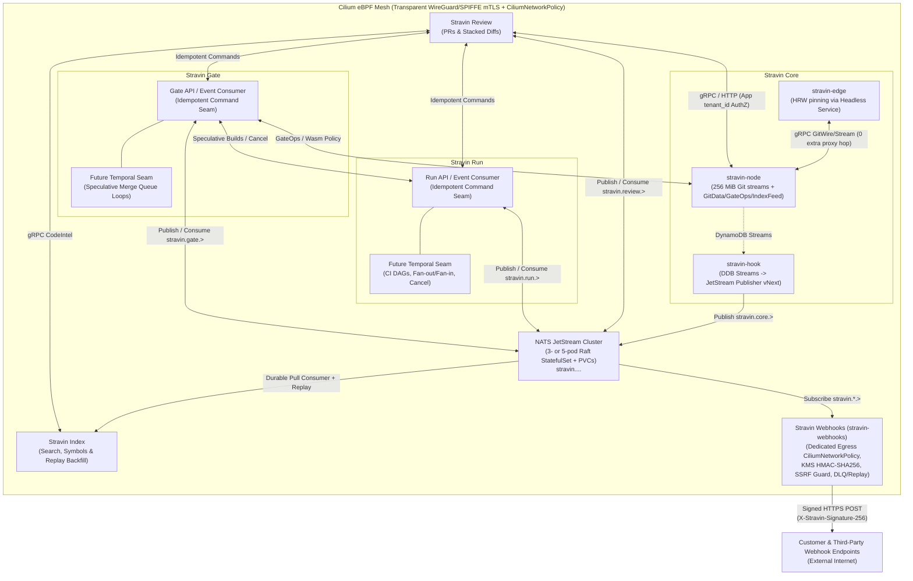

# ADR-0001: Platform Transport, Internal Events, External Webhooks, and Durable Workflow Seam

- **Status:** Proposed
- **Date:** 2026-11-24
- **Scope:** Cross-product transport, service discovery, internal async event backbone, outbound customer webhooks, and future workflow orchestration across **Stravin Core**, **Stravin Review**, **Stravin Run**, **Stravin Index**, **Stravin Gate**, and **Stravin Webhooks** (`stravin-webhooks`).

## Context

`stravin-dev/core` (`v1.12.x`) currently ships as a self-contained five-daemon Git storage engine (`stravin-edge`, `stravin-node`, `stravin-pack`, `stravin-ctrl`, `stravin-hook`) running locally in Docker Compose with Floci, Valkey, and OpenTelemetry + Grafana LGTM. In `v1.12.x`:

- Internal `stravin-edge` -> `stravin-node` Git traffic uses gRPC (`stravin.core.v1.GitWire/Stream`) with application-level TLS 1.3 mTLS (`internal/rpc/auth.go`) and Go Highest Random Weight (HRW) routing keyed by `(tenant_id, repo_id)` so pushes and fetches hit warm NVMe caches.
- Asynchronous post-receive notifications are dispatched directly by `stravin-hook` (`internal/hooks/async/dispatcher.go`) as flat HTTP `POST` webhooks with HMAC-SHA256 signatures (`X-Stravin-Signature-256`).

As Stravin grows from a single Git engine into a multi-product platform (**Review**, **Run**, **Index**, **Gate**), four architectural problems emerge if we simply extend point-to-point HTTP webhooks and ad-hoc service plumbing:

1. **Service-to-service transport overhead on 256 MiB Git streams:** Sidecar proxy meshes inject an extra L7 TCP/HTTP proxy hop (and CPU/memory tax) on every `stravin-edge` -> `stravin-node` packfile stream and interfere with `stravin-edge`'s custom HRW `(tenant_id, repo_id)` pinning.
2. **Point-to-point internal webhook fragility:** Fan-out from Core to Review, Run, Index, and Gate over direct HTTP `POST` webhooks couples producers to every consumer's endpoint availability, lacks durable replay for Index backfill/recovery, and duplicates retry/DLQ machinery in every product.
3. **External internet blast radius inside Core:** Delivering outbound customer/third-party webhooks from `stravin-hook` inside Core exposes the Git engine to slow endpoints, SSRF/DNS-rebinding attacks, noisy-neighbor retries, and customer delivery-log APIs that do not belong in a bare Git engine.
4. **Long-running state machines in Run and Gate:** CI DAG execution (fan-out/fan-in, cancellations, timeouts) in **Stravin Run** and speculative merge-queue loops (rebase, cancel, bisect, promote) in **Stravin Gate** will eventually outgrow hand-rolled DB state machines. Without an explicit workflow boundary today, introducing a durable workflow engine later would force breaking cross-product wire changes.

## Decision

We adopt a four-pillar platform transport and event architecture for Stravin `vNext`:

1. **Service Mesh & Transport — Cilium (eBPF)**
2. **Internal Async Event Backbone — NATS JetStream**
3. **Dedicated External Webhooks Service — Stravin Webhooks (`stravin-webhooks`)**
4. **Future Durable Workflow Seam — Temporal (scoped strictly behind Run and Gate)**



### Pillar 1: Service Mesh & Transport — Cilium (eBPF)

- **Sidecarless L3/L4 mTLS:** Cilium provides transparent WireGuard encryption and SPIFFE workload identity across all Stravin pods in Kubernetes without injecting Envoy sidecar containers into every pod.
- **Discovery & Routing:** Standard Kubernetes DNS + `EndpointSlice` (extended with **Cilium Cluster Mesh** for multi-region service discovery) handles service discovery. `stravin-edge` retains its custom Go HRW `(tenant_id, repo_id)` routing via a headless Kubernetes `Service` pointing directly to `stravin-node` pod IPs—guaranteeing **zero extra proxy hops** on Core's 256 MiB Git pack streams.
- **Network Policy Enforcement:** `CiliumNetworkPolicy` enforces strict L3/L4/L7 allowlists between workloads (for example, only `stravin-edge`, `stravin-review`, `stravin-index`, and `stravin-gate` may reach `stravin-node`'s internal gRPC ports; only `stravin-webhooks` is permitted outbound internet egress for customer webhooks).
- **Mandatory Security Invariant (App-Level Tenancy):** Cilium verifies **workload identity** (which service pod is calling), **NOT** `tenant_id`. Every RPC handler, HTTP endpoint, and NATS event consumer MUST still perform constant-time `tenant_id` authorization in application code (matching `edge.AuthorizeTenant` in Core `v1.12.x`) against signed service JWTs or authenticated event envelopes.

### Pillar 2: Internal Async Event Backbone — NATS JetStream

- **Replaces Internal Point-to-Point HTTP Webhooks:** All *internal* product-to-product asynchronous events move from point-to-point HTTP webhooks to **NATS JetStream**.
- **Deployment Topology:** Operated as a dedicated platform infrastructure service:
    - **Production Kubernetes (TBD / Planned):** 3- or 5-pod Raft-replicated `StatefulSet` backed by persistent volumes (PVCs), with `R=3` stream replication across availability zones.
    - **Local Development (Docker Compose):** Single `nats` container (`nats:2-alpine -js`) with a local Docker volume for JetStream file storage, maintaining exact wire and subject parity with production.
- **Canonical Subject Hierarchy:** Every internal event is published to a deterministic five-segment subject:

```text
stravin.<product>.<tenant_id>.<repo_id>.<event>
```

    Examples:

    - `stravin.core.<tenant_id>.<repo_id>.ref.updated`
    - `stravin.core.<tenant_id>.<repo_id>.repo.meta_updated`
    - `stravin.core.<tenant_id>.<repo_id>.repo.deleted`
    - `stravin.review.<tenant_id>.<repo_id>.pr.approved`
    - `stravin.review.<tenant_id>.<repo_id>.pr.eligibility_changed`
    - `stravin.review.<tenant_id>.<repo_id>.pr.opened_or_updated`
    - `stravin.run.<tenant_id>.<repo_id>.check.completed`
    - `stravin.run.<tenant_id>.<repo_id>.gate_verdict.ready`
    - `stravin.gate.<tenant_id>.<repo_id>.queue.updated`
    - `stravin.gate.<tenant_id>.<repo_id>.entry.merged`

- **Streams, Durable Consumers & Replay:**
    - One JetStream stream per product domain (`STRAVIN_CORE`, `STRAVIN_REVIEW`, `STRAVIN_RUN`, `STRAVIN_GATE`) with configurable retention (e.g., 7–14 days for `STRAVIN_CORE`) so **Stravin Index** can replay missed ranges for backfill and crash recovery without re-crawling every repository.
    - Consumers bind durable pull or push consumers scoped by product filter (e.g., `stravin.core.*.*.ref.updated`), enabling independent consumer lag tracking and horizontal scaling via queue groups.
    - **Deduplication:** Publishers set the native `Nats-Msg-Id` header equal to the envelope's `idempotency_key`, leveraging JetStream's server-side deduplication window alongside consumer-side idempotency.
    - **Dead-Letter Queue (DLQ):** Exhausted messages (`MaxDeliver` exceeded) trigger JetStream advisory events (`$JS.EVENT.ADVISORY.CONSUMER.MAX_DELIVERIES.>`) routed into a dedicated `STRAVIN_DLQ` stream for alerting and replay.
    - **Trace Context Propagation:** Publishers inject W3C `traceparent` (and optional `tracestate` / `baggage`) directly into NATS message headers so consumers link OpenTelemetry spans via `SpanLinkFromTraceparent`.
- **Current Core Status Badge:**
    - **Implemented in Core v1.12.x:** `stravin-hook` (`internal/hooks/async/dispatcher.go`) currently dispatches flat HTTP `POST` push webhooks directly from DynamoDB Streams.
    - **Proposed Core Extension (vNext):** `stravin-hook` publishes Standard Async Event Envelopes to NATS JetStream (`stravin.core.<tenant_id>.<repo_id>.*`), decoupling Core from downstream consumer availability and external HTTP delivery.

### Pillar 3: Separate External Webhooks Service (`stravin-webhooks` / Stravin Webhooks)

- **Dedicated Egress & Delivery Service:** All outbound customer and third-party HTTP webhook delivery is owned by a dedicated platform service, **Stravin Webhooks** (`stravin-webhooks`), rather than living inside `stravin-hook` in Core.
- **Stream Subscription:** `stravin-webhooks` subscribes to internal JetStream streams (`stravin.core.>`, `stravin.review.>`, `stravin.run.>`, `stravin.gate.>`), filters against tenant-configured webhook subscriptions, and fans out to per-endpoint JetStream delivery queues/consumers so one broken customer endpoint can never head-of-line block another customer or another product.
- **Core Capabilities Owned by `stravin-webhooks`:**
    - Per-destination rate limiting and circuit breakers.
    - Exponential backoff with jitter and configurable retry budgets.
    - Durable DLQ plus a customer-facing delivery-log and manual replay API.
    - KMS-backed HMAC-SHA256 payload signing (`X-Stravin-Signature-256`, matching Core's `crypto.EnvelopeCipher` envelope encryption pattern).
    - Strict SSRF and egress isolation: dedicated egress `CiliumNetworkPolicy` (zero access to internal platform services except JetStream and its own DB/KMS), DNS rebinding protection, and private/link-local/loopback IP blocking on resolved dial addresses.
- **Detailed Contract:** See [External Webhooks Interface](../interfaces/external-webhooks.md) for the full meet-in-the-middle specification.

### Pillar 4: Future Durable Workflow Seam — Temporal

- **Not Required on Day 1:** Teams do not need to deploy or operate a Temporal cluster to ship v1 of Review, Run, Index, or Gate.
- **Where the Seam Belongs:** Only **Stravin Run** (multi-step CI DAGs, fan-out/fan-in, cancellations, timeouts) and **Stravin Gate** (speculative merge-queue batch state machines, rebase/cancel/promote loops) manage complex, long-lived, failure-sensitive workflows that benefit from Temporal.
- **Contract Requirement Now:** Run and Gate MUST expose **idempotent command/activity boundaries** (`Idempotency-Key` on all mutating APIs, deterministic state transitions, explicit cancellation and status-reconciliation endpoints) and consume/emit canonical **NATS JetStream** events. This guarantees Temporal can be introduced internally behind Run and Gate later with **zero wire-contract changes** for Core, Review, Index, or `stravin-webhooks`.
- **Services Staying Temporal-Free:** **Stravin Core**, **Stravin Review**, **Stravin Index**, and **Stravin Webhooks** remain permanently Temporal-free.

## Alternatives Considered

| Alternative | Summary | Why Rejected |
| :--- | :--- | :--- |
| **Dapr sidecars** | Per-pod Dapr sidecar handling mTLS, pub/sub, and workflow abstractions. | Adds a sidecar proxy hop and memory/CPU overhead to every pod, penalizes Core's 256 MiB Git streams, and hides JetStream/gRPC semantics behind a lowest-common-denominator abstraction. |
| **Linkerd** | Lightweight Rust sidecar service mesh for mTLS and L7 load balancing. | Still requires per-pod sidecars on `stravin-edge` and `stravin-node`, adding an unnecessary proxy hop on large Git pack streams and complicating `stravin-edge`'s custom HRW `(tenant_id, repo_id)` pod pinning. |
| **Istio Ambient + Redpanda** | Sidecarless ztunnel/waypoint mesh paired with Kafka-compatible Redpanda broker. | Istio Ambient adds waypoint/control-plane complexity compared to Cilium (which also replaces the CNI and network policy engine); Redpanda carries higher operational footprint and RAM requirements than NATS JetStream for Stravin's control/event message volumes. |
| **Apache Kafka / Amazon MSK** | Managed or self-hosted Kafka cluster for internal async event backbone. | Heavyweight broker/controller footprint in local Docker Compose (breaks fast laptop dev parity), rigid topic-per-entity partitioning compared to NATS wildcard subject routing (`stravin.core.<tenant>.<repo>.>`), and higher baseline cost. |
| **Keeping HTTP webhooks in Core (`stravin-hook`)** | Extend Core `v1.12.x` `stravin-hook` to fan out to Review, Run, Index, Gate, and external customer URLs over HTTP. | Couples Core's availability and egress security to external internet chaos, provides no durable replay for Index backfill, and forces every product to build bespoke webhook fan-out, retry, and DLQ infrastructure. |

## Consequences

### Positive

- **Zero data-plane tax on Git traffic:** Cilium eBPF keeps `stravin-edge` -> `stravin-node` packfile streaming direct and preserves HRW cache locality.
- **Clean product decoupling & replayability:** Adding a new internal consumer (or backfilling Index after downtime) requires only a new durable JetStream consumer, with zero producer code changes.
- **Contained internet egress blast radius:** Isolating customer webhooks in `stravin-webhooks` keeps Core focused on Git storage and concentrates SSRF, rate-limit, and KMS signing controls in one hardened egress boundary.
- **Future-proof orchestration without day-1 bloat:** Run and Gate can start with lightweight Go/Postgres state machines and adopt Temporal later without breaking any sibling product.
- **High local-dev parity:** A single `nats` container + `stravin-webhooks` container in Docker Compose reproduces the exact subject hierarchy, headers, deduplication, and delivery flows used in production.

### Negative / Trade-offs

- **New stateful infrastructure dependency:** Operating NATS JetStream adds a Raft-replicated `StatefulSet` (3–5 pods + PVCs) to production Kubernetes operations, monitoring, and backup runbooks.
- **Application-level tenancy remains mandatory:** Because Cilium authenticates workloads rather than tenants, every service must enforce `tenant_id` checks in code and contract tests (defense-in-depth, not delegated to the mesh).
- **Two-phase migration from Core `v1.12.x`:** Core must temporarily support both legacy `stravin-hook` direct HTTP push webhooks (`v1.12.x`) and JetStream publishing (`vNext`) during transition.

## Migration Path (`v1.12.x` -> `vNext`)

1. **Phase 1 — Local Dev & JetStream Addition:** Add a single `nats` container (`-js`, persistent volume) to `stravin-dev/core`'s `docker-compose.yml` alongside Floci and Valkey. Keep `v1.12.x` `stravin-hook` HTTP webhook delivery intact as the default.
2. **Phase 2 — Core `stravin-hook` JetStream Publisher (vNext):** Add a JetStream publisher sink to `stravin-hook` emitting Standard Async Event Envelopes to `stravin.core.<tenant_id>.<repo_id>.ref.updated` (with `Nats-Msg-Id` = `idempotency_key` and `traceparent` header), reading from the existing DynamoDB Streams transactional outbox.
3. **Phase 3 — Extract External Webhooks (`stravin-webhooks`):** Stand up `stravin-webhooks` subscribing to `stravin.core.>` (and later `review`, `run`, `gate`), migrating outbound customer webhook rules (`SK: WEBHOOKS`), KMS signing secrets, retries, and DLQ out of `stravin-hook`.
4. **Phase 4 — Upper Product Consumers & Temporal Seam:** Build Review, Run, Index, and Gate against NATS JetStream subjects and idempotent command APIs. Introduce Temporal behind Run and Gate only when workflow complexity (multi-stage DAG retries, long-lived merge-queue bisection) justifies the operational footprint.
5. **Phase 5 — Production Kubernetes + Cilium (TBD / Planned):** Deploy Cilium eBPF CNI with WireGuard/SPIFFE mTLS, headless `stravin-node` Service for `stravin-edge` HRW routing, and per-service `CiliumNetworkPolicy` manifests (including dedicated egress policy for `stravin-webhooks`).

## Security & Local Dev Parity

| Concern | Local Docker Compose (`v1.12.x` / `vNext`) | Production Kubernetes (TBD / Planned) |
| :--- | :--- | :--- |
| **Transport encryption & workload identity** | Direct Docker network + optional app-level TLS 1.3 mTLS (`internal/rpc/auth.go`) | Cilium eBPF transparent WireGuard + SPIFFE mTLS across all pods |
| **Network segmentation** | Compose network boundaries; `STRAVIN_WEBHOOK_ALLOW_PRIVATE_NETWORKS=true` for local mock receivers | Strict `CiliumNetworkPolicy` L3/L4/L7 allowlists; `stravin-webhooks` isolated in dedicated egress namespace/policy with private-IP dial blocking enabled |
| **Tenant authorization** | Mandatory app-level constant-time `tenant_id` check (`edge.AuthorizeTenant` + JWT/envelope validation) | Identical mandatory app-level constant-time `tenant_id` check (Cilium never replaces tenant AuthZ) |
| **Async event backbone** | Single `nats` container with JetStream enabled and mounted volume | 3- or 5-pod Raft-replicated NATS JetStream `StatefulSet` with PVCs (`R=3`) |
| **Trace propagation** | W3C `traceparent` across HTTP, gRPC, and NATS headers into local Grafana Tempo | Identical W3C `traceparent` propagation into production OTel collectors |

## Related Documents

- [Product-Stack Interface Overview & Matrix](../interfaces/index.md) — System topology, intersection matrix, and shared contract conventions.
- [External Webhooks Interface](../interfaces/external-webhooks.md) — Full meet-in-the-middle contract for `stravin-webhooks`.
- [Server-Side Hooks](../core/hooks.md) — Core `v1.12.x` three-tier hook architecture and `vNext` JetStream evolution.
- [Core <-> Review](../interfaces/core-review.md), [Core <-> Run](../interfaces/core-run.md), [Core <-> Index](../interfaces/core-index.md), [Core <-> Gate](../interfaces/core-gate.md) — Core product intersections.
- [Review <-> Run](../interfaces/review-run.md), [Review <-> Gate](../interfaces/review-gate.md), [Run <-> Gate](../interfaces/run-gate.md), [Review <-> Index](../interfaces/review-index.md) — Upper-layer product intersections.
