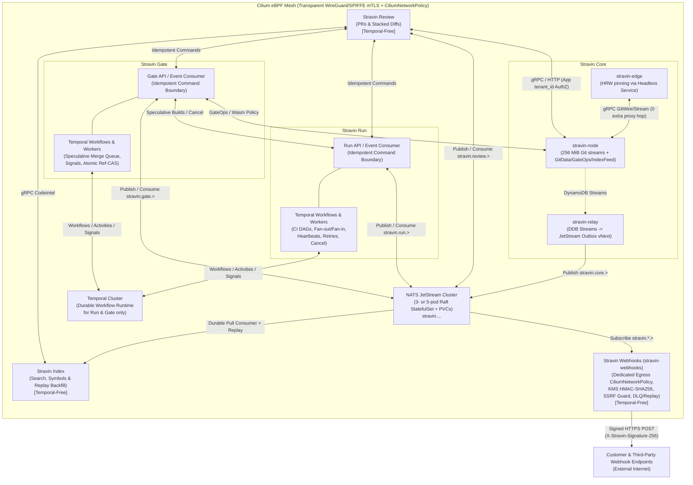

# ADR-0001: Platform Transport, Internal Events, External Webhooks, and Durable Workflows

- **Status:** Proposed
- **Date:** 2026-11-24
- **Scope:** Cross-product transport, service discovery, internal async event backbone, outbound customer webhooks, and durable workflow orchestration across **Stravin Core**, **Stravin Review**, **Stravin Run**, **Stravin Index**, **Stravin Gate**, and **Stravin Webhooks** (`stravin-webhooks`).

## Context

`stravin-dev/core` (`v1.12.x`) currently ships as a self-contained five-daemon Git storage engine (`stravin-edge`, `stravin-node`, `stravin-pack`, `stravin-ctrl`, `stravin-hook`) running locally in Docker Compose with Floci, Valkey, and OpenTelemetry + Grafana LGTM. In `v1.12.x`:

- Internal `stravin-edge` -> `stravin-node` Git traffic uses gRPC (`stravin.core.v1.GitWire/Stream`) with application-level TLS 1.3 mTLS (`internal/rpc/auth.go`) and Go Highest Random Weight (HRW) routing keyed by `(tenant_id, repo_id)` so pushes and fetches hit warm NVMe caches.
- Asynchronous post-receive notifications are dispatched directly by `stravin-hook` (`internal/hooks/async/dispatcher.go`) as flat HTTP `POST` webhooks with HMAC-SHA256 signatures (`X-Stravin-Signature-256`).

As Stravin grows from a single Git engine into a multi-product platform (**Review**, **Run**, **Index**, **Gate**), four architectural problems emerge if we simply extend point-to-point HTTP webhooks and ad-hoc service plumbing:

1. **Service-to-service transport overhead on 256 MiB Git streams:** Sidecar proxy meshes inject an extra L7 TCP/HTTP proxy hop (and CPU/memory tax) on every `stravin-edge` -> `stravin-node` packfile stream and interfere with `stravin-edge`'s custom HRW `(tenant_id, repo_id)` pinning.
2. **Point-to-point internal webhook fragility:** Fan-out from Core to Review, Run, Index, and Gate over direct HTTP `POST` webhooks couples producers to every consumer's endpoint availability, lacks durable replay for Index backfill/recovery, and duplicates retry/DLQ machinery in every product.
3. **External internet blast radius inside Core:** Delivering outbound customer/third-party webhooks from `stravin-hook` inside Core exposes the Git engine to slow endpoints, SSRF/DNS-rebinding attacks, noisy-neighbor retries, and customer delivery-log APIs that do not belong in a bare Git engine.
4. **Long-running workflows in Run and Gate:** CI pipeline DAG execution (fan-out/fan-in, heartbeating, retries, cancellations, timeouts) in **Stravin Run** and speculative merge-queue batch orchestration (enqueue/dequeue/verdict signals, rebase, cancel, bisect, atomic Ref-CAS promotion) in **Stravin Gate** are inherently durable, failure-sensitive workflows. Hand-rolling custom DB state machines as a stop-gap duplicates timer, retry, signal, and crash-recovery plumbing only to require a costly rewrite later.

## Decision

We adopt a four-pillar platform transport, event, and workflow architecture for Stravin `vNext`:

1. **Service Mesh & Transport — Cilium (eBPF)**
2. **Internal Async Event Backbone — NATS JetStream**
3. **Dedicated External Webhooks Service — Stravin Webhooks (`stravin-webhooks`)**
4. **Durable Workflow Engine — Temporal (official for Stravin Run and Stravin Gate)**



### Pillar 1: Service Mesh & Transport — Cilium (eBPF)

- **Sidecarless L3/L4 mTLS:** Cilium provides transparent WireGuard encryption and SPIFFE workload identity across all Stravin pods in Kubernetes without injecting Envoy sidecar containers into every pod.
- **Discovery & Routing:** Standard Kubernetes DNS + `EndpointSlice` (extended with **Cilium Cluster Mesh** for multi-region service discovery) handles service discovery. `stravin-edge` retains its custom Go HRW `(tenant_id, repo_id)` routing via a headless Kubernetes `Service` pointing directly to `stravin-node` pod IPs—guaranteeing **zero extra proxy hops** on Core's 256 MiB Git pack streams.
- **Network Policy Enforcement:** `CiliumNetworkPolicy` enforces strict L3/L4/L7 allowlists between workloads (for example, only `stravin-edge`, `stravin-review`, `stravin-index`, and `stravin-gate` may reach `stravin-node`'s internal gRPC ports; only `stravin-webhooks` is permitted outbound internet egress for customer webhooks).
- **Mandatory Security Invariant (App-Level Tenancy):** Cilium verifies **workload identity** (which service pod is calling), **NOT** `tenant_id`. Every RPC handler, HTTP endpoint, and NATS event consumer MUST still perform constant-time `tenant_id` authorization in application code (matching `edge.AuthorizeTenant` in Core `v1.12.x`) against signed service JWTs or authenticated event envelopes.

### Pillar 2: Internal Async Event Backbone — NATS JetStream

- **Replaces Internal Point-to-Point HTTP Webhooks:** All *internal* product-to-product asynchronous events move from point-to-point HTTP webhooks to **NATS JetStream**.
- **Deployment Topology:** Operated as a dedicated platform infrastructure service:
    - **Production Kubernetes (TBD / Planned):** 3- or 5-pod Raft-replicated `StatefulSet` backed by persistent volumes (PVCs), with `R=3` stream replication across availability zones.
    - **Local Development (Docker Compose):** Single `nats` container (`nats:2-alpine -js`) with a local Docker volume for JetStream file storage, maintaining exact wire and subject parity with production.
- **Canonical Subject Hierarchy:** Every internal event is published to a deterministic five-segment subject:

```text
stravin.<product>.<tenant_id>.<repo_id>.<event>
```

    Examples:

    - `stravin.core.<tenant_id>.<repo_id>.ref.updated`
    - `stravin.core.<tenant_id>.<repo_id>.repo.meta_updated`
    - `stravin.core.<tenant_id>.<repo_id>.repo.deleted`
    - `stravin.review.<tenant_id>.<repo_id>.pr.approved`
    - `stravin.review.<tenant_id>.<repo_id>.pr.eligibility_changed`
    - `stravin.review.<tenant_id>.<repo_id>.pr.opened_or_updated`
    - `stravin.run.<tenant_id>.<repo_id>.check.completed`
    - `stravin.run.<tenant_id>.<repo_id>.gate_verdict.ready`
    - `stravin.gate.<tenant_id>.<repo_id>.queue.updated`
    - `stravin.gate.<tenant_id>.<repo_id>.entry.merged`

- **Streams, Durable Consumers & Replay:**
    - One JetStream stream per product domain (`STRAVIN_CORE`, `STRAVIN_REVIEW`, `STRAVIN_RUN`, `STRAVIN_GATE`) with configurable retention (e.g., 7–14 days for `STRAVIN_CORE`) so **Stravin Index** can replay missed ranges for backfill and crash recovery without re-crawling every repository.
    - Consumers bind durable pull or push consumers scoped by product filter (e.g., `stravin.core.*.*.ref.updated`), enabling independent consumer lag tracking and horizontal scaling via queue groups.
    - **Deduplication:** Publishers set the native `Nats-Msg-Id` header equal to the envelope's `idempotency_key`, leveraging JetStream's server-side deduplication window alongside consumer-side idempotency.
    - **Dead-Letter Queue (DLQ):** Exhausted messages (`MaxDeliver` exceeded) trigger JetStream advisory events (`$JS.EVENT.ADVISORY.CONSUMER.MAX_DELIVERIES.>`) routed into a dedicated `STRAVIN_DLQ` stream for alerting and replay.
    - **Trace Context Propagation:** Publishers inject W3C `traceparent` (and optional `tracestate` / `baggage`) directly into NATS message headers so consumers link OpenTelemetry spans via `SpanLinkFromTraceparent`.
- **Core Outbox Daemon Rename (`stravin-hook` -> `stravin-relay` in `vNext`):**
    - **Implemented in Core v1.12.x:** `stravin-hook` (`cmd/stravin-hook`, `internal/hooks/async/dispatcher.go`) currently polls DynamoDB Streams and dispatches flat HTTP `POST` push webhooks directly.
    - **Proposed Core Extension (vNext):** Rename `stravin-hook` to **`stravin-relay`**—a pure, lightweight transactional outbox relay that tails DynamoDB Streams and publishes Standard Async Event Envelopes to NATS JetStream (`stravin.core.<tenant_id>.<repo_id>.*`), decoupling Core from downstream consumer availability and external HTTP delivery. `stravin-relay` runs **zero Wasm** and sends **zero external HTTP webhooks**.
    - **Future Server-Side Async (`post-receive`) Wasm Hooks Boundary:** Synchronous Tier 1 (`pre-receive` / `update`) Wasm hooks remain inside `stravin-node`. If server-side asynchronous `post-receive` Wasm hooks are added in the future, they MUST run as a separate NATS JetStream consumer—never inside `stravin-relay`—so slow or buggy Wasm execution cannot stall the DynamoDB Streams outbox cursor for `Review`, `Run`, `Index`, `Gate`, and `stravin-webhooks`.

### Pillar 3: Separate External Webhooks Service (`stravin-webhooks` / Stravin Webhooks)

- **Dedicated Egress & Delivery Service:** All outbound customer and third-party HTTP webhook delivery is owned by a dedicated platform service, **Stravin Webhooks** (`stravin-webhooks`), rather than living inside `stravin-hook` in Core.
- **Stream Subscription:** `stravin-webhooks` subscribes to internal JetStream streams (`stravin.core.>`, `stravin.review.>`, `stravin.run.>`, `stravin.gate.>`), filters against tenant-configured webhook subscriptions, and fans out to per-endpoint JetStream delivery queues/consumers so one broken customer endpoint can never head-of-line block another customer or another product.
- **Core Capabilities Owned by `stravin-webhooks`:**
    - Per-destination rate limiting and circuit breakers.
    - Exponential backoff with jitter and configurable retry budgets.
    - Durable DLQ plus a customer-facing delivery-log and manual replay API.
    - KMS-backed HMAC-SHA256 payload signing (`X-Stravin-Signature-256`, matching Core's `crypto.EnvelopeCipher` envelope encryption pattern).
    - Strict SSRF and egress isolation: dedicated egress `CiliumNetworkPolicy` (zero access to internal platform services except JetStream and its own DB/KMS), DNS rebinding protection, and private/link-local/loopback IP blocking on resolved dial addresses.
- **Detailed Contract:** See [External Webhooks Interface](../interfaces/external-webhooks.md) for the full meet-in-the-middle specification.

### Pillar 4: Durable Workflow Engine — Temporal

- **Official Platform Pillar for Run & Gate:** **Temporal** is the committed durable workflow runtime for **Stravin Run** and **Stravin Gate**. Neither product builds throwaway custom DB state machines; both implement their orchestration directly on Temporal Workflows, Activities, and Signals from day one:
    - **Stravin Run:** CI pipeline DAG workflows, parallel fan-out/fan-in across matrix jobs, runner activity heartbeating, transient infra-error retries, timeouts, and fast cancellation.
    - **Stravin Gate:** Speculative merge-queue batch workflows, external signals for enqueue/dequeue/eligibility invalidation/CI verdicts/Core ref drift, batch bisection, and idempotent `GateOps` (`ComputeMergeTree`, `AtomicRefCAS`) merge activities.
- **Deployment Topology:**
    - **Local Development (Docker Compose):** Single `temporal` dev container (`temporal server start-dev`) running alongside Core, Floci, Valkey, Grafana LGTM, `nats -js`, and `stravin-webhooks`.
    - **Production Kubernetes (TBD / Planned):** Dedicated Temporal Cluster (Frontend, History, Matching, and Worker services backed by durable persistence) with isolated namespaces for `stravin-run` and `stravin-gate`.
- **Clean Cross-Product Wire Boundary:** Even with Temporal as an official engine, Run and Gate still expose **idempotent command/query APIs** (`Idempotency-Key` on all mutating endpoints, explicit cancellation and status-reconciliation reads) and consume/emit canonical **NATS JetStream** events. Sibling products never share Temporal workflow histories or call Temporal APIs across product boundaries.
- **Services Staying Temporal-Free:** **Stravin Core**, **Stravin Review**, **Stravin Index**, and **Stravin Webhooks** (`stravin-webhooks`) remain permanently **Temporal-free**—communicating exclusively via synchronous gRPC/HTTP and **NATS JetStream** events.

## Alternatives Considered

| Alternative | Summary | Why Rejected |
| :--- | :--- | :--- |
| **Dapr sidecars** | Per-pod Dapr sidecar handling mTLS, pub/sub, and workflow abstractions. | Adds a sidecar proxy hop and memory/CPU overhead to every pod, penalizes Core's 256 MiB Git streams, and hides JetStream/gRPC semantics behind a lowest-common-denominator abstraction. |
| **Linkerd** | Lightweight Rust sidecar service mesh for mTLS and L7 load balancing. | Still requires per-pod sidecars on `stravin-edge` and `stravin-node`, adding an unnecessary proxy hop on large Git pack streams and complicating `stravin-edge`'s custom HRW `(tenant_id, repo_id)` pod pinning. |
| **Istio Ambient + Redpanda** | Sidecarless ztunnel/waypoint mesh paired with Kafka-compatible Redpanda broker. | Istio Ambient adds waypoint/control-plane complexity compared to Cilium (which also replaces the CNI and network policy engine); Redpanda carries higher operational footprint and RAM requirements than NATS JetStream for Stravin's control/event message volumes. |
| **Apache Kafka / Amazon MSK** | Managed or self-hosted Kafka cluster for internal async event backbone. | Heavyweight broker/controller footprint in local Docker Compose (breaks fast laptop dev parity), rigid topic-per-entity partitioning compared to NATS wildcard subject routing (`stravin.core.<tenant>.<repo>.>`), and higher baseline cost. |
| **Keeping HTTP webhooks in Core (`stravin-hook`)** | Extend Core `v1.12.x` `stravin-hook` to fan out to Review, Run, Index, Gate, and external customer URLs over HTTP. | Couples Core's availability and egress security to external internet chaos, provides no durable replay for Index backfill, and forces every product to build bespoke webhook fan-out, retry, and DLQ infrastructure. |
| **Custom DB state machines in Run & Gate** | Hand-roll Postgres/DynamoDB state tables, polling loops, and lease timers for CI DAGs and speculative merge queues before adopting Temporal. | Reinvents durable timers, heartbeating, signal ordering, crash recovery, and history inspection poorly, creating throwaway stop-gap infrastructure that must later be rewritten under production load. |

## Consequences

### Positive

- **Zero data-plane tax on Git traffic:** Cilium eBPF keeps `stravin-edge` -> `stravin-node` packfile streaming direct and preserves HRW cache locality.
- **Clean product decoupling & replayability:** Adding a new internal consumer (or backfilling Index after downtime) requires only a new durable JetStream consumer, with zero producer code changes.
- **Contained internet egress blast radius:** Isolating customer webhooks in `stravin-webhooks` keeps Core focused on Git storage and concentrates SSRF, rate-limit, and KMS signing controls in one hardened egress boundary.
- **Durable orchestration without throwaway state machines:** Run and Gate get crash-resilient CI DAGs, heartbeating, retries, signals, and speculative merge-queue workflows from day one on Temporal, while Core, Review, Index, and `stravin-webhooks` stay lean and Temporal-free.
- **High local-dev parity:** A single `nats -js` container, `stravin-webhooks`, and a single `temporal server start-dev` container in Docker Compose reproduce the exact subjects, headers, deduplication, webhook delivery, and workflow execution semantics used in production.

### Negative / Trade-offs

- **Stateful platform infrastructure dependencies:** Production Kubernetes operations must run, monitor, and back up both a Raft-replicated **NATS JetStream** `StatefulSet` (3–5 pods + PVCs) and a **Temporal Cluster** (scoped to Run and Gate).
- **Application-level tenancy remains mandatory:** Because Cilium authenticates workloads rather than tenants, every service must enforce `tenant_id` checks in code and contract tests (defense-in-depth, not delegated to the mesh).
- **Two-phase migration from Core `v1.12.x`:** Core must temporarily support both legacy `stravin-hook` direct HTTP push webhooks (`v1.12.x`) and `stravin-relay` JetStream outbox publishing (`vNext`) during transition.

## Phased Adoption Plan (`v1.12.x` -> `vNext`)

Rather than introducing all four pillars in one big-bang cutover—or building throwaway state machines—the platform adopts each pillar in four sequential phases:

1. **Phase 1 — Core Event Relay & Bus (`stravin-relay` + NATS JetStream):** Stand up NATS JetStream (`nats -js` with a local volume in Docker Compose; 3- or 5-pod Raft `StatefulSet` + PVCs in Kubernetes) and transition `stravin-hook` (`v1.12.x`) to **`stravin-relay`**, publishing Standard Async Event Envelopes (`Nats-Msg-Id` = `idempotency_key`, W3C `traceparent`) from DynamoDB Streams onto `STRAVIN_CORE` (`stravin.core.<tenant_id>.<repo_id>.*`).
2. **Phase 2 — External Webhooks Isolation (`stravin-webhooks`):** Stand up the dedicated **`stravin-webhooks`** service consuming internal JetStream streams with per-endpoint delivery queues, rate limits, circuit breakers, KMS HMAC-SHA256 signing, DLQ/replay, and SSRF egress isolation—removing all external HTTP webhook delivery from Core.
3. **Phase 3 — Durable Workflow Runtime (`Temporal` for `Run` & `Gate`):** Deploy **Temporal** (`temporal server start-dev` in local Docker Compose; Temporal Cluster in Kubernetes) directly as the orchestration backbone for **Stravin Run** and **Stravin Gate**, avoiding throwaway custom state machines while keeping **Core**, **Review**, **Index**, and **`stravin-webhooks`** Temporal-free.
4. **Phase 4 — Production Mesh & Network Policy (`Cilium` eBPF on K8s):** Enable sidecarless WireGuard/SPIFFE mTLS, headless `stravin-node` Service discovery for `stravin-edge` HRW routing, strict `CiliumNetworkPolicy` allowlists, dedicated egress policy for `stravin-webhooks`, and **Cilium Cluster Mesh** for multi-region discovery.

## Security & Local Development Parity

- **Daily Local Development (Docker Compose):** Runs 100% in **Docker Compose** (`stravin-dev/core` + Floci + Valkey + Grafana LGTM + single `nats -js` + `stravin-webhooks` + single `temporal server start-dev` container). No Kubernetes cluster or Cilium CNI is required for day-to-day feature, event, webhook, or Temporal workflow development.
- **Local Kubernetes & Cilium Testing:** **OrbStack Kubernetes** works well for validating Helm charts and `StatefulSet` manifests (NATS JetStream, Temporal), but uses a fixed CNI that cannot be swapped. When testing **Cilium eBPF** or `CiliumNetworkPolicy` rules locally, use **`kind` on OrbStack** with `disableDefaultCNI: true` and install Cilium into the `kind` cluster.

| Concern | Local Docker Compose (`v1.12.x` / `vNext`) | Production Kubernetes (TBD / Planned) |
| :--- | :--- | :--- |
| **Transport encryption & workload identity** | Direct Docker network + optional app-level TLS 1.3 mTLS (`internal/rpc/auth.go`); no Cilium required | Cilium eBPF transparent WireGuard + SPIFFE mTLS across all pods (test locally with `kind` on OrbStack, `disableDefaultCNI: true`) |
| **Network segmentation** | Compose network boundaries; `STRAVIN_WEBHOOK_ALLOW_PRIVATE_NETWORKS=true` for local mock receivers | Strict `CiliumNetworkPolicy` L3/L4/L7 allowlists; `stravin-webhooks` isolated in dedicated egress namespace/policy with private-IP dial blocking enabled |
| **Tenant authorization** | Mandatory app-level constant-time `tenant_id` check (`edge.AuthorizeTenant` + JWT/envelope validation) | Identical mandatory app-level constant-time `tenant_id` check (Cilium never replaces tenant AuthZ) |
| **Async event backbone** | Single `nats -js` container with JetStream enabled and mounted volume | 3- or 5-pod Raft-replicated NATS JetStream `StatefulSet` with PVCs (`R=3`) |
| **Durable workflow engine (`Run` & `Gate`)** | Single `temporal` dev container (`temporal server start-dev`) | Temporal Cluster (Frontend, History, Matching, Worker + persistent DB) with separate `stravin-run` and `stravin-gate` namespaces |
| **Trace propagation** | W3C `traceparent` across HTTP, gRPC, NATS headers, and Temporal workflow/activity headers into local Grafana Tempo | Identical W3C `traceparent` propagation into production OTel collectors |

## Related Documents

- [Product-Stack Interface Overview & Matrix](../interfaces/index.md) — System topology, intersection matrix, and shared contract conventions.
- [External Webhooks Interface](../interfaces/external-webhooks.md) — Full meet-in-the-middle contract for `stravin-webhooks`.
- [Server-Side Hooks](../core/hooks.md) — Core `v1.12.x` three-tier hook architecture and `vNext` JetStream evolution.
- [Core <-> Review](../interfaces/core-review.md), [Core <-> Run](../interfaces/core-run.md), [Core <-> Index](../interfaces/core-index.md), [Core <-> Gate](../interfaces/core-gate.md) — Core product intersections.
- [Review <-> Run](../interfaces/review-run.md), [Review <-> Gate](../interfaces/review-gate.md), [Run <-> Gate](../interfaces/run-gate.md), [Review <-> Index](../interfaces/review-index.md) — Upper-layer product intersections.
