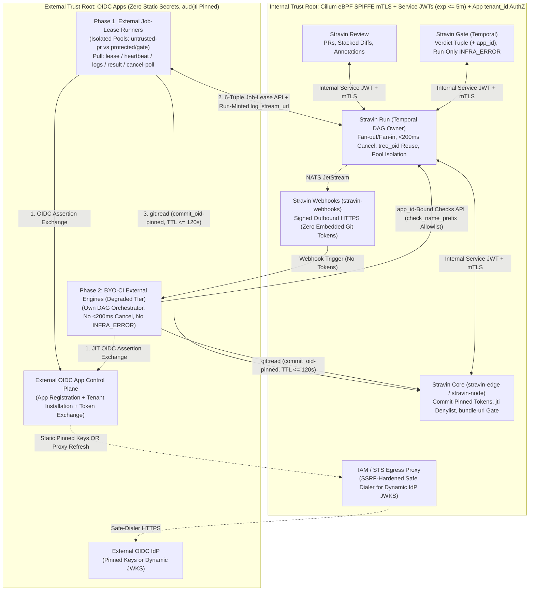

# ADR-0002: External Runner Seam, State-Machine Ownership, and OIDC App Authentication

- **Status:** Proposed
- **Date:** 2026-11-25
- **Scope:** External runner execution seam, CI DAG state-machine ownership, external CI integration tier, OIDC App authentication scope, and Git/Gate security hardening across **Stravin Core**, **Stravin Review**, **Stravin Run**, **Stravin Gate**, and **Stravin Webhooks** (`stravin-webhooks`).

## Context

[ADR-0001](0001-platform-transport-events-webhooks.md) establishes **Cilium (eBPF)** sidecarless WireGuard/SPIFFE mTLS for internal service-to-service transport, **NATS JetStream** for internal async events, **Stravin Webhooks** (`stravin-webhooks`) for outbound customer HTTP delivery, and **Temporal** as the official durable workflow runtime for **Stravin Run** and **Stravin Gate**.

As Stravin opens **Stravin Run** to customer-hosted / externally hosted runners and third-party CI integrations, three architectural questions must be settled before Run, Core, Review, and Gate build against each other:

1. **Where is the external execution seam?** Should external runners execute individual jobs leased from Run's Temporal DAG, or should Run delegate entire pipelines to external CI engines over outbound webhooks and a Checks API?
2. **Where does OIDC App authentication apply?** Should first-party internal products (`Core`, `Review`, `Run`, `Index`, `Gate`, `Webhooks`) also authenticate via OIDC App installations, or should OIDC Apps be scoped strictly to external/decoupled callers while internal RPCs stay on Cilium SPIFFE mTLS + short-lived internal service JWTs?
3. **What security invariants protect Core and Gate once untrusted external compute enters the loop?** External runners introduce SSRF/JWKS egress risks, long-lived token exposure, unrevocable presigned `bundle-uri` URLs, cross-pool verdict poisoning (`untrusted-pr` vs. `protected`/`gate`), and malicious `INFRA_ERROR` self-assertion against Gate's merge queue.

## Decision

We adopt a **phased Hybrid Runner Seam** paired with **External-Only OIDC App Authentication** and six non-negotiable security hardening invariants:

1. **Hybrid Runner Seam (Phased):**
    - **Phase 1 (Primary — Job-Level Pull Lease):** **Stravin Run (Temporal)** retains sole ownership of the CI pipeline DAG state machine—matrix fan-out/fan-in, heartbeats, retries, timeouts, `< 200 ms` cancellation, `tree_oid` verdict reuse/inheritance, and `INFRA_ERROR` classification. External runners act as remote activity workers implementing a pull-based job-lease contract (`lease`, `heartbeat`, `log-stream`, `report-result`, `cancel-poll`) mapped 1:1 to Temporal Activities.
    - **Phase 2 (Secondary / Degraded Tier — BYO-CI Pipeline-Level):** External CI engines that own their own orchestrator (e.g., Buildkite, GitHub Actions) integrate via outbound **`stravin-webhooks`** triggers plus an `app_id`-bound **Checks & Verdict API** on the same external OIDC App control plane. This tier carries explicit limits: no unified step-level `< 200 ms` runner-kill guarantee (relying on Gate's `timeout_seconds` and 30 s reconciliation backstop), no mixed hosted+external DAGs, and no `INFRA_ERROR` self-assertion.
2. **Auth Scope — OIDC Apps External-Only (Separate Trust Roots):**
    - **Internal First-Party Products (`Core`, `Review`, `Run`, `Index`, `Gate`, `Webhooks`):** Remain on **Cilium (eBPF) WireGuard/SPIFFE mTLS** + `CiliumNetworkPolicy` allowlists + short-lived internal service JWTs (`exp <= 5m`) + mandatory constant-time app-level `tenant_id` checks. Internal product-to-product RPCs are **never** forced through external OIDC App installation flows.
    - **External Runners, External CI & Third-Party Integrations:** Authenticate via **OIDC Apps** (App Registration + Tenant Installation + OIDC workload identity exchange -> short-lived, single-job/scoped tokens with **zero static secrets**). Both Phase 1 job-lease runners and Phase 2 Checks API CI apps share one external OIDC App control plane.

### Phase 1: Primary Job-Lease Seam

- **Temporal Retains Sole DAG Ownership:** Stravin Run executes every workflow DAG as a Temporal Workflow. Each job (including matrix shards and speculative Gate checks) maps 1:1 to a Temporal Activity whose worker may be a first-party hosted sandbox or an externally leased runner.
- **Pull-Based Lease Protocol:** External runners hold zero inbound ports. They authenticate via their pool-scoped OIDC App installation and long-poll Run's external ingress:
    1. `POST /v1/runner/leases` — Claim a matching job for the runner's authorized `(tenant_id, runner_pool)`. Returns a 6-tuple-bound lease token, job spec, `commit_oid`, Run-minted `log_stream_url`, and initial `commit_oid`-pinned `git:read` token (`TTL <= 120s`).
    2. `POST /v1/runner/leases/{lease_id}/heartbeat` — Extends activity liveness, returns immediate cancel directives (`cancel-poll`), and refreshes the short-lived `git:read` token only while the lease remains active.
    3. `POST /v1/runner/leases/{lease_id}/result` — Idempotently reports step status, annotations (capped at `50/batch`, `1,000/run`), and conclusion.
- **Preserved Platform SLAs:** Because Run owns the activity lease and server-side token revocation, Gate retains `< 200 ms` cancel acknowledgment, per-check fail-fast eviction, Review stacked-diff `tree_oid` inheritance, and Run-managed `INFRA_ERROR` retries.

### Phase 2: Secondary BYO-CI Seam (Degraded Tier)

- **Trigger & Callback Flow:** Teams bringing their own CI orchestrator install an OIDC App, subscribe to platform events (`core.ref.updated`, `review.pr.opened_or_updated`, `gate.queue.updated`) via **`stravin-webhooks`**, exchange their OIDC workload assertion just-in-time for a `commit_oid`-pinned `git:read` token, run their own pipeline, and post terminal conclusions back to Run's public `app_id`-bound **Checks & Verdict API**.
- **Explicit Degraded-Tier Limits:**
    - No unified step-level `< 200 ms` runner-kill guarantee; Gate falls back to `timeout_seconds` and its 30 s reconciliation backstop.
    - No mixed hosted+external DAGs within a single Run workflow.
    - Cannot self-assert `INFRA_ERROR` to trigger Gate requeues or queue pauses.
    - External `details_url` must be `https://` on the registered app's origin; Run never accepts runner-supplied `log_stream_url` endpoints.

### Security Hardening Invariants

All six invariants are mandatory across Core, Review, Run, Gate, and Webhooks:

1. **No Direct JWKS Egress from Run (SSRF Isolation):**
    - `stravin-webhooks` remains the sole general outbound webhook egress service ([ADR-0001](0001-platform-transport-events-webhooks.md)).
    - **Stravin Run MUST never fetch arbitrary tenant-supplied OIDC JWKS URLs directly.** App registrations MUST use **pre-pinned public keys / static JWKS**, OR route dynamic IdP JWKS refreshes exclusively through a dedicated **IAM/STS egress proxy** enforcing the same safe-dialer private-CIDR, loopback, link-local (`169.254.169.254`), and DNS-rebinding blocks as `stravin-webhooks`.
    - When jobs need credentials for external clouds (AWS, GCP, Azure), use **Stravin-issued OIDC tokens** outbound (zero outbound egress required from Run).
2. **Short-Lived, `commit_oid`-Pinned `git:read` Tokens & Active Revocation:**
    - External job-lease and Checks API checkouts use **`commit_oid`-pinned `git:read` tokens with `TTL <= 120s`** (matching exact-OID fetches and Core's 120 s checkout timeout), refreshed only through Run while the lease/job is active.
    - **Never embed Git tokens or OIDC assertions in outbound `stravin-webhooks` payloads.** External CI engines exchange their OIDC assertion just-in-time immediately before checkout.
    - External runners default to `git:read` only and receive **zero AWS IAM credentials**. `git:write` is permitted exclusively on explicitly configured protected release/tag pools with narrow `ref_globs` and active server-side `jti` revocation at `stravin-edge` (Valkey `jti` denylist) on lease termination or cancel.
    - All external OIDC App tokens enforce strict `aud` pinning, short `exp`, and `jti` replay protection.
3. **Strict Pool Isolation, 6-Tuple Lease Binding & Partitioned `tree_oid` Reuse:**
    - Isolate `untrusted-pr` vs. `protected`/`gate` `runner_pool`s via pool-scoped OIDC claims so untrusted PR workloads can never lease Gate or release jobs.
    - Bind every job-lease token to the 6-tuple `(tenant_id, repo_id, runner_pool, job_id, attempt_id, runner_instance_id)` and revoke server-side on `< 200 ms` cancel or `INFRA_ERROR` retry.
    - Partition `tree_oid` verdict reuse by `(tenant_id, repo_id, tree_oid, check_name, app_id, runner_pool, policy_version)` so `untrusted-pr` pools or lower-trust external apps can never poison or satisfy protected `gate` verdicts.
4. **Gate Verdict Binding & External Callback Hardening:**
    - Bind every Gate verdict to the 6-tuple `(tenant_id, repo_id, tree_oid, commit_oid, policy_version, app_id)`.
    - Bind each Phase 2 Checks API App installation to an explicit `(tenant_id, repo_id, check_name_prefix)` allowlist matching an active `batch_run_id`.
    - Run mints `log_stream_url` tokens (never accept runner-supplied log URLs); restrict external `details_url` to `https://` on the registered app's origin; enforce `50/batch` and `1,000/run` annotation caps and constant-time `tenant_id` checks at the external ingress edge.
5. **`bundle-uri` Gating (`git:bundle:read`):**
    - Require an explicit **`git:bundle:read`** scope for `bundle-uri` capability advertisement and presigned S3 URL issuance—auto-granted to Cilium-attested internal pools and opt-in for authorized external OIDC leases/Apps.
    - Cap presigned S3 bundle URL TTL to `min(token_remaining_ttl, 120s)`.
    - Suppress `bundle-uri` advertisement completely for external `commit_oid`-pinned tokens lacking `git:bundle:read`, preventing unrevocable S3 URLs from bypassing `stravin-edge` rate limits or exposing the full default-branch `latest.bundle`.
6. **`INFRA_ERROR` Boundary (Strictly Run-Only):**
    - `INFRA_ERROR` classification is **strictly Run-only** (available to hosted and Phase 1 Run-managed runners where Run observes infrastructure/lease failures directly).
    - Phase 2 external Checks API callers can **never** self-assert `INFRA_ERROR` to trigger automated Gate front-of-queue requeues or merge-queue pauses. Transient external CI failures map to a non-retrying conclusion (e.g., `external_infra_error` or `failure`) since external CI engines already own their own retry loops before posting terminal conclusions.

## Alternatives Considered

| Alternative | Summary | Why Rejected |
| :--- | :--- | :--- |
| **Pipeline-only Webhook + Checks API (no Job-Lease)** | Replace Run's Temporal DAG with `stravin-webhooks` triggers and external Checks API callbacks for all external compute. | `stravin-webhooks` has a 10 s per-attempt timeout + exponential backoff, breaking Gate's `< 200 ms` cancel SLA, per-check fail-fast eviction, Review stacked-diff `tree_oid` inheritance, and non-blame `INFRA_ERROR` requeue. |
| **Job-Lease only (no Phase 2 Checks API)** | Force every customer with existing Buildkite or GitHub Actions pipelines to rewrite pipelines as Stravin Run workflows. | Blocks adoption for teams with large existing CI orchestrators; adding a degraded-tier Checks API adapter on the same OIDC App control plane is purely additive and preserves Run's idempotent boundary. |
| **Unified OIDC Apps for internal + external services** | Force internal `Core`, `Review`, `Run`, `Index`, `Gate`, and `Webhooks` RPCs through OIDC App registrations and token exchanges. | Collapses the internal/external trust boundary, adds unnecessary token-exchange hops and registration sprawl, and still requires the exact same app-level constant-time `tenant_id` check already paired with Cilium SPIFFE mTLS + `exp <= 5m` service JWTs. |
| **Allow `bundle-uri` on any `git:read` token** | Advertise presigned S3 `latest.bundle` URLs to all external runners holding `git:read`. | Presigned S3 URLs bypass `stravin-edge` rate limits, cannot be revoked on `< 200 ms` cancel, and expose the full default-branch bundle beyond the pinned `commit_oid`. |
| **Allow capped external `INFRA_ERROR` self-assertion** | Permit external Checks API apps to report `INFRA_ERROR` with a per-`app_id` requeue cap. | Even a capped external `INFRA_ERROR` lets a flapping or compromised third-party app amplify merge-queue retries and pollute Run's infra SLOs; external CI engines already control their own retries. |

## Consequences

### Positive

- **Preserves Temporal DAG & Gate SLAs:** Phase 1 external runners participate in `< 200 ms` cancellation, fail-fast eviction, stacked-diff `tree_oid` inheritance, and `INFRA_ERROR` recovery without duplicating orchestrator state.
- **Clean trust-root separation:** Internal products keep zero-overhead Cilium SPIFFE mTLS + `exp <= 5m` service JWTs, while all external callers share one zero-static-secret OIDC App control plane.
- **Defense-in-depth against untrusted compute:** Pool isolation, 6-tuple lease binding, `commit_oid`-pinned `<= 120s` tokens, `git:bundle:read` gating, partitioned `tree_oid` reuse, and Run-only `INFRA_ERROR` contain compromised runners and flapping third-party apps.
- **Additive BYO-CI path:** Phase 2 Checks API layers cleanly onto the same OIDC App control plane without weakening Phase 1 or Gate guarantees.

### Negative / Risks

- **Large monorepo clones `> 120s` on external runners without `git:bundle:read`:** External runners that cannot use `bundle-uri` must refresh their `commit_oid`-pinned token via Run's active-lease refresh endpoint mid-clone; the runner's Git credential helper must handle seamless refresh without aborting packfile transfer.
- **Active `jti` revocation state on `stravin-edge`:** Supporting `git:write` on protected external release pools requires a low-latency revocation store (e.g., Valkey `jti` denylist) in `stravin-edge`, adding a small hot-path lookup strictly for external write tokens.
- **Dedicated IAM/STS JWKS egress component:** Tenants using dynamic external IdPs (rather than pinned public keys / static JWKS) require standing up the SSRF-hardened IAM/STS egress proxy before dynamic OIDC federation can be enabled.

## Undo / Rollback Path

- **Reverting from Hybrid to Job-Lease-Only:** Disable or omit the Phase 2 Checks API adapter endpoints and `app_id` external-verdict route in Run; Core, Review, Gate, and `stravin-webhooks` contracts remain completely intact.
- **Relaxing `bundle-uri` or `INFRA_ERROR` gates:** Both are additive policy checks inside `stravin-edge` (`git:bundle:read` claim check) and `stravin-run` (Checks API conclusion mapping)—changing either requires a single policy/schema update without breaking wire compatibility (`N / N-1` additive evolution per [Interface Conventions](../interfaces/index.md)).
- **Adopting internal OIDC later (if ever desired):** Because internal service JWTs (`iss`, `sub`, `aud`, `tenant_id`, `scopes`, `exp <= 5m`) already use standard signed JWT claims, internal services can adopt an internal OIDC issuer later without changing handler authorization logic.

## Related Documents

- [ADR-0001: Platform Transport, Internal Events, External Webhooks, and Durable Workflows](0001-platform-transport-events-webhooks.md) — Cilium eBPF mesh, NATS JetStream, `stravin-webhooks`, and Temporal workflow pillars.
- [Product-Stack Interface Overview & Matrix](../interfaces/index.md) — Shared auth boundaries, scoped Git token rules, and canonical identifiers.
- [Core ⟷ Run](../interfaces/core-run.md) — `commit_oid`-pinned `<= 120s` tokens, `git:bundle:read` gating, and `jti` revocation.
- [Review ⟷ Run](../interfaces/review-run.md) — Phase 1 job-lease vs. Phase 2 Checks API, pool isolation, and external callback hardening.
- [Run ⟷ Gate](../interfaces/run-gate.md) — Gate verdict tuple with `app_id`, partitioned `tree_oid` reuse, and Run-only `INFRA_ERROR`.
- [External Webhooks](../interfaces/external-webhooks.md) — Phase 2 BYO-CI trigger delivery without embedded Git tokens and SSRF-hardened egress boundaries.
