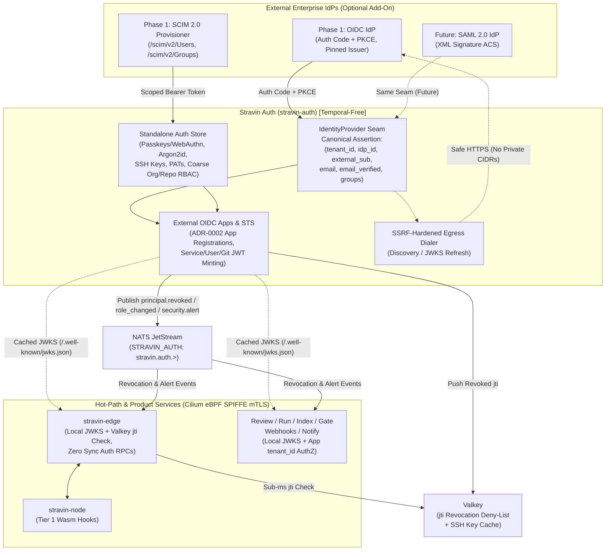

# ADR-0003: Platform IAM, Authentication, STS, and Pluggable SSO Seam (`stravin-auth`)

- **Status:** Proposed
- **Date:** 2026-11-26
- **Scope:** Platform identity, authentication, Security Token Service (STS), coarse org/repo RBAC, Valkey `jti` revocation, and pluggable enterprise SSO (`OIDC`, `SCIM 2.0`, future `SAML 2.0`) across **Stravin Core**, **Stravin Review**, **Stravin Run**, **Stravin Index**, **Stravin Gate**, **Stravin Webhooks**, and **Stravin Notify**.

## Context

`stravin-dev/core` (`v1.12.x`) currently authenticates Git Smart HTTP and SSH clients via `edge.StaticAuthenticator` (static `tenant_id:actor_id:token` credentials and SSH `authorized_keys`). Across the upper platform:

- [ADR-0001](0001-platform-transport-events-webhooks.md) established **Cilium (eBPF)** transparent WireGuard/SPIFFE mTLS for pod-to-pod workload identity (explicitly NOT user or tenant RBAC), **NATS JetStream** for internal async events, **Stravin Webhooks** (`stravin-webhooks`) for outbound customer HTTP delivery, and **Temporal** for Run and Gate workflows.
- [ADR-0002](0002-external-runner-seam-and-oidc-auth.md) introduced an **External OIDC App Control Plane**, an **SSRF-hardened IAM/STS egress proxy** for dynamic IdP JWKS fetches, short-lived `commit_oid`-pinned `git:read` tokens (`TTL <= 120s`), and a Valkey `jti` deny-list at `stravin-edge`.

As Stravin scales from local Docker Compose and single-tenant self-hosted deployments to multi-tenant SaaS and enterprise SSO environments, four architectural requirements must be settled in one foundation service:

1. **Zero-External-IdP Standalone Operation:** Local development, open-source self-hosting, and small teams must work out of the box without deploying or operating Keycloak, Dex, Okta, or Entra ID.
2. **Enterprise SSO Without Polluting Product Services:** Enterprise tenants require OIDC SSO, SCIM 2.0 automated provisioning/deprovisioning, and eventually SAML 2.0. Downstream products (`Core`, `Review`, `Run`, `Index`, `Gate`, `Webhooks`, `Notify`) must contain **zero IdP-specific protocol code**.
3. **Zero Synchronous Auth Tax on the Git Hot Path:** Calling an auth service synchronously on every `git push`, `git fetch`, or internal RPC would add tail latency, create a single point of failure, and jeopardize Core's throughput SLOs.
4. **Fast Deprovisioning & Account-Takeover Prevention:** When an enterprise admin deactivates a user via SCIM 2.0 or downgrades their role, active sessions, PATs, and Git tokens must be invalidated within seconds, and SSO logins must never be exploitable to hijack unverified local accounts.

## Decision

We introduce **`stravin-auth`** (Stravin Auth) as the dedicated, **Temporal-free** Platform IAM, Authentication, and STS service with four architectural pillars:

1. **Standalone First (Zero External IdP Required)**
2. **Pluggable SSO Add-On Seam (`IdentityProvider` interface: Phase 1 OIDC + SCIM 2.0; Future SAML 2.0)**
3. **Strictly Off the Synchronous Hot Path (Local JWKS + Valkey `jti` Deny-List)**
4. **Mandatory Security Hardening Invariants & Local Dev Parity**



### 1. Standalone First (Zero External IdP Required)

`stravin-auth` ships with a complete built-in identity store and STS so single-tenant, self-hosted, and local Docker Compose environments require zero external identity infrastructure:

- **Local Human Accounts:** Passkeys / WebAuthn (primary) and Argon2id password hashing with MFA support.
- **SSH Public Keys:** User-managed SSH key registration (`ed25519`, `ecdsa`, `rsa` with minimum key-strength policy) served to `stravin-edge` via cached fingerprint resolution.
- **Personal Access Tokens (PATs):** Fine-grained, tenant- and repo-scoped tokens (prefix `stv_pat_`, SHA-256 hashed at rest, explicit expiration, instant revocation).
- **OIDC Apps & Installations (per [ADR-0002](0002-external-runner-seam-and-oidc-auth.md)):** App registration, tenant installation, OIDC workload identity exchange, and pool-scoped runner claims.
- **STS Token Minting:** Issues signed Ed25519/ES256 JWTs for internal services (`exp <= 5m`), user web/API sessions, and `stravin-edge` scoped Git tokens (`commit_oid`-pinned `git:read` `TTL <= 120s`, `git:bundle:read`, and protected `git:write` with narrow `ref_globs`).
- **Valkey `jti` Revocation Deny-List:** Shared low-latency revocation store keyed by `(tenant_id, jti)` with TTL matching the token's remaining lifetime.
- **Coarse Org/Repo RBAC:** Authoritative mapping of `(principal, tenant_id, repo_id, role/scopes)` across canonical roles (`owner`, `admin`, `maintainer`, `write`, `read`) and fine-grained scopes.

### 2. Pluggable SSO Add-On Seam (`IdentityProvider` Interface)

All external enterprise identity protocols plug behind a single internal `IdentityProvider` adapter interface inside `stravin-auth`. Every adapter normalizes its protocol-specific assertion into one canonical struct:

```text
ExternalIdentityAssertion {
    tenant_id:      string   // Immutable tenant binding
    idp_id:         string   // Registered IdP configuration ID (idp_<ulid>)
    external_sub:   string   // Immutable IdP subject identifier (never mutable email)
    email:          string   // Normalized lowercase email address
    email_verified: bool     // Explicitly asserted by the IdP
    groups:         []string // IdP group identifiers for deterministic role mapping
}
```

Because every downstream product (`Core`, `Review`, `Run`, `Index`, `Gate`, `Webhooks`, `Notify`) consumes only `stravin-auth`-minted JWTs and `STRAVIN_AUTH` JetStream events, **zero IdP-specific code exists outside `stravin-auth`**:

- **Phase 1 SSO Add-On (OIDC + SCIM 2.0):**
    - **OIDC:** Authorization Code flow with PKCE (`S256`), strict `state` and `nonce` binding, pinned issuer URL (`iss`), and an SSRF-hardened discovery/JWKS HTTP client enforcing the same private-CIDR, loopback, link-local (`169.254.169.254`), and DNS-rebinding blocks defined in [ADR-0002](0002-external-runner-seam-and-oidc-auth.md).
    - **SCIM 2.0:** `/scim/v2/Users` and `/scim/v2/Groups` endpoints authenticated by a per-tenant scoped bearer token (hashed at rest, rotatable), driving deterministic group-to-role mapping and instant user deprovisioning.
- **Future SSO Add-On (SAML 2.0):**
    - Plugs into the exact same `IdentityProvider` seam: Assertion Consumer Service (ACS) validates XML signatures against the tenant's pinned IdP X.509 certificate, enforces assertion ID replay protection, and emits the identical `ExternalIdentityAssertion` -> same JWT minting + same SCIM 2.0 provisioning pipeline, with **zero downstream product changes**.

### 3. Strictly Off the Synchronous Hot Path (Critical Invariant)

- **Zero Sync Auth RPCs on Git Traffic:** `stravin-auth` is **NEVER** called synchronously on every `git push`, `git fetch`, or hot-path product RPC.
- **Local JWKS Verification + Valkey `jti` Check:** `stravin-edge`, Review, Run, Index, Gate, Notify, and Webhooks verify `stravin-auth` JWT signatures **locally in-process** using cached JWKS (`/.well-known/jwks.json`, refreshed proactively on `jwks.rotated` events and periodic TTL) paired with sub-millisecond Valkey `jti` deny-list checks for revocable tokens.
- **Domain Policies Stay in Owning Products:** `stravin-auth` owns coarse org/repo RBAC (`(principal, tenant_id, repo_id, role/scopes)`), NOT product-specific business rules:
    - **`stravin-node` (Core):** Continues to own synchronous Tier 1 `wazero` Wasm `pre-receive` / `update` hooks (`HookHostABI`).
    - **`Stravin Gate`:** Continues to own branch protection, `CODEOWNERS`, `policy_version`, and merge-queue eligibility.
    - **`Stravin Run`:** Continues to own `runner_pool` isolation (`untrusted-pr` vs. `protected`/`gate`) and active-lease checks.
- **Cilium eBPF Boundary Unchanged:** Cilium continues to own pod-to-pod WireGuard/SPIFFE mTLS workload identity and `CiliumNetworkPolicy` allowlists—never user or tenant RBAC.

### 4. Security Hardening Invariants

1. **No Auto-Linking to Unverified Emails (Account Takeover Prevention):**
    - `stravin-auth` MUST NEVER automatically link an incoming `ExternalIdentityAssertion` to an existing local account solely by matching `email` when `email_verified` is `false` or when the local account's email is unverified.
    - Linking an SSO identity to a pre-existing local account requires either an existing `(tenant_id, idp_id, external_sub)` binding or an explicit authenticated account-linking flow where the user proves control of both identities.
2. **Instant SCIM Deprovisioning & Revocation Propagation:**
    - On SCIM user deactivation (`active: false`), deletion (`DELETE /scim/v2/Users/{id}`), admin suspension, or role downgrade, `stravin-auth` MUST synchronously:
        1. Revoke all active web sessions and mark the principal suspended (blocking all PAT and SSH key resolution).
        2. Push all active revocable `jti` values (or principal revocation epoch) into the Valkey `jti` deny-list.
        3. Publish `stravin.auth.<tenant_id>.principal.revoked` (or `principal.role_changed`) onto NATS JetStream (`STRAVIN_AUTH`) so `stravin-edge`, Review, Run, Index, Gate, Webhooks, and Notify drop cached permissions and active streams within seconds.
3. **SSRF-Hardened Egress Isolation:**
    - `stravin-auth` formally owns the SSRF-hardened IAM/STS egress proxy role introduced in [ADR-0002](0002-external-runner-seam-and-oidc-auth.md). Outbound OIDC discovery and JWKS fetches use a custom safe dialer rejecting private, loopback, link-local (`169.254.169.254`), and multicast CIDRs on resolved socket IPs under a dedicated egress `CiliumNetworkPolicy`.
4. **Mandatory Constant-Time `tenant_id` Isolation:**
    - Every IdP config, SCIM bearer token, PAT, SSH key, RBAC binding, and minted JWT is strictly bound to `tenant_id` and verified in constant time.
5. **Local Development Parity:**
    - Docker Compose runs a single `stravin-auth` container in standalone mode out of the box (pre-seeded with dev accounts, PATs, SSH keys, and `/.well-known/jwks.json`).
    - An optional Docker Compose profile (`--profile sso`) boots a local mock OIDC/SCIM provider so enterprise SSO login, group-to-role mapping, and SCIM instant deprovisioning are tested locally without external cloud dependencies.

## Alternatives Considered

| Alternative | Summary | Why Rejected |
| :--- | :--- | :--- |
| **Require Keycloak or Dex for all deployments** | Bundle an external Java/Go IdP as a mandatory dependency even for local dev and single-tenant self-hosting. | Heavy operational and memory footprint in Docker Compose; still requires custom Stravin code for SSH keys, fine-grained PATs, `commit_oid`-pinned Git STS tokens, Valkey `jti` deny-lists, and coarse repo RBAC. |
| **Synchronous auth sidecar / `ext_authz` on every request** | Call `stravin-auth` synchronously on every `stravin-edge` Git push/fetch and internal product RPC. | Adds network latency and a hard availability dependency to Core's 256 MiB Git hot path; unnecessary when Ed25519/ES256 JWKS verification + Valkey `jti` checks execute locally in sub-millisecond time. |
| **Embed OIDC/SAML/SCIM directly into Review or Core** | Put user login and enterprise SSO inside Review, and keep separate static auth in Core. | Splits identity truth across products, forces duplicated token minting and revocation logic, and leaks IdP protocol parsing into domain services. |
| **Push user/tenant RBAC into Cilium eBPF** | Encode tenant or user permissions into Cilium identities and `CiliumNetworkPolicy` rules. | Violates Cilium's workload-identity boundary ([ADR-0001](0001-platform-transport-events-webhooks.md)), explodes eBPF policy cardinality per user/repo, and cannot express Git-ref or PR-level tenancy. |

## Consequences

### Positive

- **Zero-friction standalone & local dev:** Developers and self-hosters get full auth (passkeys, Argon2id, SSH keys, PATs, OIDC Apps, RBAC) with one lightweight container and zero external IdP setup.
- **Enterprise-ready without downstream churn:** Adding OIDC + SCIM 2.0 (Phase 1) and SAML 2.0 (Future) behind `IdentityProvider` requires zero changes in Core, Review, Run, Index, Gate, Webhooks, or Notify.
- **Hot-path resilience:** `stravin-edge` and all product services continue validating tokens via cached JWKS even if `stravin-auth` restarts briefly.
- **Unified ADR-0002 ownership:** Consolidates the external OIDC App control plane, SSRF-hardened JWKS egress proxy, and Valkey `jti` deny-list into one dedicated, Temporal-free service.

### Negative / Trade-offs

- **Eventual consistency window on non-revoked JWTs:** Short-lived JWTs (`exp <= 5m`, Git tokens `<= 120s`) remain valid until expiry unless explicitly checked against the Valkey `jti` deny-list or principal revocation epoch. High-sensitivity actions (`git:write`, admin mutations, notification dispatch) must check Valkey / `stravin-auth` rather than relying solely on JWT expiry.
- **Shared Valkey dependency for instant revocation:** Instant `< 5s` SCIM revocation across `stravin-edge` and upper products depends on Valkey availability and `STRAVIN_AUTH` JetStream delivery; degraded Valkey behavior must fail closed for writes and admin actions.

## Undo / Rollback Path

- **Disable Enterprise SSO Add-On:** Removing or disabling tenant `IdentityProvider` configs reverts a tenant cleanly to standalone local accounts, SSH keys, and PATs with zero schema or downstream wire breakage.
- **Swap External IdP Protocol:** Because downstream services only verify `stravin-auth` JWTs, migrating a tenant from OIDC to SAML 2.0 (or vice versa) requires updating only the tenant's `IdentityProvider` record while preserving `principal_id` and RBAC bindings.
- **Fallback in Core `v1.12.x`:** `stravin-edge` retains `edge.StaticAuthenticator` behind its authenticator interface during the `v1.12.x` -> `vNext` transition.

## Related Documents

- [Platform Products ⟷ Stravin Auth Interface](../interfaces/platform-auth.md) — Full meet-in-the-middle contract, STS/JWKS/SCIM APIs, `STRAVIN_AUTH` JetStream events, and contract-test fixtures.
- [Platform Events ⟷ Stravin Notify Interface](../interfaces/platform-notify.md) — Consumes `stravin-auth` RBAC visibility checks and `STRAVIN_AUTH` security/revocation events.
- [ADR-0001: Platform Transport, Internal Events, External Webhooks, and Durable Workflows](0001-platform-transport-events-webhooks.md) — Cilium eBPF mesh, NATS JetStream, `stravin-webhooks`, and Temporal boundaries.
- [ADR-0002: External Runner Seam, State-Machine Ownership, and OIDC App Authentication](0002-external-runner-seam-and-oidc-auth.md) — External OIDC Apps, `commit_oid`-pinned Git tokens, Valkey `jti` deny-list, and SSRF-hardened JWKS egress.
- [Product-Stack Interface Overview & Matrix](../interfaces/index.md) — System-wide topology, canonical identifiers, and shared auth conventions.
