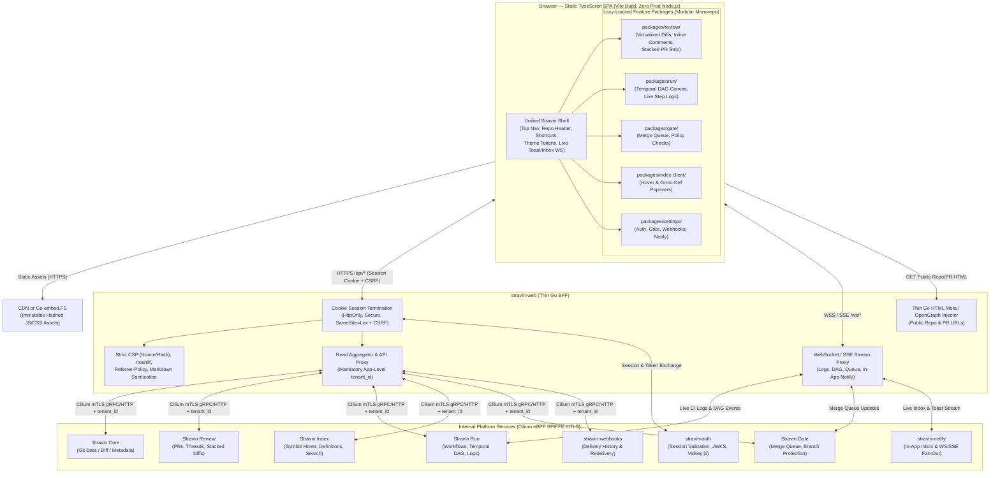

# ADR-0004: Web Frontend Stack — Static TypeScript SPA + Go BFF (`stravin-web`)

- **Status:** Proposed
- **Date:** 2026-11-26
- **Scope:** Web application runtime architecture, browser authentication boundary, real-time streaming proxy, modular frontend workspace structure, security headers, public SEO/OpenGraph unfurling, and local development parity across **Stravin Core**, **Stravin Review**, **Stravin Run**, **Stravin Index**, **Stravin Gate**, **Stravin Auth**, **Stravin Notify**, and **Stravin Webhooks**.

## Context

Stravin's backend platform is written in Go and operates on a strict set of infrastructure and security boundaries established in prior ADRs and UI specifications:

- [ADR-0001](0001-platform-transport-events-webhooks.md) established **Cilium (eBPF)** sidecarless SPIFFE mTLS for pod-to-pod workload identity, **NATS JetStream** for internal async events, **Stravin Webhooks** (`stravin-webhooks`) for outbound customer delivery, and **Temporal** for Run and Gate durable workflows.
- [ADR-0002](0002-external-runner-seam-and-oidc-auth.md) defined the external runner seam, OIDC App authentication, and short-lived scoped tokens.
- [ADR-0003](0003-platform-auth-and-sso-seam.md) introduced **`stravin-auth`** as the sole token issuer with local JWKS verification, Valkey `jti` deny-list revocation, and `STRAVIN_AUTH` revocation events.
- [UI Design Overview & Shell](../ui/index.md) defines a GitHub-familiar, high-density developer experience spanning Pull Requests (`Stravin Review`), Actions & Workflows (`Stravin Run`), Merge Queues (`Stravin Gate`), inline code intelligence (`Stravin Index`), and Settings (`Auth`, `Gate`, `Webhooks`, `Notify`, `Runners`).

Building the Stravin web application introduces five competing architectural requirements:

1. **Zero Node.js / Bun Runtime Fleet in Production:** Operating, patching, and autoscaling a dedicated server-side JavaScript runtime tier solely to render an authenticated developer application adds operational overhead and failure modes that conflict with Stravin's lightweight, Go-first footprint (including single-host self-hosted and local Docker Compose parity).
2. **High-Interactivity Client Workflows:** Core developer workflows—virtualized 10,000-line side-by-side diffs, inline review comment editors, `Stravin Index` symbol hover/go-to-definition popovers, Stacked PR navigation strips, interactive Temporal Job DAG canvases, and instant tab switching (`Conversation | Commits | Checks | Files Changed`)—require rich client-side state and persistent WebSocket/SSE streams that must not tear down on navigation.
3. **Browser-Safe Authentication & Multi-Tenant Isolation:** Browser clients must never hold bearer tokens in `localStorage` or JavaScript-accessible storage. Every backend request must cross Cilium mTLS with verified user identity and mandatory app-level `tenant_id` propagation.
4. **Product Team Ownership Without MFE Fragmentation:** Teams owning Review, Run, Gate, Index, and Settings need clear code ownership and small initial bundles without paying the runtime duplication, version skew, and shared-state fragmentation tax of Micro Frontends.
5. **Public Link Unfurling & SEO Without SSR Overhead:** Public repositories, pull requests, and workflow pages still need accurate `<title>`, meta descriptions, and OpenGraph (`og:*`) cards when shared in Slack, chat tools, or search engines.

## Decision

We adopt a **Static TypeScript SPA (Vite + React or Svelte, with lazy-loaded route modules)** paired with a **Thin Go Backend-for-Frontend (`stravin-web`)**, running **zero Node.js or Bun processes in production**.



### 1. Static TypeScript SPA & Zero Node.js Runtime in Production

- **Build-Time Bundling Only:** All TypeScript, CSS, and static assets are compiled once at CI time with **Vite** (targeting React or Svelte with strict TypeScript and code-split lazy route modules).
- **Static Asset Delivery:** Compiled assets are content-hashed and served either from a CDN edge (SaaS) or directly from Go's `embed.FS` compiled into the `stravin-web` binary (self-hosted and local Docker Compose).
- **Zero Production JS Server:** No Node.js, Deno, or Bun runtime is deployed, patched, or scaled in production clusters. Every production web tier pod is a single static Go binary (`stravin-web`).

### 2. Modular Monorepo Without Micro Frontends (MFE)

Rather than splitting the UI into independently deployed Micro Frontends, Stravin uses a single modular TypeScript monorepo built into one cohesive application:

- **Unified Stravin Shell:** Owns the global top navigation bar, repository header, command palette and keyboard shortcuts, canonical Stravin theme/brand tokens, and a single shared `stravin-notify` WebSocket/SSE connection for live in-app toasts and inbox counts.
- **Lazy-Loaded Product Feature Packages:** Product domains live in isolated workspace packages loaded on demand per route:
    - `packages/review/` — Pull request list, virtualized diffs, inline comment threads, and Stacked PR navigation strip.
    - `packages/run/` — Workflow runs, runner pool badges, interactive Temporal DAG canvas, and streaming step log viewer.
    - `packages/gate/` — Merge queue status, speculative batch views, and branch protection summaries.
    - `packages/settings/` — Repository and organization settings for `Auth`, `Gate`, `Webhooks`, `Notify`, and `Runners`.
    - `packages/index-client/` — Lightweight code intelligence client for symbol hover, go-to-definition popovers, and code search queries.
- **Ownership Without Runtime Tax:** Each package has explicit `CODEOWNERS`, independent unit tests, and typed BFF client interfaces while sharing one framework version, one router, one design system, and one client cache—avoiding MFE bundle duplication, shared-state fragmentation, and cross-team version skew.

### 3. Thin Go BFF (`stravin-web`) Responsibilities

`stravin-web` is a stateless, thin Go Backend-for-Frontend that sits between the browser and the Cilium eBPF service mesh. It owns four focused responsibilities and **zero product domain business logic**:

1. **Browser Authentication Termination & CSRF Protection:**
    - Terminates browser login flows with `stravin-auth` ([ADR-0003](0003-platform-auth-and-sso-seam.md)) and issues **`HttpOnly`, `Secure`, `SameSite=Lax`** session cookies.
    - Access tokens, refresh tokens, and internal JWTs are **NEVER** stored in `localStorage`, `sessionStorage`, or any JavaScript-readable cookie or DOM attribute.
    - Enforces strict **CSRF protection** on all state-changing HTTP requests (`POST`, `PUT`, `PATCH`, `DELETE`) via `Origin`/`Sec-Fetch-Site` verification paired with a per-session CSRF token header.
2. **Read Aggregation & Mandatory `tenant_id` Propagation:**
    - Aggregates read-heavy composite views (for example, PR header + checks summary + merge-queue status + review threads) over **Cilium eBPF mTLS** gRPC/HTTP to `Core`, `Review`, `Run`, `Index`, `Gate`, `Auth`, `Notify`, and `Webhooks`.
    - Validates the user session locally via `stravin-auth` JWKS + Valkey `jti` deny-list checks and propagates verified `principal_id` and mandatory app-level `tenant_id` on every downstream RPC.
3. **Real-Time WebSocket / SSE Stream Proxying:**
    - Proxies authenticated **WebSocket** and **Server-Sent Events (SSE)** streams from internal services to the browser for:
        - Live `Stravin Run` CI step logs and Temporal Job DAG state transitions.
        - `Stravin Gate` merge-queue position and speculative batch updates.
        - `stravin-notify` real-time in-app inbox updates and toast popups.
    - Subscribes to `STRAVIN_AUTH` revocation events (`principal.revoked`, `principal.role_changed`) so compromised or deprovisioned browser streams are terminated within seconds.
4. **Thin Go HTML Meta-Tag / OpenGraph Injection:**
    - For public repository and pull request URLs, `stravin-web` performs a lightweight metadata lookup and injects `<title>`, `<meta name="description">`, and OpenGraph (`og:title`, `og:description`, `og:url`, `og:image`) tags directly into the static `index.html` template in Go before flushing the response.
    - Private or unauthenticated repository URLs emit generic non-leaking metadata only, preventing repository or PR title disclosure to unfurling bots.

### 4. High-Interactivity Client Capabilities & Responsive Breakpoints

The SPA architecture directly supports the dense interactive surfaces specified in the [UI Design docs](../ui/index.md):

- **Virtualized Diffs & Review (`Stravin Review`):** Windowed side-by-side and unified diff rendering for 10,000+ line changes, inline review comment threads, draft batching, and the **Stacked PR navigation strip**.
- **Inline Code Intelligence (`Stravin Index`):** Low-latency hover cards, go-to-definition popovers, and cross-file reference jumps triggered directly inside diff and blob views.
- **Interactive Temporal DAG Canvas (`Stravin Run`):** Pan/zoom job dependency graph with live node status updates and streaming ANSI step logs without page reloads.
- **Full-Width Responsive Breakpoints:** Layout adapts cleanly across four canonical viewport tiers without horizontal overflow:
    - `<768px` (mobile: collapsed nav drawer, unified diff default, stacked summary cards).
    - `768-1023px` (tablet: compact header, collapsible metadata rail).
    - `1024-1439px` (compact desktop: standard two-column PR/run layouts).
    - `>=1440px` (wide desktop: full-width side-by-side diffs and expanded DAG canvas).

#### Pluggable Diff Renderer Seam (`packages/review/src/diff/`)

To support code diffs at launch, image diffs in Phase 2, and future rich file types (Markdown, CSV/tabular, structural JSON/YAML, sandboxed SVG, notebooks, PDF) without modifying the PR Review shell or Core Git API, `packages/review/src/diff/` defines a priority-ordered `DiffRenderer` registry:

```ts
export interface DiffFileDescriptor {
  path: string;
  oldPath?: string;
  changeKind: "add" | "modify" | "delete" | "rename";
  mimeType: string;
  extension: string;
  isBinary: boolean;
  oldBlobOid?: string;
  newBlobOid?: string;
  oldSizeBytes: number;
  newSizeBytes: number;
  hunks: DiffHunk[]; // empty ([]) for binary / non-text files
}

export interface DiffRendererProps {
  file: DiffFileDescriptor;
  viewMode: string;
  blobUrl: (blobOid: string) => string; // stravin-web BFF blob proxy URL
  onComment: (anchor: LineAnchor | RegionAnchor | FileAnchor) => void;
}

export interface DiffRenderer {
  id: string;
  priority: number; // highest matching priority wins; BinaryMetadataRenderer is lowest fallback
  matches: (file: DiffFileDescriptor) => boolean;
  capabilities: {
    inlineComments: "line" | "region" | "file-only";
    viewModes: string[];
  };
  load: () => Promise<{ default: ComponentType<DiffRendererProps> }>;
}
```

- **Zero-Cost Lazy Chunks (Vite Code-Splitting):** Each `DiffRenderer.load()` wraps a dynamic `import()` so Vite emits an isolated chunk per renderer. Pure code PRs never download image diffing, notebook, or PDF codec bundles.
- **Uniform Shell Chrome:** The Review shell owns the file-card header (path, `+N / -M` or byte delta, `capabilities.viewModes` pill, `Viewed` checkbox, `Raw` link) and mounts the matched renderer inside the body slot.
- **Security Invariant (BFF Blob Proxy & Sandboxed Rendering):** Binary, image, SVG, and document blobs are fetched exclusively through `stravin-web`'s authenticated blob proxy (`GET /api/v1/repos/{tenant}/{repo}/blobs/{oid}` backed by `GitData.GetBlob`) with `X-Content-Type-Options: nosniff`, strict CSP (`default-src 'none'; sandbox`), and sandboxed rendering (``, `<canvas>`, or `sandbox=""` iframe) so inline `<script>` inside SVGs or HTML files can never execute in the application origin.

### 5. Strict Security Headers & Content Boundaries

`stravin-web` enforces defense-in-depth browser security controls on every response:

- **Strict `Content-Security-Policy`:** Per-request cryptographic nonce or build-time hash-based script policy with **zero `unsafe-inline` scripts**, `object-src 'none'`, `base-uri 'self'`, and strict `frame-ancestors 'none'` (clickjacking protection).
- **Hardened Standard Headers:** `X-Content-Type-Options: nosniff`, `Referrer-Policy: strict-origin-when-cross-origin`, and `Strict-Transport-Security` on TLS origins.
- **Untrusted User Content Sanitization:** All user-authored Markdown (PR descriptions, review comments, READMEs) and diff content pass through strict HTML sanitization with safe URL scheme allowlists (`https`, `http`, `mailto`) before rendering, preventing stored XSS and CSS exfiltration.

### 6. Local Development Parity

- UI developers run `vite dev` locally, which proxies `/api/*` and `/ws/*` directly to the local `stravin-web` Go BFF running inside Docker Compose (alongside `stravin-auth`, Floci, Valkey, and Core/product daemons).
- This delivers sub-second Hot Module Replacement (HMR) for frontend iteration while exercising the exact same Go BFF auth cookies, CSRF checks, API aggregation, and WebSocket/SSE proxy code paths that run in production—with **zero Kubernetes or Node.js production parity gap**.

## Alternatives Considered

| Alternative | Summary | Why Rejected |
| :--- | :--- | :--- |
| **Micro Frontends (Module Federation / Single-SPA / iframes)** | Deploy Review, Run, Gate, and Settings as separate runtime frontend bundles composed in the browser. | Premature org-scaling tax; fragments shared shell state (auth session, repo header, live notifications, keyboard shortcuts), duplicates framework/design-system bundles, and introduces cross-team runtime version skew. |
| **SSR Meta-Framework (SvelteKit / TanStack Start / React Router SSR on Node/Bun)** | Run a production Node.js or Bun SSR server tier in front of the Go backend services. | Deferred / not chosen as default; introduces a separate Node/Bun runtime fleet to operate, secure, and autoscale when an authenticated developer tool only needs thin Go OpenGraph/SEO meta injection on public URLs. |
| **AstroJS with Server Islands (MPA + Islands)** | Multi-page HTML architecture with isolated interactive islands hydrated per page. | Rejected for the core app; full-page navigations drop persistent WebSocket/SSE connections (live CI logs, notifications) and degrade high-interactivity tab switching (`Conversation \| Commits \| Checks \| Files Changed`). Ideal for `stravin.dev` marketing and docs (`stravin-dev/website`), not the main application. |
| **Go-Native HTML (`templ` + HTMX / Datastar)** | Render all application views as server-driven HTML fragments from Go with minimal client JavaScript. | Rejected for the full app; strong fit for Settings and simple tables, but virtualized 10k-line diffs, inline review editors, `Stravin Index` symbol popovers, and interactive Temporal DAG canvases require a rich client-side TypeScript runtime anyway. |

## Consequences

### Positive

- **Single-language production operations:** Production clusters run only Go services (`stravin-web` + Core/platform daemons) and static CDN/embedded assets—zero Node.js/Bun pods to size, monitor, or patch.
- **Persistent real-time UX:** Client-side routing keeps WebSocket/SSE connections alive across tab switches (`Conversation | Commits | Checks | Files Changed`) and repository navigation.
- **Strong browser security posture:** `HttpOnly`/`Secure`/`SameSite=Lax` cookies keep credentials out of JavaScript reach, while `stravin-web` centralizes CSRF enforcement, strict CSP headers, and `tenant_id` propagation.
- **Fast local iteration with prod parity:** `vite dev` HMR + Docker Compose `stravin-web` lets frontend and backend engineers iterate locally without Kubernetes or separate SSR servers.
- **Clean team scaling:** Modular workspace packages (`packages/review/`, `packages/run/`, `packages/gate/`, `packages/settings/`, `packages/index-client/`) provide clear ownership and small initial bundles without MFE complexity.

### Negative / Trade-offs

- **No full HTML SSR for complex dynamic pages:** Public repository and PR pages get rich `<title>` and OpenGraph meta tags via thin Go HTML injection, but full interactive page rendering happens client-side after the initial JS bundle loads (mitigated by route-level code splitting and CDN caching).
- **Thin BFF maintenance surface:** `stravin-web` must stay strictly a thin aggregation/auth/proxy layer; discipline is required so product domain rules remain in `Review`, `Run`, `Gate`, `Index`, and `Core` rather than leaking into BFF handlers.
- **Client bundle discipline:** A unified SPA requires CI bundle-size budgets and strict lazy-loading boundaries so heavy surfaces (such as the Temporal DAG canvas or diff highlighter) never bloat the initial shell payload.

## Undo / Rollback Path

- **Future SSR Adoption Without Backend Churn:** Because `stravin-web` terminates browser auth and communicates with all backend products over typed Cilium mTLS gRPC/HTTP contracts, introducing a Node.js/Bun SSR frontend (e.g., SvelteKit, TanStack Start, or React Router SSR) later—either globally or for specific public-facing routes—requires **zero changes to any backend product contract** (`Core`, `Review`, `Run`, `Index`, `Gate`, `Auth`, `Notify`, `Webhooks`).
- **Framework or Asset-Hosting Flexibility:** Static assets are decoupled behind `stravin-web` / CDN routing, allowing independent migration between `embed.FS` and external CDN origins or incremental UI framework changes without altering API or auth boundaries.

## Related Documents

- [ADR-0001: Platform Transport, Internal Events, External Webhooks, and Durable Workflows](0001-platform-transport-events-webhooks.md) — Cilium eBPF mTLS, NATS JetStream, `stravin-webhooks`, and Temporal boundaries.
- [ADR-0002: External Runner Seam, State-Machine Ownership, and OIDC App Authentication](0002-external-runner-seam-and-oidc-auth.md) — External runner pools, OIDC App control plane, and scoped token boundaries.
- [ADR-0003: Platform IAM, Authentication, STS, and Pluggable SSO Seam (`stravin-auth`)](0003-platform-auth-and-sso-seam.md) — Standalone-first IAM, local JWKS + Valkey `jti` deny-list, and `STRAVIN_AUTH` revocation events consumed by `stravin-web`.
- [UI Design Overview & Shell](../ui/index.md) — Canonical Stravin brand tokens, shell architecture, and GitHub ⟷ Stravin UX mapping.
- [Platform Products ⟷ Stravin Auth Interface](../interfaces/platform-auth.md) — Session, JWKS, and revocation contracts used by `stravin-web`.
- [Platform Events ⟷ Stravin Notify Interface](../interfaces/platform-notify.md) — In-app inbox and WebSocket/SSE notification delivery proxied through `stravin-web`.
