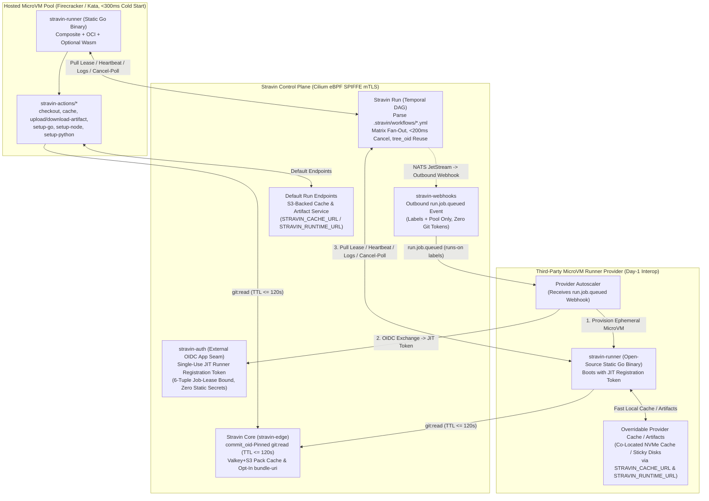

# ADR-0005: Declarative YAML Workflow Execution, First-Party Action Repositories, and Runner Runtime

- **Status:** Proposed
- **Date:** 2026-11-26
- **Scope:** Declarative workflow syntax and expression safety, OCI/Wasm-first hybrid action execution runtimes, first-party action repositories (`stravin-actions/*`), static Go runner runtime (`stravin-runner`) with local Docker parity, and Day-1 third-party ephemeral microVM runner hooks across **Stravin Run**, **Stravin Core**, **Stravin Gate**, **Stravin Auth**, and **Stravin Webhooks**.

## Context

Prior ADRs establish the control-plane transport, durability, and security seams for **Stravin Run**:

- [ADR-0001](0001-platform-transport-events-webhooks.md) designates **Temporal** as the durable workflow orchestrator for Run and Gate, **NATS JetStream** (`STRAVIN_CORE`, `STRAVIN_RUN`) for internal async events, and **`stravin-webhooks`** for outbound machine-to-machine HTTP delivery.
- [ADR-0002](0002-external-runner-seam-and-oidc-auth.md) establishes the **Phase 1 Job-Lease Seam** (where Run's Temporal DAG leases individual jobs to hosted or external runners over `lease`, `heartbeat`, `log-stream`, `report-result`, and `cancel-poll`), external **OIDC App** authentication with zero static secrets, 6-tuple job-lease binding, `commit_oid`-pinned `git:read` tokens (`TTL <= 120s`), opt-in `git:bundle:read` gating, and `< 200 ms` cancellation propagation.
- [ADR-0003](0003-platform-auth-and-sso-seam.md) designates **`stravin-auth`** as the sole token and STS issuer for external OIDC App exchanges and Valkey `jti` revocation.

Before Wave 3 builds `stravin-run` and its runner agent in `stravin-dev/platform`, four execution-plane questions must be settled:

1. **Workflow authoring contract:** What declarative format do developers check into repositories, and how does Stravin prevent expression-based shell injection and stdout command-smuggling vulnerabilities?
2. **Action packaging and runtime model:** How are reusable build steps (`checkout`, `cache`, `upload-artifact`, toolchain setup) packaged and executed without forcing heavy Node.js or .NET runtimes into every ephemeral microVM rootfs?
3. **Runner binary and local parity:** How does the runner agent achieve `< 300 ms` microVM cold starts in production while letting engineers run the exact same workflows locally under Docker Engine?
4. **Third-party microVM runner interoperability:** What Day-1 hooks allow specialized third-party microVM runner providers to provision on-demand VMs, register cleanly with zero static secrets, and plug in co-located NVMe caches or sticky disks without bespoke Stravin forks?

## Decision

We adopt **Option B: Compatible Declarative YAML + OCI/Wasm-First Hybrid Action Runtimes + Static Go `stravin-runner` + Day-1 Third-Party MicroVM Runner Hooks**.

### 1. Workflow Syntax & Expression Safety

Workflows are authored as declarative YAML files under **`.stravin/workflows/*.yml`** (and `.yaml`), fetched at the exact triggering `commit_oid`:

- **Core Schema:** Supports `on` triggers (`push`, `pull_request`, `merge_group`, `workflow_dispatch`, `schedule`), `jobs`, `needs` (DAG edges), `runs-on` (label selector routing), `strategy.matrix` (with `include`/`exclude`/`fail-fast`), `services` (sidecar containers attached to the job network), and `steps` (`name`, `id`, `if`, `uses`, `with`, `run`, `env`, `working-directory`, `continue-on-error`, `timeout-minutes`).
- **Expression Engine & Shell-Injection Guardrails:**
    - `${{ }}` expressions support standard logical/comparison operators, context objects (`stravin.*`, `inputs.*`, `matrix.*`, `needs.*`, `steps.*`, `env.*`, `vars.*`, `secrets.*`), and pure built-in functions (`contains`, `startsWith`, `endsWith`, `format`, `join`, `toJSON`, `fromJSON`, `hashFiles`, `always`, `success`, `failure`, `cancelled`).
    - **Strict Untrusted-Context Guardrail:** Direct interpolation of untrusted event-context fields (such as PR titles, PR bodies, branch/head ref names, commit messages, comment bodies, or author display names) inside `run:` shell scripts is **rejected at workflow validation time and blocked by the runner evaluator**. Authors MUST bind untrusted values through `env:` variables and reference them as quoted shell variables (`"$PR_TITLE"`), eliminating expression-to-shell injection by default.
- **File-Based Step Commands (Zero Stdout Command Parsing):**
    - Steps communicate outputs, environment mutations, PATH additions, and post-step state exclusively through per-step temporary files exposed via environment variables:
        - `STRAVIN_OUTPUT` — Key-value step outputs consumed by downstream steps and job `outputs`.
        - `STRAVIN_ENV` — Environment variables propagated to subsequent steps in the same job (with a deny-list blocking sensitive loader/runtime overrides such as `LD_PRELOAD`, `NODE_OPTIONS`, and `STRAVIN_RUNTIME_TOKEN`).
        - `STRAVIN_PATH` — Directory entries prepended to `PATH` for subsequent steps.
        - `STRAVIN_STATE` — Private state shared between a step's `pre`, `main`, and `post` hooks.
    - Legacy stdout magic-string directives are **not supported**, removing log-injection command-smuggling vectors.

### 2. Action Execution Runtimes (Composite + OCI + Optional Wasm)

Every `uses:` step executes through one of three runtime tiers, prioritizing zero-overhead composition, hermetic digest-pinned OCI containers, and optional zero-dependency Wasm sandboxes:

1. **Composite Actions (First-Class, Default for Multi-Step Tooling):**
    - Declared with `runs: using: 'composite'` in `action.yml`.
    - Recursively expanded directly into the job's step queue by `stravin-runner`, inheriting the workspace, environment, and `STRAVIN_*` command files with **zero nested VM or container startup overhead**.
2. **OCI Container Actions (First-Class, Default for Packaged Logic):**
    - Declared with `runs: using: 'oci'` referencing a digest-pinned OCI image (`image: oci://registry.example.com/org/action@sha256:...`).
    - Runs inside a hardened container sandbox with a read-only root filesystem, explicit workspace bind mount, dropped Linux capabilities, and inputs injected via `INPUT_<NAME>` environment variables.
3. **Optional Sandboxed Wasm Actions (`using: 'wasm'`):**
    - Declared with `runs: using: 'wasm'` and executed via an embedded `wazero` runtime inside `stravin-runner` with zero external host dependencies.
    - Maps `with:` inputs onto the standard `INPUT_<NAME>` environment bridge and invokes bundled `action.wasm` entrypoints, providing portable cross-OS execution (Linux, macOS, Windows) with minimal startup overhead.
- **Why Host `using: node` Is Omitted:**
    - Any author who wants Node.js or JavaScript execution can package it in a digest-pinned OCI container (`using: 'oci'`) without forcing `stravin-runner` to ship, patch, or maintain host Node.js runtimes across EOL cycles.
    - `using: 'composite'` (shell and static Go binaries) and `using: 'wasm'` handle cross-OS portability (Linux, macOS, Windows) and host `PATH`/toolchain setup (`setup-*`) without introducing Node.js runtime debt.
- **Mandatory Pinning Policy for External `uses:` References:**
    - External `uses:` references MUST be pinned to a **full commit SHA** (40-char SHA-1 or 64-char SHA-256 matching repository `object_format`) or an **immutable OCI image digest** (`@sha256:...`).
    - Mutable tag or branch references (e.g., `@v1`, `@main`) on third-party repositories are rejected by policy unless explicitly exempted in tenant/repository settings; first-party `stravin-actions/*` repositories publish immutable signed releases and major-version tags under tenant policy control.

### 3. First-Party Shared Action Repositories (`stravin-actions/*`)

Stravin maintains a focused set of official, audited first-party action repositories under the `stravin-actions` organization namespace:

| Repository | Runtime Tier | Responsibility & Contract |
| :--- | :--- | :--- |
| `stravin-actions/checkout` | Composite + static helper / Wasm | Checks out the exact `commit_oid` using [ADR-0002](0002-external-runner-seam-and-oidc-auth.md)'s `commit_oid`-pinned `git:read` token (`TTL <= 120s`), Protocol v2 deterministic fetch flags (`stravin-edge` Valkey+S3 pack-cache hit maximization), `traceparent` header propagation, and opt-in `git:bundle:read` for `bundle-uri` bootstrap on large repos. Strips credentials from `.git/config` in its `post` hook. |
| `stravin-actions/upload-artifact` | Wasm / static Go helper | Streams build artifacts (with SHA-256 manifest and retention metadata) to `STRAVIN_RUNTIME_URL` authenticated with `STRAVIN_RUNTIME_TOKEN`. |
| `stravin-actions/download-artifact` | Wasm / static Go helper | Verifies manifest digests and downloads job or cross-job artifacts from `STRAVIN_RUNTIME_URL`. |
| `stravin-actions/cache` | Wasm / static Go helper | Computes content-addressed cache keys (with restore-key prefix fallback) and reads/writes compressed archives against `STRAVIN_CACHE_URL` (`main` restore + `post` save). |
| `stravin-actions/setup-go` | Composite | Installs and caches pinned Go toolchains (respecting `go.mod` / `.tool-versions`), updates `STRAVIN_PATH`, and wires Go module/build caches. |
| `stravin-actions/setup-node` | Composite | Installs pinned Node.js/pnpm/npm toolchains on demand inside the job workspace without baking Node.js into the base microVM image. |
| `stravin-actions/setup-python` | Composite | Installs pinned Python/`uv` toolchains and configures virtualenv caching. |
| `stravin-actions/templates` | Composite | Reusable composite action templates and reference patterns for repository maintainers. |

### 4. Runner Runtime (`stravin-runner`) & Local Execution Parity

- **Single Static Go Binary (`stravin-runner`):**
    - Compiled with `CGO_ENABLED=0` into a single static Linux/macOS binary with **zero .NET, Node.js, or Python host dependencies**.
    - Keeping the agent footprint under ~25 MiB and dependency-free enables **`< 300 ms` Firecracker / Kata microVM cold starts** from minimal rootfs snapshots.
    - Speaks [ADR-0002](0002-external-runner-seam-and-oidc-auth.md)'s Phase 1 pull-lease protocol (`lease`, `heartbeat`, `log-stream`, `report-result`, `cancel-poll`), propagates W3C `traceparent` across step execution, and enforces `< 200 ms` cancel acknowledgment (`SIGTERM` -> grace window -> `SIGKILL`).
- **Local Docker Engine Execution Mode (`stravin-runner local` / Docker Compose):**
    - Developers run workflows locally against their working tree via `stravin-runner local` or the unified `stravin-dev/platform` Docker Compose stack without requiring Firecracker, Kata, or Kubernetes.
    - `stravin-runner local` launches an **embedded local HTTP artifact & cache server** bound to loopback (`127.0.0.1`) and injects the exact same environment variables used in production:
        - `STRAVIN_RUNTIME_URL` — Job artifact and step-metadata API endpoint.
        - `STRAVIN_CACHE_URL` — Content-addressed build cache endpoint.
        - `STRAVIN_RUNTIME_TOKEN` — Scoped per-job bearer token.
    - Because `stravin-actions/upload-artifact`, `download-artifact`, and `cache` talk exclusively to these HTTP endpoints, local runs and production S3-backed runs exercise the **exact same action code paths 1:1**.

### 5. Third-Party Ephemeral MicroVM Runner Hooks (Day-1 Interoperability)

Stravin Run is designed from Day 1 so specialized third-party microVM runner providers can plug into Stravin's hosted workflow UX without maintaining custom protocol shims or holding long-lived credentials:

1. **`runs-on:` Label Routing & `run.job.queued` Outbound Webhook:**
    - Workflow jobs specify target labels via `runs-on:` (e.g., `runs-on: [self-hosted, linux-arm64-16c]` or provider-managed pool labels).
    - When a job enters the queued state on an external/provider-backed `runner_pool`, Run publishes an event to `STRAVIN_RUN` that **`stravin-webhooks`** delivers as a signed `run.job.queued` outbound webhook containing `(tenant_id, repo_id, job_id, attempt_id, runner_pool, labels[])` — with **zero embedded Git tokens or runner secrets** ([ADR-0002](0002-external-runner-seam-and-oidc-auth.md)).
    - The third-party provider's autoscaler provisions a fresh ephemeral microVM matching the requested labels.
2. **Single-Use JIT Runner Registration Token (Zero Static Secrets):**
    - The provider exchanges its workload identity assertion over [ADR-0002](0002-external-runner-seam-and-oidc-auth.md)'s external **OIDC App** seam at `stravin-auth` to mint a **single-use JIT Runner Registration Token** strictly bound to the 6-tuple job lease `(tenant_id, repo_id, runner_pool, job_id, attempt_id, runner_instance_id)`.
    - The JIT token expires immediately upon lease claim or short TTL (`<= 120s`) and is injected into the ephemeral microVM boot config; the provider never stores static org-wide runner registration keys.
3. **Open-Source Static `stravin-runner` Binary Inside Any Third-Party MicroVM:**
    - Third-party providers bake or inject the open-source static `stravin-runner` binary into their microVM images.
    - On boot, `stravin-runner --jit-token <token> --ephemeral` claims its exact leased job, streams ANSI logs to Run's minted `log_stream_url`, heartbeats liveness, honors `< 200 ms` `cancel-poll` directives, and exits cleanly so the provider destroys the microVM immediately after one job.
4. **Overridable Cache & Artifact Endpoints (`STRAVIN_CACHE_URL`, `STRAVIN_RUNTIME_URL`):**
    - Third-party microVM providers can override `STRAVIN_CACHE_URL` and/or `STRAVIN_RUNTIME_URL` at runner boot (e.g., pointing to a co-located regional NVMe cache proxy or sticky-disk cache service on the host hypervisor).
    - `stravin-actions/cache` and `stravin-actions/*-artifact` transparently use the overridden endpoints while preserving Run's cache-key scoping and token validation—letting providers deliver sub-second NVMe cache throughput without asking users to rewrite workflow YAML.

## Alternatives Considered

| Alternative | Summary | Why Rejected |
| :--- | :--- | :--- |
| **Option A: Host Node.js / JS-Mandatory Parity (`using: node`)** | Require a full Node.js / .NET runner agent or host `using: node` runtime shim so actions execute as Node.js processes. | Bloats microVM rootfs images and slows Firecracker/Kata cold starts past `< 300 ms`; forces `stravin-runner` and third-party microVM providers to ship and patch Node.js runtimes across EOL cycles when authors can already package Node.js inside a digest-pinned `using: oci` container; inherits legacy stdout command-injection and unpinned-tag supply-chain hazards. |
| **Option C: Pure OCI Step Pipelines** | Require every single workflow step to run as an isolated OCI container image with no composite action expansion or lightweight host-step execution. | Adds container-pull and layer-unpack latency to trivial steps (`checkout`, `cache`, `setup-go`); breaks ergonomic multi-step composition; complicates Docker-in-Docker and nested tooling inside ephemeral microVMs. |
| **Option D: Programmable Container DAGs / BuildKit SDKs** | Author CI pipelines in general-purpose programming languages (Go, TypeScript, Python SDKs) compiling to BuildKit LLB graphs instead of declarative YAML. | Raises the onboarding bar for teams expecting familiar declarative `.stravin/workflows/*.yml` files; shifts DAG state out of Run's Temporal engine, weakening `tree_oid` verdict reuse, per-check Gate fail-fast eviction, and visual DAG inspection; poorly matched to third-party microVM providers expecting job-level `runs-on` webhooks. |

**Why Option B Wins:** Option B combines familiar, low-friction declarative YAML ergonomics (`.stravin/workflows/*.yml`, `stravin-actions/*`, composite actions) with modern supply-chain and runtime hygiene (strict expression-injection guardrails, file-based step commands, mandatory SHA/digest pinning, zero-dependency static Go `stravin-runner`, and `composite` + `oci` + optional `wasm` execution with zero host Node.js runtime debt) while giving third-party microVM runner providers first-class Day-1 hooks (`run.job.queued`, single-use JIT OIDC tokens, open-source static runner binary, and overridable `STRAVIN_CACHE_URL`/`STRAVIN_RUNTIME_URL`).

## Consequences

### Positive

- **Fast, lean microVM cold starts:** A single static Go `stravin-runner` with zero .NET/Node.js host dependencies keeps Firecracker/Kata rootfs images minimal and cold starts `< 300 ms`.
- **Strong default supply-chain and shell safety:** Blocking untrusted `${{ }}` interpolation in `run:` scripts, eliminating stdout magic commands, and enforcing full commit-SHA / OCI-digest pinning prevent entire classes of CI exploitation at parse time.
- **1:1 local and production parity:** `stravin-runner local` with an embedded loopback HTTP cache/artifact server exercises the exact same `STRAVIN_RUNTIME_URL` / `STRAVIN_CACHE_URL` contract as production S3-backed endpoints.
- **Zero-friction third-party microVM ecosystem:** Providers integrate on Day 1 using standard webhooks, zero-static-secret JIT OIDC tokens, the open-source `stravin-runner` binary, and overridable NVMe cache endpoints—while Run retains full Temporal DAG ownership and `< 200 ms` Gate cancellation.

### Negative / Trade-offs

- **No host `using: node` runtime:** Authors bringing Node.js or JavaScript actions must package them as digest-pinned OCI containers (`using: 'oci'`) or port them to `composite` / `wasm` actions, incurring container startup latency for Node.js-packaged actions (mitigated by keeping all first-party `stravin-actions/*` on `composite`, `wasm`, or static Go helpers).
- **Maintenance of `stravin-actions/*` repositories:** Owning first-party repositories (`checkout`, `cache`, `upload-artifact`, `download-artifact`, `setup-*`) requires dedicated release automation, security patching, and cross-arch (`amd64`/`arm64`) builds.
- **Strict expression lint friction:** Developers migrating scripts that directly interpolate untrusted event fields into `run:` blocks will encounter validation errors until those values are moved into `env:` bindings (mitigated by clear diagnostic messages with exact copy-paste fixes).

## Undo / Rollback Path

- **Adding or retiring action runtime tiers:** Because `stravin-runner` dispatches steps behind a `StepRuntime` interface (`composite`, `oci`, `wasm`), adding a new runtime tier or retiring optional Wasm support requires no change to Temporal DAG orchestration, Core Git tokens, or Gate verdict contracts.
- **Extending workflow syntax:** `.stravin/workflows/*.yml` carries an explicit schema version; additive YAML fields follow `N / N-1` compatibility without breaking existing pipelines or third-party `stravin-runner` binaries.
- **Disabling endpoint overrides per tenant:** Overriding `STRAVIN_CACHE_URL` and `STRAVIN_RUNTIME_URL` is controlled by runner-pool policy in `stravin-run`, allowing tenants with strict data-residency requirements to pin all cache and artifact traffic to Stravin-managed S3 endpoints.

## Related Documents

- [ADR-0001: Platform Transport, Internal Events, External Webhooks, and Durable Workflows](0001-platform-transport-events-webhooks.md) — Temporal workflow ownership, NATS JetStream, and `stravin-webhooks`.
- [ADR-0002: External Runner Seam, State-Machine Ownership, and OIDC App Authentication](0002-external-runner-seam-and-oidc-auth.md) — Phase 1 Job-Lease protocol, 6-tuple lease binding, external OIDC App seam, `commit_oid`-pinned `git:read` tokens (`TTL <= 120s`), and `git:bundle:read` gating.
- [ADR-0003: Platform IAM, Authentication, STS, and Pluggable SSO Seam (`stravin-auth`)](0003-platform-auth-and-sso-seam.md) — External OIDC App token exchange and Valkey `jti` revocation.
- [Core ⟷ Run Interface](../interfaces/core-run.md) — Runner checkout protocol, `stravin-edge` pack cache, and `commit_oid`-pinned token minting.
- [Run ⟷ Gate Interface](../interfaces/run-gate.md) — Speculative merge-queue batch builds, `< 200 ms` cancellation, and partitioned `tree_oid` verdict reuse.
- [External Webhooks Interface](../interfaces/external-webhooks.md) — Signed outbound `run.job.queued` webhook delivery via `stravin-webhooks`.
- [Full-Stack Build Waves](../roadmap/full-stack-waves.md) — Wave 3 implementation deliverables for `stravin-run`, `stravin-runner`, and `stravin-actions/*`.
