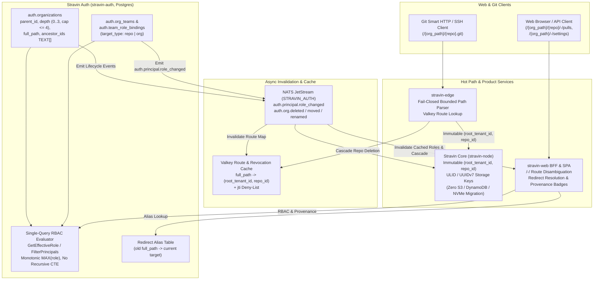

# ADR-0006: Bounded Nested Organizations, Monotonic Inheritance, and Cross-Cutting Team Overlays

- **Status:** Proposed
- **Date:** 2026-11-27
- **Scope:** Bounded nested organization hierarchy (`auth.organizations`), materialized ancestor paths, monotonic-only RBAC inheritance, cross-cutting team overlays (`auth.team_role_bindings`), immutable Core `(root_tenant_id, repo_id)` addressing, `stravin-edge` Valkey route-map resolution, `/-/` URL disambiguation, redirect aliases, and UI permission provenance across **Stravin Auth**, **Stravin Core**, **Stravin Review**, **Stravin Index**, **Stravin Gate**, **Stravin Notify**, and **Stravin Web**.

## Context

[ADR-0003](0003-platform-auth-and-sso-seam.md) unified repository ownership under a single flat organization model (`is_personal = true` for personal namespaces and `is_personal = false` for multi-member organizations) backed by `stravin-auth`. As organizations grow beyond a handful of repositories, flat namespaces create two competing tensions:

1. **Flat Prefix Sprawl:** Without nested organizations, engineering divisions must encode hierarchy into flat slugs (`acme-eng-payments`, `acme-eng-infra`), duplicating membership administration across dozens of separate orgs.
2. **Unbounded Hierarchy Hazards:** Unrestricted tree depth forces recursive CTEs on every RBAC check, invites path-traversal ambiguity in Git URLs, creates route collisions between sub-org slugs and web sub-routes, and turns org renames/moves into expensive storage migrations if Git storage keys depend on mutable slugs.
3. **Cross-Cutting Access Without Broad Inheritance:** Even with nested organizations, cross-cutting functions—such as infosec, auditors, compliance, SRE, and release engineering—need targeted access (for example, `read` or `maintainer`) to specific repositories or sub-organizations across unrelated branches of the org tree without receiving broad parent-org membership.

## Decision

We adopt **Bounded Nested Organizations + Monotonic-Only Role Inheritance + Cross-Cutting Team Overlays (`auth.team_role_bindings`) + Immutable Core IDs + `/-/` URL Disambiguation**.

- **Nested Organizations** model repository hierarchy and inherited administration.
- **Teams (`auth.org_teams`)** model cross-cutting people overlays that grant targeted roles across organization boundaries.



### 1. Bounded Hierarchy & Materialized Ancestors (`stravin-auth`)

`auth.organizations` is extended with four columns to represent a bounded tree without recursive queries on the read path:

| Column | Type / Constraint | Purpose |
| :--- | :--- | :--- |
| `parent_id` | `TEXT NULL`, FK `(tenant_id, parent_id) -> auth.organizations(tenant_id, id)` | Direct parent organization; `NULL` for root organizations and all personal organizations. |
| `depth` | `INT NOT NULL DEFAULT 0`, `CHECK (depth >= 0 AND depth <= 3)` (configurable up to `4`) | Zero-indexed nesting depth (`0` = root, `1..3` = sub-orgs; max configurable ceiling `4`). |
| `full_path` | `TEXT NOT NULL`, `UNIQUE (tenant_id, full_path)` | Canonical slash-delimited slug path (e.g., `acme/eng/payments`). |
| `ancestor_ids` | `TEXT[] NOT NULL DEFAULT '{}'` (GIN-indexed) | Ordered materialized path of ancestor org IDs from root to direct parent (excluding `id` itself) for single-query indexed RBAC and subtree lookups. |

#### Structural & Lifecycle Invariants

1. **Personal Organizations Are Strictly Leaf-Only:**
    - When `is_personal = true`, `parent_id` MUST be `NULL`, `depth` MUST be `0`, and `ancestor_ids` MUST be `'{}'` (enforced by a database `CHECK` constraint).
    - Creating or moving a child organization under any organization with `is_personal = true` is rejected (`409 Conflict` / `FAILED_PRECONDITION: PERSONAL_ORG_LEAF_ONLY`).
2. **Cycle & Depth-Overflow Prevention:**
    - On create: `parent.depth + 1` MUST be `<= max_depth` (default `3`, configurable ceiling `4`).
    - On move: `stravin-auth` locks the moving subtree inside a Postgres transaction, rejects any move where `new_parent_id == org.id` or `org.id = ANY(new_parent.ancestor_ids)` (cycle prevention), and rejects any move where `new_parent.depth + 1 + max_subtree_height > max_depth` (depth-overflow prevention).
    - Moving or renaming an organization atomically updates `full_path`, `depth`, and `ancestor_ids` across the bounded subtree (at most 3–4 levels deep), writes redirect aliases for the previous paths, and publishes invalidation events to `STRAVIN_AUTH`.
3. **Sub-Organization Delete Cascade:**
    - Deleting a sub-organization follows the double-verification guard in [Platform Products ⟷ Stravin Auth](../interfaces/platform-auth.md) (`confirm_org_path == org.full_path` + fresh re-authentication).
    - Within Postgres, `stravin-auth` atomically marks the target sub-organization and all descendant organizations (`org.id = ANY(ancestor_ids)`) deleted, revokes all memberships, team bindings, and pending invitations across that subtree, and publishes `stravin.auth.<tenant_id>.org.deleted` carrying the full deleted organization ID set so downstream services (`stravin-core`, `stravin-review`, `stravin-index`, `stravin-webhooks`, `stravin-notify`, `stravin-edge`) cascade repository deletion and evict cached routes.

### 2. Monotonic-Only Role Inheritance

Effective authorization uses a total order over canonical coarse roles:

```text
none (0) < read (1) < write (2) < maintainer (3) < admin (4) < owner (5)
```

For a principal `P` targeting repository `R` (owned by organization `O` with materialized `O.ancestor_ids`) or targeting organization `O` directly, the effective role is strictly:

```text
effective_role(P, R) = MAX(
    ancestor_org_memberships(P, O.ancestor_ids),
    target_org_membership(P, O.id),
    direct_repo_role_bindings(P, R.id),
    team_role_bindings(P, target_type='repo', target_id=R.id),
    team_role_bindings(P, target_type='org',  target_id IN (O.id || O.ancestor_ids))
)
```

- **No Child Deny or Downgrade Overrides:** A child organization or repository can elevate a principal's role, never downgrade or deny a role inherited from an ancestor organization or granted via a team overlay.
- **Why Monotonic-Only:** Eliminating deny/downgrade overrides guarantees that `GetEffectiveRole` and `FilterPrincipals` execute as a single indexed SQL query (`MAX(role_rank)` over indexed joins against `O.ancestor_ids || O.id`) with zero recursive CTEs, deterministic caching, and unambiguous provenance explanation.

### 3. Cross-Cutting Team Overlays (`auth.team_role_bindings`)

`auth.org_teams` and `auth.org_team_members` remain first-class entities dedicated to **cross-cutting people overlays** (e.g., infosec, compliance auditors, SRE, release engineering) that need targeted access across unrelated sub-organizations without joining a parent organization:

- **Schema (`auth.team_role_bindings`):**
    - `tenant_id TEXT NOT NULL`
    - `id TEXT NOT NULL` (ULID)
    - `team_id TEXT NOT NULL` (FK to `(tenant_id, id)` in `auth.org_teams`)
    - `target_type TEXT NOT NULL CHECK (target_type IN ('repo', 'org'))`
    - `target_id TEXT NOT NULL` (immutable `repo_id` or `org_id`)
    - `role TEXT NOT NULL CHECK (role IN ('read', 'write', 'maintainer', 'admin', 'owner'))`
    - `UNIQUE (tenant_id, team_id, target_type, target_id)`
- **Single-Query RBAC Integration:** `GetEffectiveRole` and `FilterPrincipals` evaluate `auth.team_role_bindings` joined through `auth.org_team_members` in the same indexed query as ancestor org memberships and direct repo bindings.
- **Event Propagation:** Every mutation to `auth.org_team_members` (add/remove member) or `auth.team_role_bindings` (bind/update/unbind target role) publishes `stravin.auth.<tenant_id>.principal.role_changed` (`auth.principal.role_changed`) onto `STRAVIN_AUTH` so downstream services invalidate cached role snapshots immediately.

### 4. Immutable Core IDs & Edge Valkey Route Map

Mutable hierarchy paths MUST NEVER leak into `stravin-core` storage keys:

- **Immutable Core Addressing:** Platform services address `stravin-core` exclusively by immutable `(root_tenant_id, repo_id)` ULIDs/UUIDv7s rather than mutable `(org_slug, repo_slug)` strings.
    - Renaming a sub-org (`acme/eng/payments` -> `acme/platform/billing`) or reparenting it requires **zero DynamoDB metadata migration, zero S3 object rewrites, and zero NVMe cache invalidation** in `stravin-node` or `stravin-pack`.
- **Bounded Multi-Segment Git Path Parsing (`stravin-edge`):**
    - Both Smart HTTP (`/{org_path}/{repo}.git/...`) and SSH (`git-upload-pack '/{org_path}/{repo}.git'`) accept bounded multi-segment paths where the final segment is the repository slug (with optional `.git` suffix) and the preceding `1 .. (max_depth + 1)` segments form `org.full_path`.
    - **Fail-Closed Validation:** `stravin-edge` rejects any path containing `..`, `.`, empty segments (`//`), backslashes, NUL or ASCII control characters (`0x00..0x1F`, `0x7F`), percent-encoded traversal sequences, or segment counts exceeding `max_depth + 2` before touching Valkey or Core.
- **Valkey-Cached Route Map:**
    - `stravin-edge` resolves validated `full_path` (+ `repo_slug`) to `(root_tenant_id, repo_id, canonical_path)` via a Valkey route cache (`edge:route:{tenant_hint}:{full_path}/{repo}`), populating on cold miss from `stravin-auth` / `stravin-review`.
    - `stravin-edge` subscribes to `STRAVIN_AUTH` lifecycle events (`org.renamed`, `org.moved`, `org.deleted`, `repo.renamed`, `repo.moved`, `repo.deleted`) to eagerly evict affected route keys within seconds.

### 5. URL Disambiguation (`/-/`) & Redirect Aliases

With arbitrary nested paths (`/{org_path}` and `/{org_path}/{repo}`), flat resource routes like `/acme/eng/settings` become ambiguous between a repository named `settings` under `acme/eng` and the settings page of `acme/eng`.

- **Reserved `/-/` Route Separator:**
    - All platform resource sub-routes sit behind the reserved `/-/` segment:
        - Organization routes: `/{org_path}/-/settings`, `/{org_path}/-/people`, `/{org_path}/-/teams`, `/{org_path}/-/suborgs`, `/{org_path}/-/new`.
        - Repository routes: `/{org_path}/{repo}/-/pulls`, `/{org_path}/{repo}/-/issues`, `/{org_path}/{repo}/-/actions`, `/{org_path}/{repo}/-/tree/{ref}/{path}`, `/{org_path}/{repo}/-/blob/{ref}/{path}`, `/{org_path}/{repo}/-/settings`.
    - The literal slug `-` is reserved and rejected for organization and repository names so `/-/` is globally unambiguous at any nesting depth.
- **Redirect Aliases on Move / Rename:**
    - When an organization or repository is renamed or moved, `stravin-auth` records previous `full_path` entries in a redirect alias table (`old_full_path -> target_type, target_id`).
    - Web requests hitting an old path receive an HTTP `301`/`308` redirect preserving the `/-/` suffix; Git Smart HTTP receives a redirect (or transparent alias resolution with a stderr relocation notice on SSH) so existing clones and bookmarks continue working seamlessly.
    - Creating a new organization or repository at a previously aliased path explicitly reclaims the path and retires the old alias (subject to tenant admin policy).
- **UI Permission Provenance Badges:**
    - Organization and repository access management pages in `stravin-web` display provenance badges alongside each principal's effective role—for example, `Inherited from acme/eng`, `Via team infosec-auditors`, or `Direct`—so administrators can audit why a principal holds access without tracing parent trees manually.

## Alternatives Considered

| Alternative | Summary | Why Rejected |
| :--- | :--- | :--- |
| **Keep flat organizations only** | Encode hierarchy into hyphenated slugs (`acme-eng-payments`) and rely solely on teams. | Forces duplicated org membership management, clutters global slug namespaces, and provides no inherited administration across related repositories. |
| **Unbounded nested organizations with recursive CTEs** | Allow arbitrary nesting depth and evaluate RBAC via `WITH RECURSIVE` SQL queries. | Unbounded query latency on hot control-plane paths, deep URL parsing edge cases, and complex cycle/cascade blast radius. |
| **Allow child deny / downgrade overrides** | Let a sub-org or repo subtract permissions inherited from a parent org. | Breaks single-query `MAX(role)` evaluation, complicates auditing ("why can't this org owner see this repo?"), and encourages fragile exception sprawl instead of clean sub-org boundaries. |
| **Key `stravin-core` storage by mutable `full_path`** | Store DynamoDB partition keys and S3 prefixes using `acme/eng/payments/repo`. | Turns every sub-org rename or move into a multi-gigabyte S3/DynamoDB/NVMe data migration with downtime or split-brain risk. |
| **Prefix-reserved web routes without `/-/`** | Maintain a blocklist of reserved repo/org names (`settings`, `pulls`, `teams`, `actions`). | Fragile as new platform features add routes; every new feature risks colliding with existing customer sub-org or repository names. |

## Consequences

### Positive

- **Fast, predictable RBAC:** Materialized `ancestor_ids` + monotonic `MAX(role)` evaluates ancestor org roles, target org roles, direct repo bindings, and cross-cutting `team_role_bindings` in one indexed query with zero recursive CTEs.
- **Zero-migration moves & renames:** Immutable `(root_tenant_id, repo_id)` addressing decouples Core storage completely from org hierarchy mutations.
- **Clean separation of concerns:** Nested orgs handle repository hierarchy and inherited administration; teams handle cross-cutting overlays (infosec, auditors, SRE) without leaking parent-org access.
- **Unambiguous URLs & graceful evolution:** `/-/` eliminates route collisions permanently, redirect aliases preserve existing Git remotes and web links, and provenance badges keep effective permissions transparent.

### Negative / Trade-offs

- **Write amplification on sub-org move/rename:** Moving or renaming an org must update `full_path`, `depth`, and `ancestor_ids` for all descendant orgs in one transaction. Bounding depth to `3` (configurable ceiling `4`) keeps subtree sizes small and transactions fast.
- **Valkey route cache invalidation dependency:** `stravin-edge` relies on `STRAVIN_AUTH` JetStream invalidation events (backed by bounded cache TTL) to reflect org/repo moves and deletions promptly.
- **URL migration for existing web routes:** `stravin-web` and API clients adopt the `/-/` separator for resource sub-routes.

## Undo / Rollback Path

- **Disable Sub-Org Creation:** Setting the tenant/cluster `max_depth` configuration to `0` immediately restricts new organizations to flat root organizations (`depth = 0`, `ancestor_ids = '{}'`), reducing `GetEffectiveRole` and `FilterPrincipals` to the original flat org + repo + team evaluation with zero schema rollback.
- **Immutable Core Keys Are Strictly Additive:** Core continues addressing repositories by `(root_tenant_id, repo_id)` regardless of whether organizations are nested or flat.

## Related Documents

- [ADR-0003: Platform IAM, Authentication, STS, and Pluggable SSO Seam](0003-platform-auth-and-sso-seam.md) — Unified personal/multi-member org model, `stravin-auth` service boundaries, and hot-path invariants.
- [Platform Products ⟷ Stravin Auth Interface](../interfaces/platform-auth.md) — Synchronous RBAC APIs, org lifecycle invariants, and `STRAVIN_AUTH` JetStream events.
- [Core ⟷ Review Interface](../interfaces/core-review.md) — Immutable `(root_tenant_id, repo_id)` contract between Review and Core.
- [UI Design: Profiles (User & Org)](../ui/profiles.md) — User/org profile views, nested org navigation, and permission provenance badges.
