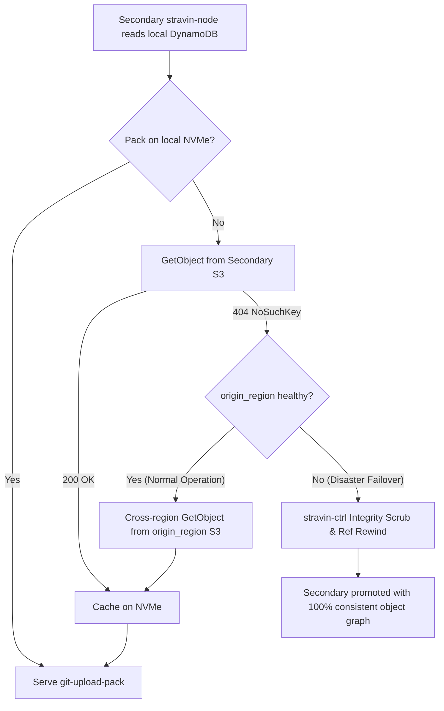

# Multi-Region HA & Consistency

Stravin Core delivers multi-region high availability with **zero home-region latency penalty** by pinning writes to a repository's `home_region` and replicating asynchronously via DynamoDB Global Tables (MREC) and S3 CRR + RTC. This document details how the system handles cross-service replication asymmetry, disaster failover, split-brain fencing, and CAP/PACELC trade-offs.

## The Metadata-Before-Blob Race Condition

Pairing DynamoDB Global Tables (MREC) with S3 Cross-Region Replication creates an inherent timing asymmetry:

- **DynamoDB MREC** typically replicates ref and manifest items in **under 1 second**.
- **S3 CRR + RTC** replicates packfiles in **seconds up to 15 minutes** (99.99% SLA).

A secondary-region `stravin-node` will frequently observe a newly replicated ref in local DynamoDB *before* its corresponding `.pack` file arrives in the secondary S3 bucket. Naive local-only reads would fail with missing-object or corrupt-repository errors.

### Two-Tier Defense

1. **Normal Operation (Transparent Origin Fallback):**
   - Every Pack Manifest item records `origin_region`.
   - When a secondary `stravin-node` receives `404 NoSuchKey` from local S3, it immediately issues a cross-region `GetObject` against `s3://git-objects-{origin_region}` (where the pack is guaranteed strongly consistent), caches it on local NVMe, and serves the fetch without error.
   - Over 99% of reads hit local NVMe or already-replicated local S3; only ultra-fresh cross-region reads pay a one-time cross-region S3 fetch.
   - **Data Loss:** None. The pack is durably persisted in `origin_region` S3 before the ref is committed to DynamoDB.
   - **Recovery:** Automatic via transparent origin fallback and local NVMe caching.
2. **Disaster Failover (Integrity Scrub on Promotion):**
   - If `origin_region` suffers a hard outage, cross-region fallback cannot retrieve packs that failed to replicate before the outage.
   - Before `stravin-ctrl` promotes the secondary region to accept writes, it executes a deterministic scrub:
     1. Increment `failover_epoch` and set `home_region = secondary_region` in DynamoDB `META`.
     2. Query all Pack Manifest items created in the last **20 minutes** (exceeding S3 RTC's 15-minute SLA window) and run parallel `HeadObject` checks against the secondary S3 bucket.
     3. For any missing pack, walk the `Ref History` log for affected refs and atomically rewind those specific refs to the most recent commit whose packs exist in secondary S3, recording every truncated OID in an incident audit trail.
   - The promoted repository is guaranteed **100% object-graph consistent** with zero dangling refs.
   - **Data Loss:** **Known (bounded RPO).** Pushes acknowledged in `home_region` whose DynamoDB updates (<1s lag) or S3 packfiles (seconds to 15m CRR+RTC lag) had not replicated before the outage are rewound on promotion.
   - **Recovery:** Clients re-push any rewound commits from local Git clones, or operators restore them from the old primary's preserved S3 packs as recovery branches (`refs/stravin-recovery/<ref>-<oid>`) once the old primary comes back online.

## Split-Brain Prevention on Old-Primary Recovery

When a failed primary region recovers, stale `stravin-node` instances may still hold an old cached `META` record and attempt to accept pushes. Under DynamoDB MREC's **Last-Writer-Wins (LWW)** conflict resolution, accepting writes in both regions would silently clobber commits accepted in the new primary.

Stravin Core prevents split-brain with three layered fences:

1. **Short-Lived Regional Write Leases:** `stravin-edge` and `stravin-node` enforce a strict regional write lease (e.g., 5-second heartbeat against the regional control plane plus `failover_epoch` validation). Any node whose lease expires immediately stops accepting pushes.
2. **Lease Fence Wait on Promotion:** `stravin-ctrl` waits out one full lease duration plus a clock-skew safety margin (e.g., 15 seconds) before enabling writes in the newly promoted secondary region.
3. **`DRAINING` / `READ-ONLY` Recovery Mode:** When the former primary comes back online, it boots in `DRAINING` / `READ-ONLY` mode until reconciled with the active `failover_epoch`. Any packfiles orphaned in the former primary's S3 bucket that never replicated prior to the outage are preserved for automated recovery branch creation rather than silently deleted.

- **Data Loss:** **None** when all three fences hold; **Known / Severe** if a stale primary accepts writes concurrently with the new primary (MREC LWW silently overwrites commits).
- **Recovery:** Reconcile `failover_epoch` in `DRAINING` mode before re-enabling traffic; surface any orphaned S3 packs as recovery branches for human or automated merge.

## Multi-Region Read & Network Split Edge Cases

Beyond normal replication lag and full regional failover, cross-region reads and partial network partitions introduce six edge cases that require explicit handling.

### 1. Network Split During Metadata-Before-Blob Lag (Broken Origin Fallback)

If DynamoDB MREC replicates a new ref right before a WAN partition—while S3 CRR has not yet delivered the corresponding `.pack` file—a secondary `stravin-node` gets `404 NoSuchKey` locally and its cross-region `GetObject` fallback to `origin_region` S3 fails or times out before failover is declared.

- **Data Loss:** **None.** The packfile remains durable in `origin_region` S3; this is a transient read-availability failure.
- **Recovery:** Return a retryable `503 Service Unavailable` (or optionally serve a read-only degraded view pinned to the latest locally-complete commit in `Ref History`) until the WAN heals or `stravin-ctrl` runs a full disaster failover scrub.

### 2. Read-Your-Own-Writes (RYOW) After Cross-Region Push

A developer or CI job in a secondary region runs `git push` (proxied by `stravin-edge` to `home_region`, which succeeds) and immediately runs `git fetch` or `git clone` locally. Because DynamoDB MREC is asynchronous (<1s), the local read in the secondary region can observe pre-push refs.

- **Data Loss:** **None.** The push is durably committed in `home_region`.
- **Recovery:** Retry after sub-second replication converges, or attach a short-lived RYOW watermark token (e.g., `min_ulid` / `home_region` sticky-read hint) so `stravin-edge` proxies immediate post-push reads to `home_region` until local DynamoDB catches up.

### 3. Multi-Ref & Cross-Shard Torn Reads Under DynamoDB MREC

`TransactWriteItems` is atomic within `home_region`, but DynamoDB Global Tables MREC replicates **item-by-item**, not as a cross-item transaction. A secondary reader can observe:

- An updated `REF#<name>` whose corresponding `PACK#<ulid>#<pack_id>` manifest item has not yet replicated.
- A partial view of an atomic multi-ref push (e.g., `REF#a` updated while `REF#b` still shows its prior OID).

- **Data Loss:** **None.** Only a transient cross-item read inconsistency occurs.
- **Recovery:** When a ref's `pack_id` is missing from local manifest shards, `stravin-node` resolves the deterministic S3 key directly from `pack_id` and `origin_region` (both stored on the `REF` item) or retries briefly. Workflows requiring strict multi-ref atomic snapshots route reads to `home_region`.

### 4. Long Network Split Overlapping Compaction & Delayed GC

In `home_region`, `stravin-pack` runs two-phase compaction (Publish compacted pack, then Supersede small packs) and deletes superseded S3 objects after a 24-hour grace window. If a WAN split or S3 CRR stall outlasts that window—or if the `COMPACTED` manifest update replicates before the new compacted pack finishes S3 CRR—secondary readers can hit `404` on the compacted pack while the superseded small packs have already been deleted in `origin_region`, breaking origin fallback.

- **Data Loss:** **Likely / Known if unmitigated.** If S3 CRR delete-marker replication were enabled, or if a regional outage occurs after `home_region` GC deletes superseded packs while CRR for the compacted pack is still stalled, the secondary region loses the ability to materialize affected refs.
- **Recovery:** Never enable S3 CRR delete-marker replication. Gate `stravin-pack` GC deletion on **S3 replication completion (`ReplicationStatus == COMPLETED`)** of the replacement compacted pack (plus a replication-lag circuit breaker) rather than a fixed wall-clock timer. If triggered prior to gating, re-replicate or re-compact from surviving packs in `home_region` S3.

### 5. Asymmetric Network Split & False Failover

During an asymmetric WAN partition, Region B's health probes cannot reach Region A even though Region A is still healthy and accepting pushes from clients. If `stravin-ctrl` in Region B promotes Region B based solely on local probe failure, both regions become active writers simultaneously.

- **Data Loss:** **Known / Severe if unmitigated.** Concurrent writes to the same ref in both regions collide under DynamoDB MREC Last-Writer-Wins when the partition heals, silently overwriting commits from one region.
- **Recovery:** Never allow automatic promotion from a single region's perspective—require either **explicit operator approval** or an **independent third-region/global witness quorum** to issue a new `failover_epoch`. If a false failover occurs, immediately put both regions in `DRAINING` / `READ-ONLY` mode, audit `Ref History` across both regions, and recover overwritten commits from preserved S3 packfiles into `refs/stravin-recovery/<ref>-<oid>` branches.

### 6. S3 Origin-Fallback Thundering Herd During CRR Lag Spikes

If S3 CRR experiences a multi-minute lag spike on a hot repository (e.g., CI clone fan-out), many secondary `stravin-node` pods simultaneously receive `404 NoSuchKey` from local S3 and issue duplicate cross-region `GetObject` calls to `origin_region` S3 (per-node `singleflight` deduplicates only within one pod).

- **Data Loss:** **None.** Impact is limited to cross-region egress cost, latency spikes, and S3 request throttling.
- **Recovery:** Rely on rendezvous hashing to concentrate `(tenant_id, repo_id)` traffic onto a primary secondary `stravin-node`, add cross-region fallback rate limits / circuit breakers, and alert on S3 CRR replication lag.

## Data Loss & Recovery Matrix

| Scenario | Data Loss Risk | Why | Recovery Path |
| :--- | :--- | :--- | :--- |
| **Normal pack-lags-ref** | None | Pack durable in `origin_region` S3 before DynamoDB commit | Automatic cross-region `GetObject` fallback + NVMe cache |
| **Disaster failover (hard outage)** | Known (bounded RPO) | Unreplicated DynamoDB (<1s) or S3 CRR (up to 15m) data rewound | `stravin-ctrl` 20m scrub + ref rewind + recovery branches on old-primary return |
| **Old-primary recovery** | None (with fences); Severe if bypassed | MREC LWW clobbers concurrent writes | 5s lease + 15s fence wait + `DRAINING` boot + recovery branches |
| **Split during metadata-before-blob lag** | None | Pack safe in `origin_region`; fallback unreachable | Return `503` (or degraded local-history read) until WAN heals or failover runs |
| **Read-your-own-writes (remote push)** | None | Async MREC (<1s) lags proxied push | Short retry or RYOW watermark token proxying read to `home_region` |
| **Multi-ref / cross-shard torn read** | None | MREC replicates item-by-item, not transactionally | Direct S3 key lookup from `REF` item (`pack_id`, `origin_region`) or `home_region` read |
| **Long split overlapping compaction GC** | Likely / Known if unmitigated | Blind timer GC deletes superseded packs before CRR completes | Disable CRR delete-marker replication; gate GC on `ReplicationStatus == COMPLETED` |
| **Asymmetric split / false failover** | Known / Severe if unmitigated | Dual active writers trigger MREC LWW silent commit loss | Require operator gate or third-region witness quorum; recover from preserved S3 packs |
| **CRR lag spike fallback storm** | None | Concurrent cross-region `GetObject` fan-out across pods | Rendezvous hash affinity, fallback rate-limiting, CRR lag alerting |

## CAP & PACELC Theorem Analysis

A single "CP" or "AP" label oversimplifies a multi-region Git host because consistency guarantees differ by **scope** (intra-region vs. cross-region) and **operation** (reads vs. writes). Evaluating both **CAP** (behavior under network partition `P`) and **PACELC** (latency `L` vs. consistency `C` during normal operation `E`) clarifies each design decision:

| Scope & Condition | Classification | Concrete Behavior in Stravin Core | Rationale |
| :--- | :--- | :--- | :--- |
| **Intra-Region (Home Region)** | **CP** (PACELC: **PC/EC**) | Strongly consistent S3 puts + linearizable DynamoDB per-ref CAS and `TransactWriteItems` across 3+ AZs | Git pushes require atomic compare-and-swap (`old_oid -> new_oid`). Losing intra-region linearizability breaks branch integrity and CI/agent workflows. |
| **Cross-Region Normal Operation (`E`)** | **EL** (Latency over Global Consistency) | Home-region writes commit locally without waiting for secondary DynamoDB or S3. Remote readers observe bounded staleness (<1s via DynamoDB MREC + S3 origin fallback) | Enforces the core constraint: zero home-region latency penalty for replication durability. Choosing `EC` (DynamoDB MRSC + sync S3 dual-write) adds 40–150 ms RTT per push and disables DynamoDB transactions. |
| **Cross-Region Partition (`P`) — Reads** | **AP** | Both regions continue serving `git clone` and `git fetch` from local DynamoDB and local S3 (secondary serves slightly stale refs) | Git objects are immutable and content-addressed; serving a slightly older commit graph during a WAN partition is safe and keeps developer/CI reads available. |
| **Cross-Region Partition (`P`) — Writes (Default)** | **CP** | Only `home_region` accepts pushes. Partitioned remote regions cannot proxy writes to `home_region` and **fail closed** (reject pushes) | **Why active-active AP fails for Git:** DynamoDB MREC resolves concurrent cross-region writes to the same ref with silent Last-Writer-Wins. Concurrent pushes to `main` from two regions would overwrite each other's CAS blindly, causing silent commit loss equivalent to an unintended `--force` push. |
| **Cross-Region Partition (`P`) — Regional Disaster Failover** | **Operator/Policy-Gated AP** | After a confirmed outage exceeding the lease fence, `stravin-ctrl` promotes the secondary region to `home_region` and scrubs dangling refs | Explicitly trades bounded `C` (non-zero RPO covering sub-second DynamoDB lag or seconds-scale S3 CRR lag) to restore write availability `A` during a prolonged regional outage. |

### Key Trade-Off Summary

By separating object durability (S3) from reference linearization (DynamoDB) and combining home-region write pinning with asynchronous replication, Stravin isolates strong consistency strictly to where Git semantics require it (per-ref CAS in the home region) while scaling reads linearly across stateless Go replicas worldwide. The unavoidable consequence of refusing synchronous cross-region replication is a bounded non-zero RPO during an ungraceful regional loss—which `stravin-ctrl`'s ref-history scrubber turns from silent repository corruption into a clean, auditable recovery boundary.

## Related Documents

- [Storage Layer: S3 & DynamoDB](storage.md) — S3 CRR + RTC and DynamoDB MREC configuration.
- [System Topology & Request Flows](topology.md) — `stravin-ctrl` and `stravin-edge` write-proxy routing.
- [Zero-Downtime Deployment](../operations/deployment.md) — Multi-region rollout progression and standby-first `stravin-ctrl` upgrades.
