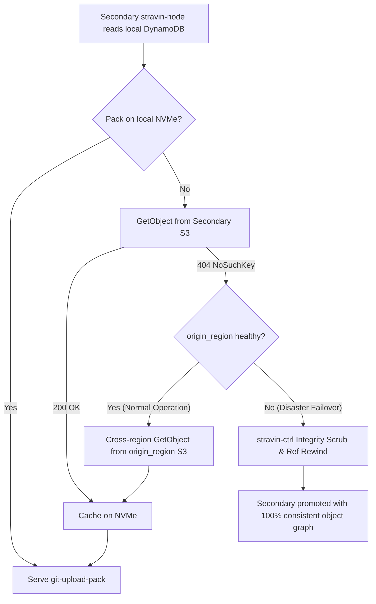

# Multi-Region HA & Consistency

Stravin Core delivers multi-region high availability with **zero home-region latency penalty** by pinning writes to a repository's `home_region` and replicating asynchronously via DynamoDB Global Tables (MREC) and S3 CRR + RTC. This document details how the system handles cross-service replication asymmetry, disaster failover, split-brain fencing, and CAP/PACELC trade-offs.

## The Metadata-Before-Blob Race Condition

Pairing DynamoDB Global Tables (MREC) with S3 Cross-Region Replication creates an inherent timing asymmetry:

- **DynamoDB MREC** typically replicates ref and manifest items in **under 1 second**.
- **S3 CRR + RTC** replicates packfiles in **seconds up to 15 minutes** (99.99% SLA).

A secondary-region `stravin-node` will frequently observe a newly replicated ref in local DynamoDB *before* its corresponding `.pack` file arrives in the secondary S3 bucket. Naive local-only reads would fail with missing-object or corrupt-repository errors.

### Two-Tier Defense

1. **Normal Operation (Transparent Origin Fallback):**
   - Every Pack Manifest item records `origin_region`.
   - When a secondary `stravin-node` receives `404 NoSuchKey` from local S3, it immediately issues a cross-region `GetObject` against `s3://git-objects-{origin_region}` (where the pack is guaranteed strongly consistent), caches it on local NVMe, and serves the fetch without error.
   - Over 99% of reads hit local NVMe or already-replicated local S3; only ultra-fresh cross-region reads pay a one-time cross-region S3 fetch.
2. **Disaster Failover (Integrity Scrub on Promotion):**
   - If `origin_region` suffers a hard outage, cross-region fallback cannot retrieve packs that failed to replicate before the outage.
   - Before `stravin-ctrl` promotes the secondary region to accept writes, it executes a deterministic scrub:
     1. Increment `failover_epoch` and set `home_region = secondary_region` in DynamoDB `META`.
     2. Query all Pack Manifest items created in the last **20 minutes** (exceeding S3 RTC's 15-minute SLA window) and run parallel `HeadObject` checks against the secondary S3 bucket.
     3. For any missing pack, walk the `Ref History` log for affected refs and atomically rewind those specific refs to the most recent commit whose packs exist in secondary S3, recording every truncated OID in an incident audit trail.
   - The promoted repository is guaranteed **100% object-graph consistent** with zero dangling refs.

## Split-Brain Prevention on Old-Primary Recovery

When a failed primary region recovers, stale `stravin-node` instances may still hold an old cached `META` record and attempt to accept pushes. Under DynamoDB MREC's **Last-Writer-Wins (LWW)** conflict resolution, accepting writes in both regions would silently clobber commits accepted in the new primary.

Stravin Core prevents split-brain with three layered fences:

1. **Short-Lived Regional Write Leases:** `stravin-edge` and `stravin-node` enforce a strict regional write lease (e.g., 5-second heartbeat against the regional control plane plus `failover_epoch` validation). Any node whose lease expires immediately stops accepting pushes.
2. **Lease Fence Wait on Promotion:** `stravin-ctrl` waits out one full lease duration plus a clock-skew safety margin (e.g., 15 seconds) before enabling writes in the newly promoted secondary region.
3. **`DRAINING` / `READ-ONLY` Recovery Mode:** When the former primary comes back online, it boots in `DRAINING` / `READ-ONLY` mode until reconciled with the active `failover_epoch`. Any packfiles orphaned in the former primary's S3 bucket that never replicated prior to the outage are preserved for automated recovery branch creation rather than silently deleted.

## CAP & PACELC Theorem Analysis

A single "CP" or "AP" label oversimplifies a multi-region Git host because consistency guarantees differ by **scope** (intra-region vs. cross-region) and **operation** (reads vs. writes). Evaluating both **CAP** (behavior under network partition `P`) and **PACELC** (latency `L` vs. consistency `C` during normal operation `E`) clarifies each design decision:

| Scope & Condition | Classification | Concrete Behavior in Stravin Core | Rationale |
| :--- | :--- | :--- | :--- |
| **Intra-Region (Home Region)** | **CP** (PACELC: **PC/EC**) | Strongly consistent S3 puts + linearizable DynamoDB per-ref CAS and `TransactWriteItems` across 3+ AZs | Git pushes require atomic compare-and-swap (`old_oid -> new_oid`). Losing intra-region linearizability breaks branch integrity and CI/agent workflows. |
| **Cross-Region Normal Operation (`E`)** | **EL** (Latency over Global Consistency) | Home-region writes commit locally without waiting for secondary DynamoDB or S3. Remote readers observe bounded staleness (<1s via DynamoDB MREC + S3 origin fallback) | Enforces the core constraint: zero home-region latency penalty for replication durability. Choosing `EC` (DynamoDB MRSC + sync S3 dual-write) adds 40–150 ms RTT per push and disables DynamoDB transactions. |
| **Cross-Region Partition (`P`) — Reads** | **AP** | Both regions continue serving `git clone` and `git fetch` from local DynamoDB and local S3 (secondary serves slightly stale refs) | Git objects are immutable and content-addressed; serving a slightly older commit graph during a WAN partition is safe and keeps developer/CI reads available. |
| **Cross-Region Partition (`P`) — Writes (Default)** | **CP** | Only `home_region` accepts pushes. Partitioned remote regions cannot proxy writes to `home_region` and **fail closed** (reject pushes) | **Why active-active AP fails for Git:** DynamoDB MREC resolves concurrent cross-region writes to the same ref with silent Last-Writer-Wins. Concurrent pushes to `main` from two regions would overwrite each other's CAS blindly, causing silent commit loss equivalent to an unintended `--force` push. |
| **Cross-Region Partition (`P`) — Regional Disaster Failover** | **Operator/Policy-Gated AP** | After a confirmed outage exceeding the lease fence, `stravin-ctrl` promotes the secondary region to `home_region` and scrubs dangling refs | Explicitly trades bounded `C` (non-zero RPO covering sub-second DynamoDB lag or seconds-scale S3 CRR lag) to restore write availability `A` during a prolonged regional outage. |

### Key Trade-Off Summary

By separating object durability (S3) from reference linearization (DynamoDB) and combining home-region write pinning with asynchronous replication, Stravin isolates strong consistency strictly to where Git semantics require it (per-ref CAS in the home region) while scaling reads linearly across stateless Go replicas worldwide. The unavoidable consequence of refusing synchronous cross-region replication is a bounded non-zero RPO during an ungraceful regional loss—which `stravin-ctrl`'s ref-history scrubber turns from silent repository corruption into a clean, auditable recovery boundary.

## Related Documents

- [Storage Layer: S3 & DynamoDB](storage.md) — S3 CRR + RTC and DynamoDB MREC configuration.
- [System Topology & Request Flows](topology.md) — `stravin-ctrl` and `stravin-edge` write-proxy routing.
