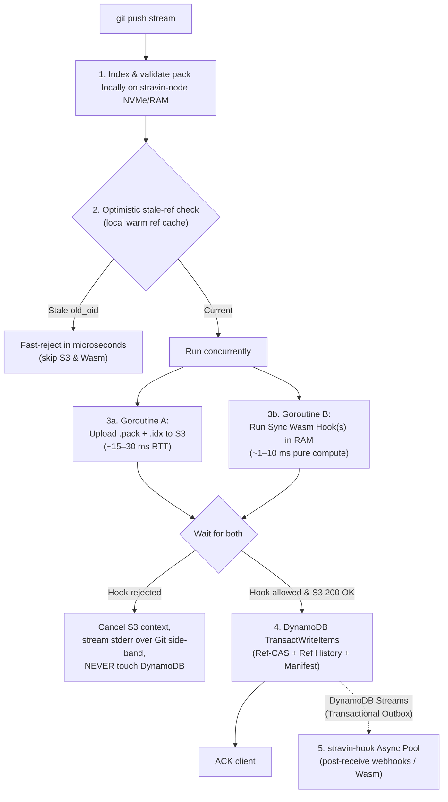

# Server-Side Hooks

Stravin Core supports language-agnostic, sandboxed server-side hooks without sacrificing multi-thousand-push/sec throughput by combining **WebAssembly (`wazero`)** with a **strict synchronous/asynchronous tier split**.

In traditional Git servers (Gitaly, Gitolite, bare Git), a slow `pre-receive` hook holds filesystem ref locks or stalls concurrent pushes on the storage host. Because Stravin Core acquires **no locks before the final DynamoDB `TransactWriteItems`**, a synchronous hook running on `branch-a` never blocks a concurrent push to `branch-b`, and nearly all hook execution latency is hidden inside the S3 upload window.

## Three-Tier Hook Architecture

Hooks are divided strictly by whether they must reject a push before persistence and whether they require external I/O:

| Tier | Git Equivalent | Execution Model | Capabilities Allowed | Latency Impact on `git push` | Use Cases |
| :--- | :--- | :--- | :--- | :--- | :--- |
| **Tier 1: Hermetic Gate** | `pre-receive` / `update` | **Synchronous** Wasm on `stravin-node` (concurrent with S3 `PutObject`) | Pure CPU + read-only Git object host calls; **zero network, zero disk** | **~0 ms net** (overlapped with S3 upload; capped at 50–100 ms) | Secret scanning, commit lint, max file size, path/branch rules, GPG/SSH signature checks |
| **Tier 2: Reactive Hook** | `post-receive` | **Asynchronous** worker pool (`stravin-hook`) via DynamoDB Streams | Outbound HTTP, external APIs, heavy compute, cross-repo queries | **0 ms** (decoupled via transactional outbox) | Webhooks, CI triggers, issue/chat sync, search indexing, audit pipelines |
| **Tier 3: Heavy Blocking** | Merge checks | **Async + Gated Merge** in **Stravin Gate** | Arbitrary CI builds, LLM review, external approvals | **0 ms** on feature branch pushes; enforced at merge time | Unit tests, builds, external policy APIs blocking `main` |

## Concurrent S3 Upload & Wasm Overlap Flow

Rather than running `pre-receive` hooks serially before or after S3 persistence, `stravin-node` overlaps Wasm execution with the S3 pack upload:

Three properties preserve write throughput at scale:

1. **Zero net latency for fast hooks:** S3 `PutObject` typically takes 15–30 ms, whereas a compiled Wasm hook checking commit messages, file sizes, or regex secret patterns finishes in 1–10 ms—completing before S3 returns HTTP `200 OK`.
2. **Safe cancellation on reject:** If a hook rejects, `stravin-node` cancels the S3 upload context and skips DynamoDB entirely. Even if the S3 upload already completed, no manifest or ref points to the pack, leaving the repository clean while S3 lifecycle rules or `stravin-pack` GC reap the unreferenced object.
3. **Zero wasted work on stale pushes:** Checking `old_oid` against the warm in-memory ref cache rejects stale non-fast-forward pushes in microseconds before starting S3 uploads or Wasm execution.

## Wasm Runtime, Storage & Host ABI

### Runtime & Binary Storage

- **Pure-Go `wazero` runtime:** Embeds directly into `stravin-node` with zero `cgo`, caches compiled modules in RAM, instantiates sandboxes in ~50–200 µs, and enforces strict capability-based isolation (no filesystem or network access by default).
- **Content-addressed S3 storage:** Hook `.wasm` binaries are **never** loaded from files committed inside the Git repository (which would let any committer disable guardrails). Instead, binaries are stored at `s3://git-objects-{region}/hooks/{wasm_sha256}.wasm` and replicated across regions automatically via S3 CRR.
- **DynamoDB pipeline configuration:** Active hooks are stored under `PK: T#{tenant_id}#REPO#{repo_id}, SK: HOOKS` (with optional org-level inheritance under `ORG#{org_id}`) as an ordered list of `{hook_id, wasm_sha256, ref_glob, timeout_ms, memory_limit_mb, fail_mode}`.
- **Pre-compiled LRU cache:** `stravin-node` caches `wazero.CompiledModule` instances keyed by `wasm_sha256`, compiling each module version once per node.

### Read-Only `HookHostABI`

Inside WebAssembly, hooks cannot fork `git rev-list`, `git diff-tree`, or `git cat-file`, and copying an entire packfile into Wasm linear memory wastes RAM. `stravin-node` (`internal/hooks/wasm/abi.go`) exposes a minimal, budgeted host-function ABI under the `"stravin"` Wasm host module directly over the newly indexed packfile and warm repo cache. Both **v1** (fixed 20-byte SHA-1 OID pointers) and **v2** (length-prefixed raw or hex OIDs supporting dual-hash SHA-1 and SHA-256 repositories) exports are registered:

| Wasm Export (`"stravin"` module) | Hash Support | Description |
| :--- | :--- | :--- |
| `get_push_context` | SHA-1 & SHA-256 | Writes JSON `PushContext` (`actor_id`, `tenant_id`, `repo_id`, `object_format`, and `[]RefUpdate{ref, old_oid, new_oid}`) into guest memory. |
| `list_new_commits` / `list_new_commits_v2` | v1: SHA-1 / v2: SHA-1 & SHA-256 | Fast header-only commit inspection via commit-graph + newly indexed pack, bounded by `MaxCommitsWalked`. |
| `diff_tree` / `diff_tree_v2` | v1: SHA-1 / v2: SHA-1 & SHA-256 | Changed file paths, modes, and blob sizes without loading blob contents. |
| `read_blob_chunk` / `read_blob_chunk_v2` | v1: SHA-1 / v2: SHA-1 & SHA-256 | Bounded chunked blob reader so secret scanners cannot exhaust Wasm linear memory or `MaxBlobBytesRead`. |
| `set_verdict` | SHA-1 & SHA-256 | Emits structured `HookVerdict` (`ALLOW` or `REJECT`, optional per-ref verdicts, and user-facing stderr message). |

Unifying Git's `pre-receive` and `update` semantics into a single Wasm invocation that returns either a global decision or per-ref verdicts avoids invoking the runtime `N` times on multi-branch pushes.

## Async Hooks: Transactional Outbox via DynamoDB Streams

Because every accepted push already writes a `Ref History` item inside the atomic DynamoDB `TransactWriteItems` call, enabling **DynamoDB Streams** (`NEW_IMAGE`) provides a built-in **transactional outbox** with zero extra write-path overhead:

- An accepted push is guaranteed to emit its `post-receive` event, and a rejected push can never fire a webhook.
- **`stravin-hook`** (`internal/hooks/async/`) polls DynamoDB Streams, persists per-shard sequence cursors in DynamoDB (`PK: STREAMS#CHECKPOINT, SK: SHARD#{shard_id}`), loads repository webhook rules from `SK: WEBHOOKS`, decrypts per-webhook signing secrets via KMS (`crypto.EnvelopeCipher`), and executes a GoF Chain-of-Responsibility delivery pipeline (`Tracing -> Retry/DLQ -> Safe HTTP Sender`).
- **Signed Webhook Headers:** Every outbound HTTP `POST` carries `X-Stravin-Event` (e.g., `push`) and `X-Stravin-Signature-256` (HMAC-SHA256 hex digest of the JSON `WebhookPayload`). Private/loopback destinations are blocked by default unless `STRAVIN_WEBHOOK_ALLOW_PRIVATE_NETWORKS=true` (used in local dev).
- **Retries & Dead-Letter Queue (DLQ):** Transient delivery failures retry with exponential backoff (defaults: `3` attempts, `100ms` initial backoff, `5s` max backoff, `10s` HTTP timeout). Exhausted deliveries are recorded to the configured `DLQSink` (structured logging DLQ by default locally; durable external DLQ queue is **TBD / Planned** for production) without blocking the stream consumer.
- Checks requiring external network I/O *and* merge blocking (CI tests, external security scanners, human approvals) belong in **Stravin Gate** (**TBD / Planned**), keeping Stravin Core fast and deterministic.

## Resource Guardrails & Isolation Policy

To ensure buggy or adversarial hooks cannot degrade `stravin-node`:

- **Hard resource caps (`internal/hooks/wasm/types.go`):** Enforces per-invocation linear memory limits (`MaxMemoryLimitMB = 64`), strict wall-clock timeouts via `wazero.NewRuntimeConfig().WithCloseOnContextDone(true)` (`DefaultTimeoutMS = 50`, `MaxTimeoutMS = 250`), and host-call budgets (`DefaultMaxCommitsWalked = 1000`, `DefaultMaxBlobBytesRead = 10 MiB`, `DefaultMaxHostCalls = 1024`).
- **Dedicated bulkhead pool (`internal/hooks/wasm/bulkhead.go`):** Runs Wasm hooks behind a bounded worker semaphore on `stravin-node` so a burst of hook-heavy pushes on one repository cannot starve `git-upload-pack` reads or pack uploads for other repositories on the same host.
- **In-process vs. sidecar boundary:** `stravin-dev/core` currently executes `wazero` in-process inside `stravin-node` (well suited for self-hosted enterprise and trusted org-admin hooks). Moving untrusted multi-tenant SaaS Wasm execution into an out-of-process Unix-socket sidecar (`stravin-hook-exec` with cgroup v2 and seccomp) while preserving the exact `HookHostABI` contract is **TBD / Planned**.
- **Fail-open vs. fail-closed policy:** Security hooks (secret scanning, signature verification) configure `fail_mode: closed` to reject pushes on timeout or OOM; advisory lint hooks configure `fail_mode: open` to emit a warning over Git's side-band stream without blocking the push.

## Related Documents

- [System Topology & Request Flows](topology.md) — Full write path and `stravin-node` architecture.
- [Storage Layer: S3 & DynamoDB](storage.md) — `HOOKS` metadata item and S3 binary layout.
- [Sandboxed Execution & Multi-Tenancy](isolation-multitenancy.md) — Isolation boundaries for multi-tenant deployments.
