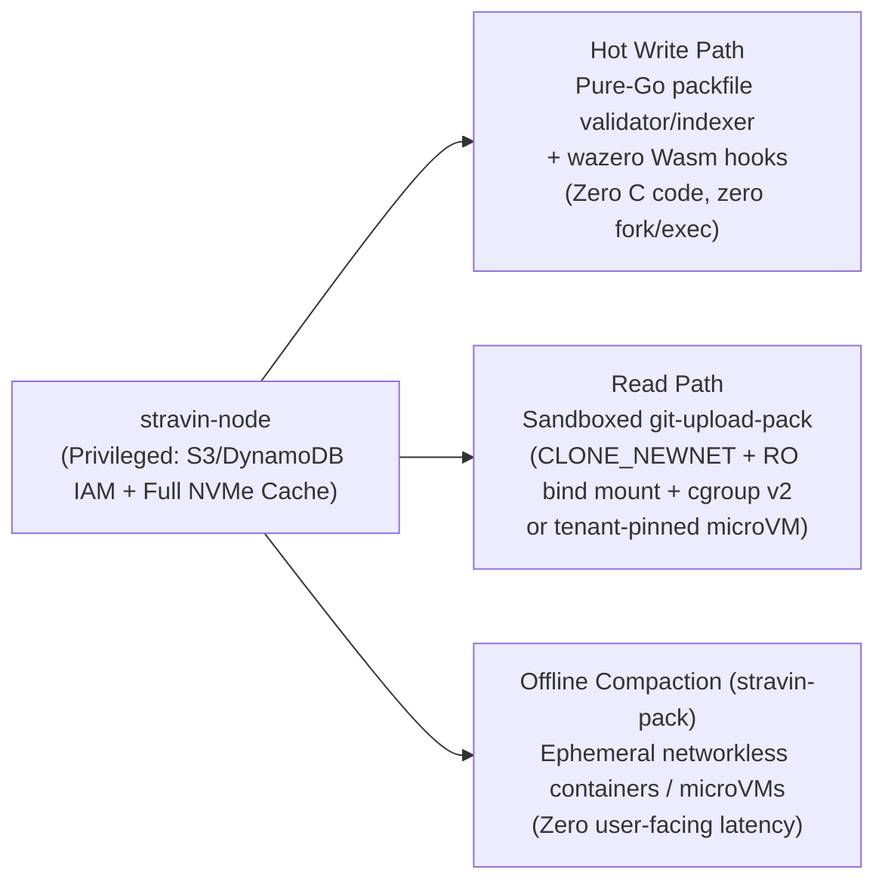

# Sandboxed Execution & Multi-Tenancy

`git` is a large C codebase parsing untrusted binary packfiles, while `stravin-node` holds AWS IAM credentials, DynamoDB access, and every tenant's cached repositories. Running `git` in the same privilege context as `stravin-node` means a single memory-corruption CVE or crafted packfile delta bomb compromises the entire host.

!!! info "Implementation Status (`internal/gitexec/`)"
    **Implemented today (`v1.12.x`):** `internal/gitexec/` implements the pluggable `GitExecutor` (`SubprocessExecutor`), Git config attack-surface lockdown (`GIT_CONFIG_NOSYSTEM=1`, `GIT_CONFIG_GLOBAL=/dev/null`, `core.hooksPath=/dev/null`, `core.fsmonitor=false`), Linux namespace + `cgroup v2` sandboxing (`DefaultMemoryMaxBytes = 512 MiB`, `DefaultCPUQuota = "200000 100000"`, `DefaultPidsMax = 64`, `DefaultTimeout = 5m`), and **automatic graceful fallback** when running inside unprivileged local Docker containers or non-Linux hosts (`FallbackSandboxConfigurator`).

    **TBD / Planned (Production — tracked in `stravin-dev/core#71`):** Strict fail-closed sandbox enforcement (`STRAVIN_GITEXEC_REQUIRE_SANDBOX`), production Kubernetes security contexts, tenant-pinned microVMs (Firecracker / Cloud Hypervisor / gVisor), and out-of-process `stravin-hook-exec` sidecars.

Designing Stravin Core for multi-tenancy from day one incurs only a **minor performance delta (~5–20% compute/memory overhead and 1–5 ms latency)** when structured around tenant-boundary isolation and four zero-cost architectural seams—avoiding the orders-of-magnitude penalties of naive per-request VM churn.

## Comparing Sandboxed `git` Execution Models

| Sandbox Architecture | Latency Overhead | Multi-Tenant Safety | Resource / DoS Protection | Best Fit for Stravin |
| :--- | :--- | :--- | :--- | :--- |
| **1. Direct Linux Sandbox** (`cgroup v2` + namespaces + `seccomp` spawned by Go) | **~1–3 ms** | Strong OS isolation (separate mount, PID, net, user NS per command) | Exact per-repo CPU/RAM/PID caps (`cgroup v2`) | **Default for Stravin Core** (high throughput, zero daemon overhead) |
| **2. Pre-Warmed Single-Use Sandbox Pool** (blank containers or microVMs claimed once, recycled async) | **~2–10 ms** (claim time; teardown off hot path) | Strongest (no cross-tenant memory persistence; separate kernel if microVM) | Full VM/container ceiling; OOM kills only the worker | **Public multi-tenant SaaS** running hostile untrusted traffic |
| **3. Tenant-Pinned Warm Sandbox** (one long-lived OS jail or microVM per active org) | **<1 ms** (Unix socket / vsock RPC) | Safe *between* orgs; shared *within* an org | Per-org cgroup or VM ceiling | **Multi-tenant & enterprise SaaS** with high-throughput orgs |
| **4. Shared Warm Container Pool** (reused across all repos/orgs) | **<1 ms** | **Weak** (cross-tenant memory persistence if `git` is exploited) | Shared noisy-neighbor risk unless sub-cgrouped | **Single-tenant self-hosted** deployments only |

Using `docker exec` or `containerd` per request adds 20–100 ms of daemon contention and breaks multi-thousand-push/sec ceilings, while sharing warm containers across tenants breaks isolation.

## Direct Linux Sandbox Primitives

A Linux container is a wrapper around namespaces, `pivot_root`, `cgroup v2`, and `seccomp-bpf`. `stravin-node` achieves deterministic isolation directly via Go's `os/exec` `SysProcAttr` (or a minimal static `stravin-jail` wrapper binary) with zero container-daemon overhead:

1. **Zero network, zero AWS access:** Spawn `git` in an empty network namespace (`CLONE_NEWNET`). The process has no outbound internet, no VPC access, and **cannot reach EC2 IMDS (`169.254.169.254`)** or ECS task metadata endpoints to steal `stravin-node`'s IAM role.
2. **Repo-scoped filesystem view:** In a private mount namespace (`CLONE_NEWNS`), bind-mount *only* the target materialized repository directory (`/nvme/t/{tenant_id}/{repo_id}`):
    - **Read-only (`MS_RDONLY`)** for `git-upload-pack` (`fetch` / `clone`).
    - **Read-only repo + writable ephemeral staging directory** for `git index-pack` (when C `git` is used on the write path), preventing corruption of cached packs or sibling repositories.
3. **Hard `cgroup v2` blast-radius caps:** Place each execution inside a per-repo or per-org `cgroup v2` slice enforcing `memory.max` (default `512 MiB`), `cpu.max` (default `200000 100000`), and `pids.max` (default `64`). Packfile delta bombs and massive graph walks are far more frequent outage vectors than RCEs; `cgroup v2` ensures a pathological fetch OOM-kills only its own `git` process. In unprivileged local Docker containers without namespace/cgroup capabilities, `SubprocessExecutor` logs a one-time warning and falls back to config-locked subprocess execution; production deployments will enforce fail-closed isolation (`STRAVIN_GITEXEC_REQUIRE_SANDBOX`, **TBD / Planned**, `stravin-dev/core#71`).
4. **Git config attack-surface lockdown:** Always invoke `git` with environment and flag overrides so repository config cannot execute auxiliary binaries:

```bash
GIT_CONFIG_NOSYSTEM=1 \
GIT_CONFIG_GLOBAL=/dev/null \
git -c core.hooksPath=/dev/null \
    -c core.fsmonitor=false \
    -c 'core.alternateRefsCommand=exit 0' \
    upload-pack ...
```

### When Pre-Warmed MicroVMs Pay Off

Two workloads justify going beyond Linux namespaces to **Firecracker / Cloud Hypervisor** microVMs or **gVisor**:

- **Hostile public multi-tenant SaaS (kernel-escape threat model):** Separate guest kernels prevent a kernel exploit from crossing tenant boundaries.
- **Offline `stravin-pack` compaction:** Tier-1 repacking (`git repack`, `.midx`, `commit-graph`) is CPU/RAM-intensive, parses untrusted object graphs, and runs completely off the critical push latency path—making ephemeral networkless containers or microVMs free in user-facing latency.

## Layering with Pure-Go Writes & Wasm Hooks

Combining pure-Go packfile ingestion, Wasm hooks, and sandboxed C `git` shrinks the native-code attack surface to read-only operations and offline compaction:



## Multi-Tenancy Performance Delta by Layer

| Layer | Single-Tenant Baseline | Multi-Tenant Design | Performance Delta |
| :--- | :--- | :--- | :--- |
| **DynamoDB Schema & Ref-CAS** | `REPO#{id}#RS#{s}` | `T#{tenant}#REPO#{id}#RS#{s}` + per-tenant rate limiter | **~0% latency / 0 WCU overhead** (microsecond in-memory token bucket) |
| **S3 Object Plane** | `{pack_hash[0:2]}/{repo_id}/...` | `{pack_hash[0:2]}/{tenant_id}/{repo_id}/...` + cached envelope encryption | **~0% latency** (avoids per-pack KMS calls via cached DEKs or S3 Bucket Keys) |
| **Hot Write Path (`push`)** | In-process Go pack parser + in-process `wazero` | Pure-Go parser + local Unix-socket `wazero` sidecar (or strict memory-capped runtime) | **+0.5–2 ms IPC**; thousands of pushes/sec preserved |
| **Read Path (`git-upload-pack`)** | Unsandboxed subprocess on shared NVMe | Tenant-pinned warm sandbox (`cgroup v2` + namespaces, or Firecracker/Cloud Hypervisor over vsock) | **+1–5 ms RPC**, **~5–15% CPU/I/O overhead** (+ RAM floor per active org) |
| **NVMe Pack Cache** | Global LRU across all repos | Partitioned / weighted LRU with per-tenant byte quotas | **0% hit-path latency**; eliminates noisy-neighbor cache thrashing |
| **Compaction (`stravin-pack`)** | Shared host workers | Ephemeral networkless microVMs/containers + fair-share tenant queues | **0 ms user-facing impact**; ~10–15% higher background compute cost |

## Avoiding the Three Orders-of-Magnitude Traps

Multi-tenancy degrades performance by 10x–100x only when falling into three avoidable structural traps:

### 1. Per-Request MicroVM Churn (100x Trap)

- **Trap:** Booting a fresh Firecracker/Cloud Hypervisor microVM per push or fetch adds 100–150 ms cold start (or 5–20 ms from a snapshot) plus teardown and virtio-fs attach overhead, collapsing a 64-vCPU host from thousands of RPS to dozens.
- **Fix:** Isolate at the **tenant (organization) boundary**, not the request boundary. Maintain a warm sandbox (OS jail or microVM) pinned per *active* tenant on the `stravin-node` chosen by `hash(tenant_id, repo_id)`, communicate over vsock or a Unix socket, and hibernate/reap after an idle timeout (e.g., 5 minutes). An agent swarm firing 2,000 pushes/sec for Tenant A reuses its warm worker at **<1 ms** isolation overhead while keeping cross-tenant escape impossible.

### 2. Noisy-Neighbor Cache & Compaction Starvation (10x Tail-Latency Trap)

- **Trap:** Without cache quotas, one tenant cloning a 50 GB monorepo evicts hot packs belonging to hundreds of smaller tenants—turning sub-10 ms NVMe reads into S3 fetches across the fleet. Likewise, one tenant pushing 3,000 packs/sec can starve `stravin-pack` workers for everyone else.
- **Fix:** Enforce **per-tenant NVMe byte ceilings** (e.g., no single tenant may occupy more than 20% of a node's cache disk) and use **weighted fair queuing** in `stravin-pack` and `stravin-hook` (`stravin-relay` / `stravin-webhooks` in `vNext`) so heavy tenants trigger autoscaling of their own shard leases rather than delaying quiet tenants.

### 3. Per-Pack AWS KMS Calls (Latency & Quota Trap)

- **Trap:** Invoking a tenant's dedicated AWS KMS CMK on every S3 `PutObject`/`GetObject` adds 5–15 ms per pack and exhausts KMS regional request quotas (5,500–30,000 RPS) under agent bursts.
- **Fix:** Use **envelope encryption**: wrap a per-tenant Data Encryption Key (DEK) with the tenant's KMS CMK, cache the decrypted DEK in `stravin-node` RAM for a short TTL (e.g., 5 minutes), and encrypt/decrypt packfiles in Go with hardware-accelerated AES-256-GCM (AES-NI runs at multiple GB/sec per core—effectively zero latency overhead).

## Four Day-1 Zero-Cost Architectural Seams

Stravin Core does not need a Firecracker orchestrator or envelope encryption on commit one—only four zero-cost seams baked into the core interfaces so strict multi-tenancy drops in without a rewrite:

1. **Mandatory `TenantID` in every context and key:** Thread `TenantID` through every RPC, DynamoDB partition key (`T#{tenant_id}#...`), S3 prefix (`{pack_sha256[0:2]}/{tenant_id}/{repo_id}/...`), and NVMe cache path (`/nvme/t/{tenant_id}/{repo_id}`). Retrofitting tenant IDs later requires a full storage migration; including them from day one costs zero runtime overhead.
2. **Tenant-aware rendezvous hashing:** Route `stravin-edge` → `stravin-node` on `(tenant_id, repo_id)` (or `(tenant_id, repo_id, ref_shard)` for hot repos) so a tenant's warm cache and warm sandbox stay co-located.
3. **Pluggable `GitExecutor` interface in Go:** Abstract `git-upload-pack` behind a small Go interface (`ExecUploadPack(ctx, TenantRepo, stdin, stdout)`). Ship the **Linux namespaces + `cgroup v2` + read-only bind-mount** implementation first (~1–3 ms overhead, zero VM ops burden), then add a **tenant-pinned microVM (vsock)** implementation behind the same interface for untrusted public SaaS without touching `stravin-edge`, DynamoDB, or S3.
4. **Per-tenant ingress `Limiter` in `stravin-edge`:** Place a thin `Limiter` interface (RPS, concurrent clones, pack bytes/min) on ingress from day one—even starting as an in-memory pass-through—so fairness controls and billing tiers plug in cleanly later.

## Related Documents

- [System Topology & Request Flows](topology.md) — `stravin-edge` routing and `stravin-node` lifecycle.
- [Storage Layer: S3 & DynamoDB](storage.md) — Tenant-prefixed S3 keys and DynamoDB partition keys.
- [Server-Side Hooks](hooks.md) — Sidecar boundary and bulkhead isolation for untrusted Wasm hooks.
- [ADR-0001: Platform Transport, Events & Webhooks](../adr/0001-platform-transport-events-webhooks.md) & [ADR-0003: Platform Auth & SSO Seam](../adr/0003-platform-auth-and-sso-seam.md) — `vNext` **Cilium (eBPF)** workload identity + `CiliumNetworkPolicy` (never replacing mandatory app-level `tenant_id` AuthZ) and **`stravin-auth`** local JWKS + Valkey `jti` isolation.
