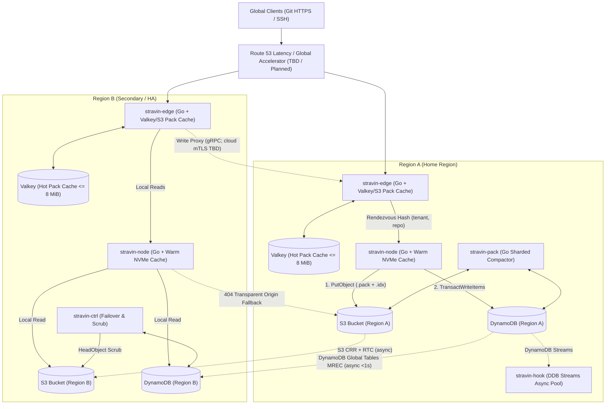

# System Topology & Request Flows

Stravin Core synthesizes patterns from GitHub's **Project Rubicon** and Cursor Origin's **Continuity** onto AWS managed primitives: stateless Go services backed by **Amazon S3** for immutable Git packfiles and **Amazon DynamoDB Global Tables (MREC)** for per-reference compare-and-swap (Ref-CAS) and pack manifests.

## Comparison to Prior Art

| Architectural Concern | GitHub Project Rubicon | Cursor Continuity | Stravin Core (AWS Go + S3 + DynamoDB) |
| :--- | :--- | :--- | :--- |
| **Durable Object Plane** | Packfiles and read-acceleration indexes in Azure Blob Storage | Packfile WAL entries stored as immutable objects in S3 | Content-addressed immutable `.pack`, `.idx`, `.midx`, and `commit-graph` objects in regional S3 buckets |
| **Reference & Manifest Coordination** | Dedicated replicated log service (**Ref-CAS**) with per-reference ordering | Single S3 manifest (`gitwal.pb`) updated via S3 conditional CAS (~120–300 pushes/sec ceiling) | DynamoDB per-ref CAS + `TransactWriteItems` (eliminates single-blob bottleneck and custom Raft/Paxos) |
| **Compute & Cache Model** | Disposable virtual replicas with rebuildable local caches | Stateless nodes using local NVMe as warm cache; rendezvous hashing for soft affinity | Stateless Go `stravin-node` fleet with local NVMe bare-repo caches and tenant-aware rendezvous hashing |
| **Compaction & GC** | Sharded out-of-band compaction workers; two-phase manifest swap | Background WAL compaction decoupled from request serving | Go `stravin-pack` workers claiming DynamoDB shard leases and running two-phase manifest swaps |
| **Multi-Region Durability** | Global replicas with bounded staleness | Single-region S3 / S3 Express One Zone WAL | Home-region write pinning + async DynamoDB MREC + S3 CRR with RTC (zero home-region RTT penalty) |

## Multi-Region System Topology

!!! note "Local Emulation vs. Production Cloud Primitives"
    In `stravin-dev/core` (`v1.12.x`), all five Go daemons, Valkey pack caching, and dual-region replication/failover run locally via Docker Compose + Floci. Production cloud ingress (**Route 53 latency routing / AWS Global Accelerator**) and **cloud mTLS service mesh** are **TBD / Planned (Production)**.

## Go Service Responsibilities

Keeping Git operations at the packfile layer—rather than reimplementing Git's entire object graph engine—preserves full compatibility with standard Git internals. The control and data planes split into **five Go daemons** plus the **`stravin-admin` CLI**:

1. **`stravin-edge` (Ingress, Pack Cache & Routing Proxy):**
    - Terminates SSH (`golang.org/x/crypto/ssh`) and Smart HTTP (`net/http`), enforces authentication, authorization, and per-tenant ingress rate limits (`STRAVIN_RATE_LIMIT_RPS`, `STRAVIN_MAX_CONCURRENT_CLONES`), and resolves each repository's `META` / `home_region` (cached in memory with a short TTL, default `1s`).
    - **Tiered Full-Clone Pack Response Cache (`internal/edge/pack_cache.go`):** Serves repeated full-clone Smart HTTP `upload-pack` responses strictly **after** authentication and authorization succeed. Uses **Valkey** (RESP2 hot tier, entries `<= 8 MiB`, `5m` default TTL, `allkeys-lfu` eviction) with **Floci/S3 spillover** (`pack-cache/v1/...`, entries `<= 64 MiB`) and in-process `singleflight` coalescing (`PackCacheCoordinator`) to prevent thundering herds.
    - **Reads:** Routes cache misses locally via **rendezvous hashing** (Highest Random Weight) over healthy `stravin-node` instances in the client's nearest region.
    - **Writes:** When `local_region == home_region`, routes via rendezvous hashing to the primary `stravin-node` for `(tenant_id, repo_id)` (or `(tenant_id, repo_id, ref_shard)` for hot repositories) to maximize warm cache hits and minimize CAS retries. When `local_region != home_region`, transparently tunnels the Git wire stream over gRPC to `stravin-edge` in `home_region` (production cloud mTLS mesh is **TBD / Planned**).
2. **`stravin-node` (Stateless Virtual Replica):**
    - Holds ephemeral NVMe disks storing materialized bare Git repositories strictly as disposable caches.
    - Serves **pure-Go Git Protocol v2 `ls-refs`** (`internal/node/ls_refs.go`) directly from cached DynamoDB ref state without forking `git-upload-pack` (for bounded stateless-RPC requests `<= 1 MiB`), falling back transparently to `git-upload-pack` for other commands.
    - Maintains a **versioned `META` cache** keyed by `RefVersion` and `ManifestVersion` so reads whose repository version has not advanced skip redundant DynamoDB shard scatter-gather queries.
    - Handles `git-receive-pack` (pure-Go pack streaming/indexing or sandboxed `git index-pack`) and concurrency-bounded, sandboxed `git-upload-pack`, intercepting ref advertisement and ref updates so **no local ref on disk is ever authoritative**.
    - Materializes missing repositories on demand (after node restart, autoscale, or failover) by reading the manifest from DynamoDB and pulling missing packs from S3.
    - Executes synchronous [Tier 1 WebAssembly hooks](hooks.md) overlapped with S3 pack uploads.
3. **`stravin-pack` (Out-of-Band Maintenance Workers):**
    - Runs in an isolated compute pool so repacking never steals CPU or memory from live read/write `stravin-node` instances.
    - Claims sharded compaction leases in DynamoDB, merges small incoming push packs in multi-batch Tier-0 passes into consolidated packs, builds multi-pack-index (`.midx`) and `commit-graph` acceleration files, and runs delayed garbage collection.
4. **`stravin-ctrl` (Failover & Integrity Controller):**
    - Maintains regional write leases, orchestrates `home_region` ownership transitions, increments `failover_epoch` fencing tokens, and runs post-failover S3 pack verification scrubs and ref rewinds via its authenticated HTTP admin API (`/v1/lease/*`, `/v1/epoch/advance`, `/v1/scrub`, `/v1/recovery/reconcile`).
5. **`stravin-hook` (Async Outbox & Webhook Worker Pool):**
    - Consumes DynamoDB Streams (`Ref History` `NEW_IMAGE` inserts), persists per-shard checkpoints in DynamoDB, decrypts webhook signing secrets via KMS, and delivers HMAC-SHA256-signed HTTP webhooks with exponential backoff and dead-letter queue (DLQ) recording off the `git push` path.
6. **`stravin-admin` CLI (`cmd/stravin-admin`):**
    - Operational CLI for repository provisioning (`repo`), Tier 1 Wasm hook registration (`hook`), and Tier 2 webhook management (`webhook`).

## Critical Request Flows

### Write Path (`git push` in Home Region)

1. `stravin-node` receives the pack stream over stdin, indexes and validates it locally on NVMe/RAM, and checks pushed `old_oid` values against its warm ref cache to fast-reject obviously stale pushes.
2. `stravin-node` concurrently uploads `{pack_id}.pack` and `{pack_id}.idx` to local S3 (awaiting HTTP 200 for regional strong read-after-write consistency) while running any configured synchronous [Tier 1 Wasm hooks](hooks.md).
3. `stravin-node` validates its cached regional write lease and `failover_epoch` for the repository (refreshed via lightweight background lease checks).
4. `stravin-node` submits a single DynamoDB `TransactWriteItems` call (atomic up to 100 items / 4 MB within the home region):
    - **Ref State:** `UpdateItem` per pushed ref with `ConditionExpression: oid = :old_oid` (or `attribute_not_exists(oid)` for new branches).
    - **Ref History:** Append a history record (enabling safe rollback during catastrophic regional failover and feeding DynamoDB Streams for async hooks).
    - **Pack Manifest:** `PutItem` for the new pack entry tagged with `origin_region = home_region`.
    - **Repo `META` Version Bump:** Conditionally updates `META` (`ADD ref_version :one, manifest_version :one` for pack pushes, or `ADD ref_version :one` for ref-only deletes) so `stravin-node` readers can validate their versioned `META` cache in a single `GetItem`. *(Moving version tracking off `META` to avoid a 500 tx/sec single-partition ceiling on ultra-hot monorepos is a planned production scaling optimization.)*
    - *Multi-ref push limit:* Because each pushed ref writes both a state and a history item, atomic pushes exceeding ~45 refs either disable cross-ref atomicity (matching default Git behavior) or spill to a temporary bundle pointer.
5. `stravin-node` updates its local warm NVMe bare repo refs and immediately ACKs the client. **Zero cross-region calls occur on the push path.**

### Read Path (`git fetch` / `git clone` in Any Region)

1. For Smart HTTP full-clone `upload-pack` requests, `stravin-edge` checks the **Tiered Full-Clone Pack Response Cache** (Valkey hot tier `<= 8 MiB`, S3 spillover `<= 64 MiB`, with `singleflight` coalescing) strictly **after** authentication and authorization. Cache hits stream directly from `stravin-edge` without invoking `stravin-node`.
2. On a cache miss (or incremental fetch / SSH), `stravin-edge` routes via rendezvous hashing to a local `stravin-node`. `stravin-node` checks the repository's `META` item (`RefVersion` / `ManifestVersion`); if its local versioned cache matches, it skips querying DynamoDB ref and manifest shards. Otherwise it queries local DynamoDB shards incrementally.
3. For Git Protocol v2 `ls-refs` requests (`<= 1 MiB`), `stravin-node` serves the ref advertisement directly in pure Go (`internal/node/ls_refs.go`) without spawning a `git` subprocess.
4. For `fetch` / `clone` pack generation, `stravin-node` concurrently fetches any missing `.pack` and `.idx` files from local S3 (falling back to `origin_region` on `404 NoSuchKey` per [HA & Consistency](ha-consistency.md)), links them into `objects/pack/`, and runs concurrency-bounded, sandboxed `git-upload-pack` against the read-only materialized NVMe repo.

### Two-Phase Sharded Compaction (Out-of-Band)

Following Project Rubicon's pattern, `stravin-pack` workers claim a manifest shard lease (`SHARD#{m}`), merge small packs in that shard on ephemeral NVMe inside an isolated container/microVM, and upload the consolidated pack and `.midx` to S3:

1. **Transaction 1 (Publish):** Add the new compacted pack(s) to the manifest so readers begin preferring them.
2. **Transaction 2 (Supersede):** Mark superseded small packs as `COMPACTED` and remove them from active manifest queries.
3. **Delayed GC:** A background sweeper deletes superseded S3 objects only after a grace window (e.g., 24 hours—safely beyond S3 RTC's 15-minute SLA and any long-running clone).

## Related Documents

- [Storage Layer: S3 & DynamoDB](storage.md) — Exact S3 key layout and DynamoDB table schema.
- [Multi-Region HA & Consistency](ha-consistency.md) — Replication asymmetry handling and failover protocol.
- [Performance & Throughput Scaling](performance.md) — Bottleneck math and LSM compaction tiers.
- [Sandboxed Execution & Multi-Tenancy](isolation-multitenancy.md) — Execution isolation for `stravin-node` and `stravin-pack`.
