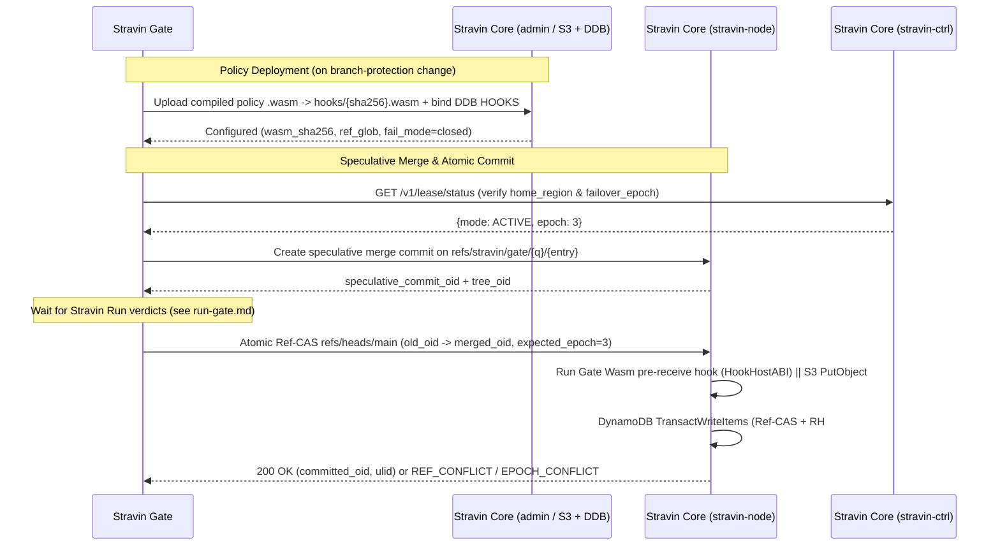

# Stravin Core <-> Stravin Gate

This specification defines the contract between **Stravin Core** (bare Git storage engine) and **Stravin Gate** (serialized merge queues, branch protection, policy checks, and agent guardrails).

## 1. Boundary & Ownership

| Concern | Source of Truth | Private Implementation Details (Never Crosses Boundary) |
| :--- | :--- | :--- |
| **Synchronous push enforcement (`wazero` Wasm runtime), atomic DynamoDB Ref-CAS, `failover_epoch` fencing** | **Stravin Core** | `wazero` module LRU cache, bulkhead semaphore, DynamoDB `TransactWriteItems` (<= 45 refs), `stravin-ctrl` lease state |
| **Branch protection policy definitions, compiled policy `.wasm` bundles, merge-queue state machine, speculative batch ordering** | **Stravin Gate** | Queue scheduler, speculative tree planner, policy compiler, approval/check rule engine |
| **Speculative merge refs (`refs/stravin/gate/{queue_id}/{entry_id}`)** | **Stravin Core** (storage) / **Stravin Gate** (lifecycle) | Core stores refs like any other Git ref; Gate creates, updates, and garbage-collects them |
| **Protected-ref writes (`refs/heads/main`, release branches)** | **Stravin Core** (enforces) / **Stravin Gate** (authorizes via principal/Wasm policy) | Direct user pushes are rejected by Gate's Tier 1 Wasm hook unless `actor_id` is the Gate merge principal or an authorized bypass |

## 2. Interaction Flow



## 3. Auth, Tenancy & Trust Boundary

- **Gate Merge Principal:** Gate authenticates to `stravin-edge` / `stravin-node` with a dedicated per-tenant service identity `actor_id = "svc:stravin-gate"` over TLS 1.3 mTLS + short-lived scoped token (`scopes: ["git:read", "git:write:gate-refs", "git:write:protected"]`).
- **Hermetic Wasm Boundary (Implemented in Core v1.12.x):** Gate compiles branch-protection rules (protected ref globs, allowed pusher `actor_id`s, linear-history / signed-commit / path-restriction checks) into a pure WebAssembly module uploaded via `admin.Service.ConfigureWasmHook`. Because `stravin-node` executes Tier 1 Wasm with **zero network and zero disk access**, Core enforces Gate's protection policy at line speed (~1–10 ms) without ever making a synchronous network RPC back to Gate during `git push`.
- **Fail-Closed Guarantee:** Gate MUST configure its protection Wasm hooks with `fail_mode: "closed"` (`ddb.FailModeClosed`) so a Wasm timeout (`50 ms` default / `250 ms` max) or memory cap (`16–64 MB`) rejects the push rather than bypassing branch protection.
- **Control-Plane Fencing (`stravin-ctrl`):** Gate queries `stravin-ctrl` using Bearer `AdminToken` (read-only `/v1/lease/status`) to observe regional `failover_epoch` and `write_state` (`ACTIVE` | `DRAINING` | `READ_ONLY`).

## 4. Synchronous Interfaces

### 4.1 Tier 1 Wasm Hook Deployment & `HookHostABI` — *Implemented in Core v1.12.x*

Gate deploys policy `.wasm` binaries via `internal/admin.Service.ConfigureWasmHook` (Go facade / `stravin-admin` CLI today; HTTP/gRPC Admin API in vNext), storing binaries at `s3://git-objects-{region}/hooks/{wasm_sha256}.wasm` and binding them under `PK=T#{tenant_id}#REPO#{repo_id}, SK=HOOKS` (with optional org-level inheritance at `T#{tenant_id}#ORG#{org_id}`).

Inside `wazero`, Gate's `.wasm` module imports the `"stravin"` host module (`internal/hooks/wasm/abi.go`):

- `get_push_context(outPtr, outCap) -> int32`: Returns JSON `wirePushContext` (`tenant_id`, `repo_id`, `org_id`, `actor_id`, `object_format`, `updates: [{ref, old_oid, new_oid}]`).
- `list_new_commits_v2(oldPtr, oldLen, newPtr, newLen, limit, outPtr, outCap) -> int32`: Dual-hash (40-hex SHA-1 or 64-hex SHA-256) commit walk (default cap 1,000 commits).
- `diff_tree_v2(oldTreePtr, oldTreeLen, newTreePtr, newTreeLen, limit, outPtr, outCap) -> int32`: Dual-hash tree diff (default cap 1,000 entries, max 10,000).
- `read_blob_chunk_v2(blobPtr, blobLen, offset, maxBytes, outPtr, outCap) -> int32`: Chunked blob read (default cap 10 MiB total).
- `set_verdict(decision, msgPtr, msgLen) -> int32`: Emits `0` (`ALLOW`), `1` (`REJECT`), or `2` (JSON `HookVerdict` with per-ref `ref_verdicts`).

### 4.2 Regional Lease & Fencing Inspection — *Implemented in Core v1.12.x*

`stravin-ctrl` (`internal/ctrl/http.go`) exposes:

- `GET /v1/lease/status` — Returns active regional lease mode (`ACTIVE`, `DRAINING`, `READ_ONLY`) and current `failover_epoch`. Gate pauses merge attempts immediately if `write_state != ACTIVE`.

### 4.3 Atomic Server-Side Merge & Ref-CAS API — *Proposed Core Extension (vNext)*

Today Gate can perform speculative merges and protected-branch pushes over Smart HTTP `git-receive-pack` (backed by Core's atomic Ref-CAS). To eliminate full clones in Gate workers and pass explicit `expected_epoch` fencing, Core vNext adds:

```protobuf
syntax = "proto3";
package stravin.core.v1;

service GateOps {
  rpc ComputeMergeTree(ComputeMergeTreeRequest) returns (ComputeMergeTreeResponse);
  rpc AtomicRefCAS(AtomicRefCASRequest) returns (AtomicRefCASResponse);
}

message ComputeMergeTreeRequest {
  string tenant_id = 1;
  string repo_id = 2;
  string base_oid = 3;         // current target branch or prior speculative commit
  repeated string head_oids = 4; // 1 for single PR, N for stacked-diff group
  string strategy = 5;         // "merge" | "squash" | "rebase"
  string target_ref = 6;       // e.g. "refs/stravin/gate/main/qe_01JDF..."
  string commit_message = 7;
  Signature author = 8;
  Signature committer = 9;
}

message ComputeMergeTreeResponse {
  bool conflict = 1;
  repeated string conflict_paths = 2;
  string merge_commit_oid = 3;
  string merge_tree_oid = 4;
}

message AtomicRefCASRequest {
  string tenant_id = 1;
  string repo_id = 2;
  uint64 expected_epoch = 3;   // must match repo META failover_epoch
  string idempotency_key = 4;
  repeated RefTransition updates = 5; // max 45 (ddb.MaxAtomicPushRefs)
}

message RefTransition {
  string ref_name = 1;
  string old_oid = 2;
  string new_oid = 3;
}
```

## 5. Asynchronous Events & Streams

### 5.1 Core -> Gate: Protected-Ref Drift Notifications

- **Implemented in Core v1.12.x:** `stravin-hook` emits signed `push` webhooks for protected branches (`refs/heads/main`, etc.).
- **Why Gate Subscribes:** If an authorized bypass push (e.g., break-glass admin push) or a `stravin-ctrl` failover rewind mutates `refs/heads/main` out-of-band, Gate receives `core.ref.updated` with `(ref, oid, prev_oid, epoch)`, immediately invalidates in-flight speculative queue entries built on the stale base, and rebuilds the speculative chain from the new `oid`.

## 6. Shared Data Contracts & Identifiers

- **Speculative Ref Namespace:** `refs/stravin/gate/{target_branch_slug}/{queue_entry_id}` — isolated from user branches (`refs/heads/*`) and Review refs (`refs/stravin/pr/*`).
- **Atomic Batch Limit:** `AtomicRefCAS` inherits Core's hard DynamoDB transaction limit of **45 refs per transaction** (`ddb.MaxAtomicPushRefs = 45`). Stacked merges exceeding 45 simultaneous ref updates must be split or use a single target branch update plus async cleanup of speculative refs.
- **Policy Bundle Digest:** `policy_version` equals the `wasm_sha256` of the compiled Tier 1 policy bundle (or a composite hash of Wasm + Gate queue config) so Core and Gate audit logs correlate 1:1.

## 7. Failure Modes, Timeouts & Idempotency

| Failure Scenario | Behavior & Degradation | Timeout / Retry Policy |
| :--- | :--- | :--- |
| **`REF_CONFLICT` on `AtomicRefCAS`** | Target branch moved concurrently (e.g., break-glass push). Gate does NOT blindly retry; it reads the new `head_oid` and resets speculative entries. | Non-retryable (`409` / `FAILED_PRECONDITION`). |
| **`EPOCH_CONFLICT` or `write_state != ACTIVE`** | Core regional failover or drain is in progress. Gate freezes the merge queue for the repo until `stravin-ctrl` reports `ACTIVE` at the new `failover_epoch`. | Poll `/v1/lease/status` with 2 s–30 s exponential backoff. |
| **Gate Wasm hook times out or OOMs on `stravin-node`** | Because `fail_mode: "closed"`, Core rejects the push and streams the error over Git side-band. Gate alerts on elevated hook errors and can roll back to the previous `wasm_sha256`. | Wasm timeout: 50 ms default, 250 ms hard cap. |
| **Orphaned speculative refs after Gate crash** | Gate runs a background sweeper deleting `refs/stravin/gate/*` entries not referenced by any active queue entry older than 1 hour. | Delete via zero-OID Ref-CAS (`old_oid -> ZeroOID`). |

## 8. Meet-in-the-Middle Bridge Checklist

### Side A: Stravin Core Build Checklist

- [ ] Maintain dual-hash `HookHostABI` v2, `fail_mode: closed`, and `stravin-ctrl` lease/epoch endpoints (Implemented in Core v1.12.x).
- [ ] Expose HTTP/gRPC Admin API wrapping `internal/admin.Service.ConfigureWasmHook` for automated Gate policy deployment (vNext).
- [ ] Implement `stravin.core.v1.GateOps` (`ComputeMergeTree`, `AtomicRefCAS` with `expected_epoch`) on `stravin-node` (vNext).

### Side B: Stravin Gate Build Checklist

- [ ] Compile branch-protection rules into deterministic, zero-I/O Wasm modules targeting `"stravin"` `HookHostABI` v2 (`*_v2` exports for SHA-1 and SHA-256).
- [ ] Fence all merges with `expected_epoch` and subscribe to `stravin-hook` protected-ref webhooks to detect out-of-band drift.
- [ ] Isolate all speculative refs under `refs/stravin/gate/*` and garbage-collect them on merge or eviction.
- [ ] Enforce `len(updates) <= 45` per atomic transaction.

### Shared Contract-Test Fixtures

- `fixtures/core-gate/policy-hook.wasm` + `fixtures/core-gate/hook-push-cases.json` — Sample Wasm policy module tested against `stravin-node` `Engine.Evaluate` for allowed Gate principal, rejected direct push, and SHA-256 repo.
- `fixtures/core-gate/atomic-ref-cas-conflicts.json` — `REF_CONFLICT` and `EPOCH_CONFLICT` response vectors.
