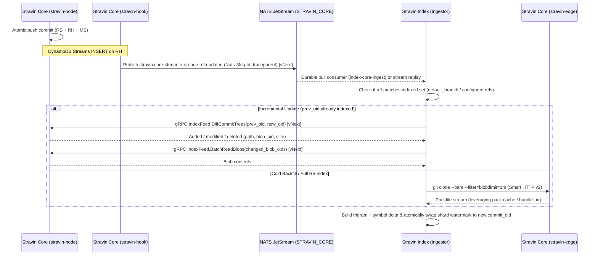

# Stravin Core <-> Stravin Index

This specification defines the contract between **Stravin Core** (bare Git storage engine) and **Stravin Index** (trigram full-text search, symbol navigation, and cross-repository dependency graphs).

## 1. Boundary & Ownership

| Concern | Source of Truth | Private Implementation Details (Never Crosses Boundary) |
| :--- | :--- | :--- |
| **Repository metadata (`default_branch`, `object_format`), refs, commits, trees, blobs** | **Stravin Core** | S3 packfiles, `.midx`/`.graph` aux files, DynamoDB sharding, compaction lifecycle |
| **Trigram inverted indexes, AST symbol tables, cross-repo reference graphs, indexed-commit watermarks** | **Stravin Index** | Zoekt/trigram shard storage, tree-sitter/LSIF/SCIP parsers, query planner, ranker |
| **Change notification stream (which refs/commits moved)** | **Stravin Core** (`stravin-hook` / DynamoDB Streams) | Stream shard leases, retry queues, DLQ storage |
| **Tombstone / repository deletion signals** | **Stravin Core** (lifecycle event) -> **Stravin Index** (purge) | Core deletes/archives repo state; Index purges all shards for `(tenant_id, repo_id)` |

## 2. Interaction Flow



## 3. Auth, Tenancy & Trust Boundary

- **Cilium eBPF Transport & Service Auth:** Index communicates with `stravin-edge` (Smart HTTP), `stravin-node` (`IndexFeed` gRPC vNext), and NATS JetStream over **Cilium (eBPF)** transparent WireGuard/SPIFFE mTLS with `CiliumNetworkPolicy` allowlists (or app-level TLS 1.3 mTLS locally), plus a tenant-scoped read-only service JWT (`scopes: ["git:read", "meta:read"]`, `exp <= 5m`).
- **Mandatory App-Level Tenancy & Shard Isolation:** Cilium verifies workload identity, NOT `tenant_id`. Both Core's `IndexFeed` handler and Index's JetStream ingestor MUST verify `tenant_id` in constant time in application code. Index MUST partition all search shards, caches, and query filters by `tenant_id` and NEVER share trigram postings or symbol tables across tenants, even if two tenants store identical `blob_oid` hashes.
- **No Raw S3/DynamoDB Coupling:** Index does NOT read Core's DynamoDB table or S3 pack bucket directly. Reading through Core's wire protocol or `IndexFeed` API ensures Core can freely evolve pack compaction, sharding, and KMS encryption without breaking Index.

## 4. Synchronous Interfaces

### 4.1 Cold Backfill & Incremental Fetch via Git Wire — *Implemented in Core v1.12.x*

Index can run against Core v1.12.x today using standard Smart HTTP Protocol v2 on `stravin-edge`:

- `GET /{tenant_id}/{repo_id}.git/info/refs?service=git-upload-pack` (`Git-Protocol: version=2`)
- `POST /{tenant_id}/{repo_id}.git/git-upload-pack` — supports shallow/partial fetch (`--filter=blob:limit=1m`) so Index skips multi-megabyte binary blobs automatically.

### 4.2 Incremental Tree/Blob & Metadata Read API — *Proposed Core Extension (vNext)*

To avoid spawning `git` subprocesses or maintaining bare mirrors on every indexer worker, Core exposes batch read-only RPCs on `stravin.core.v1.IndexFeed`:

```protobuf
syntax = "proto3";
package stravin.core.v1;

service IndexFeed {
  rpc GetRepoMetadata(GetRepoMetadataRequest) returns (RepoMetadata);
  rpc DiffCommitTrees(DiffCommitTreesRequest) returns (stream TreeDelta);
  rpc BatchReadBlobs(BatchReadBlobsRequest) returns (stream BlobPayload);
}

message RepoMetadata {
  string tenant_id = 1;
  string repo_id = 2;
  string default_branch = 3;   // e.g. "refs/heads/main" (from DDB META)
  string object_format = 4;    // "sha1" | "sha256" (from DDB META)
  uint64 failover_epoch = 5;
  bool deleted = 6;            // true when repo is tombstoned
}

message TreeDelta {
  string path = 1;
  string kind = 2;             // "add" | "modify" | "delete"
  uint32 mode = 3;             // 0100644, 0100755, 0120000, 0160000
  string old_blob_oid = 4;
  string new_blob_oid = 5;
  int64 new_size_bytes = 6;    // lets Index skip oversized files before fetching
}

message BatchReadBlobsRequest {
  string tenant_id = 1;
  string repo_id = 2;
  repeated string blob_oids = 3; // max 256 per batch
  uint64 max_blob_bytes = 4;     // default 1 MiB
}
```

## 5. Asynchronous Events & Streams

### 5.1 Core -> Index: Ref Update & Repo Lifecycle Events (`STRAVIN_CORE` JetStream)

- **Implemented in Core v1.12.x (`internal/hooks/async/dispatcher.go`):** `stravin-hook` currently delivers flat signed HTTP `push` webhooks (`X-Stravin-Event: push`, `X-Stravin-Signature-256`, `traceparent`) with `{tenant_id, repo_id, ref, oid, pack_id, timestamp}`.
- **Proposed Core Extension (vNext — NATS JetStream):** `stravin-hook` publishes to stream `STRAVIN_CORE` (retained 7–14 days for replay) with `Nats-Msg-Id: <idempotency_key>` and W3C `traceparent` headers:
    - `stravin.core.<tenant_id>.<repo_id>.ref.updated`: Adds `prev_oid`, `ulid`, `epoch`, `object_format`, and `default_branch` so Index can immediately decide whether to ingest a ref without a metadata round-trip.
    - `stravin.core.<tenant_id>.<repo_id>.repo.meta_updated`: Fired when `default_branch` changes so Index swaps its default search branch.
    - `stravin.core.<tenant_id>.<repo_id>.repo.deleted`: Tombstone event carrying `{tenant_id, repo_id, deleted_at, ulid}` requiring Index to purge all search shards and symbol graphs for the repository within its compliance SLA.
- **Stream Retention, Replay Backfill & Event Coalescing:** Index binds durable pull consumer `index-core-ingest` on `stravin.core.>`. After an Index crash, shard rebuild, or new language parser rollout, Index creates an ephemeral replay consumer starting at a historical `STRAVIN_CORE` timestamp or sequence number without putting extra load on Core's DynamoDB Streams. When a busy monorepo pushes 50 times/sec to `refs/heads/main`, Index coalesces queued events for the same `(tenant_id, repo_id, ref_name)` and indexes directly from its last committed watermark `indexed_oid` to the latest `head_oid`, skipping intermediate commits.

## 6. Shared Data Contracts & Identifiers

- **Index Watermark Key:** `(tenant_id, repo_id, ref_name)` -> `(indexed_commit_oid, indexed_tree_oid, object_format, ulid, indexed_at)`.
- **Blob Size & Binary Policy:** Both sides agree on a default `max_blob_bytes = 1_048_576` (1 MiB) ceiling for text/symbol indexing; Core reports `new_size_bytes` in `TreeDelta` so Index never transfers oversized binaries.
- **Object Format Awareness:** Index stores `object_format` per repository and validates OID lengths (40 hex for `sha1`, 64 hex for `sha256`) on every ingestion and query.

## 7. Failure Modes, Timeouts & Idempotency

| Failure Scenario | Behavior & Degradation | Timeout / Retry Policy |
| :--- | :--- | :--- |
| **Index ingestor falls behind or restarts** | Index serves slightly stale search results (reporting `indexed_commit_oid` to callers like Review) and catches up from its durable `index-core-ingest` JetStream offset, coalescing to the latest `head_oid`. | JetStream `STRAVIN_CORE` retention (7–14 d) enables self-service replay; periodic `GetRepoMetadata` + `ListRefs` reconciler covers gaps older than stream retention. |
| **`prev_oid` unknown to Index (force-push or missed events)** | Index falls back from incremental `DiffCommitTrees` to full tree walk (`ListTree` + `BatchReadBlobs`) or Smart HTTP clone for `new_oid`. | Full tree walk timeout: 60 s per batch; chunked resume via page token. |
| **Core `stravin-ctrl` failover rewinds a ref** | Core emits a new `stravin.core.<tenant>.<repo>.ref.updated` with the rewound `oid` and higher `epoch`. Index detects `epoch > watermark.epoch` and re-indexes to the rewound commit. | Watermark comparison always prioritizes higher `failover_epoch`, then newer `ulid`. |
| **Missed `core.repo.deleted` tombstone** | On `NOT_FOUND` (`404`) from Core during reconciliation, Index marks the repo pending-purge and deletes shards after a 24-hour grace check. | Prevents orphaned tenant data from lingering in search indexes. |

## 8. Meet-in-the-Middle Bridge Checklist

### Side A: Stravin Core Build Checklist

- [ ] Expose `default_branch` and `object_format` consistently in `META` (Implemented in Core v1.12.x).
- [ ] Support partial clone/fetch blob-size filters over Smart HTTP Protocol v2 (Implemented via `git-upload-pack` in Core v1.12.x).
- [ ] Implement `stravin.core.v1.IndexFeed` (`GetRepoMetadata`, `DiffCommitTrees`, `BatchReadBlobs`) on `stravin-node` with constant-time app-level `tenant_id` check (vNext).
- [ ] Publish `ref.updated`, `repo.meta_updated`, and `repo.deleted` to `STRAVIN_CORE` JetStream from `stravin-hook` with `Nats-Msg-Id` and `traceparent` (vNext).

### Side B: Stravin Index Build Checklist

- [ ] Build coalescing JetStream pull ingestor (`index-core-ingest`) keyed by `(tenant_id, repo_id, ref_name)` with watermark tracking `(indexed_commit_oid, failover_epoch, ulid)` and replay backfill support.
- [ ] Enforce strict app-level `tenant_id` isolation on every shard, cache entry, and query response.
- [ ] Support both Smart HTTP fallback (for Core v1.12.x) and `IndexFeed` gRPC (for vNext) behind an internal `CoreSource` adapter.
- [ ] Implement tombstone purge handler for `core.repo.deleted` and `404` reconciliation.

### Shared Contract-Test Fixtures

- `fixtures/core-index/incremental-tree-delta.json` — Add, modify, delete, mode-change, and oversized-blob (>1 MiB) `TreeDelta` stream.
- `fixtures/core-index/failover-rewind-sequence.json` — JetStream `STRAVIN_CORE` event sequence where `failover_epoch` advances from `1` to `2` with a rewound `oid`.
- `fixtures/core-index/repo-tombstone.json` — `stravin.core.<tenant>.<repo>.repo.deleted` JetStream message and headers (`Nats-Msg-Id`, `traceparent`).
