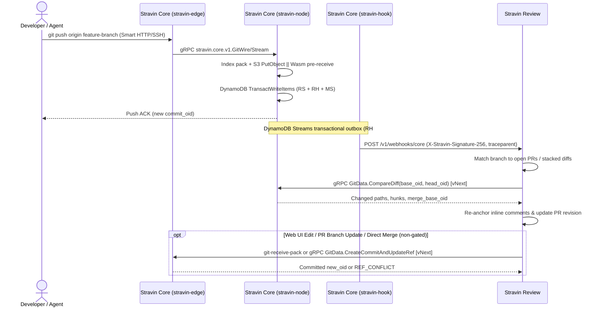

# Stravin Core <-> Stravin Review

This specification defines the contract between **Stravin Core** (bare Git storage engine) and **Stravin Review** (pull requests, stacked diffs, inline review, and repository browser).

## 1. Boundary & Ownership

| Concern | Source of Truth | Private Implementation Details (Never Crosses Boundary) |
| :--- | :--- | :--- |
| **Git objects, packs, refs, `default_branch`, `object_format`** | **Stravin Core** | S3 pack layout, DynamoDB `RS#s`/`RH#s`/`MS#m` sharding, `stravin-node` NVMe cache, `stravin-pack` compaction |
| **PR lifecycle, review comments, approvals, stacked-diff topology, draft state** | **Stravin Review** | Review SQL/document database, inline comment anchoring heuristics, UI notification preferences |
| **PR synthetic/head refs (`refs/stravin/pr/{pr_id}/head`, `refs/stravin/pr/{pr_id}/merge`)** | **Stravin Core** (storage) / **Stravin Review** (lifecycle) | Core stores refs via Ref-CAS; Review decides when to create, update, or clean them up |
| **Synchronous push guardrails (Tier 1 Wasm hooks)** | **Stravin Core** (execution) | `wazero` module cache, bulkhead semaphore; Review surfaces hook rejection messages to web-editor commits |

## 2. Interaction Flow



## 3. Auth, Tenancy & Trust Boundary

- **Git Wire Operations (Implemented in Core v1.12.x):** Review authenticates to `stravin-edge` over Smart HTTP (`Authorization: Bearer <token>`) or SSH. Core v1.12.x enforces `edge.AuthorizeTenant` so a Review credential minted for `tenant_id=acme` can never read or write another tenant's repo.
- **Scoped Service Tokens (Proposed Core Extension vNext):** Review exchanges end-user session identity for short-lived (5-minute) Core tokens containing `tenant_id`, `repo_id`, `actor_id` (original human/agent ID for audit and Wasm `PushContext.actor_id`), and `scopes` (`git:read`, `git:write:pr-refs`, `git:write`).
- **Git Data Read API (Proposed Core Extension vNext):** Service-to-service gRPC over TLS 1.3 mTLS (`RequireAndVerifyClientCert`, matching `internal/rpc/auth.go`), carrying mandatory metadata `x-stravin-tenant-id`, `x-stravin-repo-id`, `x-stravin-actor-id`, and `traceparent`.
- **Inbound Core Webhooks (Implemented in Core v1.12.x):** Review verifies `X-Stravin-Signature-256` in constant time (`async.VerifySignature`) against the per-repo KMS-managed webhook secret before parsing JSON.

## 4. Synchronous Interfaces

### 4.1 Git Wire Protocol — *Implemented in Core v1.12.x*

Review uses Smart HTTP/SSH on `stravin-edge` for web-editor commits, branch creation/deletion, and fallback cloning:

- `GET /{tenant_id}/{repo_id}.git/info/refs?service=git-upload-pack|git-receive-pack`
- `POST /{tenant_id}/{repo_id}.git/git-upload-pack` (`Git-Protocol: version=2`)
- `POST /{tenant_id}/{repo_id}.git/git-receive-pack` (decompressed body cap `256 MiB`)
- Internal `stravin-edge` -> `stravin-node` transport: `/stravin.core.v1.GitWire/Stream` with codec `stravin-gitwire` and headers `x-stravin-tenant-id`, `x-stravin-repo-id`, `x-stravin-operation`, `x-stravin-git-protocol`, `traceparent`.

### 4.2 Read-Only Git Data & Diff API — *Proposed Core Extension (vNext)*

To render PR diffs, file browsers, blame, and stacked-diff base comparisons without cloning full repositories into Review pods, Core exposes a stateless gRPC service backed by `stravin-node`'s warm NVMe cache and S3 pack plane:

```protobuf
syntax = "proto3";
package stravin.core.v1;

service GitData {
  rpc GetRepoMeta(GetRepoMetaRequest) returns (RepoMetaResponse);
  rpc ListRefs(ListRefsRequest) returns (ListRefsResponse);
  rpc GetCommit(GetCommitRequest) returns (CommitResponse);
  rpc ListTree(ListTreeRequest) returns (ListTreeResponse);
  rpc StreamBlob(StreamBlobRequest) returns (stream BlobChunk);
  rpc MergeBase(MergeBaseRequest) returns (MergeBaseResponse);
  rpc CompareDiff(CompareDiffRequest) returns (stream DiffEntry);
  rpc CreateCommitAndUpdateRef(CreateCommitRequest) returns (UpdateRefResponse);
}

message CompareDiffRequest {
  string tenant_id = 1;
  string repo_id = 2;
  string base_oid = 3;         // 40-hex (sha1) or 64-hex (sha256)
  string head_oid = 4;
  bool three_dot = 5;          // true => diff(merge_base(base, head), head)
  uint32 context_lines = 6;    // default 3
  uint32 max_files = 7;        // pagination cap (default 500)
  string page_token = 8;
}

message DiffEntry {
  string path = 1;
  string old_path = 2;         // populated on rename
  string change_kind = 3;      // "add" | "modify" | "delete" | "rename"
  string old_blob_oid = 4;
  string new_blob_oid = 5;
  bool binary = 6;
  uint32 additions = 7;
  uint32 deletions = 8;
  bytes unified_patch = 9;     // truncated if > max_patch_bytes
  bool patch_truncated = 10;
}
```

### 4.3 Tier 1 Wasm Hook Rejection Surface — *Implemented in Core v1.12.x*

When Review submits a commit (e.g., applying a suggested change or resolving a conflict in the UI), Core executes configured Tier 1 `wazero` Wasm hooks (`HookHostABI`). A `REJECT` verdict returns the hook's `message` and per-ref `ref_verdicts` over Git side-band stderr (or structured `FAILED_PRECONDITION` details on `CreateCommitAndUpdateRef`) so Review can render the exact guardrail violation inline.

## 5. Asynchronous Events & Streams

### 5.1 Core -> Review: Ref Update Webhook

- **Implemented in Core v1.12.x (`stravin-hook`):** Consumes DynamoDB Streams `INSERT` on `RH#s` and POSTs `WebhookPayload` with headers `X-Stravin-Event: push`, `X-Stravin-Signature-256: sha256=<hex>`, and `traceparent`:

```json
{
  "tenant_id": "acme",
  "repo_id": "monorepo",
  "ref": "refs/heads/feat/stack-1",
  "oid": "a1b2c3d4e5f6a1b2c3d4e5f6a1b2c3d4e5f6a1b2",
  "pack_id": "9c1185a5c5e9fc54612808977ee8f548b2258d31a1b2c3d4e5f60718293a4b5c",
  "timestamp": "2026-11-24T22:15:03.412Z"
}
```

- **Proposed Core Extension (vNext) Envelope:** Adds `event_id`, `event_type: "core.ref.updated"`, `schema_version: "1.0"`, `idempotency_key`, `data.prev_oid`, `data.ulid`, `data.epoch`, `data.actor_id`, `data.object_format`, and `data.is_force_push` (derived from commit-graph ancestry).
- **Ordering & Deduplication:** DynamoDB Streams guarantees per-shard ordering for a single `ref_name` (all updates for `ref_name` hash to the same `RH#{fnv64a(ref) % S}`). Review deduplicates on `(tenant_id, repo_id, ref, ulid)` and ignores out-of-order stale events whose `ulid` is older than the last applied revision for that ref.

## 6. Shared Data Contracts & Identifiers

- **Repository Identity:** `(tenant_id, repo_id)` + immutable `object_format` (`sha1` | `sha256`) and mutable `default_branch` (from Core `META`).
- **PR Reference Namespace:** Review-managed refs live strictly under `refs/stravin/pr/{pr_id}/head` and `refs/stravin/pr/{pr_id}/merge` so they never collide with user branches (`refs/heads/*`) or Gate refs (`refs/stravin/gate/*`).
- **OID Encoding:** Always lowercase hex matching `object_format` (40 chars for `sha1`, 64 chars for `sha256`). Zero OID (`ddb.ZeroOIDForFormat`) represents ref creation (`old_oid`) or deletion (`new_oid`).

## 7. Failure Modes, Timeouts & Idempotency

| Failure Scenario | Behavior & Degradation | Timeout / Retry Policy |
| :--- | :--- | :--- |
| **`stravin-node` / `GitData` slow or unavailable** | Review serves cached PR metadata, comments, and approvals from its own DB; diff pane shows "Git diff temporarily unavailable" with manual retry. | `GetCommit`/`ListTree`: 2 s; `CompareDiff`: 10 s; 2 retries with jitter on `UNAVAILABLE`. |
| **Review webhook endpoint down (`5xx` / timeout)** | `stravin-hook` retries with exponential backoff (`100 ms` -> `5 s`), then writes `DLQEntry` (carrying `sequence_number`, `ref_name`, `oid`, `traceparent`). | Review runs a periodic reconciliation sweep via `ListRefs` for open PRs whenever DLQ alerts fire or a user opens a PR with stale `head_oid`. |
| **Concurrent push during UI edit (`REF_CONFLICT`)** | Core Ref-CAS rejects the write atomically; Review reloads latest `head_oid` and prompts the user to rebase or re-apply. | Non-retryable (`409` / `FAILED_PRECONDITION`). |
| **Core regional failover (`failover_epoch` advance / ref rewind)** | Core may rewind un-replicated refs during `stravin-ctrl` scrub. Review detects `oid` mismatch via `core.ref.updated` or `ListRefs` and marks affected PR revisions as `rewound` rather than crashing. | Idempotent state convergence against Core's authoritative `RefState`. |

## 8. Meet-in-the-Middle Bridge Checklist

### Side A: Stravin Core Build Checklist

- [ ] Preserve `stravin-hook` HMAC-SHA256 signing, `traceparent` linking, and per-ref `RH#s` ordering (Implemented in Core v1.12.x).
- [ ] Extend `WebhookPayload` additively with `prev_oid`, `ulid`, `epoch`, `actor_id`, `object_format`, and `event_id` (vNext).
- [ ] Implement read-only `stravin.core.v1.GitData` gRPC service on `stravin-node` (reusing warm NVMe cache and commit-graph) (vNext).
- [ ] Support short-lived scoped tokens with `actor_id` forwarding to Wasm `PushContext` (vNext).

### Side B: Stravin Review Build Checklist

- [ ] Implement HMAC-SHA256 webhook receiver tolerant of both Core v1.12.x flat payload and vNext envelope.
- [ ] Store `(tenant_id, repo_id, object_format)` on every PR; never hardcode 40-char SHA-1 assumptions.
- [ ] Implement idempotent PR revision sync keyed by `(ref_name, ulid)` plus on-demand `ListRefs` reconciliation on PR view.
- [ ] Restrict all Review-managed refs to `refs/stravin/pr/{pr_id}/*`.

### Shared Contract-Test Fixtures

- `fixtures/core-review/webhook-push-v1.json` — Core v1.12.x flat push webhook + expected `X-Stravin-Signature-256` vector.
- `fixtures/core-review/webhook-ref-updated-vnext.json` — vNext envelope for branch create, fast-forward, force-push, and delete (both `sha1` and `sha256`).
- `fixtures/core-review/compare-diff-cases.json` — Rename, binary file, truncated large diff, and 3-dot merge-base test vectors.
