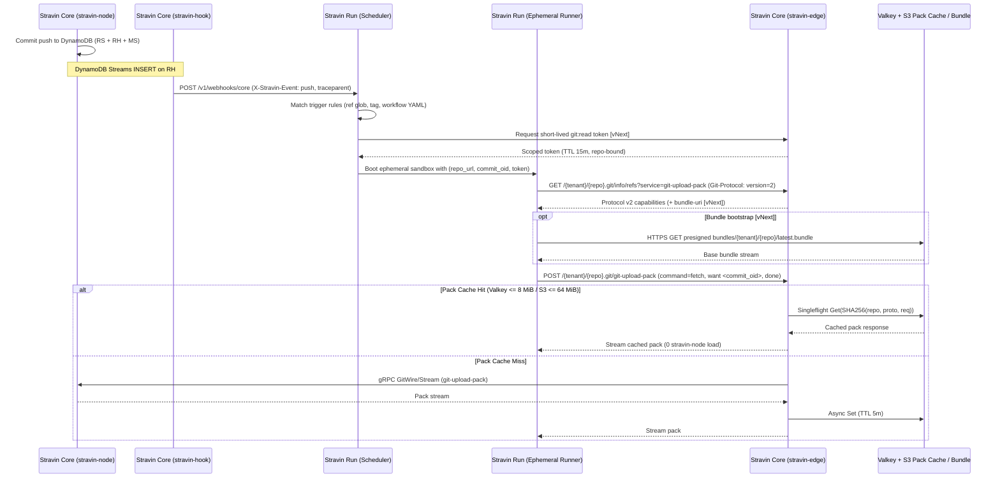

# Stravin Core <-> Stravin Run

This specification defines the contract between **Stravin Core** (bare Git storage engine) and **Stravin Run** (ephemeral CI build/test runners and pipeline scheduler).

## 1. Boundary & Ownership

| Concern | Source of Truth | Private Implementation Details (Never Crosses Boundary) |
| :--- | :--- | :--- |
| **Git refs, commits, packfiles, Valkey+S3 pack cache, precomputed bundles** | **Stravin Core** | S3 pack sharding, DynamoDB Ref-CAS, Valkey/S3 spillover thresholds, `stravin-node` NVMe cache |
| **Pipeline definitions, runner scheduling, VM/container sandboxes, build logs, artifacts** | **Stravin Run** | MicroVM/Firecracker pool, runner autoscaling, artifact storage, secret vault |
| **Trigger events (push, tag creation, ref updates)** | **Stravin Core** (`stravin-hook`) | DynamoDB Streams shard checkpointing and DLQ internals |
| **Clone/fetch authorization for ephemeral runners** | **Stravin Core** (enforcement) / **Stravin Run** (token request) | Core validates short-lived scoped tokens at `stravin-edge`; Run injects them into runner git credentials |

## 2. Interaction Flow



## 3. Auth, Tenancy & Trust Boundary

- **Runner Clone Auth (Implemented in Core v1.12.x):** Runners clone over Smart HTTP (`Authorization: Bearer <token>`) or SSH against `stravin-edge`. `edge.AuthorizeTenant` enforces strict tenant isolation.
- **Short-Lived Scoped Git Tokens (Proposed Core Extension vNext):** Before booting a runner, Run's control plane mints a read-only token scoped to `(tenant_id, repo_id, commit_oid|ref_globs, scope="git:read", exp=now+15m)`. Write tokens (`scope="git:write"`) are issued only for explicitly configured release/tag workflows and are never granted to untrusted PR runs.
- **Zero Direct Storage Access:** Ephemeral runners NEVER receive AWS IAM credentials for Core's S3 pack bucket or DynamoDB table. All object access flows through `stravin-edge` or time-limited presigned S3 URLs for `bundles/{tenant_id}/{repo_id}/latest.bundle`.
- **Untrusted Code Isolation:** Core treats every runner clone/fetch as an untrusted external Git client subject to `stravin-edge` per-tenant rate limits (`edge.Limiter`), `Git-Protocol` sanitization (`rpc.SanitizeGitProtocol`), and body-size caps (`256 MiB`).

## 4. Synchronous Interfaces

### 4.1 High-Fanout Runner Clone & Fetch — *Implemented in Core v1.12.x*

CI fan-out (e.g., 50 matrix jobs cloning the same `commit_oid` simultaneously) is specifically optimized by `stravin-edge`'s two-tier pack response cache (`internal/edge/pack_cache.go`, `pack_cache_valkey.go`, `pack_cache_s3.go`):

- **Protocol Requirement:** Runners MUST send `Git-Protocol: version=2` and use canonical deterministic fetch arguments (`git fetch --depth=1 --no-tags origin <commit_oid>` or full clone without `have` lines) so `edge.IsCacheableV2FullCloneFetch` matches.
- **Cache Key Determinism:** `SHA-256(repo_key || 0x00 || git_protocol || 0x00 || request_bytes)`. Identical matrix runner requests coalesce via `PackCacheCoordinator` singleflight, serve from Valkey (`<= 8 MiB`) or S3 spillover (`pack-cache/v1/{key[0:2]}/{key}.bin`, `<= 64 MiB`), and expire after `DefaultPackCacheTTL` (5 minutes).
- **Exact-OID Fetch:** Runners SHOULD fetch by exact `commit_oid` (not mutable branch name) to guarantee every matrix shard builds the exact same commit even if the branch advances mid-run.

### 4.2 Precomputed Bundle URI Bootstrap — *Proposed Core Extension (vNext)*

Core v1.12.x defines the S3 key convention `bundles/{tenant_id}/{repo_id}/latest.bundle` (`s3.BundleKey`). In vNext:

- `stravin-edge` advertises `bundle-uri` in Protocol v2 capabilities when a recent bundle exists.
- On `command=bundle-uri`, `stravin-edge` returns a short-lived (5-minute) presigned HTTPS URL pointing to the regional S3 bucket or CDN edge, allowing large monorepo runners to download the base pack directly from S3 and only fetch the tiny delta from `stravin-node`.

### 4.3 Scoped Token Minting API — *Proposed Core Extension (vNext)*

```http
POST /internal/v1/tokens/git HTTP/1.1
Host: stravin-edge.internal
Content-Type: application/json
Authorization: Bearer <service-jwt>
traceparent: 00-4bf92f3577b34da6a3ce929d0e0e4736-00f067aa0ba902b7-01

{
  "tenant_id": "acme",
  "repo_id": "monorepo",
  "actor_id": "svc:stravin-run:run_01JDF9A1B2C3D4E5F6G7H8J9K0",
  "scopes": ["git:read"],
  "ref_globs": ["refs/heads/*", "refs/stravin/gate/*"],
  "ttl_seconds": 900
}
```

Response (`200 OK`):

```json
{
  "token": "stv_git_v1_...",
  "expires_at": "2026-11-24T22:30:03Z",
  "clone_url": "https://git.stravin.internal/acme/monorepo.git"
}
```

## 5. Asynchronous Events & Streams

### 5.1 Core -> Run: Push & Tag Trigger Webhook

- **Implemented in Core v1.12.x:** `stravin-hook` dispatches signed POST requests (`X-Stravin-Event: push`, `X-Stravin-Signature-256`, `traceparent`) for every `RH#s` INSERT matching the repo's configured `ref_glob` (e.g., `refs/heads/*`, `refs/tags/*`).
- **Proposed Core Extension (vNext):** Uses the Standard Async Event Envelope (`core.ref.updated`) with `data.prev_oid`, `data.ulid`, `data.object_format`, and `data.deleted` (true when `oid` is zero OID) so Run can distinguish tag creation, branch deletion (cancelling superseded runs), and force-pushes without an extra round-trip.
- **Workflow File Fetch:** Run fetches `.stravin/workflows/*.yaml` at the exact `commit_oid` (via `git archive`/shallow fetch today, or `GitData.StreamBlob` in vNext) before scheduling jobs.

## 6. Shared Data Contracts & Identifiers

- **Build Pinning Tuple:** `(tenant_id, repo_id, commit_oid, ref_name)` — every runner checkout is pinned to `commit_oid` and verified against `object_format` (`sha1` vs. `sha256`).
- **Cache-Friendly Fetch Profile:** Run standardizes its Git client flags (`-c protocol.version=2 -c transfer.bundleURI=true -c fetch.negotiationAlgorithm=noop` for shallow clones) so matrix jobs maximize `stravin-edge` pack-cache hit ratio.
- **Telemetry Correlation:** Run injects `traceparent` from the triggering webhook into the runner checkout's HTTP `traceparent` header so Core traces link push -> webhook -> runner clone.

## 7. Failure Modes, Timeouts & Idempotency

| Failure Scenario | Behavior & Degradation | Timeout / Retry Policy |
| :--- | :--- | :--- |
| **Valkey or S3 pack cache unavailable** | `TieredPackCache` logs a warning and transparently falls back to `stravin-node` (`git-upload-pack`). Runners see higher latency but zero errors. | Transparent in `stravin-edge`. |
| **`stravin-edge` returns `429` or `503` during matrix burst** | Runner retries `git fetch` with capped exponential backoff + jitter (initial `500 ms`, max `15 s`, max 4 attempts) before failing checkout as `INFRA_ERROR` (not test failure). | Checkout timeout: 120 s (configurable per repo size). |
| **Token expires mid-long-clone** | Runner requests a refreshed token from Run control plane (if job still active) and retries fetch. | Token TTL default 15 m; refresh threshold 2 m before expiry. |
| **Duplicate push webhook from `stravin-hook` retry** | Run deduplicates trigger ingestion on `idempotency_key` (`tenant_id:repo_id:ref:ulid`), preventing duplicate pipeline spawns. | Idempotency window >= 24 hours. |

## 8. Meet-in-the-Middle Bridge Checklist

### Side A: Stravin Core Build Checklist

- [ ] Maintain Protocol v2 `TieredPackCache` (Valkey + S3 spillover) and `PackCacheCoordinator` singleflight (Implemented in Core v1.12.x).
- [ ] Add `POST /internal/v1/tokens/git` short-lived scoped token minting on `stravin-edge` (vNext).
- [ ] Wire `bundle-uri` capability advertisement and presigned URL generation for `s3.BundleKey` (vNext).
- [ ] Enrich `stravin-hook` push payload with `prev_oid`, `ulid`, and `event_id` (vNext).

### Side B: Stravin Run Build Checklist

- [ ] Configure all runners with `protocol.version=2`, exact `commit_oid` fetches, and `traceparent` propagation.
- [ ] Deduplicate incoming `stravin-hook` webhooks by `idempotency_key` (or `(tenant_id, repo_id, ref, oid, timestamp)` for Core v1.12.x).
- [ ] Classify `429`/`5xx` checkout failures as retryable `INFRA_ERROR`, distinct from user build failures.
- [ ] Never pass AWS storage credentials into runner sandboxes; use only scoped HTTP Git tokens.

### Shared Contract-Test Fixtures

- `fixtures/core-run/v2-cacheable-fetch.pkt` — Raw Protocol v2 `command=fetch` pkt-line request verified against `edge.IsCacheableV2FullCloneFetch`.
- `fixtures/core-run/webhook-tag-and-branch.json` — Branch push, tag push, and branch deletion payloads for trigger matching.
- `fixtures/core-run/scoped-token-response.json` — Token mint request/response schema and expiry validation fixture.
