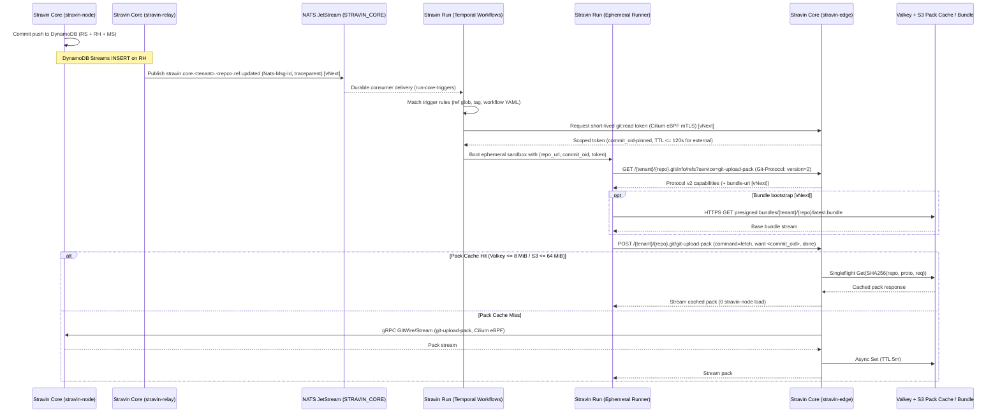

# Stravin Core ⟷ Stravin Run

This specification defines the contract between **Stravin Core** (bare Git storage engine) and **Stravin Run** (ephemeral CI build/test runners and pipeline scheduler). External runner token scoping, `bundle-uri` gating, and `jti` revocation follow [ADR-0002: External Runner Seam, State-Machine Ownership, and OIDC App Authentication](../adr/0002-external-runner-seam-and-oidc-auth.md); workflow YAML execution, `stravin-runner`, and `stravin-actions/checkout` follow [ADR-0005: Declarative YAML Workflow Execution, First-Party Action Repositories, and Runner Runtime](../adr/0005-workflow-execution-and-runner-runtime.md).

## 1. Boundary & Ownership

| Concern | Source of Truth | Private Implementation Details (Never Crosses Boundary) |
| :--- | :--- | :--- |
| **Git refs, commits, packfiles, Valkey+S3 pack cache, precomputed bundles** | **Stravin Core** | S3 pack sharding, DynamoDB Ref-CAS, Valkey/S3 spillover thresholds, `stravin-node` NVMe cache |
| **Pipeline definitions, runner scheduling, VM/container sandboxes, build logs, artifacts** | **Stravin Run** | MicroVM/Firecracker pool, runner autoscaling, artifact storage, secret vault |
| **Trigger events (push, tag creation, ref updates)** | **Stravin Core** (`stravin-hook` in `v1.12.x`; `stravin-relay` in `vNext`) | DynamoDB Streams shard checkpointing and DLQ internals |
| **Clone/fetch authorization for ephemeral runners** | **Stravin Core** (enforcement) / **Stravin Run** (token request) | Core validates short-lived scoped tokens at `stravin-edge`; Run injects them into runner git credentials |

## 2. Interaction Flow



## 3. Auth, Tenancy & Trust Boundary

- **Cilium eBPF Transport & Network Policy:** Run's control plane communicates with `stravin-edge` and NATS JetStream over **Cilium (eBPF)** transparent WireGuard/SPIFFE mTLS with `CiliumNetworkPolicy` allowlists. Ephemeral runner sandboxes are isolated by a strict egress `CiliumNetworkPolicy` permitting only `stravin-edge` (and presigned S3 bundle URLs), never `stravin-node` or internal NATS/DB ports.
- **Mandatory App-Level Tenancy Check:** Cilium verifies workload identity, NOT `tenant_id`. `stravin-edge` (`edge.AuthorizeTenant`) and Run's JetStream consumers MUST verify `tenant_id` in constant time in application code on every request and event.
- **Runner Clone Auth (Implemented in Core v1.12.x):** Runners clone over Smart HTTP (`Authorization: Bearer <token>`) or SSH against `stravin-edge`. `edge.AuthorizeTenant` enforces strict tenant isolation.
- **Short-Lived Scoped Git Tokens (Proposed Core Extension vNext — [ADR-0002](../adr/0002-external-runner-seam-and-oidc-auth.md)):**
    - **External Job-Lease & Checks API Checkouts:** Mint **`commit_oid`-pinned `git:read` tokens with `TTL <= 120s`** (matching exact-OID fetches and the 120 s checkout timeout), refreshed only through Run while the lease/job remains active. Never embed Git tokens in outbound `stravin-webhooks` payloads; external CI exchanges its OIDC workload assertion just-in-time before checkout. All external tokens enforce strict `aud` pinning, short `exp`, and `jti` replay protection.
    - **Pool Isolation & Write Restriction:** Strictly isolate `untrusted-pr` vs. `protected`/`gate` `runner_pool`s via pool-scoped OIDC claims. External runners default to `git:read` only. Write tokens (`scope="git:write"`) are issued **exclusively** for explicitly configured protected release/tag pools with narrow `ref_globs`, never to `untrusted-pr` pools, and carry active server-side `jti` revocation at `stravin-edge` (Valkey `jti` denylist) immediately upon lease termination or `< 200 ms` cancel.
- **Zero Direct Storage Access:** Ephemeral hosted and external runners NEVER receive AWS IAM credentials for Core's S3 pack bucket or DynamoDB table. All object access flows through `stravin-edge` or (only when `git:bundle:read` is explicitly granted) time-limited presigned S3 URLs for `bundles/{tenant_id}/{repo_id}/latest.bundle`.
- **Untrusted Code Isolation:** Core treats every runner clone/fetch as an untrusted external Git client subject to `stravin-edge` per-tenant rate limits (`edge.Limiter`), `Git-Protocol` sanitization (`rpc.SanitizeGitProtocol`), and body-size caps (`256 MiB`).

## 4. Synchronous Interfaces

### 4.1 High-Fanout Runner Clone & Fetch — *Implemented in Core v1.12.x*

CI fan-out (e.g., 50 matrix jobs cloning the same `commit_oid` simultaneously) is specifically optimized by `stravin-edge`'s two-tier pack response cache (`internal/edge/pack_cache.go`, `pack_cache_valkey.go`, `pack_cache_s3.go`):

- **Protocol Requirement:** Runners MUST send `Git-Protocol: version=2` and use canonical deterministic fetch arguments (`git fetch --depth=1 --no-tags origin <commit_oid>` or full clone without `have` lines) so `edge.IsCacheableV2FullCloneFetch` matches.
- **Cache Key Determinism:** `SHA-256(repo_key || 0x00 || git_protocol || 0x00 || request_bytes)`. Identical matrix runner requests coalesce via `PackCacheCoordinator` singleflight, serve from Valkey (`<= 8 MiB`) or S3 spillover (`pack-cache/v1/{key[0:2]}/{key}.bin`, `<= 64 MiB`), and expire after `DefaultPackCacheTTL` (5 minutes).
- **Exact-OID Fetch:** Runners SHOULD fetch by exact `commit_oid` (not mutable branch name) to guarantee every matrix shard builds the exact same commit even if the branch advances mid-run.

### 4.2 Precomputed Bundle URI Bootstrap — *Proposed Core Extension (vNext)*

Core v1.12.x defines the S3 key convention `bundles/{tenant_id}/{repo_id}/latest.bundle` (`s3.BundleKey`). In vNext:

- `stravin-edge` advertises `bundle-uri` in Protocol v2 capabilities **only** when a recent bundle exists **and** the authenticated Git token explicitly carries the **`git:bundle:read`** scope ([ADR-0002](../adr/0002-external-runner-seam-and-oidc-auth.md)). `git:bundle:read` is auto-granted to Cilium-attested internal runner pools and opt-in for authorized external OIDC leases/Apps; `stravin-edge` suppresses `bundle-uri` advertisement for external `commit_oid`-pinned tokens lacking `git:bundle:read`.
- On `command=bundle-uri`, `stravin-edge` returns a short-lived presigned HTTPS URL whose TTL is capped to **`min(token_remaining_ttl, 120s)`**, pointing to the regional S3 bucket or CDN edge so authorized large-monorepo runners download the base pack directly from S3 and fetch only the tiny delta from `stravin-node`.

### 4.3 Scoped Token Minting API — *Proposed Core Extension (vNext)*

```http
POST /internal/v1/tokens/git HTTP/1.1
Host: stravin-edge.internal
Content-Type: application/json
Authorization: Bearer <service-jwt>
traceparent: 00-4bf92f3577b34da6a3ce929d0e0e4736-00f067aa0ba902b7-01

{
  "tenant_id": "acme",
  "repo_id": "monorepo",
  "actor_id": "svc:stravin-run:run_01JDF9A1B2C3D4E5F6G7H8J9K0",
  "runner_pool": "untrusted-pr",
  "commit_oid": "a1b2c3d4e5f6a1b2c3d4e5f6a1b2c3d4e5f6a1b2",
  "scopes": ["git:read"],
  "ttl_seconds": 120
}
```

Response (`200 OK`):

```json
{
  "token": "stv_git_v1_...",
  "jti": "jti_01JDF9A1B2C3D4E5F6G7H8J9K0",
  "aud": "stravin-edge",
  "expires_at": "2026-11-24T22:17:03Z",
  "clone_url": "https://git.stravin.internal/acme/monorepo.git"
}
```

- **Optional `git:bundle:read` Scope:** Authorized internal or opt-in external pools include `"git:bundle:read"` in `scopes` to enable `bundle-uri` (presigned URL TTL `<= min(token_remaining_ttl, 120s)`).
- **Protected Release Write Tokens & Revocation:** Only explicitly configured protected release/tag pools may request `"git:write"` with narrow `ref_globs`; Run revokes active external write tokens immediately on cancel or lease termination via `POST /internal/v1/tokens/git/{jti}/revoke` (backed by a Valkey `jti` denylist in `stravin-edge`).

## 5. Asynchronous Events & Streams

### 5.1 Core -> Run: Push & Tag Trigger Events (`STRAVIN_CORE` JetStream)

- **Implemented in Core v1.12.x (`internal/hooks/async/dispatcher.go`):** `stravin-hook` currently dispatches flat signed HTTP `POST` webhooks (`X-Stravin-Event: push`, `X-Stravin-Signature-256`, `traceparent`) for every `RH#s` INSERT matching the repo's configured `ref_glob` (e.g., `refs/heads/*`, `refs/tags/*`).
- **Proposed Core Extension (vNext — NATS JetStream):** `stravin-relay` (renamed from `stravin-hook` in `vNext`) publishes Standard Async Event Envelopes to stream `STRAVIN_CORE` on subject `stravin.core.<tenant_id>.<repo_id>.ref.updated` with `Nats-Msg-Id: <idempotency_key>` and W3C `traceparent` in NATS headers. The payload includes `data.prev_oid`, `data.ulid`, `data.object_format`, and `data.deleted` (true when `oid` is zero OID) so Run can distinguish tag creation, branch deletion (cancelling superseded runs), and force-pushes without an extra round-trip.
- **Durable Consumer & Temporal Workflows:** Run binds durable pull consumer `run-core-triggers` on `stravin.core.*.*.ref.updated`. Trigger ingestion maps each unique `idempotency_key` to an idempotent **Temporal** pipeline workflow start (`WorkflowID = <tenant_id>:<repo_id>:<commit_oid>:<workflow>`), driving CI DAG fan-out/fan-in, runner heartbeating, retries, and cancellation while keeping **Stravin Core** completely Temporal-free and decoupled from Run's internal workflow engine.
- **Workflow File Fetch:** Run fetches `.stravin/workflows/*.yaml` at the exact `commit_oid` (via `git archive`/shallow fetch today, or `GitData.StreamBlob` in vNext) before scheduling jobs.

## 6. Shared Data Contracts & Identifiers

- **Build Pinning Tuple:** `(tenant_id, repo_id, commit_oid, ref_name)` — every runner checkout is pinned to `commit_oid` and verified against `object_format` (`sha1` vs. `sha256`).
- **Cache-Friendly Fetch Profile:** Run standardizes its Git client flags (`-c protocol.version=2 -c transfer.bundleURI=true -c fetch.negotiationAlgorithm=noop` for shallow clones) so matrix jobs maximize `stravin-edge` pack-cache hit ratio.
- **Telemetry Correlation:** Run extracts `traceparent` from the triggering NATS JetStream header and injects it into the runner checkout's HTTP `traceparent` header so Core traces link push -> JetStream -> runner clone.

## 7. Failure Modes, Timeouts & Idempotency

| Failure Scenario | Behavior & Degradation | Timeout / Retry Policy |
| :--- | :--- | :--- |
| **Valkey or S3 pack cache unavailable** | `TieredPackCache` logs a warning and transparently falls back to `stravin-node` (`git-upload-pack`). Runners see higher latency but zero errors. | Transparent in `stravin-edge`. |
| **`stravin-edge` returns `429` or `503` during matrix burst** | Runner retries `git fetch` with capped exponential backoff + jitter (initial `500 ms`, max `15 s`, max 4 attempts) before failing checkout as `INFRA_ERROR` (not test failure). | Checkout timeout: 120 s (configurable per repo size). |
| **Token expires mid-long-clone** | Runner requests a refreshed `commit_oid`-pinned token from Run's active-lease refresh endpoint (only while lease/job is active) and retries fetch; external runners without `git:bundle:read` rely on their Git credential helper for seamless refresh. | External `git:read` TTL `<= 120s`; refresh while lease active. |
| **Duplicate push event from JetStream redelivery** | JetStream deduplicates `Nats-Msg-Id` at publish time, and Run deduplicates trigger ingestion on `idempotency_key` (`tenant_id:repo_id:ref:ulid`), preventing duplicate pipeline/workflow spawns. | Idempotency window >= 24 hours; exhausted messages route to `STRAVIN_DLQ`. |

## 8. Meet-in-the-Middle Bridge Checklist

### Side A: Stravin Core Build Checklist

- [ ] Maintain Protocol v2 `TieredPackCache` (Valkey + S3 spillover) and `PackCacheCoordinator` singleflight (Implemented in Core v1.12.x).
- [ ] Add `POST /internal/v1/tokens/git` short-lived `commit_oid`-pinned token minting (`TTL <= 120s` for external `git:read`, `aud`/`jti` pinning) and `POST /internal/v1/tokens/git/{jti}/revoke` Valkey denylist on `stravin-edge` with app-level `tenant_id` check (vNext).
- [ ] Gate `bundle-uri` capability advertisement and presigned URL generation (`TTL <= min(token_remaining_ttl, 120s)`) on explicit `git:bundle:read` scope, suppressing it for external `commit_oid`-pinned tokens without that scope (vNext).
- [ ] Publish `stravin.core.<tenant_id>.<repo_id>.ref.updated` to NATS JetStream from `stravin-relay` (renamed from `stravin-hook` in `vNext`) with `Nats-Msg-Id`, `prev_oid`, `ulid`, and `traceparent` (vNext).

### Side B: Stravin Run Build Checklist

- [ ] Configure all runners with `protocol.version=2`, exact `commit_oid` fetches, and `traceparent` propagation.
- [ ] Bind durable JetStream consumer `run-core-triggers` on `STRAVIN_CORE` and deduplicate triggers by `idempotency_key` when starting idempotent Temporal pipeline workflows.
- [ ] Classify `429`/`5xx` checkout failures as retryable `INFRA_ERROR`, distinct from user build failures.
- [ ] Never pass AWS storage credentials into runner sandboxes; use only scoped HTTP Git tokens and enforce strict runner egress `CiliumNetworkPolicy`.

### Shared Contract-Test Fixtures

- `fixtures/core-run/v2-cacheable-fetch.pkt` — Raw Protocol v2 `command=fetch` pkt-line request verified against `edge.IsCacheableV2FullCloneFetch`.
- `fixtures/core-run/nats-tag-and-branch.json` — NATS JetStream `stravin.core.<tenant>.<repo>.ref.updated` messages for branch push, tag push, and branch deletion trigger matching.
- `fixtures/core-run/scoped-token-response.json` — Token mint request/response schema and expiry validation fixture.

## Related Documents

- [ADR-0002: External Runner Seam, State-Machine Ownership, and OIDC App Authentication](../adr/0002-external-runner-seam-and-oidc-auth.md)
- [ADR-0005: Declarative YAML Workflow Execution, First-Party Action Repositories, and Runner Runtime](../adr/0005-workflow-execution-and-runner-runtime.md)
