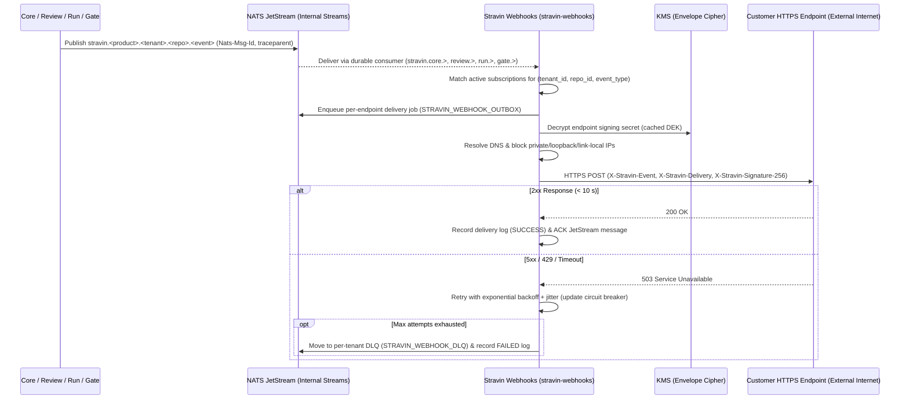

# Platform Events ⟷ Stravin External Webhooks

This specification defines the meet-in-the-middle contract between internal **NATS JetStream Platform Events** (emitted by **Stravin Core**, **Stravin Review**, **Stravin Run**, and **Stravin Gate**) and **Stravin Webhooks** (`stravin-webhooks`), the dedicated outbound customer and third-party HTTP webhook delivery service.

> **Contract Status:** **Proposed Contract (vNext)** — See [ADR-0001: Platform Transport, Internal Events, External Webhooks, and Durable Workflows](../adr/0001-platform-transport-events-webhooks.md). In Core `v1.12.x`, `stravin-hook` (`cmd/stravin-hook`, `internal/hooks/async/dispatcher.go`) currently dispatches flat HTTP `POST` push webhooks directly; in `vNext`, Core renames this daemon to `stravin-relay` (pure DynamoDB Streams -> NATS JetStream outbox relay) while `stravin-webhooks` extracts and generalizes external delivery for all Stravin products.

## 1. Boundary & Ownership

| Concern | Source of Truth | Private Implementation Details (Never Crosses Boundary) |
| :--- | :--- | :--- |
| **Domain state transitions and canonical internal events** | **Stravin Core, Review, Run, Gate** (Producers) | Internal DBs, DynamoDB Streams outbox, Wasm hooks, CI scheduler, merge-queue state machines |
| **Customer webhook subscriptions, target URLs, event filters, KMS-encrypted signing secrets** | **Stravin Webhooks** (`stravin-webhooks`) | Subscription DB, KMS envelope cipher cache, secret rotation state |
| **Per-endpoint delivery queues, rate limits, circuit breakers, retries, DLQ, and delivery logs** | **Stravin Webhooks** (`stravin-webhooks`) | Per-endpoint JetStream consumers, token buckets, circuit-breaker state, delivery log storage |
| **Outbound internet egress, SSRF/DNS-rebinding protection, HMAC-SHA256 signing** | **Stravin Webhooks** (`stravin-webhooks`) | Custom safe HTTP dialer, egress `CiliumNetworkPolicy`, TLS verification |

## 2. Interaction Flow



## 3. Auth, Tenancy & Trust Boundary

- **Internal Mesh & Ingress Auth:** `stravin-webhooks` runs inside the **Cilium eBPF** mesh (transparent WireGuard/SPIFFE mTLS). Its subscription management and replay APIs require signed service JWTs carrying `tenant_id`, `actor_id`, and `scopes` (`webhooks:read`, `webhooks:write`, `webhooks:replay`, `exp <= 5m`).
- **Mandatory App-Level Tenancy Check:** Cilium verifies workload identity, NOT `tenant_id`. Every subscription CRUD call, delivery-log query, replay request, and JetStream event fan-out MUST verify `tenant_id` in constant time in application code so a subscription for `tenant_a` can never receive events from `tenant_b`.
- **Dedicated Egress Isolation:** `stravin-webhooks` is the **only** platform service with a `CiliumNetworkPolicy` permitting outbound HTTPS (`TCP/443`, optional `TCP/80` if allowed by tenant policy) to the public internet. It is blocked at L3/L4 from dialing internal cluster services (Core, Review, Run, Index, Gate, metadata endpoints `169.254.169.254`).
- **SSRF & DNS Rebinding Protection:** The outbound HTTP dialer resolves DNS immediately before connecting and rejects private, loopback, link-local, carrier-grade NAT, and multicast CIDRs on the resolved socket IP (preventing DNS rebinding). Local development may override this only via explicit dev flag (`STRAVIN_WEBHOOK_ALLOW_PRIVATE_NETWORKS=true`).
- **KMS-Backed HMAC-SHA256 Signing:** Each webhook endpoint has an independent signing secret encrypted at rest via KMS envelope encryption (matching Core's `crypto.EnvelopeCipher`). Every outbound `POST` signs the exact UTF-8 request body bytes with HMAC-SHA256 and sends `X-Stravin-Signature-256: sha256=<hex>`. Dual-secret rotation windows are supported so customers can rotate secrets without downtime.

## 4. Synchronous Interfaces

### 4.1 Webhook Subscription Management API — *Proposed Contract (vNext)*

```http
POST /v1/webhooks/endpoints HTTP/1.1
Host: stravin-webhooks.internal
Content-Type: application/json
Authorization: Bearer <service-jwt>
Idempotency-Key: acme:monorepo:ep_create:01JDF9...
traceparent: 00-4bf92f3577b34da6a3ce929d0e0e4736-00f067aa0ba902b7-01

{
  "tenant_id": "acme",
  "repo_id": "monorepo",
  "url": "https://hooks.example.com/stravin",
  "events": ["core.ref.updated", "review.pr.approved", "run.check.completed", "gate.entry.merged"],
  "ref_globs": ["refs/heads/*"],
  "active": true,
  "max_deliveries_per_second": 25
}
```

Response (`201 Created`):

```json
{
  "endpoint_id": "whep_01JDF9A1B2C3D4E5F6G7H8J9K0",
  "tenant_id": "acme",
  "repo_id": "monorepo",
  "url": "https://hooks.example.com/stravin",
  "signing_secret_once": "whsec_...",
  "created_at": "2026-11-24T22:15:00Z"
}
```

Additional management endpoints:

- `GET /v1/webhooks/endpoints?tenant_id=...&repo_id=...` — List configured endpoints (never returns plaintext signing secrets).
- `PATCH /v1/webhooks/endpoints/{endpoint_id}` — Update URL, event filters, active state, or initiate secret rotation.
- `DELETE /v1/webhooks/endpoints/{endpoint_id}` — Deactivate endpoint and drain its per-endpoint JetStream consumer.
- `POST /v1/webhooks/endpoints/{endpoint_id}/ping` — Enqueue a synthetic `webhooks.ping` delivery to verify connectivity and signature validation.

### 4.2 Delivery Logs & Customer Replay API — *Proposed Contract (vNext)*

- `GET /v1/webhooks/endpoints/{endpoint_id}/deliveries?status=failed&limit=50` — Paginated delivery attempt history (status code, latency, error class, redacted headers, `event_id`, `trace_id`).
- `POST /v1/webhooks/deliveries/{delivery_id}/replay` — Re-enqueue a failed or dead-lettered delivery onto the endpoint's JetStream queue with a new `X-Stravin-Delivery` ID while preserving the original `event_id` and payload.

## 5. Asynchronous Events & Streams

### 5.1 Inbound NATS JetStream Subscriptions

`stravin-webhooks` binds durable pull consumers on the four internal platform streams:

| Source Stream | Subject Filter | Durable Consumer | Notes |
| :--- | :--- | :--- | :--- |
| `STRAVIN_CORE` | `stravin.core.>` | `webhooks-core-fanout` | Captures `ref.updated`, `repo.meta_updated`, `repo.deleted` |
| `STRAVIN_REVIEW` | `stravin.review.>` | `webhooks-review-fanout` | Captures `pr.opened_or_updated`, `pr.approved`, `pr.eligibility_changed` |
| `STRAVIN_RUN` | `stravin.run.>` | `webhooks-run-fanout` | Captures `check_suite.updated`, `check.completed` |
| `STRAVIN_GATE` | `stravin.gate.>` | `webhooks-gate-fanout` | Captures `queue.updated`, `entry.evicted`, `entry.merged` |

- **Per-Endpoint Isolation:** The fan-out worker does NOT perform external HTTP calls on the shared product consumer. Instead, it publishes one delivery job per matching `endpoint_id` to `STRAVIN_WEBHOOK_OUTBOX` (`stravin.webhooks.outbox.<tenant_id>.<endpoint_id>`) with `Nats-Msg-Id: <event_id>:<endpoint_id>`. Each active endpoint (or shard) consumes independently so a slow customer cannot stall other tenants.
- **Trace Context:** `stravin-webhooks` extracts W3C `traceparent` from the inbound NATS header and links the outbound HTTP delivery span via `SpanLinkFromTraceparent`. Internal `traceparent` is optionally omitted or sanitized on outbound customer headers unless configured.

### 5.2 Outbound Customer HTTP Delivery Format

```http
POST /stravin HTTP/1.1
Host: hooks.example.com
Content-Type: application/json
User-Agent: Stravin-Webhooks/1.0
X-Stravin-Event: core.ref.updated
X-Stravin-Event-ID: evt_01JDF8Z7Q2K9M4N6P8R0T2V4W6
X-Stravin-Delivery: whdel_01JDF9B2C3D4E5F6G7H8J9K0L1
X-Stravin-Schema-Version: 1.0
X-Stravin-Signature-256: sha256=9f86d081884c7d659a2feaa0c55ad015a3bf4f1b2b0b822cd15d6c15b0f00a08
```

The JSON body carries the public-safe projection of the Standard Async Event Envelope (`event_id`, `event_type`, `schema_version`, `occurred_at`, `tenant_id`, `repo_id`, `data`) with internal-only fields (such as internal cluster metadata) stripped.

## 6. Shared Data Contracts & Identifiers

- **Endpoint ID:** `whep_<ulid>` (scoped to `tenant_id`, optional `repo_id` or org-wide `*`).
- **Delivery ID:** `whdel_<ulid>` (unique per outbound delivery attempt series; preserved across retries of the same attempt, regenerated on manual replay).
- **Event Name Mapping:** Internal NATS subject `stravin.<product>.<tenant_id>.<repo_id>.<event>` maps deterministically to external `X-Stravin-Event: <product>.<event>` (e.g., `stravin.core.acme.monorepo.ref.updated` -> `core.ref.updated`).
- **Payload Size Cap:** Outbound webhook payloads are capped at **1 MiB**; oversized data fields (e.g., large commit lists) are truncated with `"truncated": true` and a pointer to fetch full details via API.

## 7. Failure Modes, Timeouts & Idempotency

| Failure Scenario | Behavior & Degradation | Timeout / Retry Policy |
| :--- | :--- | :--- |
| **Customer endpoint slow or timing out** | Request aborted at `10 s`; endpoint consumer retries with exponential backoff + jitter (`1 s` -> `2 s` -> `8 s` -> `30 s` -> `2 m` -> `10 m`, up to 8 attempts). Other endpoints are unaffected. | Per-attempt timeout: `10 s`; max response body read: `64 KiB`. |
| **Customer endpoint returning sustained `5xx` or connection refused** | Per-endpoint circuit breaker opens after 50 consecutive failures over 10 minutes, pausing delivery attempts and routing new events directly to `STRAVIN_WEBHOOK_DLQ` with a tenant alert. | Half-open probe every 5 minutes or on manual replay/ping. |
| **Customer endpoint returns `429 Too Many Requests`** | Respects `Retry-After` header (capped at `5 m`) and throttles the endpoint's token bucket. | Non-fatal; does not trip circuit breaker immediately. |
| **SSRF / private IP / DNS rebinding detected** | Dialer aborts connection before sending bytes, marks delivery `BLOCKED_SSRF` (non-retryable), logs a security audit event, and does not leak internal network errors to the customer. | Zero retries; non-retryable terminal failure. |
| **Duplicate internal JetStream event** | `Nats-Msg-Id: <event_id>:<endpoint_id>` deduplicates fan-out jobs within JetStream's dedupe window; customers are also instructed to deduplicate on `X-Stravin-Event-ID`. | At-least-once delivery guarantee. |

## 8. Meet-in-the-Middle Bridge Checklist

### Side A: Platform Event Producers (Core, Review, Run, Gate)

- [ ] Publish all externally subscribable events to canonical NATS JetStream subjects `stravin.<product>.<tenant_id>.<repo_id>.<event>`.
- [ ] Populate `Nats-Msg-Id` with `idempotency_key` and include W3C `traceparent` in NATS headers.
- [ ] Never embed internal secrets, raw IAM tokens, or unredacted internal hostnames in event `data` payloads.
- [ ] Keep Core (`stravin-relay`), Review, Run, and Gate free of outbound customer HTTP delivery logic in `vNext`.

### Side B: Stravin Webhooks (`stravin-webhooks`)

- [ ] Bind durable JetStream pull consumers on `STRAVIN_CORE`, `STRAVIN_REVIEW`, `STRAVIN_RUN`, and `STRAVIN_GATE` with per-endpoint outbox fan-out.
- [ ] Enforce constant-time `tenant_id` checks on every subscription API, replay request, and event match.
- [ ] Implement KMS envelope-encrypted secrets, `X-Stravin-Signature-256` signing, and dual-secret rotation.
- [ ] Enforce safe dialer SSRF/DNS-rebinding protection and deploy under a dedicated egress `CiliumNetworkPolicy`.
- [ ] Expose delivery logs and `POST /v1/webhooks/deliveries/{delivery_id}/replay`.

### Shared Contract-Test Fixtures

- `fixtures/external-webhooks/subject-to-event-mapping.json` — Mapping vectors from `stravin.<product>.<tenant>.<repo>.<event>` subjects to outbound HTTP headers and public JSON payloads.
- `fixtures/external-webhooks/hmac-signature-vectors.json` — Known-answer UTF-8 payloads + KMS-decrypted secret -> expected `X-Stravin-Signature-256` digests (including rotation window).
- `fixtures/external-webhooks/ssrf-blocked-targets.json` — Private IPv4/IPv6, loopback, `169.254.169.254`, and DNS-rebinding test cases verifying fail-closed rejection.
