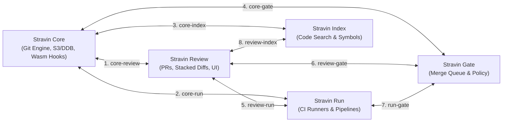

# Product-Stack Interfaces

This section defines the **meet-in-the-middle interface contracts** across all five Stravin product layers: **Stravin Core**, **Stravin Review**, **Stravin Run**, **Stravin Index**, and **Stravin Gate**. Each direct product intersection has one dedicated specification page so teams on both sides can build independently against frozen wire formats, event envelopes, auth boundaries, and contract-test fixtures.

## System-Wide Product Topology



## Intersection Matrix

Every pair of products either has a direct contract page below or stays intentionally decoupled through **Stravin Core**.

| # | Intersection | Primary Direction & Pattern | Core Status | Specification |
| :--- | :--- | :--- | :--- | :--- |
| 1 | **Core <-> Review** | Git Smart HTTP/SSH, Git Data/Diff RPC, `stravin-hook` push events, Wasm hooks | Wire/Hooks in Core v1.12.x; Read-only Git Data API is vNext | [Core <-> Review](core-review.md) |
| 2 | **Core <-> Run** | Ephemeral runner clone/fetch (Valkey+S3 pack cache, `bundle-uri`), push/tag triggers | Wire/PackCache/Hooks in Core v1.12.x; Scoped tokens & `bundle-uri` adv. are vNext | [Core <-> Run](core-run.md) |
| 3 | **Core <-> Index** | Incremental indexing from `stravin-hook` ref events, pack/tree/blob reads, backfill | Wire/Hooks/META in Core v1.12.x; Read-only Object/Stream API is vNext | [Core <-> Index](core-index.md) |
| 4 | **Core <-> Gate** | Sync `wazero` Wasm pre-receive hooks (`HookHostABI`), atomic Ref-CAS merges, epoch fencing | Wasm ABI/Ref-CAS/`stravin-ctrl` in Core v1.12.x; Atomic Merge RPC is vNext | [Core <-> Gate](core-gate.md) |
| 5 | **Review <-> Run** | Check suites/runs, inline annotations, live logs, manual re-run/cancel, stacked diffs | Proposed Contract (vNext) | [Review <-> Run](review-run.md) |
| 6 | **Review <-> Gate** | Approval/policy eligibility snapshot, enqueue/dequeue API, queue feedback, stacked groups | Proposed Contract (vNext) | [Review <-> Gate](review-gate.md) |
| 7 | **Run <-> Gate** | Speculative merge-queue batch builds, `(tree_oid, commit_oid, policy_version)` verdicts, fast cancel | Proposed Contract (vNext) | [Run <-> Gate](run-gate.md) |
| 8 | **Review <-> Index** | PR diff code intelligence (go-to-def, find-refs, hover, cross-repo callers) with lag fallback | Proposed Contract (vNext) | [Review <-> Index](review-index.md) |

### Intentionally Decoupled Pairs

Two of the ten possible pairs have **no direct runtime interface**:

- **Stravin Run <-> Stravin Index (Decoupled via Core):** CI runners do not query the code-search index to execute builds, and the indexer does not depend on runner state to index committed Git trees. If a future CI job needs symbol/graph queries (e.g., affected-target selection), it calls Index through the same read-only tenant API as any external client rather than coupling Run's scheduler to Index.
- **Stravin Index <-> Stravin Gate (Decoupled via Core & Review):** Merge-queue policy decisions must remain deterministic and hermetic against Git commits, CI verdicts, and Review approvals. Gate does not block merges on asynchronous search-index lag. Any code-intelligence check that should gate merges runs as a deterministic **Stravin Run** check or a Tier 1 Wasm hook in **Stravin Core**.

## Shared Platform Contract Conventions

All eight intersection specifications reuse the vocabulary, security boundaries, event envelope, and evolution rules below.

### Canonical Identifiers

| Identifier | Type / Format | Owner | Notes |
| :--- | :--- | :--- | :--- |
| `tenant_id` | String (`[a-z0-9][a-z0-9-_]{1,62}`) | Platform IAM / Core | Mandatory partition prefix on every RPC, HTTP route, cache key, S3 prefix, and DynamoDB key (`T#{tenant_id}`). |
| `repo_id` | String (`[a-z0-9][a-z0-9._-]{1,126}`) | Core (`META`) | Scoped within `tenant_id`; never globally unique without `tenant_id`. |
| `object_format` | Enum: `"sha1"` \| `"sha256"` | Core (`META`) | Stored on `META` (`object_format`, default `"sha1"`). Determines OID hex length (40 vs. 64 lowercase hex). |
| `commit_oid` | 40-char or 64-char lowercase hex | Core | Immutable Git commit hash. Zero OID (`40x0` or `64x0`) denotes ref creation or deletion. |
| `tree_oid` | 40-char or 64-char lowercase hex | Core | Immutable Git root tree hash; used by Run and Gate to reuse verdicts across equivalent rebases. |
| `ref_name` | Full Git ref (`refs/heads/...`, `refs/tags/...`, `refs/stravin/...`) | Core (`RS#s`) | Always fully qualified; never bare branch names like `main`. |
| `failover_epoch` | `uint64` (monotonic, starts at `1`) | Core (`stravin-ctrl`) | Fencing token incremented on regional failover; rejects stale-region writes. |
| `policy_version` | String (ULID or SHA-256 digest of policy bundle) | Gate | Immutable snapshot ID of branch-protection and merge-queue rules evaluated for a verdict. |
| `run_id` | ULID (`run_<ulid>`) | Run | Unique identifier for a CI check run or pipeline execution attempt. |
| `pr_id` | ULID or monotonic repo-scoped ID (`pr_<ulid>`) | Review | Immutable pull request identifier; survives branch renames and force-pushes. |
| `queue_entry_id` | ULID (`qe_<ulid>`) | Gate | Unique identifier for a single PR or stacked-diff group entry inside a merge queue. |

### Auth, Tenancy & Trust Boundaries

1. **Zero Cross-Tenant Leakage:** Every synchronous request and asynchronous event MUST carry `tenant_id`. Receivers MUST verify that the authenticated credential's `tenant_id` matches the payload/path `tenant_id` using constant-time comparison (matching `edge.AuthorizeTenant` in Core v1.12.x).
2. **Short-Lived Scoped Git Tokens (Proposed Core Extension vNext):** Ephemeral services (Run, Review, Index, Gate) authenticate to `stravin-edge` using short-lived JWT/opaque tokens (default TTL 5–15 minutes) scoped to `(tenant_id, repo_id, scopes, ref_globs)` where `scopes` is a subset of `git:read`, `git:write`, `git:write:gate-refs`. Core v1.12.x currently enforces static `tenant_id:actor_id:token` and SSH `authorized_keys` via `edge.StaticAuthenticator`.
3. **Service-to-Service Auth:** Internal gRPC and HTTP calls between Stravin products use **TLS 1.3 with mTLS** (matching `internal/rpc/auth.go`'s `RequireAndVerifyClientCert`) plus signed service JWTs carrying `iss`, `sub`, `aud`, `tenant_id`, `scopes`, and `exp` (<= 5 minutes).
4. **Trace Context Propagation:** Every HTTP request, gRPC stream, and async event propagates W3C `traceparent` (and optional `tracestate` / `baggage`) per `internal/telemetry/propagation.go`. Async consumers link spans using OTel `SpanLinkFromTraceparent`.

### Standard Async Event Envelope

Core v1.12.x (`internal/hooks/async/dispatcher.go`) currently posts a flat push payload (`tenant_id`, `repo_id`, `ref`, `oid`, `pack_id`, `timestamp`) with headers `X-Stravin-Event: push`, `X-Stravin-Signature-256: sha256=<hex>`, and `traceparent`.

All product-to-product webhooks and stream consumers adopt the **Standard Async Event Envelope (vNext)** below, which is an additive, backward-compatible superset of Core v1.12.x's `WebhookPayload`:

```http
POST /webhooks/stravin HTTP/1.1
Content-Type: application/json
X-Stravin-Event: core.ref.updated
X-Stravin-Event-ID: evt_01JDF8Z7Q2K9M4N6P8R0T2V4W6
X-Stravin-Schema-Version: 1.0
X-Stravin-Signature-256: sha256=9f86d081884c7d659a2feaa0c55ad015a3bf4f1b2b0b822cd15d6c15b0f00a08
traceparent: 00-4bf92f3577b34da6a3ce929d0e0e4736-00f067aa0ba902b7-01
```

```json
{
  "event_id": "evt_01JDF8Z7Q2K9M4N6P8R0T2V4W6",
  "event_type": "core.ref.updated",
  "schema_version": "1.0",
  "occurred_at": "2026-11-24T22:15:03.412Z",
  "tenant_id": "acme",
  "repo_id": "monorepo",
  "traceparent": "00-4bf92f3577b34da6a3ce929d0e0e4736-00f067aa0ba902b7-01",
  "idempotency_key": "acme:monorepo:refs/heads/main:01JDF8Z7Q2K9M4N6P8R0T2V4W6",
  "data": {}
}
```

- **Signature Verification:** Computed over the raw UTF-8 HTTP request body bytes using HMAC-SHA256 with the KMS-encrypted webhook secret (`async.SignPayload` / `async.VerifySignature`, constant-time comparison).
- **Delivery Semantics:** At-least-once delivery with exponential backoff (`100 ms` initial, `5 s` max, default 3+ attempts) and Dead-Letter Queue (DLQ) capture on exhaustion. Consumers MUST deduplicate on `idempotency_key` (or `event_id`).

### Compatibility, Versioning & Error Contract

- **N / N-1 Additive Evolution:** Minor versions (`1.0` -> `1.1`) may only add optional fields, new enum values (handled by a default branch), or new endpoints. Removing fields, renaming fields, or narrowing types requires a new major path/package (`/v2/`, `stravin.<product>.v2`).
- **Unknown-Field Tolerance:** All HTTP JSON and Protobuf clients MUST ignore unknown fields on responses and async event payloads. (Note: `stravin-ctrl` admin requests intentionally use `DisallowUnknownFields()` for operator safety; product-to-product consumers must be tolerant on reads.)
- **Canonical Error Shape (HTTP & gRPC):**
    - HTTP errors return `application/json`: `{"code": "REF_CONFLICT", "message": "...", "retryable": false, "trace_id": "..."}`.
    - Retryable conditions: HTTP `429`, `502`, `503`, `504` and gRPC `UNAVAILABLE`, `DEADLINE_EXCEEDED`, `RESOURCE_EXHAUSTED` (respecting `Retry-After` when present).
    - Non-retryable conditions: HTTP `400`, `401`, `403`, `404`, `409`, `422` and gRPC `INVALID_ARGUMENT`, `UNAUTHENTICATED`, `PERMISSION_DENIED`, `NOT_FOUND`, `FAILED_PRECONDITION`, `ALREADY_EXISTS`.

### Status Labels Used Across All Pages

Every contract in this section carries one of two explicit badges:

- **Implemented in Core v1.12.x** — Exists in `stravin-dev/core` today; file paths and symbols match the live Go implementation.
- **Proposed Core Extension (vNext)** or **Proposed Contract (vNext)** — Target interface specification for upcoming development; not yet implemented in `stravin-dev/core` or the upper product.
