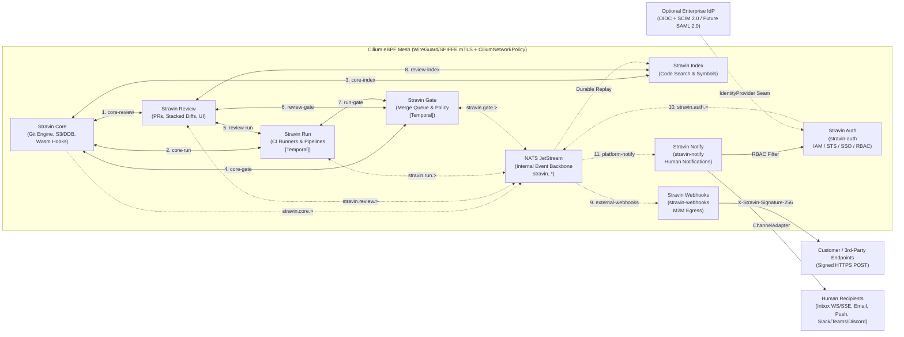

# Product-Stack Interfaces

This section defines the **meet-in-the-middle interface contracts** across all five Stravin product layers (**Stravin Core**, **Stravin Review**, **Stravin Run**, **Stravin Index**, and **Stravin Gate**) plus the three dedicated platform foundation services: **Stravin Webhooks** (`stravin-webhooks`), **Stravin Auth** (`stravin-auth`), and **Stravin Notify** (`stravin-notify`). Each direct intersection has one dedicated specification page so teams on both sides can build independently against frozen wire formats, NATS JetStream subjects, Cilium + app-level auth boundaries, and contract-test fixtures.

> **Transport, Event & Auth Architecture:** All interface contracts align with [ADR-0001: Platform Transport, Internal Events, External Webhooks, and Durable Workflows](../adr/0001-platform-transport-events-webhooks.md) (**Cilium (eBPF)** sidecarless mTLS, **NATS JetStream** internal async events, **Stravin Webhooks** (`stravin-webhooks`) outbound machine-to-machine delivery, and **Temporal** durable workflows for **Run** and **Gate**), [ADR-0002: External Runner Seam, State-Machine Ownership, and OIDC App Authentication](../adr/0002-external-runner-seam-and-oidc-auth.md) (Phase 1 pull-based Job-Lease runners under Run's Temporal DAG, Phase 2 degraded-tier BYO-CI Checks API, external-only OIDC Apps, and Core/Run/Gate hardening invariants), and [ADR-0003: Platform IAM, Authentication, STS, and Pluggable SSO Seam](../adr/0003-platform-auth-and-sso-seam.md) (standalone-first `stravin-auth`, pluggable `IdentityProvider` SSO seam, local JWKS + Valkey `jti` hot-path isolation, and instant SCIM revocation).

## System-Wide Product Topology



## Intersection Matrix

Every pair of products either has a direct contract page below or stays intentionally decoupled through **Stravin Core**.

| # | Intersection | Primary Direction & Pattern | Core Status | Specification |
| :--- | :--- | :--- | :--- | :--- |
| 1 | **Core ⟷ Review** | Git Smart HTTP/SSH, Git Data/Diff gRPC, `STRAVIN_CORE` JetStream push events, Wasm hooks | Wire/Hooks in Core v1.12.x; Git Data API & JetStream publisher are vNext | [Core ⟷ Review](core-review.md) |
| 2 | **Core ⟷ Run** | Ephemeral runner clone/fetch (Valkey+S3 pack cache, `bundle-uri`), `STRAVIN_CORE` JetStream triggers, Run Temporal workflows | Wire/PackCache/Hooks in Core v1.12.x; Scoped tokens, `bundle-uri` & JetStream are vNext | [Core ⟷ Run](core-run.md) |
| 3 | **Core ⟷ Index** | Incremental indexing + replay backfill from `STRAVIN_CORE` JetStream, pack/tree/blob reads | Wire/Hooks/META in Core v1.12.x; Object/Stream API & JetStream are vNext | [Core ⟷ Index](core-index.md) |
| 4 | **Core ⟷ Gate** | Sync `wazero` Wasm pre-receive hooks (`HookHostABI`), atomic Ref-CAS merges, `STRAVIN_CORE` drift events, Gate Temporal workflows | Wasm ABI/Ref-CAS/`stravin-ctrl` in Core v1.12.x; Atomic Merge RPC & JetStream are vNext | [Core ⟷ Gate](core-gate.md) |
| 5 | **Review ⟷ Run** | Check suites/runs via JetStream, inline annotations, live logs, idempotent re-run/cancel, Run Temporal workflows | Proposed Contract (vNext) | [Review ⟷ Run](review-run.md) |
| 6 | **Review ⟷ Gate** | Approval/policy eligibility snapshot, idempotent enqueue/dequeue API, JetStream queue feedback, Gate Temporal workflows | Proposed Contract (vNext) | [Review ⟷ Gate](review-gate.md) |
| 7 | **Run ⟷ Gate** | Speculative merge-queue batch builds, JetStream verdicts bound to `(tree_oid, commit_oid, policy_version, app_id)`, fast cancel, Run & Gate Temporal workflows | Proposed Contract (vNext) | [Run ⟷ Gate](run-gate.md) |
| 8 | **Review ⟷ Index** | PR diff code intelligence (go-to-def, find-refs, hover, cross-repo callers) over Cilium mTLS with lag fallback | Proposed Contract (vNext) | [Review ⟷ Index](review-index.md) |
| 9 | **Platform Events ⟷ External Webhooks** | `stravin-webhooks` subscribing to `stravin.*.>` JetStream streams for outbound machine-to-machine HTTPS delivery, KMS HMAC-SHA256 signing, SSRF isolation, DLQ/replay | Direct HTTP webhooks in Core v1.12.x; Dedicated `stravin-webhooks` service is vNext | [External Webhooks](external-webhooks.md) |
| 10 | **Platform Products ⟷ Stravin Auth** | `stravin-auth` standalone IAM/STS/RBAC, pluggable `IdentityProvider` + `DirectorySyncAdapter` seams (OIDC, SCIM 2.0, optional WorkOS adapter, future SAML 2.0), local JWKS + Valkey `jti` deny-list, `STRAVIN_AUTH` revocations | Static auth in Core v1.12.x; Dedicated `stravin-auth` service is vNext | [Platform Auth](platform-auth.md) |
| 11 | **Platform Events ⟷ Stravin Notify** | `stravin-notify` (parallel to `stravin-webhooks`) subscribing to `stravin.*.>` for human notifications: preferences, quiet hours, digests, `stravin-auth` RBAC filtering, `ChannelAdapter` delivery | Proposed Contract (vNext) | [Platform Notify](platform-notify.md) |

### Intentionally Decoupled Pairs

Two of the ten possible product pairs have **no direct runtime interface**:

- **Stravin Run ⟷ Stravin Index (Decoupled via Core):** CI runners do not query the code-search index to execute builds, and the indexer does not depend on runner state to index committed Git trees. If a future CI job needs symbol/graph queries (e.g., affected-target selection), it calls Index through the same read-only tenant API as any external client rather than coupling Run's scheduler to Index.
- **Stravin Index ⟷ Stravin Gate (Decoupled via Core & Review):** Merge-queue policy decisions must remain deterministic and hermetic against Git commits, CI verdicts, and Review approvals. Gate does not block merges on asynchronous search-index lag. Any code-intelligence check that should gate merges runs as a deterministic **Stravin Run** check or a Tier 1 Wasm hook in **Stravin Core**.

## Shared Platform Contract Conventions

All eleven interface specifications reuse the vocabulary, Cilium + app-level security boundaries, NATS JetStream event envelope, Temporal workflow boundaries, and evolution policies below.

### Canonical Identifiers

| Identifier | Type / Format | Owner | Notes |
| :--- | :--- | :--- | :--- |
| `tenant_id` | String (`[a-z0-9][a-z0-9-_]{1,62}`) | Stravin Auth / Core | Mandatory partition prefix on every RPC, HTTP route, NATS subject, cache key, S3 prefix, and DynamoDB key (`T#{tenant_id}`). |
| `repo_id` | String (`[a-z0-9][a-z0-9._-]{1,126}`) | Core (`META`) | Scoped within `tenant_id`; never globally unique without `tenant_id`. |
| `object_format` | Enum: `"sha1"` \| `"sha256"` | Core (`META`) | Stored on `META` (`object_format`, default `"sha1"`). Determines OID hex length (40 vs. 64 lowercase hex). |
| `commit_oid` | 40-char or 64-char lowercase hex | Core | Immutable Git commit hash. Zero OID (`40x0` or `64x0`) denotes ref creation or deletion. |
| `tree_oid` | 40-char or 64-char lowercase hex | Core | Immutable Git root tree hash; used by Run and Gate to reuse verdicts across equivalent rebases. |
| `ref_name` | Full Git ref (`refs/heads/...`, `refs/tags/...`, `refs/stravin/...`) | Core (`RS#s`) | Always fully qualified; never bare branch names like `main`. |
| `failover_epoch` | `uint64` (monotonic, starts at `1`) | Core (`stravin-ctrl`) | Fencing token incremented on regional failover; rejects stale-region writes. |
| `policy_version` | String (ULID or SHA-256 digest of policy bundle) | Gate | Immutable snapshot ID of branch-protection and merge-queue rules evaluated for a verdict. |
| `run_id` | ULID (`run_<ulid>`) | Run | Unique identifier for a CI check run or pipeline execution attempt. |
| `pr_id` | ULID or monotonic repo-scoped ID (`pr_<ulid>`) | Review | Immutable pull request identifier; survives branch renames and force-pushes. |
| `queue_entry_id` | ULID (`qe_<ulid>`) | Gate | Unique identifier for a single PR or stacked-diff group entry inside a merge queue. |
| `app_id` | ULID (`app_<ulid>`) or `"stravin-run"` | Stravin Auth / Run | Identifies the first-party Run engine or registered external OIDC App installation attesting a check or Gate verdict ([ADR-0002](../adr/0002-external-runner-seam-and-oidc-auth.md), [ADR-0003](../adr/0003-platform-auth-and-sso-seam.md)). |
| `principal_id` | `usr_<ulid>` \| `svc_<ulid>` \| `app_<ulid>` | Stravin Auth | Canonical JWT subject (`sub`) for human users, internal services, and external OIDC Apps ([Platform Auth](platform-auth.md)). |
| `idp_id` | ULID (`idp_<ulid>`) | Stravin Auth | Scoped external enterprise IdentityProvider configuration ID (Phase 1 OIDC + SCIM 2.0; future SAML 2.0). |
| `jti` | ULID (`jti_<ulid>`) | Stravin Auth | Unique JWT identifier checked against the shared Valkey `jti` revocation deny-list. |
| `notification_id` | ULID (`ntf_<ulid>`) | Stravin Notify | Unique identifier for a persisted human notification item ([Platform Notify](platform-notify.md)). |

### Auth, Tenancy & Transport Boundaries (Cilium eBPF + `stravin-auth` + App-Level AuthZ)

1. **Cilium eBPF Sidecarless mTLS & Discovery:** Production Kubernetes transport uses **Cilium (eBPF)** for transparent WireGuard/SPIFFE mTLS at L3/L4, Kubernetes DNS + `EndpointSlice` (+ Cilium Cluster Mesh for multi-region) for discovery, and `CiliumNetworkPolicy` for L3/L4/L7 workload allowlists. This imposes **zero extra proxy hops** on Core's 256 MiB Git streams while `stravin-edge` retains Go HRW `(tenant_id, repo_id)` pinning via a headless Kubernetes Service. (Local Docker Compose retains direct networking and optional app-level TLS 1.3 mTLS matching `internal/rpc/auth.go`'s `RequireAndVerifyClientCert`.)
2. **Mandatory App-Level Tenancy Invariant (Zero Cross-Tenant Leakage):** Cilium authenticates **workload identity**, NOT `tenant_id`. Every synchronous RPC/HTTP handler and every NATS JetStream consumer MUST still verify that the authenticated credential's or envelope's `tenant_id` matches the target resource `tenant_id` using constant-time comparison (matching `edge.AuthorizeTenant` in Core `v1.12.x`).
3. **Standalone-First `stravin-auth` & Off-Hot-Path Verification ([ADR-0003](../adr/0003-platform-auth-and-sso-seam.md)):**
    - **Zero Sync Auth RPCs on Git Hot Path:** `stravin-auth` is never called synchronously on `git push` / `git fetch`. `stravin-edge` and all product services verify `stravin-auth` JWTs locally via cached JWKS (`/.well-known/jwks.json`) + sub-millisecond Valkey `jti` deny-list checks.
    - **Internal First-Party Products (`Core`, `Review`, `Run`, `Index`, `Gate`, `Webhooks`, `Auth`, `Notify`):** Stay on Cilium SPIFFE mTLS + signed internal service JWTs (`iss`, `sub`, `aud`, `tenant_id`, `scopes`, `exp <= 5m`) + mandatory constant-time app-level `tenant_id` checks. Internal services are never forced through external OIDC App installation flows.
    - **External Runners, External CI & Third-Party Integrations (OIDC Apps — [ADR-0002](../adr/0002-external-runner-seam-and-oidc-auth.md)):** Authenticate via **OIDC Apps** managed by `stravin-auth` (App Registration + Tenant Installation + OIDC workload identity exchange -> short-lived, single-job/scoped tokens with zero static secrets, strict `aud` pinning, short `exp`, and `jti` replay protection). Run never fetches arbitrary tenant-supplied JWKS URLs directly (`stravin-auth` enforces pinned public keys or SSRF-hardened safe-dialer egress).
    - **Scoped Git Tokens (`stravin-edge`):** External job-lease and Checks API checkouts use **`commit_oid`-pinned `git:read` tokens (`TTL <= 120s`)** refreshed only via Run while the lease/job is active (never embedded in webhooks). `bundle-uri` presigned S3 URLs require explicit **`git:bundle:read`** scope (auto-granted to Cilium-attested internal pools; opt-in for authorized external pools; presigned URL TTL `<= min(token_remaining_ttl, 120s)`). `git:write` is restricted to explicitly configured protected release/tag pools with narrow `ref_globs` and active server-side `jti` revocation. Core `v1.12.x` currently enforces static `tenant_id:actor_id:token` and SSH `authorized_keys` via `edge.StaticAuthenticator`.
4. **Trace Context Propagation:** Every HTTP request, gRPC stream, and NATS JetStream message propagates W3C `traceparent` (and optional `tracestate` / `baggage`) per `internal/telemetry/propagation.go`. Async consumers link spans using OTel `SpanLinkFromTraceparent`.

### Internal Async Event Backbone (NATS JetStream) & Standard Event Envelope

- **Implemented in Core v1.12.x:** `stravin-hook` (`cmd/stravin-hook`, `internal/hooks/async/dispatcher.go`) currently posts a flat push payload (`tenant_id`, `repo_id`, `ref`, `oid`, `pack_id`, `timestamp`) directly over HTTP `POST` with headers `X-Stravin-Event: push`, `X-Stravin-Signature-256: sha256=<hex>`, and `traceparent`.
- **Proposed Platform Architecture (vNext — NATS JetStream):** All *internal* product-to-product async events publish to **NATS JetStream** (3- or 5-pod Raft-replicated `StatefulSet` + PVCs in Kubernetes; single `nats` container with volume in local Docker Compose). In Core `vNext`, `stravin-hook` is renamed to **`stravin-relay`**—a pure DynamoDB Streams -> NATS JetStream transactional outbox relay with zero Wasm and zero external HTTP delivery. Outbound machine-to-machine HTTP delivery and `X-Stravin-Signature-256` signing are handled exclusively by [Stravin Webhooks (`stravin-webhooks`)](external-webhooks.md), while human-facing notifications run in parallel in [Stravin Notify (`stravin-notify`)](platform-notify.md).

**Canonical Subject Hierarchy:**

```text
stravin.<product>.<tenant_id>.<repo_id>.<event>   # repo-scoped events
stravin.auth.<tenant_id>.<event>                  # tenant-scoped auth/revocation events
```

**NATS JetStream Streams & Headers:**

| Stream | Subject Filter | Purpose |
| :--- | :--- | :--- |
| `STRAVIN_CORE` | `stravin.core.>` | Ref updates, repo metadata changes, repo tombstones (retained for Index replay/backfill) |
| `STRAVIN_REVIEW` | `stravin.review.>` | PR open/update hints, approvals, mentions, eligibility invalidations |
| `STRAVIN_RUN` | `stravin.run.>` | Check suite/run transitions, individual gate check completions, batch verdicts |
| `STRAVIN_GATE` | `stravin.gate.>` | Merge queue position updates, evictions, atomic merges |
| `STRAVIN_AUTH` | `stravin.auth.>` | Instant `principal.revoked`, `principal.role_changed`, `security.alert`, and `jwks.rotated` events |
| `STRAVIN_DLQ` | `stravin.dlq.>` | Dead-lettered messages captured from `$JS.EVENT.ADVISORY.CONSUMER.MAX_DELIVERIES.>` |

```text
Subject: stravin.core.acme.monorepo.ref.updated
Headers:
  Nats-Msg-Id: acme:monorepo:refs/heads/main:01JDF8Z7Q2K9M4N6P8R0T2V4W6
  Stravin-Event-Type: core.ref.updated
  Stravin-Schema-Version: 1.0
  traceparent: 00-4bf92f3577b34da6a3ce929d0e0e4736-00f067aa0ba902b7-01
```

```json
{
  "event_id": "evt_01JDF8Z7Q2K9M4N6P8R0T2V4W6",
  "event_type": "core.ref.updated",
  "schema_version": "1.0",
  "occurred_at": "2026-11-24T22:15:03.412Z",
  "tenant_id": "acme",
  "repo_id": "monorepo",
  "traceparent": "00-4bf92f3577b34da6a3ce929d0e0e4736-00f067aa0ba902b7-01",
  "idempotency_key": "acme:monorepo:refs/heads/main:01JDF8Z7Q2K9M4N6P8R0T2V4W6",
  "data": {}
}
```

- **Delivery & Deduplication:** At-least-once delivery via durable pull/push consumers with server-side `Nats-Msg-Id` deduplication (mapped 1:1 to `idempotency_key`), configurable `AckWait` + backoff redelivery, and DLQ advisory capture on `MaxDeliver` exhaustion. Consumers MUST still enforce idempotency on `idempotency_key` (or `event_id`).

### Durable Workflow Engine (Temporal)

- **Official Scope (Run & Gate):** **Temporal** is the official durable workflow engine for **Stravin Run** (CI pipeline DAG workflows, fan-out/fan-in, heartbeating, retries, cancellations, timeouts) and **Stravin Gate** (speculative merge-queue batch workflows, enqueue/dequeue/verdict signals, atomic Ref-CAS merge activities). Neither service builds throwaway custom state machines. Both still expose **idempotent command/query APIs** (`Idempotency-Key`, explicit cancel and status-read endpoints) and **NATS JetStream** events so sibling products remain decoupled from Temporal internals and never share workflow histories.
- **Temporal-Free Services:** **Stravin Core**, **Stravin Review**, **Stravin Index**, **Stravin Webhooks** (`stravin-webhooks`), **Stravin Auth** (`stravin-auth`), and **Stravin Notify** (`stravin-notify`) remain permanently Temporal-free (synchronous gRPC/HTTP + NATS JetStream events only).

### Compatibility, Versioning & Error Contract

- **N / N-1 Additive Evolution:** Minor versions (`1.0` -> `1.1`) may only add optional fields, new enum values (handled by a default branch), or new endpoints/subjects. Removing fields, renaming fields, or narrowing types requires a new major path/package (`/v2/`, `stravin.<product>.v2`).
- **Unknown-Field Tolerance:** All HTTP JSON, Protobuf, and NATS JetStream consumers MUST ignore unknown fields on responses and async event payloads. (Note: `stravin-ctrl` admin requests intentionally use `DisallowUnknownFields()` for operator safety; product-to-product consumers must be tolerant on reads.)
- **Canonical Error Shape (HTTP & gRPC):**
    - HTTP errors return `application/json`: `{"code": "REF_CONFLICT", "message": "...", "retryable": false, "trace_id": "..."}`.
    - Retryable conditions: HTTP `429`, `502`, `503`, `504` and gRPC `UNAVAILABLE`, `DEADLINE_EXCEEDED`, `RESOURCE_EXHAUSTED` (respecting `Retry-After` when present).
    - Non-retryable conditions: HTTP `400`, `401`, `403`, `404`, `409`, `422` and gRPC `INVALID_ARGUMENT`, `UNAUTHENTICATED`, `PERMISSION_DENIED`, `NOT_FOUND`, `FAILED_PRECONDITION`, `ALREADY_EXISTS`.

### Status Labels Used Across All Pages

Every contract in this section carries one of two explicit badges:

- **Implemented in Core v1.12.x** — Exists in `stravin-dev/core` today; file paths and symbols match the live Go implementation.
- **Proposed Core Extension (vNext)** or **Proposed Contract (vNext)** — Target interface specification for upcoming development; not yet implemented in `stravin-dev/core` or the upper product.
