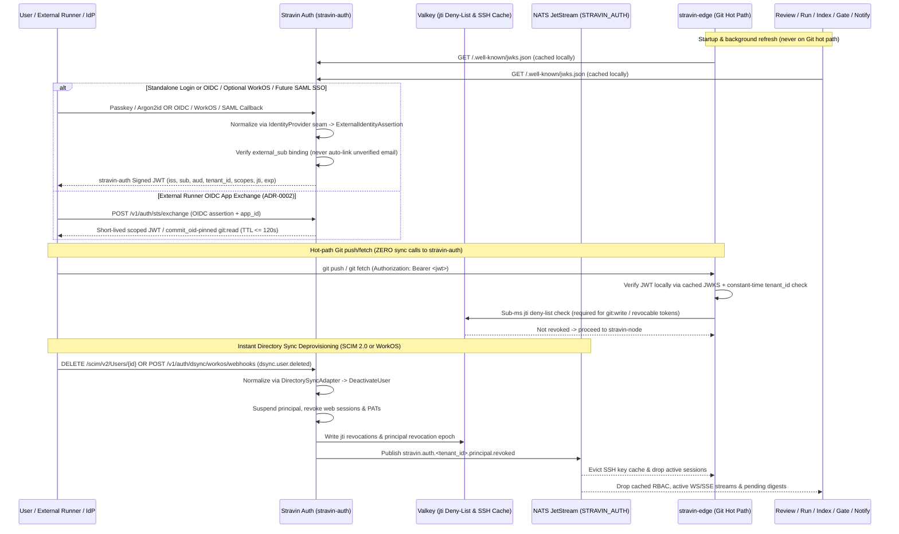

# Platform Products ⟷ Stravin Auth (`stravin-auth`)

This specification defines the meet-in-the-middle contract between **Stravin Auth** (`stravin-auth`, the platform IAM, authentication, STS, and coarse RBAC service) and all consuming Stravin platform services (**Stravin Core**, **Stravin Review**, **Stravin Run**, **Stravin Index**, **Stravin Gate**, **Stravin Webhooks**, and **Stravin Notify**).

> **Contract Status:** **Proposed Contract (vNext)** — See [ADR-0003: Platform IAM, Authentication, STS, and Pluggable SSO Seam](../adr/0003-platform-auth-and-sso-seam.md) and [ADR-0002: External Runner Seam, State-Machine Ownership, and OIDC App Authentication](../adr/0002-external-runner-seam-and-oidc-auth.md). Core `v1.12.x` currently enforces static `tenant_id:actor_id:token` credentials and SSH `authorized_keys` via `edge.StaticAuthenticator`; `stravin-auth` replaces static auth in `vNext` while remaining strictly off the synchronous Git hot path.

## 1. Boundary & Ownership

| Concern | Source of Truth | Private Implementation Details (Never Crosses Boundary) |
| :--- | :--- | :--- |
| **Local accounts (passkeys/WebAuthn, Argon2id), SSH & GPG keys, PATs, OIDC Apps & installations** | **Stravin Auth** (`stravin-auth`) | Password hashes, WebAuthn challenges, PAT hash table, KMS signing key custody |
| **External SSO (`IdentityProvider`: Phase 1 OIDC, Optional WorkOS SSO, Future SAML 2.0) & Directory Sync (`DirectorySyncAdapter`: Native SCIM 2.0, Optional WorkOS Directory Sync)** | **Stravin Auth** (`stravin-auth`) | IdP/broker protocol parsing, PKCE/state stores, WorkOS webhook HMAC verification, SAML XML verification, SSRF-hardened discovery/JWKS client |
| **Sole STS token minting (service JWTs, user JWTs, `commit_oid`-pinned Git tokens), Valkey `jti` deny-list, coarse org/repo RBAC** | **Stravin Auth** (`stravin-auth`) | Private signing keys, RBAC assignment tables, directory group-to-role rules (WorkOS never mints tokens accepted by downstream products) |
| **Local JWT verification (`/.well-known/jwks.json`) & sub-ms Valkey `jti` checks** | **Consuming Products** (`stravin-edge`, Review, Run, Index, Gate, Webhooks, Notify) | In-process JWKS cache, per-request token parser, constant-time `tenant_id` middleware |
| **Domain-specific policies (Wasm hooks, branch protection / `CODEOWNERS`, runner pool isolation / leases)** | **Owning Products** (`stravin-node`, Gate, Run) | `HookHostABI` Wasm execution, `policy_version` bundles, Temporal runner leases |
| **Pod-to-pod workload identity & transport encryption** | **Cilium eBPF Mesh** | WireGuard tunnels, SPIFFE certificates, `CiliumNetworkPolicy` eBPF maps |

## 2. Interaction Flow



## 3. Auth, Tenancy & Trust Boundary

- **Cilium eBPF Mesh + App-Level Tenancy:** Internal calls to `stravin-auth` (JWKS, STS exchange, SSH key resolution, RBAC batch filter) traverse **Cilium (eBPF)** WireGuard/SPIFFE mTLS with strict `CiliumNetworkPolicy` allowlists. Every endpoint and NATS event still enforces constant-time `tenant_id` verification in application code.
- **Strictly Off the Synchronous Hot Path:** `stravin-edge` and all product services MUST NOT make synchronous RPCs to `stravin-auth` on every `git push`, `git fetch`, or hot-path request. Authentication on the hot path uses **in-process JWKS signature verification** plus **Valkey `jti` deny-list lookups** (sub-millisecond).
- **No Auto-Linking Unverified Emails:** `stravin-auth` rejects any SSO login that attempts to match an existing local account by email when `email_verified` is `false` or without an explicit `(tenant_id, idp_id, external_sub)` link (returning `409 ACCOUNT_LINK_REQUIRED`).
- **SSRF-Hardened Outbound Egress:** `stravin-auth` is the sole IAM component permitted outbound HTTPS egress to external OIDC IdP discovery/JWKS endpoints (fulfilling [ADR-0002](../adr/0002-external-runner-seam-and-oidc-auth.md)'s IAM/STS egress proxy requirement). Its HTTP dialer resolves DNS immediately prior to dialing and blocks private, loopback, link-local (`169.254.169.254`), carrier-grade NAT, and multicast CIDRs.
- **Sole Token Issuer Invariant:** `stravin-auth` is the **only** service that mints JWTs, PATs, and Git STS tokens trusted by Stravin services. External IdPs and optional brokers such as WorkOS (`workos.com`) authenticate or sync users into `stravin-auth` only and NEVER issue tokens accepted by Core, Review, Run, Index, Gate, Webhooks, or Notify.
- **Directory Sync Scoping & Webhook Verification:** Each tenant's SCIM 2.0 bearer token is strictly bound to one `tenant_id`, hashed at rest (Argon2id/SHA-256), supports dual-token rotation, and can never read or modify principals outside its `tenant_id`. Optional WorkOS Directory Sync webhooks (`POST /v1/auth/dsync/workos/webhooks`) require per-tenant HMAC-SHA256 signature verification (`WorkOS-Signature` header) with timestamp replay-window enforcement (`<= 5m` skew) and constant-time MAC comparison before dispatching into `DirectorySyncAdapter`.
- **Temporal-Free Service:** `stravin-auth` remains permanently Temporal-free (synchronous HTTP/gRPC + Valkey + NATS JetStream only).

## 4. Synchronous Interfaces

### 4.1 JWKS Discovery Endpoint — *Proposed Contract (vNext)*

```http
GET /.well-known/jwks.json HTTP/1.1
Host: stravin-auth.internal
```

Returns RFC 7517 JSON Web Key Set containing active and overlapping-rotation public keys (`EdDSA` / `ES256`, `kid`, `use: "sig"`). Consuming services cache the keyset in memory (`Cache-Control: max-age=300`) and trigger immediate out-of-band refresh when encountering an unknown `kid` (rate-limited) or receiving `stravin.auth.<tenant_id>.jwks.rotated`.

### 4.2 STS Token Exchange & Scoped Minting API — *Proposed Contract (vNext)*

Used for internal service JWT minting (`exp <= 5m`), external OIDC App workload identity exchange ([ADR-0002](../adr/0002-external-runner-seam-and-oidc-auth.md)), and scoped Git token issuance:

```http
POST /v1/auth/sts/exchange HTTP/1.1
Host: stravin-auth.internal
Content-Type: application/json
Authorization: Bearer <caller-assertion-or-service-jwt>
traceparent: 00-4bf92f3577b34da6a3ce929d0e0e4736-00f067aa0ba902b7-01

{
  "grant_type": "urn:ietf:params:oauth:grant-type:token-exchange",
  "tenant_id": "acme",
  "repo_id": "monorepo",
  "audience": "stravin-edge",
  "scopes": ["git:read"],
  "commit_oid": "9f86d081884c7d659a2feaa0c55ad015a3bf4f1b",
  "ttl_seconds": 120
}
```

Response (`200 OK`):

```json
{
  "access_token": "eyJhbGciOiJFZERTQSIsImtpZCI6ImtleV8wMUpERi4uLiJ9...",
  "token_type": "Bearer",
  "jti": "jti_01JDF9Z1A2B3C4D5E6F7G8H9J0",
  "expires_in": 120
}
```

### 4.3 Cold-Path SSH Public Key Resolution — *Proposed Contract (vNext)*

```http
POST /v1/auth/ssh/resolve HTTP/1.1
Host: stravin-auth.internal
Content-Type: application/json
Authorization: Bearer <edge-service-jwt>

{
  "tenant_id": "acme",
  "fingerprint_sha256": "SHA256:47DEQpj8HBSa+/TImW+5JCeuQeRkm5NMpJWZG3hSuFU"
}
```

- Called by `stravin-edge` **only on Valkey cache miss**; responses are cached in Valkey (`TTL <= 60s`) and eagerly evicted on `principal.revoked` or `ssh_key.revoked` JetStream events.
- `stravin-auth` also stores users' **GPG** and **SSH signing public keys** for cold-path commit signature verification by `stravin-review` (powering `Verified` badges on commits and PRs), using the same Valkey cache and revocation-eviction pattern.

### 4.4 Coarse RBAC Check & Batch Visibility Filter — *Proposed Contract (vNext)*

```http
POST /v1/auth/rbac/filter HTTP/1.1
Host: stravin-auth.internal
Content-Type: application/json
Authorization: Bearer <service-jwt>

{
  "tenant_id": "acme",
  "repo_id": "monorepo",
  "action": "repo:read",
  "principal_ids": ["usr_01JDF8...", "usr_01JDF9..."]
}
```

Response (`200 OK`):

```json
{
  "allowed_principal_ids": ["usr_01JDF8..."],
  "denied_principal_ids": ["usr_01JDF9..."]
}
```

- Used by **Stravin Notify** (to guarantee removed users never receive private PR titles/diffs), **Stravin Index** (search result filtering), and control-plane endpoints. Never called on Core's Git push/fetch hot path.

### 4.5 Pluggable `IdentityProvider` Seam & Enterprise SSO Endpoints — *Proposed Contract (vNext)*

Internal login adapter seam inside `stravin-auth`:

```go
type ExternalIdentityAssertion struct {
    TenantID      string
    IdPID         string
    ExternalSub   string
    Email         string
    EmailVerified bool
    Groups        []string
}

type IdentityProvider interface {
    Protocol() string // "oidc" (Phase 1) | "workos" (Optional) | "saml2" (Future)
    BeginAuth(ctx context.Context, req BeginAuthRequest) (RedirectURL string, err error)
    CompleteAuth(ctx context.Context, req CallbackRequest) (ExternalIdentityAssertion, error)
}
```

- **Phase 1 Native OIDC Endpoints:** `GET /v1/auth/sso/{tenant_id}/oidc/login`, `GET /v1/auth/sso/{tenant_id}/oidc/callback` (Auth Code + PKCE `S256`, pinned issuer, safe-dialer discovery/JWKS).
- **Optional WorkOS SSO Adapter (`workos.com`):** `GET /v1/auth/sso/{tenant_id}/workos/login`, `GET /v1/auth/sso/{tenant_id}/workos/callback` — optional managed-SaaS broker adapter implementing `IdentityProvider`. Exchanges the WorkOS authorization code for the user profile over `stravin-auth`'s SSRF-hardened egress client and emits the identical `ExternalIdentityAssertion`. Self-hosted and local dev deployments require zero WorkOS dependency, and `stravin-auth` remains the sole JWT issuer.
- **Future Native SAML 2.0 Endpoints:** `GET /v1/auth/sso/{tenant_id}/saml/metadata`, `POST /v1/auth/sso/{tenant_id}/saml/acs` (plugs into `IdentityProvider.CompleteAuth` with zero downstream product changes).

### 4.6 Pluggable `DirectorySyncAdapter` Seam & Provisioning Endpoints — *Proposed Contract (vNext)*

Internal provisioning/deprovisioning adapter seam inside `stravin-auth` normalizing both native SCIM 2.0 and optional WorkOS Directory Sync into one canonical event union:

```go
type DirectorySyncEventKind string

const (
    DirSyncUpsertUser        DirectorySyncEventKind = "UpsertUser"
    DirSyncDeactivateUser    DirectorySyncEventKind = "DeactivateUser"
    DirSyncSyncGroup         DirectorySyncEventKind = "SyncGroup"
    DirSyncRemoveGroupMember DirectorySyncEventKind = "RemoveGroupMember"
)

// DirectorySyncEvent is the normalized union consumed by stravin-auth's
// internal provisioning and revocation pipeline.
type DirectorySyncEvent struct {
    Kind          DirectorySyncEventKind // UpsertUser | DeactivateUser | SyncGroup | RemoveGroupMember
    TenantID      string
    IdPID         string
    EventID       string                 // Adapter-scoped idempotency key
    ExternalSub   string                 // Immutable external user ID (for user/membership events)
    Email         string                 // Normalized lowercase email (for UpsertUser)
    EmailVerified bool                   // Must never auto-link unverified local accounts
    GroupID       string                 // External group identifier (for SyncGroup / RemoveGroupMember)
    GroupName     string                 // Human-readable group name for deterministic role mapping
    MemberSubs    []string               // Full or delta member ExternalSub list (for SyncGroup)
    Reason        string                 // e.g. "scim_deactivated" | "workos_dsync_deleted"
}

type DirectorySyncAdapter interface {
    Source() string // "scim2" (Native) | "workos" (Optional)
    ParseAndVerify(ctx context.Context, req InboundSyncRequest) ([]DirectorySyncEvent, error)
}
```

- **Native SCIM 2.0 Endpoints (Phase 1):** `GET/POST /scim/v2/Users`, `GET/PUT/PATCH/DELETE /scim/v2/Users/{id}`, `GET/POST/PUT/PATCH/DELETE /scim/v2/Groups` (RFC 7643/7644, per-tenant scoped bearer token).
    - `POST/PUT /scim/v2/Users` -> `UpsertUser`; `PATCH /scim/v2/Users/{id}` (`active: false`) or `DELETE /scim/v2/Users/{id}` -> `DeactivateUser`; `POST/PUT/PATCH /scim/v2/Groups` -> `SyncGroup` / `RemoveGroupMember`.
- **Optional WorkOS Directory Sync Webhook Endpoint:**

```http
POST /v1/auth/dsync/workos/webhooks HTTP/1.1
Host: stravin-auth.internal
Content-Type: application/json
WorkOS-Signature: t=1795644311, v1=8f4c2a1b9e...
```

- **Webhook Verification & Normalization:**
    - Verifies the `WorkOS-Signature` HMAC-SHA256 digest in constant time against the tenant's configured webhook signing secret and rejects timestamps outside the replay window (`|now - t| > 300s`) with `401 UNAUTHORIZED`.
    - Normalizes `dsync.user.created` / `dsync.user.updated` -> `UpsertUser`, `dsync.user.deleted` -> `DeactivateUser`, `dsync.group.created` / `dsync.group.updated` / `dsync.group.user_added` -> `SyncGroup`, and `dsync.group.user_removed` -> `RemoveGroupMember`.
- **Identical Revocation & RBAC Pipeline:** Both native SCIM 2.0 and WorkOS Directory Sync events execute the exact same internal handler: `DeactivateUser` synchronously suspends the principal, revokes web sessions/PATs/SSH keys, writes Valkey `jti` deny-list / `rev_epoch` entries, and publishes `stravin.auth.<tenant_id>.principal.revoked`; `SyncGroup` / `RemoveGroupMember` updates coarse RBAC and publishes `stravin.auth.<tenant_id>.principal.role_changed`.

## 5. Asynchronous Events & Streams

`stravin-auth` publishes tenant-scoped security and revocation events to the **`STRAVIN_AUTH`** NATS JetStream stream (`stravin.auth.>`):

| Subject Pattern | Event Type | Consumers | Purpose |
| :--- | :--- | :--- | :--- |
| `stravin.auth.<tenant_id>.principal.revoked` | `auth.principal.revoked` | Core (`stravin-edge`), Review, Run, Index, Gate, Webhooks, Notify | Instant session/PAT/SSH cache eviction, WS/SSE disconnect, pending digest cancellation |
| `stravin.auth.<tenant_id>.principal.role_changed` | `auth.principal.role_changed` | Review, Index, Gate, Notify | Invalidate cached repo/org role snapshots after RBAC or SCIM group update |
| `stravin.auth.<tenant_id>.security.alert` | `auth.security.alert` | Notify, Webhooks (optional audit) | Trigger user/admin notifications (new PAT, passkey removed, SSO config changed, suspicious login) |
| `stravin.auth.<tenant_id>.jwks.rotated` | `auth.jwks.rotated` | All Services | Proactive JWKS cache refresh hint during key rotation |

Example `principal.revoked` envelope:

```json
{
  "event_id": "evt_01JDFA1B2C3D4E5F6G7H8J9K0L",
  "event_type": "auth.principal.revoked",
  "schema_version": "1.0",
  "occurred_at": "2026-11-26T14:05:11.204Z",
  "tenant_id": "acme",
  "traceparent": "00-4bf92f3577b34da6a3ce929d0e0e4736-00f067aa0ba902b7-01",
  "idempotency_key": "acme:usr_01JDF9...:revoked:1795644311",
  "data": {
    "principal_id": "usr_01JDF9A1B2C3D4E5F6G7H8J9K0",
    "reason": "scim_deactivated",
    "revocation_epoch": 4,
    "revoked_jtis": ["jti_01JDF9Z1A2B3C4D5E6F7G8H9J0"]
  }
}
```

## 6. Shared Data Contracts & Identifiers

| Identifier / Key | Format | Notes |
| :--- | :--- | :--- |
| `principal_id` | `usr_<ulid>` \| `svc_<ulid>` \| `app_<ulid>` | Canonical subject (`sub`) for humans, internal services, and external OIDC Apps |
| `idp_id` | `idp_<ulid>` | Unique external IdP configuration ID scoped to `tenant_id` |
| `jti` | `jti_<ulid>` | Unique JWT ID used for replay protection and Valkey revocation |
| **Canonical JWT Claims** | `iss`, `sub`, `aud`, `tenant_id`, `repo_id` (opt), `commit_oid` (opt), `ref_globs` (opt), `scopes`, `jti`, `rev_epoch`, `iat`, `exp` | Signed with `EdDSA` (Ed25519) or `ES256`; unknown claims ignored by readers |
| **Valkey `jti` Deny-List Key** | `auth:jti:revoked:{tenant_id}:{jti}` | Value: `1`; TTL = remaining token lifetime (`<= exp - now`) |
| **Valkey Principal Epoch Key** | `auth:rev_epoch:{tenant_id}:{principal_id}` | Monotonic integer; rejects any token whose `rev_epoch` is lower |

## 7. Failure Modes, Timeouts & Idempotency

| Failure Scenario | Behavior & Degradation | Timeout / Retry Policy |
| :--- | :--- | :--- |
| **`stravin-auth` temporarily unreachable during Git push/fetch** | Zero hot-path outage: `stravin-edge` and product services continue verifying tokens locally using cached JWKS. Only new logins, STS exchanges, and cold SSH cache misses are affected. | JWKS cache TTL: `5 m`; stale-while-revalidate grace: `15 m`. |
| **Valkey `jti` deny-list unreachable** | **Fail closed** (`503 UNAVAILABLE`) for `git:write`, admin mutations, and SCIM-sensitive operations so revoked principals cannot mutate state. Read-only `git:read` with `TTL <= 120s` may optionally log/alert and fall back to strict short-TTL expiry per tenant policy. | Valkey lookup timeout: `50 ms` (no retries on hot path). |
| **External OIDC IdP discovery/JWKS slow or SSRF target** | Safe dialer blocks private/link-local/loopback IPs immediately (`BLOCKED_SSRF`, non-retryable). If IdP is down, tenant SSO login fails gracefully while standalone break-glass admin accounts remain usable. | Outbound IdP timeout: `5 s`; max 1 retry on transient `5xx`. |
| **SSO login matches existing local email with `email_verified=false`** | Hard reject with `409 ACCOUNT_LINK_REQUIRED`; audit event logged; local account untouched. | Zero retries; non-retryable security rejection. |
| **Duplicate SCIM or WorkOS Directory Sync webhook** | Idempotent on `(tenant_id, idp_id, event_id)` / `(tenant_id, idp_id, external_sub)` and JetStream `Nats-Msg-Id`; `revocation_epoch` increments monotonically only on state change. | At-least-once event propagation; idempotent consumers. |
| **Invalid WorkOS webhook signature or stale timestamp (`> 5m`)** | Hard reject with `401 UNAUTHORIZED` before parsing payload; audit counter incremented; no directory mutation applied. | Zero retries; non-retryable security rejection. |

## 8. Meet-in-the-Middle Bridge Checklist

### Side A: Stravin Auth (`stravin-auth`)

- [ ] Implement standalone auth store (passkeys/WebAuthn, Argon2id, SSH & GPG keys, PATs, OIDC Apps, coarse org/repo RBAC) with zero external IdP dependency.
- [ ] Implement `IdentityProvider` seam normalizing external assertions into `(tenant_id, idp_id, external_sub, email, email_verified, groups[])` with Phase 1 Native OIDC (Auth Code + PKCE, safe-dialer JWKS) and optional WorkOS SSO adapter (`workos.com`), keeping `stravin-auth` as sole token issuer.
- [ ] Implement `DirectorySyncAdapter` seam normalizing native SCIM 2.0 (`/scim/v2/Users`, `/scim/v2/Groups`) and optional WorkOS Directory Sync webhooks (`POST /v1/auth/dsync/workos/webhooks`, HMAC-SHA256 + timestamp replay verification) into `DirectorySyncEvent` (`UpsertUser`, `DeactivateUser`, `SyncGroup`, `RemoveGroupMember`).
- [ ] Enforce no auto-linking to unverified local emails and constant-time `tenant_id` checks on every route.
- [ ] Write `jti` revocations and `rev_epoch` to Valkey and publish `stravin.auth.<tenant_id>.principal.revoked` on SCIM deactivation, suspension, or role downgrade.
- [ ] Serve `/.well-known/jwks.json`, `/v1/auth/sts/exchange`, `/v1/auth/ssh/resolve`, and `/v1/auth/rbac/filter`.

### Side B: Consuming Platform Services (`Core`, `Review`, `Run`, `Index`, `Gate`, `Webhooks`, `Notify`)

- [ ] Verify `stravin-auth` JWTs locally via cached JWKS + constant-time `tenant_id` checks; never call `stravin-auth` synchronously on the Git push/fetch hot path.
- [ ] Check Valkey `jti` deny-list / `rev_epoch` for revocable tokens (`git:write`, external runner leases, privileged APIs).
- [ ] Subscribe to `STRAVIN_AUTH` (`stravin.auth.<tenant_id>.principal.revoked`, `role_changed`, `jwks.rotated`) to evict local caches and drop active sessions/streams within seconds.
- [ ] Keep zero IdP-specific protocol code inside Core, Review, Run, Index, Gate, Webhooks, and Notify.

### Shared Contract-Test Fixtures

- `fixtures/platform-auth/jwt-claims-vectors.json` — Valid, expired, wrong-audience, cross-tenant, and `commit_oid`-pinned JWT verification vectors against a test JWKS.
- `fixtures/platform-auth/scim-revocation-flow.json` — SCIM `active: false` patch -> expected Valkey `jti`/`rev_epoch` mutations and `stravin.auth.<tenant_id>.principal.revoked` JetStream envelope.
- `fixtures/platform-auth/dirsync-workos-scim-equivalence.json` — Verifies that an HMAC-signed WorkOS `dsync.user.deleted` webhook (`POST /v1/auth/dsync/workos/webhooks`) produces the exact same Valkey `jti` / `rev_epoch` revocation mutations and `stravin.auth.<tenant_id>.principal.revoked` JetStream event as a native SCIM `DELETE /scim/v2/Users/{id}` request (plus invalid-signature and stale-timestamp `401` rejection cases).
- `fixtures/platform-auth/sso-unverified-email-reject.json` — `ExternalIdentityAssertion` vectors verifying `409 ACCOUNT_LINK_REQUIRED` when `email_verified=false` or unlinked local account exists.
- `fixtures/platform-auth/ssrf-blocked-oidc-issuers.json` — Private IPv4/IPv6, loopback, `169.254.169.254`, and DNS-rebinding IdP discovery/JWKS URLs verifying fail-closed rejection.
