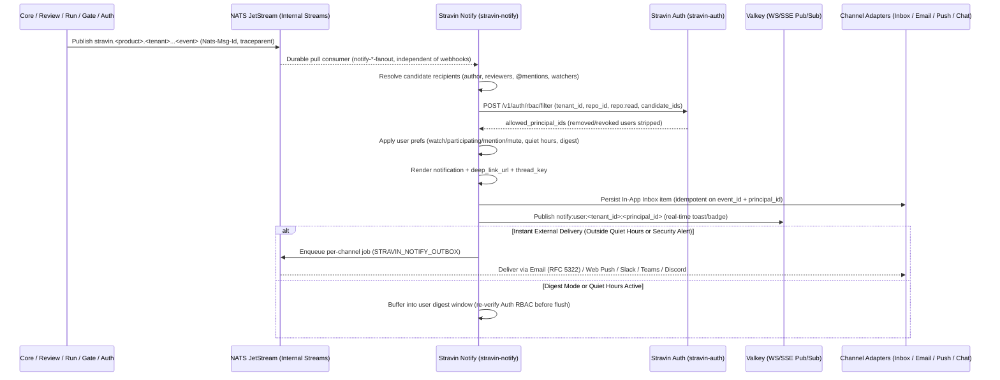

# Platform Events ⟷ Stravin Notify (`stravin-notify`)

This specification defines the meet-in-the-middle contract between internal **NATS JetStream Platform Events** (emitted by **Stravin Core**, **Stravin Review**, **Stravin Run**, **Stravin Gate**, and **Stravin Auth**) and **Stravin Notify** (`stravin-notify`), the dedicated human-facing user notification service running **in parallel to** [Stravin Webhooks (`stravin-webhooks`)](external-webhooks.md).

> **Contract Status:** **Proposed Contract (vNext)** — Aligns with [ADR-0001: Platform Transport, Internal Events, External Webhooks, and Durable Workflows](../adr/0001-platform-transport-events-webhooks.md) and [ADR-0003: Platform IAM, Authentication, STS, and Pluggable SSO Seam](../adr/0003-platform-auth-and-sso-seam.md). `stravin-notify` is a **Temporal-free** platform service with independent JetStream durable consumers and blast radius.

## 1. Boundary & Ownership

### Why Parallel to `stravin-webhooks` (NOT Merged)

`stravin-webhooks` and `stravin-notify` both subscribe independently to the **same NATS JetStream streams**, but solve fundamentally different problems with opposite security, tenancy, and delivery semantics:

| Dimension | Stravin Webhooks (`stravin-webhooks`) | Stravin Notify (`stravin-notify`) |
| :--- | :--- | :--- |
| **Audience & Scope** | **Machine-to-machine** — repo/org-scoped automation & external CI | **Human-facing** — user-scoped (`principal_id`) personal inbox & alerts |
| **Payload Format** | Raw canonical public JSON envelopes | Rendered human templates, snippets, deep links, RFC 5322 email threads, interactive chat cards |
| **Filtering & State** | Repo/org event filters and `ref_globs` | User preferences (watch / participating / mention / mute), quiet hours, digest batching, read/unread/archive state |
| **Authorization Check** | Tenant/repo subscription match | **Per-recipient RBAC visibility filtering via `stravin-auth`** (removed users never see private PR titles or diffs) |
| **Delivery Mechanics** | Arbitrary customer HTTPS URLs, KMS HMAC-SHA256 signing, SSRF dialer, DLQ + raw payload replay | Pluggable `ChannelAdapter` seam (In-App Inbox + WS/SSE, Email SMTP/SES/Postmark, Web Push VAPID/FCM/APNs, Slack/Teams/Discord) |
| **Blast Radius** | Isolated consumer group (`webhooks-*-fanout`); slow customer URLs never stall notifications | Isolated consumer group (`notify-*-fanout`); email/chat provider throttling never stalls machine webhooks |

### Ownership Table

| Concern | Source of Truth | Private Implementation Details (Never Crosses Boundary) |
| :--- | :--- | :--- |
| **Domain trigger events (PRs, reviews, mentions, CI failures, merge-queue evictions/merges, security alerts)** | **Core, Review, Run, Gate, Auth** (Producers) | Product DBs, CI schedulers, merge-queue Temporal workflows |
| **Principal RBAC visibility & revocation state** | **Stravin Auth** (`stravin-auth`) | RBAC tables, SCIM provisioning, Valkey `jti` deny-list |
| **User notification preferences, thread subscriptions, quiet hours, digest queues, inbox read/unread/archive state** | **Stravin Notify** (`stravin-notify`) | Inbox DB, preference store, digest scheduler, template engine |
| **Multi-channel delivery (WS/SSE fan-out, SMTP/SES/Postmark, VAPID/FCM/APNs, Slack/Teams/Discord)** | **Stravin Notify** (`stravin-notify`) | Valkey pub/sub fan-out, `ChannelAdapter` implementations, KMS-encrypted chat OAuth tokens, per-channel DLQ |

## 2. Interaction Flow



## 3. Auth, Tenancy & Trust Boundary

- **Cilium eBPF Mesh + App-Level Tenancy:** `stravin-notify` runs inside the **Cilium eBPF** mesh (WireGuard/SPIFFE mTLS). User-facing Inbox, Preference, and WS/SSE stream APIs validate `stravin-auth` JWTs locally via cached JWKS + Valkey `jti`/`rev_epoch` checks and enforce constant-time `tenant_id` and `principal_id` matching so a user can only read or mutate their own inbox and preferences.
- **Strict RBAC Leak Prevention (Zero Private Data Leakage):**
    - Before persisting an inbox item or dispatching **any** external message (Email, Web Push, Slack/Teams/Discord), `stravin-notify` MUST verify every candidate recipient's `repo:read` permission for `(tenant_id, repo_id)` via `stravin-auth`'s batch `POST /v1/auth/rbac/filter` (or local cache strictly invalidated by `STRAVIN_AUTH` events).
    - **Delayed Digest Re-Check:** When flushing a batched email digest or releasing messages held during quiet hours, `stravin-notify` MUST re-verify `repo:read` with `stravin-auth` immediately before rendering so a user removed from a private repo or deactivated via SCIM during the digest window never receives leaked PR titles, comment bodies, or diff snippets.
    - **Instant Stream Termination:** On receiving `stravin.auth.<tenant_id>.principal.revoked`, `stravin-notify` immediately closes active WebSocket/SSE connections for that `principal_id` and purges pending unsent digest items.
- **Scoped Egress Policy:** Unlike `stravin-webhooks` (which dials arbitrary customer URLs), `stravin-notify`'s egress `CiliumNetworkPolicy` permits outbound TLS only to configured notification providers (SMTP/SES/Postmark relays, Web Push services, and Slack/Microsoft Teams/Discord APIs). Per-tenant chat connector OAuth/bot tokens are KMS envelope-encrypted at rest.

## 4. Synchronous Interfaces

### 4.1 In-App Inbox & Real-Time Popup Stream API — *Proposed Contract (vNext)*

```http
GET /v1/notify/inbox?tenant_id=acme&state=unread&limit=50 HTTP/1.1
Host: stravin-notify.internal
Authorization: Bearer <user-jwt>
```

Response (`200 OK`):

```json
{
  "items": [
    {
      "notification_id": "ntf_01JDFA2C3D4E5F6G7H8J9K0L1M",
      "tenant_id": "acme",
      "repo_id": "monorepo",
      "thread_key": "acme:monorepo:pr:pr_01JDF8...",
      "trigger_type": "review.review_requested",
      "title": "Review requested on PR #412: Add Valkey jti deny-list",
      "deep_link_url": "https://app.stravin.dev/acme/monorepo/pulls/412",
      "state": "unread",
      "created_at": "2026-11-26T14:12:00Z"
    }
  ],
  "unread_count": 3,
  "next_cursor": "..."
}
```

Additional inbox & real-time endpoints:

- `POST /v1/notify/inbox/{notification_id}/read` — Mark a single notification read.
- `POST /v1/notify/inbox/mark-all-read` — Idempotently mark all notifications read up to `before_timestamp`.
- `POST /v1/notify/inbox/{notification_id}/archive` — Archive notification out of active inbox.
- `GET /v1/notify/stream` — Authenticated **WebSocket / SSE** endpoint subscribed to Valkey pub/sub channel `notify:user:{tenant_id}:{principal_id}` for real-time browser toast popups and unread badge updates.

### 4.2 User Preferences & Thread Subscriptions API — *Proposed Contract (vNext)*

- `GET /v1/notify/preferences` / `PUT /v1/notify/preferences` — Manage default notification level (`watch`, `participating`, `mention`, `mute`), per-repo and per-thread overrides, quiet hours (`start_local`, `end_local`, `timezone`), digest cadence (`instant`, `hourly`, `daily`), and per-channel routing toggles.
- `PUT /v1/notify/threads/{thread_key}/subscription` — Explicitly subscribe (`participating`) or mute (`mute`) a PR thread.

### 4.3 Push Subscriptions & Chat Connectors API — *Proposed Contract (vNext)*

- `POST /v1/notify/push-subscriptions` / `DELETE /v1/notify/push-subscriptions/{sub_id}` — Register/remove browser VAPID or mobile FCM/APNs endpoints for the authenticated user.
- `POST /v1/notify/connectors` / `GET /v1/notify/connectors` / `DELETE /v1/notify/connectors/{connector_id}` — Tenant-admin management of Slack, Microsoft Teams, and Discord OAuth/bot connectors (credentials KMS-encrypted at rest).

### 4.4 Pluggable `ChannelAdapter` Seam — *Proposed Contract (vNext)*

Every delivery channel implements a uniform internal `ChannelAdapter` interface so new channels require zero changes to JetStream consumers or RBAC/preference evaluation:

```go
type ChannelAdapter interface {
    Channel() string // "in_app" | "email" | "web_push" | "slack" | "teams" | "discord"
    Deliver(ctx context.Context, msg RenderedNotification) (DeliveryReceipt, error)
}
```

Four built-in adapters:

1. **In-App Inbox & Real-Time Popups (`in_app`):** Persists notification record + fans out live toast/badge events over Valkey pub/sub to connected WebSocket/SSE clients.
2. **Email (`email`):** Pluggable transport (SMTP / Amazon SES / Postmark), supporting instant delivery and digest batching, emitting RFC 5322 threading headers (`Message-ID`, `In-Reply-To`, `References` derived from `thread_key`) so mail clients group all activity per PR into one thread.
3. **Browser / Mobile Web Push (`web_push`):** Delivers compact, non-sensitive push payloads (title + deep link; no private diff bodies in third-party push relays) over VAPID, FCM, and APNs.
4. **Chat Connectors (`slack`, `teams`, `discord`):** Delivers interactive cards and threaded replies via per-tenant OAuth/bot connectors, respecting channel-level and DM-level visibility rules.

## 5. Asynchronous Events & Streams

### 5.1 Inbound NATS JetStream Subscriptions

`stravin-notify` binds its own durable pull consumers independently of `stravin-webhooks` across all five platform streams:

| Source Stream | Subject Filter | Durable Consumer | Supported Trigger Events |
| :--- | :--- | :--- | :--- |
| `STRAVIN_CORE` | `stravin.core.>` | `notify-core-fanout` | Watched release/tag pushes (`ref.updated` matching `refs/tags/*`) |
| `STRAVIN_REVIEW` | `stravin.review.>` | `notify-review-fanout` | PR ready for review, review requested, `@mention`, PR approved, changes requested, comment posted |
| `STRAVIN_RUN` | `stravin.run.>` | `notify-run-fanout` | CI check failed (`check.completed` with failure/timed_out conclusion) |
| `STRAVIN_GATE` | `stravin.gate.>` | `notify-gate-fanout` | Merge-queue eviction (`entry.evicted`), atomic merge (`entry.merged`) |
| `STRAVIN_AUTH` | `stravin.auth.>` | `notify-auth-fanout` | Security/auth alerts (`security.alert`), instant session/digest purge (`principal.revoked`, `principal.role_changed`) |

### 5.2 Per-Channel Outbox & DLQ Isolation

- External channel deliveries (Email, Web Push, Slack, Teams, Discord) are published to **`STRAVIN_NOTIFY_OUTBOX`** (`stravin.notify.outbox.<channel>.<tenant_id>`) with `Nats-Msg-Id: <event_id>:<principal_id>:<channel>` so a slow SMTP relay or rate-limited Slack workspace cannot delay In-App Inbox writes or other channels.
- Exhausted deliveries route to **`STRAVIN_NOTIFY_DLQ`** for operator inspection and metrics alerting.
- W3C `traceparent` is extracted from inbound NATS headers and linked onto channel delivery spans via `SpanLinkFromTraceparent`.

## 6. Shared Data Contracts & Identifiers

| Identifier / Field | Format | Notes |
| :--- | :--- | :--- |
| `notification_id` | `ntf_<ulid>` | Unique per persisted user notification |
| `thread_key` | `{tenant_id}:{repo_id}:pr:{pr_id}` (or `:alert:{alert_id}`) | Deterministic grouping key for inbox collapsing, RFC 5322 `In-Reply-To`/`References`, and chat threads |
| `trigger_type` | `<product>.<trigger>` (e.g., `review.mention`, `run.check_failed`, `gate.entry_evicted`, `auth.security_alert`) | Maps inbound JetStream events to user preference rules and templates |
| `deep_link_url` | `https://<tenant-host>/<tenant_id>/<repo_id>/...` | Canonical UI link rendered across inbox, email, push, and chat cards |
| **Valkey Pub/Sub Channel** | `notify:user:{tenant_id}:{principal_id}` | Ephemeral fan-out for live browser popups and unread badge counts |

## 7. Failure Modes, Timeouts, Rate Limits & Digests

| Failure Scenario | Behavior & Degradation | Timeout / Retry Policy |
| :--- | :--- | :--- |
| **User removed from repo or SCIM-deactivated before delivery / digest flush** | `stravin-auth` RBAC check returns denied (or `principal.revoked` arrives); `stravin-notify` drops notification silently, purges pending digest items, and closes WS/SSE stream. Zero private data leaked. | Non-retryable security drop; audited in metrics. |
| **Email / Push / Chat provider returns `429` or `5xx`** | Per-channel outbox worker respects `Retry-After` and retries with exponential backoff + jitter (`2 s` -> `10 s` -> `1 m` -> `5 m`, max 6 attempts). Circuit breaker trips per provider/tenant connector; exhaustions route to `STRAVIN_NOTIFY_DLQ`. In-App Inbox remains 100% available. | Per-attempt timeout: `10 s`. |
| **Notification storm (e.g., 50 matrix CI failures or force-push flood)** | Coalesce burst events by `(principal_id, thread_key, trigger_type)` within a short debounce window (`15 s`) and enforce per-user channel rate limits (e.g., max 20 emails/hour before auto-switching to digest summary). | Lossless in In-App Inbox; bounded on external channels. |
| **Quiet hours active for recipient** | In-App Inbox records the item silently (no popup); Email, Push, and Chat deliveries are held until quiet hours end, then re-checked against `stravin-auth` RBAC before dispatch. Critical `auth.security_alert` events may bypass quiet hours. | Re-evaluated at quiet-window exit. |
| **Duplicate internal JetStream event** | Deduplicated via `Nats-Msg-Id: <event_id>:<principal_id>:<channel>` and unique DB constraint on `(event_id, principal_id)` for inbox persistence. | At-least-once ingestion; effectively-once inbox state. |

## 8. Meet-in-the-Middle Bridge Checklist

### Side A: Platform Event Producers (`Core`, `Review`, `Run`, `Gate`, `Auth`)

- [ ] Emit canonical NATS JetStream events carrying `tenant_id`, `repo_id` (when repo-scoped), actor `principal_id`, mentioned/target `principal_id`s, and `traceparent`.
- [ ] Never couple producer code to user notification preferences, email templates, or chat connector APIs.
- [ ] `stravin-auth`: Serve low-latency batch `POST /v1/auth/rbac/filter` and publish `stravin.auth.<tenant_id>.principal.revoked`, `principal.role_changed`, and `security.alert`.

### Side B: Stravin Notify (`stravin-notify`)

- [ ] Bind independent durable JetStream pull consumers (`notify-*-fanout`) on `STRAVIN_CORE`, `STRAVIN_REVIEW`, `STRAVIN_RUN`, `STRAVIN_GATE`, and `STRAVIN_AUTH`—completely separate from `stravin-webhooks`.
- [ ] Enforce per-recipient `stravin-auth` RBAC visibility checks on both instant dispatch and delayed digest/quiet-hour flushes, and terminate WS/SSE streams on `principal.revoked`.
- [ ] Implement the pluggable `ChannelAdapter` seam for In-App Inbox + Valkey WS/SSE, Email (SMTP/SES/Postmark with RFC 5322 threading), Web Push (VAPID/FCM/APNs), and Chat Connectors (Slack/Teams/Discord).
- [ ] Enforce per-channel outbox isolation (`STRAVIN_NOTIFY_OUTBOX`), storm coalescing, quiet hours, and `STRAVIN_NOTIFY_DLQ`.

### Shared Contract-Test Fixtures

- `fixtures/platform-notify/rbac-leak-prevention.json` — Private PR mention + simultaneous SCIM deactivation / repo removal verifying zero email/push/chat/inbox leakage (including delayed digest flush).
- `fixtures/platform-notify/email-rfc5322-threading.json` — Multi-event PR lifecycle (`pr.opened`, `review.requested`, `comment.created`, `entry.merged`) -> expected consistent `In-Reply-To` and `References` headers derived from `thread_key`.
- `fixtures/platform-notify/preference-and-quiet-hours.json` — Matrix of `watch` / `participating` / `mention` / `mute`, quiet hours, and `auth.security_alert` bypass expectations.
- `fixtures/platform-notify/channel-outbox-isolation.json` — Simulated Slack `429` / SMTP timeout verifying In-App Inbox and unaffected channels continue delivering within SLA.
