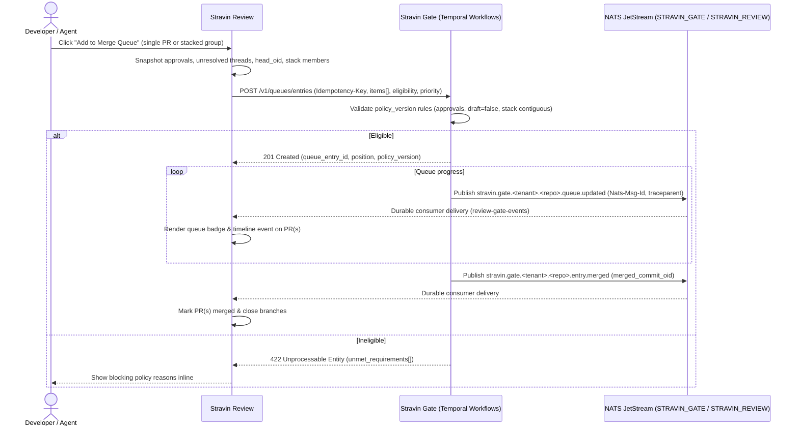

# Stravin Review <-> Stravin Gate

This specification defines the contract between **Stravin Review** (pull requests, approvals, stacked diffs) and **Stravin Gate** (serialized merge queues, branch protection, and policy enforcement).

> **Contract Status:** **Proposed Contract (vNext)** — Neither Stravin Review nor Stravin Gate is implemented in `stravin-dev/core` v1.12.x. Both teams build directly to this specification.

## 1. Boundary & Ownership

| Concern | Source of Truth | Private Implementation Details (Never Crosses Boundary) |
| :--- | :--- | :--- |
| **PR state (open/draft/closed), human/agent approvals, CODEOWNERS reviewers, unresolved comment threads, stacked-diff group membership** | **Stravin Review** | Review database, approval dismissal rules, comment resolution UI |
| **Merge-queue ordering, priority lanes, speculative batching, policy evaluation, merge execution** | **Stravin Gate** | Queue scheduler, speculative tree graph, policy evaluator, Core `AtomicRefCAS` driver |
| **Eligibility snapshot (point-in-time proof of approvals & review state at `head_oid`)** | **Stravin Review** (produces) -> **Stravin Gate** (verifies against `policy_version`) | Gate never queries Review's internal DB; it consumes the signed/structured eligibility snapshot |

## 2. Interaction Flow



## 3. Auth, Tenancy & Trust Boundary

- **Cilium eBPF Transport & Network Policy:** Bidirectional HTTP/2 or gRPC calls and NATS JetStream traffic traverse **Cilium (eBPF)** transparent WireGuard/SPIFFE mTLS with `CiliumNetworkPolicy` allowlists (or app-level TLS 1.3 mTLS locally), plus signed service JWTs (`tenant_id`, `scopes: ["gate:enqueue", "gate:dequeue", "gate:read"]`, `exp <= 5m`).
- **Mandatory App-Level Tenancy Check:** Cilium verifies workload identity, NOT `tenant_id`. Every Review and Gate API handler and JetStream consumer MUST verify `tenant_id` in constant time in application code.
- **Actor Authorization:** Every enqueue, dequeue, and priority-override call carries `actor_id`. Gate independently verifies whether `actor_id` is authorized for elevated priority lanes (e.g., `priority: "emergency"`) against its own policy config rather than blindly trusting Review.
- **Snapshot Integrity:** Review's eligibility snapshot is bound to exact `(pr_id, head_oid, evaluated_at)` pairs. If a PR receives a new push or an approval is revoked while queued, Review immediately publishes `stravin.review.<tenant_id>.<repo_id>.pr.eligibility_changed` to `STRAVIN_REVIEW` so Gate can evict the entry before merge.

## 4. Synchronous Interfaces

### 4.1 Review -> Gate: Enqueue Single PR or Stacked Group — *Proposed Contract (vNext)*

```http
POST /v1/queues/entries HTTP/1.1
Host: stravin-gate.internal
Content-Type: application/json
Authorization: Bearer <service-jwt>
Idempotency-Key: acme:monorepo:enqueue:pr_01JDF8...:a1b2c3d4...
traceparent: 00-4bf92f3577b34da6a3ce929d0e0e4736-00f067aa0ba902b7-01

{
  "tenant_id": "acme",
  "repo_id": "monorepo",
  "target_ref": "refs/heads/main",
  "actor_id": "usr_alice",
  "priority": "normal",
  "merge_strategy": "squash",
  "atomic_group": true,
  "items": [
    {
      "pr_id": "pr_01JDF7A...",
      "head_ref": "refs/heads/feat/stack-1",
      "head_oid": "9999999999999999999999999999999999999999",
      "tree_oid": "8888888888888888888888888888888888888888",
      "commit_message": "feat(edge): add singleflight pack cache (#410)",
      "eligibility": {
        "is_draft": false,
        "unresolved_thread_count": 0,
        "approvals": [
          {"actor_id": "usr_bob", "commit_oid": "9999999999999999999999999999999999999999", "codeowner_groups": ["@core-team"]}
        ],
        "changes_requested_by": [],
        "evaluated_at": "2026-11-24T22:20:00Z"
      }
    },
    {
      "pr_id": "pr_01JDF8Z...",
      "head_ref": "refs/heads/feat/stack-2",
      "head_oid": "a1b2c3d4e5f6a1b2c3d4e5f6a1b2c3d4e5f6a1b2",
      "tree_oid": "b2c3d4e5f6a1b2c3d4e5f6a1b2c3d4e5f6a1b2c3",
      "commit_message": "feat(edge): add S3 spillover tier (#411)",
      "eligibility": {
        "is_draft": false,
        "unresolved_thread_count": 0,
        "approvals": [
          {"actor_id": "usr_bob", "commit_oid": "a1b2c3d4e5f6a1b2c3d4e5f6a1b2c3d4e5f6a1b2", "codeowner_groups": ["@core-team"]}
        ],
        "changes_requested_by": [],
        "evaluated_at": "2026-11-24T22:20:00Z"
      }
    }
  ]
}
```

Response (`201 Created`):

```json
{
  "queue_entry_id": "qe_01JDF9C4D5E6F7G8H9J0K1L2M3",
  "state": "queued",
  "position": 3,
  "policy_version": "pol_01JDE0...",
  "enqueued_at": "2026-11-24T22:20:01Z"
}
```

Additional synchronous endpoints:

- `DELETE /v1/queues/entries/{queue_entry_id}` — Dequeue with `{"actor_id": "...", "reason": "user_removed" | "pr_updated" | "approval_revoked"}` -> `200 OK`.
- `GET /v1/queues/entries/{queue_entry_id}` — Fetch live queue position, speculative build status, and policy checks.
- `POST /v1/policies/evaluate` — Dry-run eligibility check used by Review to render the PR merge-box checklist before the user clicks merge.

## 5. Asynchronous Events & Streams

### 5.1 Gate -> Review: Queue State & Outcome Events (`STRAVIN_GATE` JetStream)

Published to stream `STRAVIN_GATE` with `Nats-Msg-Id: <idempotency_key>` and W3C `traceparent` headers (consumed by Review via durable pull consumer `review-gate-events`):

- `stravin.gate.<tenant_id>.<repo_id>.queue.updated` (`event_type: "gate.entry.updated"`) — Fired on position changes, speculative check start, or pause (`state`: `queued` | `testing` | `merging` | `paused`).
- `stravin.gate.<tenant_id>.<repo_id>.entry.evicted` (`event_type: "gate.entry.evicted"`) — Fired when an entry is removed due to merge conflict, required CI failure, approval revocation, or timeout:

```json
{
  "event_id": "evt_01JDF9D5E6F7G8H9J0K1L2M3N4",
  "event_type": "gate.entry.evicted",
  "schema_version": "1.0",
  "occurred_at": "2026-11-24T22:24:19Z",
  "tenant_id": "acme",
  "repo_id": "monorepo",
  "traceparent": "00-4bf92f3577b34da6a3ce929d0e0e4736-00f067aa0ba902b7-01",
  "idempotency_key": "qe_01JDF9C4D5E6F7G8H9J0K1L2M3:evicted",
  "data": {
    "queue_entry_id": "qe_01JDF9C4D5E6F7G8H9J0K1L2M3",
    "pr_ids": ["pr_01JDF7A...", "pr_01JDF8Z..."],
    "reason_code": "REQUIRED_CHECK_FAILED",
    "human_summary": "Speculative merge failed check `go-test-race` on PR #411",
    "failing_pr_id": "pr_01JDF8Z...",
    "failing_run_id": "run_01JDF9...",
    "conflict_paths": []
  }
}
```

- `stravin.gate.<tenant_id>.<repo_id>.entry.merged` (`event_type: "gate.entry.merged"`) — Fired after Core `AtomicRefCAS` succeeds, carrying `merged_commit_oid`, `target_ref`, `policy_version`, and per-PR final commit OIDs for stacked groups.

### 5.2 Review -> Gate: Eligibility Invalidation Events (`STRAVIN_REVIEW` JetStream)

- `stravin.review.<tenant_id>.<repo_id>.pr.eligibility_changed` (`event_type: "review.pr.eligibility_changed"`) — Published to `STRAVIN_REVIEW` whenever a queued PR is force-pushed, converted to draft, closed, receives a "changes requested" review, or loses a required approval (and `stravin.review.<tenant_id>.<repo_id>.pr.approved` on approvals). Gate binds durable consumer `gate-review-eligibility` and evicts the affected `queue_entry_id` (and the entire `atomic_group` if stacked).
- **Temporal Workflow Engine (Gate Only):** **Stravin Gate** runs its speculative merge-queue batch workflows on **Temporal**: `POST /v1/queues/entries` and `DELETE /v1/queues/entries/{queue_entry_id}` start or signal queue workflows idempotently, `STRAVIN_REVIEW` invalidation events deliver external workflow signals, and `GET /v1/prs/{pr_id}/eligibility` runs as an idempotent Temporal activity. **Stravin Review** remains permanently Temporal-free.

## 6. Shared Data Contracts & Identifiers

- **Atomic Stacked Groups:** `items[]` is ordered bottom-to-top (index `0` is closest to `target_ref`). When `atomic_group: true`, Gate either merges every PR in `items[]` in one atomic Ref-CAS sequence or evicts the entire group — never landing a half-merged stack.
- **Priority Enum:** `low` | `normal` | `high` | `emergency` (skip-to-front, audited).
- **Eviction Reason Codes:** `MERGE_CONFLICT`, `REQUIRED_CHECK_FAILED`, `APPROVAL_REVOKED`, `HEAD_OID_CHANGED`, `POLICY_CHANGED`, `QUEUE_TIMEOUT`, `USER_DEQUEUED`.

## 7. Failure Modes, Timeouts & Idempotency

| Failure Scenario | Behavior & Degradation | Timeout / Retry Policy |
| :--- | :--- | :--- |
| **Gate API unavailable** | Review disables "Add to Merge Queue" with "Merge queue temporarily unavailable"; PR browsing, comments, and CI checks stay fully operational. | Sync timeout: 3 s; no automatic retry on `422`. |
| **Review misses `gate.entry.merged` event** | Durable `review-gate-events` JetStream consumer redelivers (with `STRAVIN_DLQ` capture on exhaustion); Core's `core.ref.updated` event + periodic `GET /v1/queues/entries/{queue_entry_id}` reconciliation converge PR state to `merged`. | Reconcile any PR in `merging` state for > 60 s. |
| **Review crashes before publishing `review.pr.eligibility_changed`** | Before final `AtomicRefCAS`, Gate performs a fast `GET /v1/prs/{pr_id}/eligibility?head_oid=...` re-check if the snapshot is older than 5 minutes. | Re-check timeout: 1.5 s; fail-closed (evict) if Review reports invalid or unreachable past grace window. |
| **Duplicate enqueue click** | Gate enforces idempotency on `Idempotency-Key` and rejects duplicate active entries for the same `pr_id` with `409 Conflict` returning the existing `queue_entry_id`. | Safe for client retries. |

## 8. Meet-in-the-Middle Bridge Checklist

### Side A: Stravin Review Build Checklist

- [ ] Build deterministic eligibility snapshot builder bound to `(pr_id, head_oid, evaluated_at)` and bottom-to-top stack ordering.
- [ ] Publish `stravin.review.<tenant_id>.<repo_id>.pr.eligibility_changed` (with `Nats-Msg-Id` and `traceparent`) to `STRAVIN_REVIEW` whenever a queued PR's approvals, draft status, or `head_oid` changes.
- [ ] Expose `GET /v1/prs/{pr_id}/eligibility` with app-level `tenant_id` check for Gate's pre-merge freshness check.
- [ ] Bind durable JetStream consumer `review-gate-events` on `STRAVIN_GATE` and render `queue.updated`, `entry.evicted`, and `entry.merged` on all PRs in an atomic group.

### Side B: Stravin Gate Build Checklist

- [ ] Implement idempotent `POST /v1/queues/entries`, `DELETE /v1/queues/entries/{id}`, `GET /v1/queues/entries/{id}`, and `POST /v1/policies/evaluate` (backed by Temporal merge-queue workflows and signals) with constant-time `tenant_id` checks.
- [ ] Enforce `atomic_group: true` all-or-nothing semantics for stacked PRs.
- [ ] Bind durable JetStream consumer `gate-review-eligibility` on `STRAVIN_REVIEW` and re-verify eligibility snapshots older than 5 minutes before executing Core `AtomicRefCAS`.
- [ ] Publish queue outcomes to `STRAVIN_GATE` and return structured `unmet_requirements[]` and `reason_code` values for clear PR timeline feedback.

### Shared Contract-Test Fixtures

- `fixtures/review-gate/enqueue-stacked-group.json` — Two-PR atomic stack enqueue request + `201 Created` response.
- `fixtures/review-gate/eviction-reasons.json` — `STRAVIN_GATE` JetStream payloads (`Nats-Msg-Id`, `traceparent`) covering `MERGE_CONFLICT`, `REQUIRED_CHECK_FAILED`, and `APPROVAL_REVOKED`.
- `fixtures/review-gate/policy-evaluate-422.json` — Ineligible PR dry-run response with unmet CODEOWNERS and unresolved-thread items.
