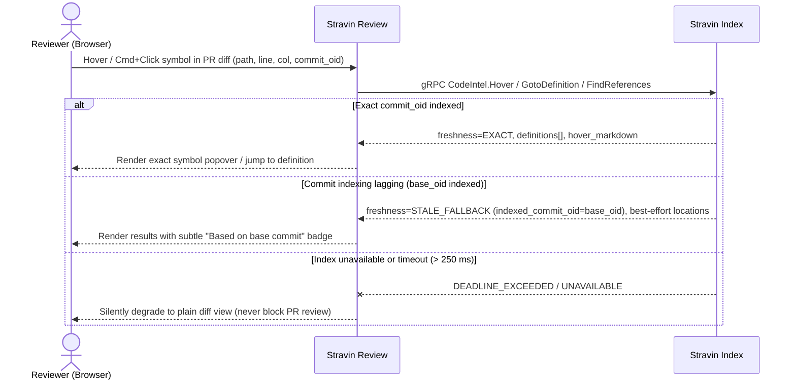

# Stravin Review <-> Stravin Index

This specification defines the contract between **Stravin Review** (PR diff viewer and repository browser) and **Stravin Index** (trigram search, AST symbol navigation, and cross-repository reference graphs).

> **Contract Status:** **Proposed Contract (vNext)** — Neither Stravin Review nor Stravin Index is implemented in `stravin-dev/core` v1.12.x. Both teams build directly to this specification.

## 1. Boundary & Ownership

| Concern | Source of Truth | Private Implementation Details (Never Crosses Boundary) |
| :--- | :--- | :--- |
| **PR diff rendering, cursor hover/click events, UI tooltips, fallback presentation** | **Stravin Review** | Diff hunk layout, browser popover state, keyboard shortcuts |
| **Symbol definitions, references, hover documentation/types, cross-repo callers, commit index watermarks** | **Stravin Index** | SCIP/LSIF/tree-sitter symbol stores, trigram shards, cross-repo graph indices, query caching |
| **Index freshness & lag disclosure** | **Stravin Index** (reports `freshness` + `indexed_commit_oid`) -> **Stravin Review** (renders or falls back) | Review never guesses whether a commit is indexed; Index returns explicit freshness metadata on every query |

## 2. Interaction Flow



## 3. Auth, Tenancy & Trust Boundary

- **Service-to-Service Auth:** TLS 1.3 mTLS + signed service JWT (`aud: "stravin-index"`, `tenant_id`, `actor_id`, `readable_repo_ids` or RBAC policy token, `exp <= 5m`).
- **Cross-Repo Permission Filtering:** For `FindReferences` and `FindCrossRepoCallers`, Index MUST filter every returned location against the caller's `tenant_id` AND the end-user `actor_id`'s repository read permissions. A reviewer who cannot read `acme/secret-service` MUST NOT see its callers, filenames, or match counts when reviewing `acme/shared-lib`.
- **Zero Cross-Tenant Leakage:** Every query carries `tenant_id` in both gRPC metadata and the request body; Index rejects mismatches with `PERMISSION_DENIED`.

## 4. Synchronous Interfaces

### 4.1 Code Intelligence Query API — *Proposed Contract (vNext)*

All PR diff code-intelligence queries use low-latency gRPC (`stravin.index.v1.CodeIntel`) keyed by `(tenant_id, repo_id, commit_oid, path, line, col)`:

```protobuf
syntax = "proto3";
package stravin.index.v1;

service CodeIntel {
  rpc Hover(SymbolPositionRequest) returns (HoverResponse);
  rpc GotoDefinition(SymbolPositionRequest) returns (LocationsResponse);
  rpc FindReferences(FindReferencesRequest) returns (LocationsResponse);
  rpc FindCrossRepoCallers(FindReferencesRequest) returns (LocationsResponse);
}

message SymbolPositionRequest {
  string tenant_id = 1;
  string repo_id = 2;
  string commit_oid = 3;         // exact PR head_oid or base_oid
  string fallback_commit_oid = 4; // optional PR base_oid if commit_oid is lagging
  string path = 5;               // repo-relative POSIX path
  uint32 line = 6;               // 0-based line index
  uint32 col = 7;                // 0-based UTF-8 byte column
  string actor_id = 8;           // for cross-repo RBAC filtering
}

message FindReferencesRequest {
  SymbolPositionRequest position = 1;
  bool include_cross_repo = 2;
  uint32 max_results = 3;        // default 100, hard cap 500
  string page_token = 4;
}

enum IndexFreshness {
  INDEX_FRESHNESS_UNSPECIFIED = 0;
  INDEX_FRESHNESS_EXACT = 1;          // served from exact requested commit_oid
  INDEX_FRESHNESS_STALE_FALLBACK = 2; // served from fallback_commit_oid or default_branch
  INDEX_FRESHNESS_UNINDEXED = 3;      // repo/commit not yet indexed
}

message SymbolLocation {
  string repo_id = 1;
  string commit_oid = 2;
  string path = 3;
  uint32 start_line = 4;
  uint32 start_col = 5;
  uint32 end_line = 6;
  uint32 end_col = 7;
  string preview_line = 8;
}

message HoverResponse {
  IndexFreshness freshness = 1;
  string indexed_commit_oid = 2;
  string symbol_name = 3;
  string signature = 4;
  string documentation_markdown = 5;
}

message LocationsResponse {
  IndexFreshness freshness = 1;
  string indexed_commit_oid = 2;
  repeated SymbolLocation locations = 3;
  string next_page_token = 4;
  bool truncated_by_permissions = 5; // true if results were filtered for actor_id
}
```

## 5. Asynchronous Events & Streams

### 5.1 Review -> Index: Priority On-Demand Indexing Hint (Optional)

By default, Stravin Index indexes `default_branch` and configured long-lived branches driven by Core's `stravin-hook` events (see [Core <-> Index](core-index.md)). To give active PRs exact symbol navigation without indexing every ephemeral branch in the org:

- Review emits `review.pr.opened_or_updated` (Standard Async Event Envelope) carrying `{tenant_id, repo_id, pr_id, head_oid, base_oid, changed_paths[]}` as a **best-effort priority hint**.
- Index may compute an overlay symbol delta for `changed_paths[]` on `head_oid` (TTL 24 hours). If Index drops or lags on the hint, `CodeIntel` falls back cleanly to `fallback_commit_oid` (`base_oid`) or `INDEX_FRESHNESS_UNINDEXED`.

## 6. Shared Data Contracts & Identifiers

- **Coordinate System:** All `line` and `col` coordinates are **0-based** (`line = 0` is the first line; `col` is a **0-based UTF-8 byte offset** within the line) so Go/Rust Index backends and Review diff renderers never disagree on tabs or multi-byte UTF-8 characters.
- **Path Normalization:** Repo-relative POSIX paths using `/` separators, with no leading `/` or `./`.
- **Freshness Contract:** Every response includes `(freshness, indexed_commit_oid)` so Review can accurately distinguish exact PR intelligence from base-commit fallback.

## 7. Failure Modes, Timeouts & Idempotency

| Failure Scenario | Behavior & Degradation | Timeout / Retry Policy |
| :--- | :--- | :--- |
| **Index latency spike or outage** | Review treats code intelligence as **strictly non-blocking progressive enhancement**. After `250 ms` (Hover/GotoDef) or `800 ms` (FindReferences/CrossRepo), Review aborts the RPC and shows plain syntax-highlighted code. | Hard client deadlines: `250 ms` / `800 ms`; **zero retries** on interactive hover. |
| **PR `head_oid` not yet indexed** | Index automatically checks `fallback_commit_oid` (PR `base_oid`) and returns `INDEX_FRESHNESS_STALE_FALLBACK` with `indexed_commit_oid = base_oid`. | Review displays a subtle staleness indicator and suppresses stale line highlights on modified lines. |
| **Cross-repo fan-out too large** | Index caps results at `max_results` (default 100, max 500) and returns `next_page_token` rather than timing out. | Deterministic bounded response size. |
| **Unauthorized cross-repo caller** | Index omits locations from unreadable repos before pagination and sets `truncated_by_permissions = true` without revealing repo names. | Fail-closed if RBAC check service is unreachable (return single-repo results only). |

## 8. Meet-in-the-Middle Bridge Checklist

### Side A: Stravin Review Build Checklist

- [ ] Convert UI cursor positions to 0-based `(line, utf8_byte_col)` and always pass both `commit_oid` and `fallback_commit_oid` (`base_oid`).
- [ ] Enforce strict client deadlines (`250 ms` hover/def, `800 ms` refs) with circuit-breaking so Index outages never slow down PR rendering.
- [ ] Handle `INDEX_FRESHNESS_STALE_FALLBACK` and `INDEX_FRESHNESS_UNINDEXED` gracefully in the UI.
- [ ] Emit best-effort `review.pr.opened_or_updated` hints with `changed_paths[]`.

### Side B: Stravin Index Build Checklist

- [ ] Implement `stravin.index.v1.CodeIntel` (`Hover`, `GotoDefinition`, `FindReferences`, `FindCrossRepoCallers`).
- [ ] Enforce per-`actor_id` RBAC filtering on all cross-repo results without leaking existence of unauthorized repositories.
- [ ] Support `fallback_commit_oid` lookup and return accurate `IndexFreshness` + `indexed_commit_oid`.
- [ ] Support short-lived (24 h) PR overlay indexes for `changed_paths[]`.

### Shared Contract-Test Fixtures

- `fixtures/review-index/utf8-position-cases.json` — Multi-byte UTF-8 and tab-indented lines verifying 0-based byte column alignment.
- `fixtures/review-index/stale-fallback-response.json` — `INDEX_FRESHNESS_STALE_FALLBACK` and `INDEX_FRESHNESS_UNINDEXED` response fixtures.
- `fixtures/review-index/cross-repo-rbac-filter.json` — Multi-repo caller graph verifying unauthorized repos are omitted and `truncated_by_permissions = true`.
