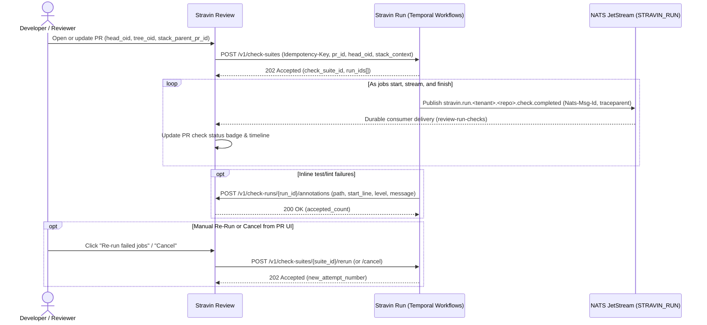

# Stravin Review <-> Stravin Run

This specification defines the contract between **Stravin Review** (pull requests, stacked diffs, inline review) and **Stravin Run** (ephemeral CI runners and pipelines).

> **Contract Status:** **Proposed Contract (vNext)** — Neither Stravin Review nor Stravin Run is implemented in `stravin-dev/core` v1.12.x. Both teams build directly to this specification.

## 1. Boundary & Ownership

| Concern | Source of Truth | Private Implementation Details (Never Crosses Boundary) |
| :--- | :--- | :--- |
| **PR metadata, stacked-diff parent/child chain, UI check-summary display, user re-run/cancel clicks** | **Stravin Review** | PR database, diff viewer layout, comment threading, user notification routing |
| **Check suites, check runs, step state, inline diagnostic annotations, live build logs, artifacts** | **Stravin Run** | Runner scheduling, sandbox lifecycle, log object storage, cache backend |
| **Stacked-diff check inheritance** | **Stravin Review** (declares stack) / **Stravin Run** (executes or inherits by `tree_oid`) | Run decides whether a child PR can reuse a parent's cached result for unchanged targets |

## 2. Interaction Flow



## 3. Auth, Tenancy & Trust Boundary

- **Cilium eBPF Transport & Network Policy:** Bidirectional HTTP/2 or gRPC calls and NATS JetStream traffic traverse **Cilium (eBPF)** transparent WireGuard/SPIFFE mTLS with `CiliumNetworkPolicy` allowlists (or app-level TLS 1.3 mTLS locally), plus signed service JWTs (`aud: "stravin-run"` or `"stravin-review"`, `tenant_id`, `scopes`, `exp <= 5m`).
- **Mandatory App-Level Tenancy Check:** Cilium verifies workload identity, NOT `tenant_id`. Every Review and Run API handler and JetStream consumer MUST verify `tenant_id` in constant time in application code.
- **Actor Attribution:** User-triggered actions (`rerun`, `cancel`) MUST pass the authenticated end-user `actor_id` and `actor_roles` so Run enforces repository RBAC (e.g., preventing read-only viewers from triggering privileged runners) and records audit trails.
- **Live Log Streaming URLs:** Run returns short-lived, tenant-scoped signed WebSocket/SSE URLs (`log_stream_url`, TTL 15 minutes) that the Review browser client connects to directly, keeping heavy log traffic off Review's API servers.
- **Event Integrity:** All `Run -> Review` async lifecycle events publish to `STRAVIN_RUN` in NATS JetStream with `Nats-Msg-Id` deduplication and W3C `traceparent` headers. (Outbound customer webhooks for check events are delivered separately by `stravin-webhooks`.)

## 4. Synchronous Interfaces

### 4.1 Review -> Run: Suite Creation, Re-Run & Cancel — *Proposed Contract (vNext)*

```http
POST /v1/check-suites HTTP/1.1
Host: stravin-run.internal
Content-Type: application/json
Authorization: Bearer <service-jwt>
Idempotency-Key: acme:monorepo:pr_01JDF8...:a1b2c3d4...
traceparent: 00-4bf92f3577b34da6a3ce929d0e0e4736-00f067aa0ba902b7-01

{
  "tenant_id": "acme",
  "repo_id": "monorepo",
  "pr_id": "pr_01JDF8Z7Q2K9M4N6P8R0T2V4W6",
  "base_ref": "refs/heads/main",
  "base_oid": "1111111111111111111111111111111111111111",
  "head_ref": "refs/heads/feat/stack-2",
  "head_oid": "a1b2c3d4e5f6a1b2c3d4e5f6a1b2c3d4e5f6a1b2",
  "tree_oid": "b2c3d4e5f6a1b2c3d4e5f6a1b2c3d4e5f6a1b2c3",
  "object_format": "sha1",
  "trigger": "pr_synchronized",
  "actor_id": "usr_alice",
  "stack_context": {
    "stack_id": "stk_01JDF8...",
    "position": 2,
    "parent_pr_id": "pr_01JDF7...",
    "parent_commit_oid": "9999999999999999999999999999999999999999",
    "allow_inherited_checks": true
  }
}
```

Manual control endpoints:

- `POST /v1/check-suites/{check_suite_id}/rerun` — Body: `{"actor_id": "usr_alice", "mode": "failed_only" | "all", "check_run_ids": [...]}` -> `202 Accepted`.
- `POST /v1/check-suites/{check_suite_id}/cancel` — Body: `{"actor_id": "usr_alice", "reason": "user_requested" | "pr_closed" | "superseded"}` -> `202 Accepted`.
- `GET /v1/check-runs/{run_id}/log-stream-token` — Returns `{"url": "wss://logs.stravin-run.../v1/stream?token=...", "expires_at": "..."}`.

### 4.2 Run -> Review: Inline Annotations Batch API — *Proposed Contract (vNext)*

```http
POST /v1/check-runs/run_01JDF9A1B2C3D4E5F6G7H8J9K0/annotations HTTP/1.1
Host: stravin-review.internal
Content-Type: application/json
Authorization: Bearer <service-jwt>

{
  "tenant_id": "acme",
  "repo_id": "monorepo",
  "commit_oid": "a1b2c3d4e5f6a1b2c3d4e5f6a1b2c3d4e5f6a1b2",
  "annotations": [
    {
      "path": "internal/edge/pack_cache.go",
      "start_line": 142,
      "end_line": 145,
      "level": "failure",
      "title": "golangci-lint (errcheck)",
      "message": "Error return value of `c.backend.Set` is not checked",
      "raw_details": "..."
    }
  ]
}
```

- Batch cap: max **50 annotations per request**, max **1,000 annotations per `run_id`**.

## 5. Asynchronous Events & Streams

### 5.1 Run -> Review: Check Suite & Check Run Lifecycle Events (`STRAVIN_RUN` JetStream)

Published to stream `STRAVIN_RUN` with NATS headers `Nats-Msg-Id: <idempotency_key>`, `Stravin-Event-Type`, `Stravin-Schema-Version: 1.0`, and W3C `traceparent`:

- `stravin.run.<tenant_id>.<repo_id>.check_suite.updated` (`event_type: "run.check_suite.updated"`) — Aggregate suite state (`queued` | `in_progress` | `completed` | `cancelled`).
- `stravin.run.<tenant_id>.<repo_id>.check.completed` / `stravin.run.<tenant_id>.<repo_id>.check_run.updated` (`event_type: "run.check_run.updated"`) — Per-job state transition:

```json
{
  "event_id": "evt_01JDF9B2C3D4E5F6G7H8J9K0L1",
  "event_type": "run.check_run.updated",
  "schema_version": "1.0",
  "occurred_at": "2026-11-24T22:18:11.004Z",
  "tenant_id": "acme",
  "repo_id": "monorepo",
  "traceparent": "00-4bf92f3577b34da6a3ce929d0e0e4736-00f067aa0ba902b7-01",
  "idempotency_key": "run_01JDF9A1B2C3D4E5F6G7H8J9K0:attempt1:completed",
  "data": {
    "pr_id": "pr_01JDF8Z7Q2K9M4N6P8R0T2V4W6",
    "check_suite_id": "cs_01JDF9...",
    "run_id": "run_01JDF9A1B2C3D4E5F6G7H8J9K0",
    "attempt": 1,
    "name": "go-test-race",
    "commit_oid": "a1b2c3d4e5f6a1b2c3d4e5f6a1b2c3d4e5f6a1b2",
    "tree_oid": "b2c3d4e5f6a1b2c3d4e5f6a1b2c3d4e5f6a1b2c3",
    "status": "completed",
    "conclusion": "success",
    "inherited_from_run_id": null,
    "started_at": "2026-11-24T22:16:02Z",
    "completed_at": "2026-11-24T22:18:10Z",
    "summary_markdown": "248 tests passed in 2m 08s",
    "details_url": "https://run.stravin.dev/acme/monorepo/runs/run_01JDF9A1B2C3D4E5F6G7H8J9K0"
  }
}
```

- **Consumer & Ordering Rule:** Review binds durable pull consumer `review-run-checks` on `STRAVIN_RUN` (`stravin.run.*.*.check_suite.updated`, `stravin.run.*.*.check_run.updated`, `stravin.run.*.*.check.completed`). Review applies updates monotonically by `(run_id, attempt, status_rank)` where `queued < in_progress < completed|cancelled`, ignoring stale out-of-order deliveries.
- **Temporal Workflow Engine (Run Only):** `POST /v1/check-suites`, `/rerun`, and `/cancel` act as idempotent command boundaries (keyed by `Idempotency-Key` and `check_suite_id`) that start or signal **Stravin Run**'s **Temporal** CI pipeline DAG workflows (handling fan-out/fan-in, runner heartbeating, retries, cancellations, and timeouts), while `STRAVIN_RUN` JetStream events carry state transitions outward. **Stravin Review** remains permanently Temporal-free.

## 6. Shared Data Contracts & Identifiers

- **Check Run Status Enum:** `queued` | `in_progress` | `completed` | `cancelled`.
- **Check Run Conclusion Enum (set when `status == completed`):** `success` | `failure` | `neutral` | `skipped` | `timed_out` | `infra_error` | `cancelled`.
- **Stacked-Diff Inheritance:** When `inherited_from_run_id` is non-null, Review renders a badge ("Inherited from parent PR #N") and links to the parent run's logs while still showing the check as satisfied for the child `commit_oid`.

## 7. Failure Modes, Timeouts & Idempotency

| Failure Scenario | Behavior & Degradation | Timeout / Retry Policy |
| :--- | :--- | :--- |
| **Stravin Run API unavailable during PR update** | Review queues the `POST /v1/check-suites` command in its own transactional outbox and displays "Checks pending dispatch" on the PR. | Sync timeout: 3 s; async retry with exponential backoff up to 15 minutes using the same `Idempotency-Key`. |
| **Review consumer unavailable or lagging** | Events buffer durably in `STRAVIN_RUN` (exhausted deliveries route to `STRAVIN_DLQ`); Review also uses `GET /v1/check-suites?commit_oid=...` pull fallback on PR page load when checks look stale (> 60 s without heartbeat). | JetStream `AckWait`: 30 s; 5 redeliveries before DLQ advisory. |
| **Live log stream disconnects** | Browser client requests a fresh `log-stream-token` from Review -> Run and resumes from the last received `log_line_offset`. | Stream reconnect backoff: 1 s -> 10 s. |
| **PR force-pushed while checks are running** | Review sends `POST /v1/check-suites/{old_suite_id}/cancel` (`reason: "superseded"`) in parallel with creating the new check suite. | Best-effort cancel; Run marks stale suite cancelled even if a job finishes mid-flight. |

## 8. Meet-in-the-Middle Bridge Checklist

### Side A: Stravin Review Build Checklist

- [ ] Persist `(pr_id, commit_oid, tree_oid, check_suite_id)` and dispatch check-suite creation via an idempotent outbox.
- [ ] Bind durable JetStream consumer `review-run-checks` on `STRAVIN_RUN` and enforce monotonic `(run_id, attempt, status_rank)` transitions with app-level `tenant_id` check.
- [ ] Render inline annotations anchored to `(commit_oid, path, start_line..end_line)` with graceful fallback when lines fall outside the diff hunk.
- [ ] Proxy short-lived `log-stream-token` requests without proxying raw log bytes.

### Side B: Stravin Run Build Checklist

- [ ] Honor `Idempotency-Key` on `POST /v1/check-suites`, `/rerun`, and `/cancel` (starting/signaling Temporal CI DAG workflows) so Review retries never spawn duplicate suites.
- [ ] Publish `run.check_suite.updated` and `run.check_run.updated` / `check.completed` to `STRAVIN_RUN` JetStream with `Nats-Msg-Id`, `traceparent`, `commit_oid`, `tree_oid`, and `inherited_from_run_id`.
- [ ] Enforce the 50/batch and 1,000/run annotation caps before calling Review.
- [ ] Validate `actor_id` RBAC and constant-time `tenant_id` on `rerun` and `cancel` endpoints.

### Shared Contract-Test Fixtures

- `fixtures/review-run/check-suite-lifecycle.json` — Full `queued -> in_progress -> completed` JetStream event sequence (`Nats-Msg-Id`, `traceparent`) including an out-of-order stale event.
- `fixtures/review-run/annotations-batch.json` — Valid and over-limit annotation payloads.
- `fixtures/review-run/stacked-diff-inheritance.json` — Parent/child PR check-suite request and inherited `run.check_run.updated` payload.
