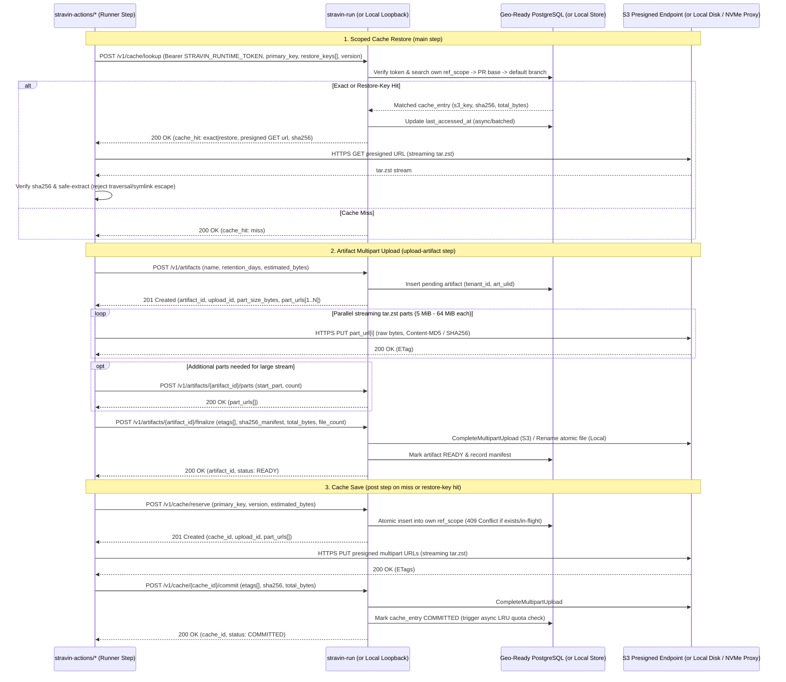

# Run Artifacts & Cache Interface (`stravin-run` ⟷ `stravin-runner` / `stravin-actions`)

This specification defines the wire contract, storage topology, security isolation rules, archive format, and action schemas shared by **Stravin Run** (`stravin-run`), the static Go runner agent (`stravin-runner`), and the first-party artifact/cache actions (`stravin-actions/upload-artifact`, `stravin-actions/download-artifact`, `stravin-actions/cache`).

> **Contract Status:** **Proposed Contract (vNext)** — Neither `stravin-run` nor `stravin-runner` is implemented in `stravin-dev/core` v1.12.x. Wave 3 teams build directly to this specification alongside [ADR-0002: External Runner Seam, State-Machine Ownership, and OIDC App Authentication](../adr/0002-external-runner-seam-and-oidc-auth.md), [ADR-0005: Declarative YAML Workflow Execution, First-Party Action Repositories, and Runner Runtime](../adr/0005-workflow-execution-and-runner-runtime.md), and the Geo-Ready PostgreSQL guardrails in [Full-Stack Build Waves](../roadmap/full-stack-waves.md).

## 1. Boundary & Ownership

| Concern | Source of Truth | Private Implementation Details (Never Crosses Boundary) |
| :--- | :--- | :--- |
| **Artifact & cache metadata, lease authorization, presigned URL minting, retention & LRU eviction** | **Stravin Run** (`stravin-run`) | Geo-Ready PostgreSQL schema (`run.*`), S3 bucket layout, lifecycle policies, Valkey `jti` revocation lookups |
| **Blob payload transfer (multipart PUT / range GET)** | **Direct-to-S3** (Cloud) / **Loopback HTTP** (Local) / **Provider NVMe Proxy** (Override) | S3 multipart internals, local disk directory layout, provider hypervisor NVMe/sticky-disk placement |
| **Runtime endpoint injection & token refresh** | **`stravin-runner`** | Heartbeat token renewal loop, loopback server lifecycle in `stravin-runner local`, `STRAVIN_STATE` file storage |
| **Archive streaming (`tar.zst`), deterministic hashing, path-safety checks, `main` / `post` lifecycle** | **`stravin-actions/*`** | File globbing internals, Zstd compression buffer tuning, manifest serialization details |

## 2. Dual-Mode Parity (Local vs. Scaled-Out Cloud vs. Provider Override)

All `stravin-actions/*` binaries and Wasm modules speak **one single HTTP/ConnectRPC wire contract** discovered exclusively through three runner-injected environment variables:

- `STRAVIN_RUNTIME_URL` — Base URL for the Artifacts API (`/v1/artifacts`, `/v1/runs/{run_id}/artifacts`).
- `STRAVIN_CACHE_URL` — Base URL for the Cache API (`/v1/cache/*`).
- `STRAVIN_RUNTIME_TOKEN` — Short-lived, job-scoped bearer JWT attached as `Authorization: Bearer <token>` on every control-plane API call (never sent to presigned S3 object URLs).

Because action code never talks to S3, local disk, or PostgreSQL directly, the exact same `stravin-actions/*` binaries run unchanged across three deployment modes:

| Mode | `STRAVIN_RUNTIME_URL` / `STRAVIN_CACHE_URL` Target | Metadata Store | Blob Data Plane |
| :--- | :--- | :--- | :--- |
| **Local Mode (`stravin-runner local` / Docker Compose)** | Embedded loopback HTTP server bound to `127.0.0.1:<ephemeral-port>` inside `stravin-runner` (or local `stravin-run` container in Compose) | Local embedded store (in-memory/SQLite in `stravin-runner local`; local PostgreSQL `run` schema in Compose) | Loopback HTTP `PUT`/`GET` backed by local disk directory (or local Floci S3 presigned URLs) |
| **Scaled-Out Cloud Mode (`stravin-run`)** | Regional `stravin-run` control plane behind HTTPS / Cilium eBPF mTLS | **Geo-Ready PostgreSQL** (`run` schema) with `(tenant_id, id)` ULID/UUIDv7 composite PKs, leading `tenant_id` indexes, zero Postgres-only extensions | **Direct-to-S3 presigned multipart PUT / presigned GET URLs** — multi-GB blobs bypass `stravin-run` pods completely |
| **Third-Party MicroVM Provider Override** | Provider-injected co-located NVMe cache / artifact proxy URLs set at runner boot | Provider proxy validates `STRAVIN_RUNTIME_TOKEN` (via `stravin-auth` JWKS + scope claims) or delegates metadata checks to `stravin-run` | Co-located regional NVMe or hypervisor sticky-disk HTTP `PUT`/`GET` implementing the identical `/v1/cache` and `/v1/artifacts` wire contract |

### 2.1 Geo-Ready PostgreSQL Metadata Guardrails (Cloud Mode)

In scaled-out cloud mode, `stravin-run` stores artifact and cache metadata in PostgreSQL following the mandatory guardrails in [Full-Stack Build Waves](../roadmap/full-stack-waves.md) so the schema upgrades cleanly to distributed SQL (YugabyteDB / CockroachDB) with zero rewrite:

- **Composite Primary Keys:** Every table (`run.artifacts`, `run.cache_entries`, `run.cache_reservations`) uses `(tenant_id, id)` with time-ordered **ULID / UUIDv7** identifiers (`art_<ulid>`, `cch_<ulid>`). Never global `SERIAL` / `BIGSERIAL` sequences.
- **Leading `tenant_id` Indexes:** Every secondary index leads with `tenant_id` (for example, `(tenant_id, repo_id, run_id, name)` for artifact listing; `(tenant_id, repo_id, ref_scope, version, primary_key)` for exact cache lookup; `(tenant_id, repo_id, last_accessed_at)` for LRU eviction).
- **Zero Postgres-Only Extensions:** No advisory locks (idempotent reservation uses `INSERT ... ON CONFLICT DO NOTHING` on a unique key), no `LISTEN/NOTIFY` as a durable bus, and no custom C extensions.
- **Direct-to-S3 Bypass:** `stravin-run` pods only handle small JSON control messages and S3 presign operations; raw `tar.zst` bytes flow directly between the runner and S3 (or loopback disk in local mode).

### 2.2 Regional Placement & Third-Party Provider Override Policy

Per [ADR-0005](../adr/0005-workflow-execution-and-runner-runtime.md), `stravin-run` schedules jobs in the repository's home region by default so presigned S3 cache and artifact traffic incurs **zero cross-region S3 egress** and satisfies data residency automatically. Opt-in multi-region or external pools (selected via `runs-on:` / `runner_pool`) use either home-region S3 presigned URLs or a provider-local `STRAVIN_CACHE_URL` / `STRAVIN_RUNTIME_URL` NVMe proxy:

- **Tenant Data-Residency Enforcement:** Endpoint overrides and cross-region pool routing are governed per `runner_pool` in `stravin-run` tenant policy (`allow_cache_url_override`, `allow_runtime_url_override`, `home_region_only`). When a tenant enforces strict home-region residency, `stravin-run` locks placement to the repository's home region, sets `endpoint_override_allowed: false` in the job lease, and `stravin-runner` rejects overridden URLs at startup.
- **Wire Parity Requirement:** Any provider proxy MUST implement the identical HTTP paths, status codes, `ref_scope` isolation rules, and `STRAVIN_RUNTIME_TOKEN` verification defined in Sections 4–6.

## 3. Interaction Flow



## 4. Security, Token Scoping & Cache-Poisoning Isolation

### 4.1 `STRAVIN_RUNTIME_TOKEN` Claims & Lifecycle

Every leased job receives a short-lived signed JWT (`STRAVIN_RUNTIME_TOKEN`) minted by `stravin-run` (or `stravin-auth` STS) and bound to the exact job execution context from [ADR-0002](../adr/0002-external-runner-seam-and-oidc-auth.md):

```json
{
  "iss": "https://auth.stravin.internal",
  "aud": ["stravin-run-runtime", "stravin-run-cache"],
  "sub": "job_01JDF9F1A2B3C4D5E6F7G8H9J0",
  "jti": "jti_01JDF9F1K2L3M4N5P6Q7R8S9T0",
  "tenant_id": "acme",
  "repo_id": "monorepo",
  "run_id": "run_01JDF9A1B2C3D4E5F6G7H8J9K0",
  "job_id": "job_01JDF9F1A2B3C4D5E6F7G8H9J0",
  "attempt_id": "att_01",
  "ref_scope": "refs/pull/42/merge",
  "base_ref_scope": "refs/heads/main",
  "default_ref_scope": "refs/heads/main",
  "runner_pool": "untrusted-pr",
  "scopes": [
    "artifact:read",
    "artifact:write",
    "cache:read",
    "cache:write"
  ],
  "iat": 1795700000,
  "exp": 1795700300
}
```

- **Short TTL & Heartbeat Refresh:** Token TTL is `<= 300s` (5 minutes). `stravin-runner` refreshes `STRAVIN_RUNTIME_TOKEN` automatically on its [ADR-0002](../adr/0002-external-runner-seam-and-oidc-auth.md) lease heartbeat and updates the step environment/token file for subsequent steps.
- **Immediate Revocation on `< 200 ms` Cancel:** When a run or job is cancelled (e.g., Gate merge-queue eviction or user cancel), `stravin-run` writes the token's `jti` to the shared Valkey revocation deny-list. All `/v1/artifacts` and `/v1/cache` handlers reject revoked `jti` tokens immediately with `401 UNAUTHENTICATED`, preventing cancelled jobs from publishing poisoned artifacts or caches.
- **Presigned URL Bounds:** Presigned S3 upload/download URLs carry a short TTL (`<= 900s` for active multipart parts, `<= 120s` for single-file downloads) and are bound to a single S3 object key (`tenants/{tenant_id}/repos/{repo_id}/...`) and HTTP verb. Runners never receive AWS IAM credentials.
- **Mandatory App-Level Tenancy Check:** Every handler verifies `token.tenant_id` against the requested resource's `tenant_id` in constant time, independent of Cilium SPIFFE workload identity.
- **Environment Protection:** Per [ADR-0005](../adr/0005-workflow-execution-and-runner-runtime.md), `STRAVIN_RUNTIME_TOKEN` is on `STRAVIN_ENV`'s immutable deny-list so untrusted step scripts cannot overwrite it for downstream steps, and `stravin-runner` masks its value in streamed step logs.

### 4.2 Strict Branch & Pool Cache-Poisoning Isolation

Build caches are a primary supply-chain lateral-movement vector if an untrusted pull request can poison caches consumed by default-branch releases or merge-queue (`gate`) builds. `stravin-run` enforces strict server-side scope isolation derived solely from verified JWT claims (clients can never specify or override `ref_scope` in request bodies):

| Caller Context (`runner_pool` / Trigger) | Allowed Cache Write Scope | Ordered Cache Read Search Path | Cross-Scope Write to Protected / Default? | Read from Untrusted PR Scopes? |
| :--- | :--- | :--- | :--- | :--- |
| **Default branch push** (`refs/heads/main`, hosted/standard pool) | `refs/heads/main` | 1. `refs/heads/main` | Own scope only | **Never** |
| **Feature branch push** (`refs/heads/feat-x`) | `refs/heads/feat-x` | 1. `refs/heads/feat-x`<br>2. `refs/heads/<default>` | **Never** | **Never** |
| **Same-repo PR** (`refs/pull/42/merge`, `untrusted-pr` pool) | `refs/pull/42/merge` | 1. `refs/pull/42/merge`<br>2. PR `base_ref_scope` (e.g., `refs/heads/release-2`)<br>3. `refs/heads/<default>` | **Never** | Own PR only |
| **Fork / External PR** (`refs/pull/99/merge`, `untrusted-pr` pool) | `refs/pull/99/merge` (isolated fork scope) | 1. `refs/pull/99/merge`<br>2. `refs/heads/<default>` (read-only) | **Never** | Own PR only |
| **Merge Queue (`gate` / `protected` pool)** | `refs/stravin/gate/<target>` (or `<target>` on merge) | 1. `refs/stravin/gate/<target>`<br>2. `refs/heads/<target>` (e.g., `main`) | Protected/gate scopes only | **Never** |

**Non-Negotiable Isolation Invariants:**

1. **Write-to-Own-Scope Only:** `POST /v1/cache/reserve` ALWAYS writes under the JWT's `ref_scope`. A job running in `untrusted-pr` can NEVER write to `refs/heads/<default>`, any release branch, or any `gate`/`protected` scope.
2. **Protected & Gate Pool Read Barrier:** Jobs running on `gate` or `protected` runner pools NEVER read cache entries written by `untrusted-pr` pools or unmerged PR `ref_scope`s.
3. **Deterministic Scope Precedence:** On `POST /v1/cache/lookup`, `stravin-run` evaluates `primary_key` across the ordered read scopes first (nearest scope wins), then evaluates `restore_keys[]` in caller-specified order across the same ordered read scopes, selecting the newest `committed_at` match for a given `(scope, prefix)`.

## 5. Artifacts Wire API (`STRAVIN_RUNTIME_URL/v1/artifacts`)

All requests include `Authorization: Bearer <STRAVIN_RUNTIME_TOKEN>`, `Content-Type: application/json`, and W3C `traceparent`. ConnectRPC protobuf definitions mirror these exact JSON payloads and HTTP routes.

### 5.1 `POST /v1/artifacts` (`CreateArtifact`)

Initiates a new artifact upload for the authenticated `(tenant_id, repo_id, run_id, job_id)` and mints the initial batch of presigned multipart PUT URLs (or a single loopback PUT URL in local mode).

```http
POST /v1/artifacts HTTP/1.1
Host: runtime.stravin.internal
Authorization: Bearer <STRAVIN_RUNTIME_TOKEN>
Content-Type: application/json
Idempotency-Key: run_01JDF9A1:job_01JDF9F1:att_01:linux-amd64-dist
traceparent: 00-4bf92f3577b34da6a3ce929d0e0e4736-00f067aa0ba902b7-01

{
  "name": "linux-amd64-dist",
  "archive_format": "tar.zst",
  "retention_days": 30,
  "estimated_bytes": 134217728,
  "initial_part_count": 4,
  "overwrite": false
}
```

Response (`201 Created`):

```json
{
  "artifact_id": "art_01JDF9G2H3J4K5L6M7N8P9Q0R1",
  "upload_id": "mpu_01JDF9G2S3T4U5V6W7X8Y9Z0A1",
  "mode": "presigned_multipart",
  "part_size_bytes": 33554432,
  "max_parts": 10000,
  "expires_at": "2026-12-27T14:00:00Z",
  "parts": [
    {
      "part_number": 1,
      "upload_url": "https://s3.us-west-2.amazonaws.com/stravin-run-blobs/...",
      "expires_at": "2026-11-27T14:15:00Z"
    }
  ]
}
```

- **Local Loopback Mode:** Returns `"mode": "loopback_put"` with `part_urls` pointing to `http://127.0.0.1:<port>/v1/artifacts/{artifact_id}/upload/{part_number}` so the client upload loop is identical.
- **Duplicate Name Handling:** If an artifact with the same `(run_id, name)` is already `READY` and `overwrite: false`, returns `409 ARTIFACT_ALREADY_EXISTS`.

### 5.2 `POST /v1/artifacts/{artifact_id}/parts` (`MintArtifactPartURLs`)

Mints additional presigned multipart PUT URLs when a streaming upload exceeds the initial batch or when a presigned part URL is close to expiry.

```http
POST /v1/artifacts/art_01JDF9G2H3J4K5L6M7N8P9Q0R1/parts HTTP/1.1
Authorization: Bearer <STRAVIN_RUNTIME_TOKEN>
Content-Type: application/json

{
  "upload_id": "mpu_01JDF9G2S3T4U5V6W7X8Y9Z0A1",
  "start_part_number": 5,
  "count": 8
}
```

Response (`200 OK`):

```json
{
  "artifact_id": "art_01JDF9G2H3J4K5L6M7N8P9Q0R1",
  "parts": [
    {
      "part_number": 5,
      "upload_url": "https://s3.us-west-2.amazonaws.com/stravin-run-blobs/...",
      "expires_at": "2026-11-27T14:25:00Z"
    }
  ]
}
```

### 5.3 `POST /v1/artifacts/{artifact_id}/finalize` (`FinalizeArtifact`)

Completes the S3 multipart upload (or atomically commits the local archive), persists the file-level SHA-256 manifest, and transitions the artifact from `PENDING` to `READY`.

```http
POST /v1/artifacts/art_01JDF9G2H3J4K5L6M7N8P9Q0R1/finalize HTTP/1.1
Authorization: Bearer <STRAVIN_RUNTIME_TOKEN>
Content-Type: application/json

{
  "upload_id": "mpu_01JDF9G2S3T4U5V6W7X8Y9Z0A1",
  "archive_sha256": "e3b0c44298fc1c149afbf4c8996fb92427ae41e4649b934ca495991b7852b855",
  "total_bytes": 129482112,
  "uncompressed_bytes": 412876544,
  "file_count": 42,
  "etags": [
    {"part_number": 1, "etag": "\"9b2cf535f27731c974343645a3985328\""},
    {"part_number": 2, "etag": "\"a4c1e9f0b2d3c4e5f6a7b8c9d0e1f2a3\""}
  ],
  "sha256_manifest": [
    {"path": "bin/stravin-runner", "sha256": "4f8b...", "size_bytes": 24117248, "mode": "0755"}
  ]
}
```

Response (`200 OK`):

```json
{
  "artifact_id": "art_01JDF9G2H3J4K5L6M7N8P9Q0R1",
  "name": "linux-amd64-dist",
  "status": "READY",
  "total_bytes": 129482112,
  "file_count": 42,
  "archive_sha256": "e3b0c44298fc1c149afbf4c8996fb92427ae41e4649b934ca495991b7852b855",
  "expires_at": "2026-12-27T14:00:00Z"
}
```

### 5.4 `GET /v1/runs/{run_id}/artifacts` (`ListArtifacts`)

Lists `READY` artifacts belonging to a workflow run for cross-job download (`needs:`) or UI display in `stravin-web`.

- **Query Parameters:** `name` (optional exact or glob filter), `page_size` (default `50`, max `200`), `page_token`.
- **Authorization:** Accepts either a job `STRAVIN_RUNTIME_TOKEN` (with `artifact:read`, scoped to the same `tenant_id` and `repo_id`) or a user/BFF JWT from `stravin-web` authorized by `stravin-auth` RBAC (`repo:read`).

Response (`200 OK`):

```json
{
  "artifacts": [
    {
      "artifact_id": "art_01JDF9G2H3J4K5L6M7N8P9Q0R1",
      "run_id": "run_01JDF9A1B2C3D4E5F6G7H8J9K0",
      "job_id": "job_01JDF9F1A2B3C4D5E6F7G8H9J0",
      "name": "linux-amd64-dist",
      "archive_format": "tar.zst",
      "total_bytes": 129482112,
      "file_count": 42,
      "archive_sha256": "e3b0c44298fc1c149afbf4c8996fb92427ae41e4649b934ca495991b7852b855",
      "created_at": "2026-11-27T14:02:11Z",
      "expires_at": "2026-12-27T14:00:00Z"
    }
  ],
  "next_page_token": ""
}
```

### 5.5 `GET /v1/artifacts/{artifact_id}/download` (`GetArtifactDownloadURL`)

Mints a short-lived presigned GET URL (`TTL <= 120s`) and returns the verified `archive_sha256` and `sha256_manifest` so both cross-job `stravin-actions/download-artifact` steps and authenticated `stravin-web` UI downloads stream directly from S3 (or loopback disk).

Response (`200 OK`):

```json
{
  "artifact_id": "art_01JDF9G2H3J4K5L6M7N8P9Q0R1",
  "name": "linux-amd64-dist",
  "archive_format": "tar.zst",
  "download_url": "https://s3.us-west-2.amazonaws.com/stravin-run-blobs/...",
  "url_expires_at": "2026-11-27T14:05:00Z",
  "total_bytes": 129482112,
  "archive_sha256": "e3b0c44298fc1c149afbf4c8996fb92427ae41e4649b934ca495991b7852b855",
  "sha256_manifest": [
    {"path": "bin/stravin-runner", "sha256": "4f8b...", "size_bytes": 24117248, "mode": "0755"}
  ]
}
```

### 5.6 Artifact Retention TTL & Garbage Collection

- **Retention Policy:** Default `retention_days` is `90` (configurable `1`–`400` days; clamped to the repository/tenant maximum configured in Settings).
- **Two-Layer Garbage Collection:**
    - **PostgreSQL Metadata GC:** A periodic background sweeper in `stravin-run` queries expired rows via `(tenant_id, expires_at)` index, marks them `EXPIRED`, deletes the corresponding S3 objects in batches, and removes tombstoned rows after a short audit grace window.
    - **S3 Lifecycle Safety Net:** Bucket lifecycle rules enforce hard expiration on `tenants/*/repos/*/artifacts/*` and automatically abort incomplete multipart uploads (`AbortIncompleteMultipartUpload`) after `24h` so crashed runners never leak orphaned S3 parts.

## 6. Cache Wire API (`STRAVIN_CACHE_URL/v1/cache`)

### 6.1 `POST /v1/cache/lookup` (`LookupCache`)

Searches for a matching cache entry across the caller's allowed read scopes (Section 4.2) using exact `primary_key` match first, followed by ordered `restore_keys[]` prefix matches, all scoped by `version`.

- **`version` Digest:** Deterministic SHA-256 computed by `stravin-actions/cache` over canonicalized inputs: `SHA-256(sorted_paths[] || 0x00 || compression="zstd" || 0x00 || os || 0x00 || arch)`. This prevents incompatible architectures, compression formats, or path layouts from colliding under the same user key.

```http
POST /v1/cache/lookup HTTP/1.1
Host: cache.stravin.internal
Authorization: Bearer <STRAVIN_RUNTIME_TOKEN>
Content-Type: application/json

{
  "primary_key": "go-linux-amd64-8f3a9c2e1b4d5a6f",
  "restore_keys": [
    "go-linux-amd64-",
    "go-linux-"
  ],
  "version": "7d1a4e9b2c3f8a6e5d4c3b2a1f0e9d8c7b6a5f4e3d2c1b0a9f8e7d6c5b4a3f2e"
}
```

Response on Hit (`200 OK`):

```json
{
  "cache_hit": "exact",
  "matched_key": "go-linux-amd64-8f3a9c2e1b4d5a6f",
  "matched_scope": "refs/heads/main",
  "cache_id": "cch_01JDF9H3J4K5L6M7N8P9Q0R1S2",
  "archive_format": "tar.zst",
  "total_bytes": 84934656,
  "archive_sha256": "9a8b7c6d...",
  "download_url": "https://s3.us-west-2.amazonaws.com/stravin-run-cache/...",
  "url_expires_at": "2026-11-27T14:07:00Z"
}
```

- `cache_hit` enum: `"exact"` (matched `primary_key`), `"restore"` (matched one of `restore_keys[]`), or `"miss"` (no entry found; `download_url` omitted).
- On `"exact"` or `"restore"` hit, `stravin-run` updates `last_accessed_at` (debounced/batched to avoid write amplification) to drive LRU eviction.

### 6.2 `POST /v1/cache/reserve` (`ReserveCache`)

Acquires an idempotent write lock for `(tenant_id, repo_id, token.ref_scope, primary_key, version)` and mints presigned multipart PUT URLs.

```http
POST /v1/cache/reserve HTTP/1.1
Host: cache.stravin.internal
Authorization: Bearer <STRAVIN_RUNTIME_TOKEN>
Content-Type: application/json

{
  "primary_key": "go-linux-amd64-8f3a9c2e1b4d5a6f",
  "version": "7d1a4e9b2c3f8a6e5d4c3b2a1f0e9d8c7b6a5f4e3d2c1b0a9f8e7d6c5b4a3f2e",
  "archive_format": "tar.zst",
  "estimated_bytes": 92274688,
  "initial_part_count": 4
}
```

- **Success (`201 Created`):** Returns `cache_id`, `upload_id`, `part_size_bytes`, and `parts[]` presigned PUT URLs (with `POST /v1/cache/{cache_id}/parts` available to mint additional part URLs for large caches, identical to Artifacts Section 5.2).
- **Already Exists / In-Flight (`409 Conflict`):** Returns `code: "CACHE_ALREADY_EXISTS"` or `code: "CACHE_RESERVATION_IN_FLIGHT"` if another parallel matrix shard has already committed or reserved the exact `(ref_scope, primary_key, version)`. `stravin-actions/cache` treats `409` as a benign no-op and logs an informational notice rather than failing the job.

### 6.3 `POST /v1/cache/{cache_id}/commit` (`CommitCache`)

Atomically completes the multipart upload and publishes the cache entry as readable.

```http
POST /v1/cache/cch_01JDF9H3J4K5L6M7N8P9Q0R1S2/commit HTTP/1.1
Authorization: Bearer <STRAVIN_RUNTIME_TOKEN>
Content-Type: application/json

{
  "upload_id": "mpu_01JDF9H3T4U5V6W7X8Y9Z0A1B2",
  "archive_sha256": "9a8b7c6d...",
  "total_bytes": 88412160,
  "etags": [
    {"part_number": 1, "etag": "\"1a2b3c4d...\""},
    {"part_number": 2, "etag": "\"5e6f7a8b...\""}
  ]
}
```

Response (`200 OK`):

```json
{
  "cache_id": "cch_01JDF9H3J4K5L6M7N8P9Q0R1S2",
  "primary_key": "go-linux-amd64-8f3a9c2e1b4d5a6f",
  "ref_scope": "refs/pull/42/merge",
  "status": "COMMITTED",
  "total_bytes": 88412160
}
```

### 6.4 Per-Repo Quota Caps & LRU Eviction

- **Default Quota:** `10 GiB` per `(tenant_id, repo_id)` (configurable per tenant/repository plan). Single cache entry hard cap defaults to `5 GiB`.
- **LRU + TTL Eviction:**
    - Entries untouched for `7 days` (`last_accessed_at < now() - 7d`) are eligible for TTL expiration.
    - Whenever a repository's committed cache bytes exceed its quota cap after a `CommitCache`, an asynchronous evictor orders entries by `(tenant_id, repo_id, last_accessed_at ASC)` and evicts the least-recently-used entries until usage drops below `90%` of the cap, deleting both PostgreSQL rows and backing S3 objects.
    - Stale uncommitted reservations (`PENDING` > `1h`) are automatically released and their S3 multipart uploads aborted.

## 7. Archive Format & Extraction Safety

Both Artifacts and Cache standardize on **streaming `tar.zst`** (POSIX PAX tar stream piped through Zstd compression):

- **Deterministic Archiving:**
    - Input files are sorted lexicographically by normalized UTF-8 relative path before archiving.
    - Streaming single-pass compression pipes directly into fixed-size multipart buffers (`part_size_bytes`) while computing `archive_sha256` (and per-file `sha256_manifest` for artifacts) with bounded memory footprint (`O(part_size_bytes)`), avoiding temporary full-archive copies on disk.
- **Hardened Extraction Checks (Mandatory in `stravin-actions/download-artifact` and `stravin-actions/cache`):**
    - **Path-Traversal Rejection:** Reject any tar header with an absolute path (`/etc/...`), drive prefix, NUL byte, or `..` path component resolving outside the extraction root.
    - **Symlink & Hardlink Escape Rejection:** Validate every symlink and hardlink target against the canonical extraction root; reject any link that resolves outside the destination directory or attempts to traverse through an extracted symlink to write outside the workspace.
    - **Special File Rejection:** Reject character devices, block devices, and FIFOs (`TypeChar`, `TypeBlock`, `TypeFifo`).
    - **Integrity & Resource Caps:** Verify streaming `archive_sha256` (and per-file `sha256_manifest` digests for artifacts) before reporting success; enforce configurable maximum extracted bytes and decompression-ratio guardrails to mitigate archive-bomb payloads.

## 8. `stravin-actions/*` Schemas & Lifecycle

All three first-party actions execute as Wasm or static Go helpers per [ADR-0005](../adr/0005-workflow-execution-and-runner-runtime.md), reading `with:` parameters via `INPUT_<NAME>` environment variables and emitting outputs via `STRAVIN_OUTPUT`.

### 8.1 `stravin-actions/upload-artifact`

| `with:` Input | Type | Required | Default | Description |
| :--- | :--- | :--- | :--- | :--- |
| `name` | string | Yes | — | Artifact name unique within the run (`[A-Za-z0-9._-]{1,128}`). |
| `path` | string (multiline globs) | Yes | — | File, directory, or newline-delimited glob patterns (supports `!` exclusions). |
| `if-no-files-found` | enum | No | `warn` | Behavior when `path` matches zero files: `warn`, `error`, or `ignore`. |
| `retention-days` | integer | No | repo default (`90`) | Days to retain artifact before GC (clamped to repo/tenant maximum). |
| `compression-level` | integer | No | `3` | Zstd compression level (`1`–`19`; `0` disables compression). |
| `include-hidden-files` | boolean | No | `false` | Include dotfiles/directories matching glob patterns. |
| `overwrite` | boolean | No | `false` | Replace an existing artifact with the same `name` in the current run. |

| `outputs:` Key | Type | Description |
| :--- | :--- | :--- |
| `artifact-id` | string | Created `art_<ulid>` identifier. |
| `artifact-digest` | string | `sha256:<hex>` digest of the finalized `tar.zst` archive. |
| `artifact-bytes` | integer | Final compressed byte size stored. |

### 8.2 `stravin-actions/download-artifact`

| `with:` Input | Type | Required | Default | Description |
| :--- | :--- | :--- | :--- | :--- |
| `name` | string | No | `""` (all) | Exact artifact name to download. If omitted, downloads all run artifacts (or those matching `pattern`). |
| `pattern` | string | No | `""` | Glob pattern matched against artifact names when `name` is omitted. |
| `path` | string | No | `.` | Destination directory for safe extraction. |
| `merge-multiple` | boolean | No | `false` | When downloading multiple artifacts, extract into `path` directly instead of `path/<artifact-name>/`. |
| `verify-digest` | boolean | No | `true` | Verify `archive_sha256` and per-file `sha256_manifest` during extraction. |

| `outputs:` Key | Type | Description |
| :--- | :--- | :--- |
| `download-path` | string | Resolved absolute directory where artifacts were extracted. |
| `artifact-count` | integer | Number of artifacts downloaded and verified. |

### 8.3 `stravin-actions/cache`

| `with:` Input | Type | Required | Default | Description |
| :--- | :--- | :--- | :--- | :--- |
| `path` | string (multiline globs) | Yes | — | Directories/files to cache and restore. |
| `key` | string | Yes | — | Exact primary cache key (max 512 bytes; commas forbidden). |
| `restore-keys` | string (multiline) | No | `""` | Ordered fallback key prefixes evaluated when `key` misses. |
| `lookup-only` | boolean | No | `false` | Check cache existence without downloading or saving in `post`. |
| `fail-on-cache-miss` | boolean | No | `false` | Fail the step if neither `key` nor `restore-keys` hits. |
| `compression-level` | integer | No | `3` | Zstd compression level (`1`–`19`). |

| `outputs:` Key | Type | Description |
| :--- | :--- | :--- |
| `cache-hit` | string | `"true"` on exact `key` match; `"false"` on restore-key match or miss. |
| `cache-matched-key` | string | Exact key of the restored entry (empty string on miss). |

#### `main` Restore + `post` Save Lifecycle via `STRAVIN_STATE`

`stravin-actions/cache` declares both `main` and `post` entrypoints in `action.yml` and coordinates them exclusively through `STRAVIN_STATE` ([ADR-0005](../adr/0005-workflow-execution-and-runner-runtime.md)):

1. **`main` Phase (Restore):**
    - Computes canonical `version` hash from normalized `path`, compression (`zstd`), OS, and CPU architecture.
    - Calls `POST /v1/cache/lookup` with `primary_key`, `restore_keys[]`, and `version`.
    - On `"exact"` or `"restore"` hit (when `lookup-only` is `false`), streams `tar.zst` from `download_url`, verifies `archive_sha256`, and safe-extracts into the target paths.
    - Writes `cache-hit` and `cache-matched-key` to `STRAVIN_OUTPUT`.
    - Persists `CACHE_PRIMARY_KEY`, `CACHE_VERSION`, `CACHE_MATCHED_KEY`, `CACHE_HIT_TIER`, and `CACHE_PATHS_JSON` into `STRAVIN_STATE`.
2. **`post` Phase (Save — runs automatically after job steps succeed):**
    - Reads state from `STRAVIN_STATE`.
    - If `CACHE_HIT_TIER == "exact"` or `lookup-only == true`, exits immediately (no upload needed).
    - Otherwise calls `POST /v1/cache/reserve` for `(CACHE_PRIMARY_KEY, CACHE_VERSION)`.
    - If `409 Conflict` is returned (another parallel job already saved the key), logs a notice and exits `0`.
    - Otherwise streams `tar.zst` parts to the minted presigned PUT URLs and calls `POST /v1/cache/{cache_id}/commit`.

## 9. Error Handling, Observability & Compatibility

### 9.1 Canonical Error Codes

All `/v1/artifacts` and `/v1/cache` endpoints return the platform error envelope (`{"code", "message", "retryable", "trace_id"}`) defined in [Product-Stack Interfaces](index.md):

| HTTP Status | Canonical `code` | Retryable | Client Action (`stravin-actions/*`) |
| :--- | :--- | :--- | :--- |
| `400` | `INVALID_ARGUMENT` | `false` | Fail step immediately with diagnostic message (e.g., invalid key or path). |
| `401` | `UNAUTHENTICATED` | `false` | Token expired or revoked (`jti` denied on cancel); abort without retry. |
| `403` | `PERMISSION_DENIED` | `false` | Missing scope (`artifact:write` / `cache:write`) or tenant/pool policy violation. |
| `404` | `NOT_FOUND` | `false` | Artifact or upload session not found / expired. |
| `409` | `ARTIFACT_ALREADY_EXISTS` / `CACHE_ALREADY_EXISTS` / `CACHE_RESERVATION_IN_FLIGHT` | `false` | Fail on artifact duplicate (unless `overwrite: true`); treat as benign no-op on cache reserve. |
| `413` | `PAYLOAD_TOO_LARGE` | `false` | Entry exceeds single-artifact or single-cache size limit. |
| `429` | `RATE_LIMITED` | `true` | Exponential backoff with jitter respecting `Retry-After`. |
| `502`/`503`/`504` | `UNAVAILABLE` | `true` | Bounded retry (up to 3 attempts) on control-plane or S3 part PUTs; cache save failures degrade to warning unless configured otherwise. |

### 9.2 Observability

- Every API call propagates W3C `traceparent` so `stravin-runner` step spans link directly to `stravin-run` presign/metadata spans in Tempo/Grafana.
- Key Prometheus metrics emitted by `stravin-run`:
    - `stravin_run_cache_lookups_total{hit_tier="exact|restore|miss", pool="..."}`
    - `stravin_run_cache_bytes_stored{tenant_id="..."}` and `stravin_run_cache_evictions_total{reason="lru|ttl"}`
    - `stravin_run_artifact_uploads_total{status="ready|aborted|expired"}` and `stravin_run_artifact_bytes_total`

## Related Documents

- [Product-Stack Interface Overview & Matrix](index.md) — Shared identifiers, error envelope, Cilium eBPF + `stravin-auth` boundaries.
- [ADR-0002: External Runner Seam, State-Machine Ownership, and OIDC App Authentication](../adr/0002-external-runner-seam-and-oidc-auth.md) — Job-lease protocol, heartbeat token refresh, `< 200 ms` cancel, and runner-pool isolation.
- [ADR-0005: Declarative YAML Workflow Execution, First-Party Action Repositories, and Runner Runtime](../adr/0005-workflow-execution-and-runner-runtime.md) — `stravin-runner local` parity, `STRAVIN_STATE` / `STRAVIN_OUTPUT`, `stravin-actions/*`, and third-party microVM endpoint overrides.
- [Core ⟷ Run Interface](core-run.md) — `stravin-actions/checkout` and `commit_oid`-pinned `git:read` tokens.
- [Run ⟷ Gate Interface](run-gate.md) — Merge-queue `gate` pool isolation and fast cancellation.
- [Full-Stack Build Waves](../roadmap/full-stack-waves.md) — Geo-Ready PostgreSQL schema guardrails and Wave 3 `stravin-run` deliverables.
