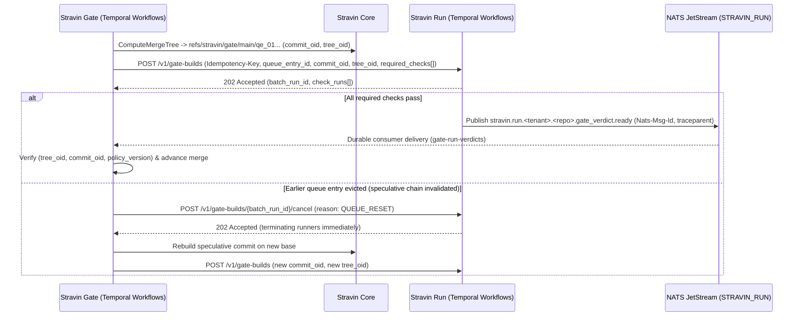

# Stravin Run <-> Stravin Gate

This specification defines the contract between **Stravin Run** (CI runners and pipeline execution) and **Stravin Gate** (speculative merge queues and merge policy).

> **Contract Status:** **Proposed Contract (vNext)** — Neither Stravin Run nor Stravin Gate is implemented in `stravin-dev/core` v1.12.x. Both teams build directly to this specification.

## 1. Boundary & Ownership

| Concern | Source of Truth | Private Implementation Details (Never Crosses Boundary) |
| :--- | :--- | :--- |
| **Speculative merge-queue topology, required check names, batching/bisection strategy, merge decision** | **Stravin Gate** | Queue state machine, batch bisection algorithm, `policy_version` rules, Core `AtomicRefCAS` |
| **Check execution, runner pool, artifact/test caching, individual check verdicts** | **Stravin Run** | MicroVM scheduling, cache hit computation, step logs, retry of flaky infra errors |
| **Verdict binding `(tree_oid, commit_oid, policy_version)`** | **Stravin Run** (attests execution) -> **Stravin Gate** (evaluates policy) | Gate accepts a verdict only when `tree_oid` and `commit_oid` match the exact speculative merge commit and `policy_version` matches the active rule set |

## 2. Interaction Flow



## 3. Auth, Tenancy & Trust Boundary

- **Cilium eBPF Transport & Network Policy:** Bidirectional HTTP/2 or gRPC calls and NATS JetStream traffic traverse **Cilium (eBPF)** transparent WireGuard/SPIFFE mTLS with `CiliumNetworkPolicy` allowlists (or app-level TLS 1.3 mTLS locally), plus signed service JWTs (`tenant_id`, `scopes: ["run:gate-build", "run:cancel"]` for Gate -> Run; scoped NATS publish/subscribe credentials on `STRAVIN_RUN`).
- **Mandatory App-Level Tenancy Check:** Cilium verifies workload identity, NOT `tenant_id`. Both Gate and Run MUST verify `tenant_id` in constant time in application code on every HTTP request and NATS JetStream message.
- **Tamper-Evident Verdict Attestation:** Every verdict event published by Run to `STRAVIN_RUN` carries `(tenant_id, repo_id, queue_entry_id, commit_oid, tree_oid, policy_version, check_name, conclusion)` (with optional detached attestation signature for high-assurance compliance policies). Gate rejects any verdict whose `tenant_id`, `commit_oid`, or `tree_oid` does not match its active speculative entry.
- **No Unbounded Runner Waste:** Gate's fast-cancel API (`POST /v1/gate-builds/{batch_run_id}/cancel`) is high-priority and bypasses normal rate limits so evicted speculative batches stop burning runner CPU within seconds.

## 4. Synchronous Interfaces

### 4.1 Gate -> Run: Speculative Batch Build Request — *Proposed Contract (vNext)*

```http
POST /v1/gate-builds HTTP/1.1
Host: stravin-run.internal
Content-Type: application/json
Authorization: Bearer <service-jwt>
Idempotency-Key: acme:monorepo:qe_01JDF9C4...:c3d4e5f6...
traceparent: 00-4bf92f3577b34da6a3ce929d0e0e4736-00f067aa0ba902b7-01

{
  "tenant_id": "acme",
  "repo_id": "monorepo",
  "queue_entry_id": "qe_01JDF9C4D5E6F7G8H9J0K1L2M3",
  "target_ref": "refs/heads/main",
  "speculative_ref": "refs/stravin/gate/main/qe_01JDF9C4D5E6F7G8H9J0K1L2M3",
  "commit_oid": "c3d4e5f6a1b2c3d4e5f6a1b2c3d4e5f6a1b2c3d4",
  "tree_oid": "d4e5f6a1b2c3d4e5f6a1b2c3d4e5f6a1b2c3d4e5",
  "object_format": "sha1",
  "policy_version": "pol_01JDE0...",
  "required_checks": ["go-test-race", "lint", "e2e-smoke"],
  "priority": "high",
  "allow_tree_oid_reuse": true,
  "timeout_seconds": 1800
}
```

Response (`202 Accepted`):

```json
{
  "batch_run_id": "br_01JDF9E6F7G8H9J0K1L2M3N4P5",
  "reused_checks": ["lint"],
  "scheduled_checks": ["go-test-race", "e2e-smoke"]
}
```

### 4.2 Gate -> Run: Fast Cancellation on Queue Eviction/Reset — *Proposed Contract (vNext)*

```http
POST /v1/gate-builds/br_01JDF9E6F7G8H9J0K1L2M3N4P5/cancel HTTP/1.1
Host: stravin-run.internal
Content-Type: application/json
Authorization: Bearer <service-jwt>

{
  "tenant_id": "acme",
  "repo_id": "monorepo",
  "queue_entry_id": "qe_01JDF9C4D5E6F7G8H9J0K1L2M3",
  "reason": "QUEUE_RESET",
  "superseded_by_commit_oid": "e5f6a1b2c3d4e5f6a1b2c3d4e5f6a1b2c3d4e5f6"
}
```

- Run MUST acknowledge cancellation in `< 200 ms` and propagate `SIGTERM` -> `SIGKILL` to active sandboxes asynchronously.

### 4.3 Gate -> Run: Verdict Reconciliation Pull — *Proposed Contract (vNext)*

- `GET /v1/gate-builds/{batch_run_id}` — Returns current status and per-check verdicts so Gate can recover after missed webhooks or restarts.

## 5. Asynchronous Events & Streams

### 5.1 Run -> Gate: Check Verdict & Batch Completion Events (`STRAVIN_RUN` JetStream)

Published to stream `STRAVIN_RUN` with NATS headers `Nats-Msg-Id: <idempotency_key>`, `Stravin-Event-Type`, `Stravin-Schema-Version: 1.0`, and W3C `traceparent` (consumed by Gate via durable pull consumer `gate-run-verdicts`):

- `stravin.run.<tenant_id>.<repo_id>.gate_check.completed` (`event_type: "run.gate_check.completed"`) — Emitted per individual required check as soon as it finishes (enables **fail-fast eviction**: if `lint` fails in 15 s, Gate immediately evicts the entry and cancels the 20-minute `e2e-smoke` job).
- `stravin.run.<tenant_id>.<repo_id>.gate_verdict.ready` (`event_type: "run.gate_verdict.ready"`) — Emitted when all `required_checks` have reached a terminal conclusion:

```json
{
  "event_id": "evt_01JDF9F7G8H9J0K1L2M3N4P5Q6",
  "event_type": "run.gate_verdict.ready",
  "schema_version": "1.0",
  "occurred_at": "2026-11-24T22:26:40Z",
  "tenant_id": "acme",
  "repo_id": "monorepo",
  "traceparent": "00-4bf92f3577b34da6a3ce929d0e0e4736-00f067aa0ba902b7-01",
  "idempotency_key": "br_01JDF9E6F7G8H9J0K1L2M3N4P5:verdict",
  "data": {
    "batch_run_id": "br_01JDF9E6F7G8H9J0K1L2M3N4P5",
    "queue_entry_id": "qe_01JDF9C4D5E6F7G8H9J0K1L2M3",
    "commit_oid": "c3d4e5f6a1b2c3d4e5f6a1b2c3d4e5f6a1b2c3d4",
    "tree_oid": "d4e5f6a1b2c3d4e5f6a1b2c3d4e5f6a1b2c3d4e5",
    "policy_version": "pol_01JDE0...",
    "overall_verdict": "PASSED",
    "checks": [
      {"name": "go-test-race", "run_id": "run_01JDF9...", "conclusion": "success", "reused_from_tree_oid": false},
      {"name": "lint", "run_id": "run_01JDF8...", "conclusion": "success", "reused_from_tree_oid": true},
      {"name": "e2e-smoke", "run_id": "run_01JDF9...", "conclusion": "success", "reused_from_tree_oid": false}
    ]
  }
}
```

- **Independent Temporal Workflow Engines:** Both **Stravin Run** and **Stravin Gate** run on **Temporal** behind their own service boundaries without ever coupling workflow histories. **Gate**'s speculative merge-queue workflow invokes `POST /v1/gate-builds` and `/cancel` as idempotent Temporal activities (with `Idempotency-Key`), polls `GET /v1/gate-builds/{batch_run_id}` for reconciliation, and receives `STRAVIN_RUN` JetStream verdict events as workflow signals; **Run** maps those commands to its own Temporal CI pipeline DAG workflows (fan-out/fan-in, heartbeating, retries, timeouts, and fast cancellation).

## 6. Shared Data Contracts & Identifiers

- **Verdict Binding Tuple:** `(tenant_id, repo_id, tree_oid, commit_oid, policy_version)`.
    - When `allow_tree_oid_reuse: true`, Run may satisfy a deterministic check using a prior passing run with identical `(tenant_id, repo_id, tree_oid, check_name)` (e.g., when a commit is rebased onto `main` with an identical resulting tree), setting `reused_from_tree_oid: true`.
    - Gate's policy may disallow `tree_oid` reuse for non-hermetic integration checks by setting `allow_tree_oid_reuse: false`.
- **Overall Verdict Enum:** `PASSED` | `FAILED` | `INFRA_ERROR` | `TIMED_OUT` | `CANCELLED`.

## 7. Failure Modes, Timeouts & Idempotency

| Failure Scenario | Behavior & Degradation | Timeout / Retry Policy |
| :--- | :--- | :--- |
| **Check fails with `infra_error` (runner crash / Core 503)** | Run auto-retries once internally; if still `INFRA_ERROR`, Gate does NOT blame the PR — it requeues at the front of the queue (up to 2 retries) before pausing the queue and alerting operators. | Prevents innocent PRs from being evicted on transient CI outages. |
| **Speculative batch exceeds `timeout_seconds`** | Gate sends `/cancel` (`reason: "QUEUE_TIMEOUT"`) and evicts the entry with `QUEUE_TIMEOUT`. | Default `timeout_seconds: 1800` (30 m). |
| **JetStream verdict event delayed or dead-lettered** | Durable `gate-run-verdicts` consumer redelivers (with `STRAVIN_DLQ` advisory on exhaustion); Gate also polls `GET /v1/gate-builds/{batch_run_id}` every 30 s for any active batch without a recent event. | Ensures queue head never stalls silently. |
| **Stale verdict arrives after queue reset** | Gate checks `(queue_entry_id, commit_oid, policy_version)` and discards verdicts for superseded `commit_oid`s. | Idempotent and safe against out-of-order delivery. |

## 8. Meet-in-the-Middle Bridge Checklist

### Side A: Stravin Run Build Checklist

- [ ] Implement idempotent `POST /v1/gate-builds`, `POST /v1/gate-builds/{id}/cancel`, and `GET /v1/gate-builds/{id}` (backed by Temporal CI DAG workflows) with app-level `tenant_id` check.
- [ ] Publish `stravin.run.<tenant_id>.<repo_id>.gate_check.completed` and `gate_verdict.ready` to `STRAVIN_RUN` JetStream with `Nats-Msg-Id` and `traceparent` immediately on individual failures for fail-fast eviction.
- [ ] Support `tree_oid` verdict reuse strictly scoped to `(tenant_id, repo_id, tree_oid, check_name)` and gated by `allow_tree_oid_reuse`.
- [ ] Distinguish `infra_error` from `failure` in conclusions.

### Side B: Stravin Gate Build Checklist

- [ ] Bind every speculative build request and verdict verification to `(tree_oid, commit_oid, policy_version)` with deterministic `Idempotency-Key`s in Gate's Temporal activities.
- [ ] Bind durable JetStream consumer `gate-run-verdicts` on `STRAVIN_RUN` and call `/cancel` immediately whenever an entry is evicted or a speculative chain resets.
- [ ] Poll `GET /v1/gate-builds/{batch_run_id}` as a staleness backstop for active queue entries.
- [ ] Requeue (rather than evict) on `INFRA_ERROR` up to the configured retry budget.

### Shared Contract-Test Fixtures

- `fixtures/run-gate/speculative-build-pass.json` — Request, `202 Accepted`, and `STRAVIN_RUN` JetStream `gate_verdict.ready` (`PASSED`, including one `reused_from_tree_oid: true` check).
- `fixtures/run-gate/fail-fast-cancel.json` — Early `gate_check.completed` (`failure`) JetStream message triggering `POST /v1/gate-builds/{id}/cancel`.
- `fixtures/run-gate/infra-error-requeue.json` — `INFRA_ERROR` verdict fixture verifying non-blame requeue behavior.
