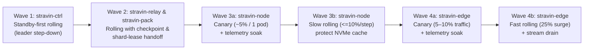
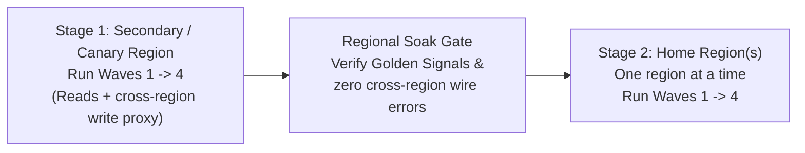

# Zero-Downtime Deployment

!!! warning "Status: TBD / Planned (Not Yet Built)"
    Only the **local Docker Compose + Floci development experience** exists today in `stravin-dev/core` (`v1.12.x`). Production **Kubernetes deployment manifests, rollout controllers, and multi-region promotion automation are TBD** (tracked in `stravin-dev/core#71` and future product phases).

This document defines the deployment strategy for rolling out changes across Stravin Core's five Go daemons (`stravin-ctrl`, `stravin-relay` [`stravin-hook` in `v1.12.x`], `stravin-pack`, `stravin-node`, and `stravin-edge`) and the `vNext` platform foundation services (`Cilium`, `NATS JetStream`, `Temporal`, `stravin-webhooks`, `stravin-auth`, and `stravin-notify`) with zero user-facing downtime.

The approach assumes a **Kubernetes-style orchestration model** (readiness probes, PodDisruptionBudgets, surge/unavailable budgets, graceful `SIGTERM` draining, and percentage-based traffic shifting) while remaining **tool-agnostic**—the exact deployment engine varies by environment, but the ordering, pacing, and compatibility invariants stay the same.

## Zero-Downtime Invariants

Zero-downtime rollouts rely on four structural prerequisites across every release:

1. **N / N-1 Wire & Schema Compatibility (Expand-and-Contract):** Every new binary must interoperate cleanly with the immediately preceding version across:
    - Internal gRPC/mTLS streams (`stravin-edge` ⟷ `stravin-edge` write proxy and `stravin-edge` ⟷ `stravin-node`).
    - DynamoDB records (`META`, `RS#`, `RH#`, `MS#`, `HOOKS`, and shard leases)—add new attributes in release `N`, start writing them once all readers run `N`, and drop deprecated attributes only in release `N+1`.
    - NATS JetStream Standard Async Event Envelopes (`STRAVIN_CORE`, `STRAVIN_REVIEW`, `STRAVIN_RUN`, `STRAVIN_GATE`, `STRAVIN_AUTH`)—additive fields only; unknown fields ignored on read.
    - S3 pack/index layouts and the `HookHostABI` contract.
2. **Readiness-First Cutover & Graceful Drain:** Every terminating pod flips its readiness probe to unready *before* stopping, waits for load-balancer / service-discovery convergence, and drains active work (long-lived `git clone`/`git push` streams, active two-phase manifest swaps, in-flight DynamoDB Streams / JetStream checkpoints, external webhook HTTP deliveries, or Temporal activity heartbeats) within a bounded `terminationGracePeriodSeconds` window.
3. **Never Drop Below Regional HA Floors:** Enforce `maxUnavailable: 0` (surge-first) on stateless/rolling services and PodDisruptionBudgets so every active region keeps at least 2 healthy pods of `stravin-edge` and `stravin-node` across Availability Zones, 1 active + 1 standby for `stravin-ctrl`, and a healthy Raft quorum for `NATS JetStream`.
4. **Cilium eBPF Sidecarless Transport (`vNext`):** Production Kubernetes transport uses **Cilium (eBPF)** transparent WireGuard/SPIFFE mTLS and `CiliumNetworkPolicy` ([ADR-0001](../adr/0001-platform-transport-events-webhooks.md))—eliminating Envoy sidecar shutdown races on 256 MiB Git streams while `stravin-edge` preserves Go HRW `(tenant_id, repo_id)` pinning via a headless Kubernetes `Service`. Cilium agent DaemonSet upgrades run separately from application waves using Cilium's BPF state-preservation rolling upgrade.

## Core Service Deployment Strategy Matrix

| Wave | Service | Rollout Pattern | Surge / Unavailable Policy | Graceful Drain & Handoff | Promotion Gate |
| :--- | :--- | :--- | :--- | :--- | :--- |
| **1** | **`stravin-ctrl`** | **Standby-first rolling** | Update standby(s) first, then step down active leader | Leader relinquishes lease cleanly; upgraded standby assumes leadership | Leader election healthy; zero split-brain epoch errors |
| **2** | **`stravin-relay`** (`stravin-hook` in `v1.12.x`) | **Rolling** | `maxSurge: 1`, `maxUnavailable: 0` | Stop polling new DynamoDB Stream batches, flush in-flight JetStream publishes (`Nats-Msg-Id`), commit stream checkpoint | Stream iterator age stable; zero JetStream publish error spikes (`v1.12.x` `stravin-hook`: no webhook error/DLQ spike) |
| **2** | **`stravin-pack`** | **Rolling** | `maxSurge: 1`, `maxUnavailable: 0` (keep total active workers ≤ `M`) | Stop claiming new shard leases, finish active two-phase manifest swap, release lease | Compaction cycles succeeding; no lease-contention or lag spike |
| **3** | **`stravin-node`** | **Canary → Slow Rolling** | Canary (~5% / 1 pod), then ≤ 10% per step, `maxUnavailable: 0` | Remove from rendezvous ring, drain active `git-upload-pack` / `git-receive-pack` streams | Node p99, error rate, CAS conflicts, Wasm verdicts, and NVMe cache recovery healthy |
| **4** | **`stravin-edge`** | **Canary → Fast Rolling** | Canary (5–10% traffic), then 25% surge batches, `maxUnavailable: 0` | Fail readiness probe, wait for LB drain, finish active SSH/HTTP Git streams | Edge p99, non-auth 5xx rate, and cross-region write-proxy latency healthy |

## Regional Rollout Sequence

Within a region, Core services deploy in **four ordered waves**. Updating control and downstream consumers before writers guarantees that every reader and stream processor understands new metadata or pack attributes before `stravin-node` emits them, while pushing `stravin-edge` last isolates ingress routing changes until the data plane is already verified.

### Wave 1: `stravin-ctrl` (Standby-First Rolling)

`stravin-ctrl` runs as an active-passive leader/standby pair and sits off the normal Git request path.

1. Upgrade standby replica(s) first and wait for readiness probes to pass.
2. Trigger graceful leader step-down on the old active pod so an upgraded standby acquires leadership without an unowned gap.
3. Replace the old leader pod as the new standby.

### Wave 2: `stravin-relay` (`stravin-hook` in `v1.12.x`) and `stravin-pack` (Rolling)

Both background workers run in parallel during Wave 2 because neither serves synchronous Git client connections, and both must understand any new DynamoDB `Ref History` or `Pack Manifest` fields before `stravin-node` writes them.

- **`stravin-relay` (`vNext`; `stravin-hook` in `v1.12.x`):** Roll pods with `maxUnavailable: 0`. In `vNext` ([ADR-0001](../adr/0001-platform-transport-events-webhooks.md)), `stravin-relay` is a pure DynamoDB Streams -> NATS JetStream transactional outbox relay (zero Wasm, zero external HTTP webhooks). On `SIGTERM`, each pod stops fetching new DynamoDB Stream batches, flushes in-flight JetStream publishes (protected by server-side `Nats-Msg-Id` deduplication), and writes its final sequence checkpoint (`STREAMS#CHECKPOINT`) so the replacement pod resumes without gaps. *(In Core `v1.12.x`, `stravin-hook` drains in-flight direct HTTP webhooks before committing its checkpoint.)*
- **`stravin-pack`:** Roll pods with `maxUnavailable: 0` (keeping total active workers at or below manifest shard count `M`). On `SIGTERM`, each worker stops claiming new shard leases, completes any active two-phase manifest swap (`Publish` → `Supersede`), releases its DynamoDB lease, and exits.

### Wave 3: `stravin-node` (Canary → Slow Rolling)

`stravin-node` carries warm NVMe bare-repo caches and executes synchronous Wasm hooks, making it the highest-sensitivity data-plane rollout.

1. **Canary (~5% or 1 pod, `maxUnavailable: 0`):** Add the canary pod to the region's rendezvous ring. Because Highest Random Weight (HRW) hashing remaps only `~1/N` of repositories, the canary receives a bounded slice of live reads and writes and warms its NVMe cache naturally.
2. **Soak & Telemetry Gate (10–15 minutes):** Verify:
    - `stravin_node_request_duration_seconds` (p95/p99) and `stravin_node_requests_total{status_code="error"}` match baseline.
    - `stravin_ddb_transact_total{result="conflict|throttled"}` does not regress.
    - `stravin_hook_wasm_duration_seconds` and `stravin_hook_wasm_verdicts_total` show no timeout or OOM regression.
    - `stravin_node_cache_hits_total` climbs cleanly after initial warmup without sustained `stravin_node_s3_pack_fetches_total` storms.
3. **Progressive Slow Rolling (≤ 10% or 1 pod per step):** Surge a new pod, wait for readiness, then remove one old pod from the rendezvous ring and drain its active `git-upload-pack` and `git-receive-pack` streams. Pause briefly between steps so remapped repositories re-warm on remaining nodes without saturating S3 `GetObject` bandwidth.

### Wave 4: `stravin-edge` (Canary → Fast Rolling)

`stravin-edge` is stateless with no local disk cache, so it rolls out faster once `stravin-node` is stable.

1. **Canary (5–10% of ingress traffic):** Route a small slice of SSH and Smart HTTP traffic to canary `stravin-edge` pods.
2. **Soak & Telemetry Gate (5–10 minutes):** Verify `stravin_edge_requests_total` (non-auth `5xx` and timeout error classes), `stravin_edge_request_duration_seconds` p99, and cross-region gRPC write-proxy latency remain within SLO.
3. **Fast Rolling (e.g., 25% surge, `maxUnavailable: 0`):** Roll remaining replicas in batches. Each terminating pod marks itself unready so the load balancer stops sending new connections, then drains active long-lived `git clone` and `git push` streams before exiting.

## Multi-Region Rollout Progression

Never roll a release to all regions simultaneously. Progress region by region so a bad release cannot impact both the home region and its failover target at the same time:

1. **Secondary / Non-Home Region First:** Validates the read path, local DynamoDB/S3 reads, S3 origin fallback, and the cross-region `stravin-edge` → `home_region` write proxy without risking home-region write durability.
2. **Regional Soak:** Hold for a bake window (e.g., 30–60 minutes) and verify Golden Signals across both regions—specifically checking cross-region gRPC compatibility between upgraded secondary `stravin-edge` and existing home-region `stravin-edge`.
3. **Home Region(s) One at a Time:** Run Waves 1–4 in one home region, soak, and repeat for remaining regions.

## Platform & Foundation Services Rollout (`vNext`)

Per [ADR-0001](../adr/0001-platform-transport-events-webhooks.md) and [ADR-0003](../adr/0003-platform-auth-and-sso-seam.md), the `vNext` platform adds dedicated foundation infrastructure and shared services alongside Stravin Core. Each rolls out independently with its own compatibility and drain invariants:

| Service | Scope | Rollout Pattern | Graceful Drain & Zero-Downtime Handoff | Key Promotion Gate |
| :--- | :--- | :--- | :--- | :--- |
| **`NATS JetStream`** | Internal async event backbone (`STRAVIN_*` streams) | **Ordered `StatefulSet` rolling** (1 pod at a time; 3- or 5-pod Raft cluster, `R=3`) | Step down stream/meta Raft leader on the terminating pod (`lame-duck` mode), wait for peer catch-up and quorum stability (`PDB: maxUnavailable: 1`) before restarting next pod | All `R=3` streams synchronized; zero Raft election storms or `Nats-Msg-Id` publish failures |
| **`Temporal`** | Durable workflow runtime (**Run** & **Gate** only) | **Cluster rolling + Worker versioning** | Upgrade Temporal Server roles (Frontend/Matching/History) with `maxUnavailable: 0`. For **Run** and **Gate** workers, enforce deterministic replay (`workflow.GetVersion` / Worker Build IDs) and drain in-flight activities + heartbeats on `SIGTERM` before exiting | Zero non-determinism replay errors; task-queue schedule-to-start latency and activity timeouts healthy |
| **`stravin-webhooks`** | External customer HTTP webhooks (Temporal-free) | **Rolling** (`maxUnavailable: 0`) | Stop pulling new `webhooks-*-fanout` / `STRAVIN_WEBHOOK_OUTBOX` JetStream batches on `SIGTERM`; finish in-flight `<= 10 s` customer HTTPS `POST` calls, write delivery logs, and `ACK` before exit; preserve KMS dual-secret rotation windows | Delivery latency, circuit-breaker rate, and `STRAVIN_WEBHOOK_DLQ` inflow stable |
| **`stravin-auth`** | Platform IAM, STS, SSO & RBAC (Temporal-free) | **Rolling** (`maxUnavailable: 0`) + **Dual-key JWKS rotation** | Publish new signing `kid` on `/.well-known/jwks.json` and emit `stravin.auth.<tenant_id>.jwks.rotated` *before* signing with it; keep old `kid` published past max token TTL + cache grace. Maintain Valkey `jti` deny-list continuity; `stravin-edge` verifies cached JWKS locally so `stravin-auth` restarts cause zero Git hot-path outage | STS/OIDC/SCIM 5xx rate zero; `stravin-edge` JWKS verification errors zero; Valkey `jti` latency `< 5 ms` |
| **`stravin-notify`** | Human notifications (Temporal-free, parallel to `stravin-webhooks`) | **Rolling** (`maxUnavailable: 0`) | Stop pulling new `notify-*-fanout` / `STRAVIN_NOTIFY_OUTBOX` JetStream batches on `SIGTERM`; finish in-flight `ChannelAdapter` calls and `ACK`; send graceful WebSocket/SSE close frames so clients reconnect with jitter over Valkey pub/sub | Inbox persistence errors zero; `STRAVIN_NOTIFY_DLQ` stable; WS/SSE reconnect storm bounded |
| **`Cilium` (eBPF)** | Sidecarless WireGuard/SPIFFE mTLS & `CiliumNetworkPolicy` | **Rolling DaemonSet** (node-by-node, separate from app waves) | Preserve existing eBPF conntrack/datapath maps across agent restart so active 256 MiB `stravin-edge` ⟷ `stravin-node` Git streams and `CiliumNetworkPolicy` rules stay uninterrupted | Zero dropped packets on `stravin-edge` ⟷ `stravin-node`; WireGuard/SPIFFE identity sync healthy |

- **Temporal-Free Boundary:** **Stravin Core**, **Stravin Review**, **Stravin Index**, **`stravin-webhooks`**, **`stravin-auth`**, and **`stravin-notify`** remain permanently Temporal-free and never depend on Temporal cluster upgrades.
- **Future Async `post-receive` Wasm Runner:** If server-side asynchronous `post-receive` Wasm hooks are added in `vNext`, they deploy and roll out as an independent NATS JetStream consumer—never inside `stravin-relay`.

## Abort Conditions & Rollback

Halt promotion and roll back immediately if any canary or rolling wave breaches its telemetry gate:

| Abort Signal | Scope | Action |
| :--- | :--- | :--- |
| Elevated `stravin_edge_requests_total` non-auth `5xx` / timeout rate | `stravin-edge` | Shift canary weight to 0% and revert `stravin-edge` |
| `stravin_node_request_duration_seconds` p99 or error spike, or Wasm timeout/OOM surge | `stravin-node` | Remove canary / halt rolling step and revert `stravin-node` |
| `stravin_ddb_transact_total{result="conflict|throttled"}` regression on new pods | `stravin-node` | Halt rollout immediately; inspect schema/CAS logic |
| `stravin_pack_compaction_lag_seconds` spike or manifest-swap errors | `stravin-pack` | Halt Wave 2 and revert `stravin-pack` before touching `stravin-node` |
| DynamoDB Streams iterator age spike or JetStream publish errors (`v1.12.x`: webhook DLQ spike) | `stravin-relay` (`stravin-hook`) | Halt Wave 2 and revert `stravin-relay` before touching `stravin-node` |
| `stravin_otel_dropped_items_total` spike or missing metrics | Any | **Pause rollout** (never promote blindly without telemetry visibility) |

!!! note "Reverse-Order Rollback"
    Because every release maintains N / N-1 wire and schema compatibility, rollbacks require no data migration. Revert Core services in **reverse wave order** (`stravin-edge` → `stravin-node` → `stravin-pack`/`stravin-relay` [`stravin-hook` in `v1.12.x`] → `stravin-ctrl`) using the same surge-first (`maxUnavailable: 0`) and graceful-drain rules.

## Related Documents

- [Service Scaling](scaling.md) — Telemetry-driven horizontal/vertical scaling and graceful drain rules for Core daemons and `vNext` platform services.
- [Telemetry & Observability](telemetry.md) — Golden Signals, Prometheus metrics, and distributed traces used as rollout gates.
- [Multi-Region HA & Consistency](../core/ha-consistency.md) — Home-region write pinning, failover fencing, and cross-region behavior.
- [System Topology & Request Flows](../core/topology.md) — Service boundaries, rendezvous hashing, and cross-region write-proxy flows.
- [ADR-0001: Platform Transport, Events & Webhooks](../adr/0001-platform-transport-events-webhooks.md) — Cilium eBPF mesh, NATS JetStream, `stravin-relay`, `stravin-webhooks`, and Temporal boundaries.
- [ADR-0003: Platform Auth & SSO Seam](../adr/0003-platform-auth-and-sso-seam.md) — `stravin-auth` JWKS rotation, Valkey `jti` deny-list, and off-hot-path isolation.
