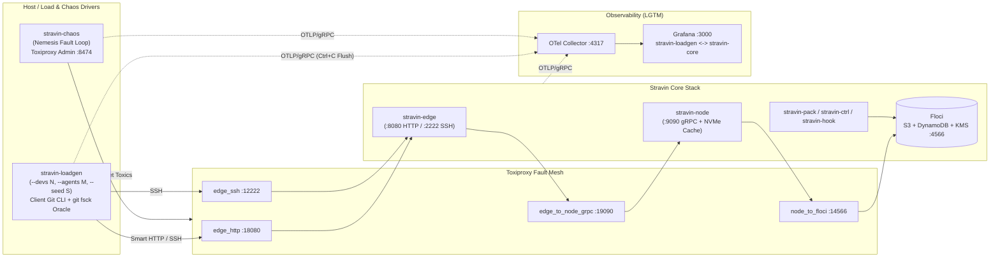

# Load Testing & Chaos Engineering (`stravin-loadgen` & `stravin-chaos`)

Stravin Core ships a standalone multi-persona Git load generator (`stravin-loadgen`), a deterministic Toxiproxy fault injector (`stravin-chaos`), and a local chaos Compose stack (`docker-compose.chaos.yml`) to prove protocol correctness, storage durability, and client experience under concurrent developer and AI coding-agent workloads.

## Load & Chaos Architecture

`stravin-loadgen` drives real `git` CLI subprocesses against `stravin-edge` over both Smart HTTP and Git SSH, either directly or through Toxiproxy (`edge_http` on `:18080`, `edge_ssh` on `:12222`). Internally, `docker-compose.chaos.yml` also interposes Toxiproxy on the `stravin-edge -> stravin-node` gRPC link (`edge_to_node_grpc` on `:19090`) and the `stravin-node -> Floci` S3/DynamoDB link (`node_to_floci` on `:14566`). Both `stravin-loadgen` and `stravin-chaos` export OpenTelemetry traces, metrics, and correlated logs to the local LGTM stack.



### Worker & Strategy Execution Model

- **GoF Strategy Registry (`internal/loadgen/scenario.go`):** Every workload implements the `Scenario` interface (`Name()`, `Persona()`, `Weight()`, `Run(ctx, env)`). `Registry.Select(persona, rng)` performs deterministic weighted random selection per persona, and `--scenarios` filters the active catalog.
- **Isolated Worker Goroutines & Staggered Ramp-Up (`internal/loadgen/runner.go`, `internal/loadgen/config.go`):** `Runner` spawns `--devs` developer workers (`persona="dev"`) and `--agents` AI agent workers (`persona="agent"`), staggered smoothly across `--ramp-up` (default `5s`; `0` disables ramp-up) to avoid artificial cold-start connection storms. Each worker owns an isolated temporary workspace (`os.MkdirTemp`) cleaned up on exit and selects a target repository from `--repos <N>` (integer count generating deterministic `repo-1..repo-N`, default `3` matching `floci-init` bootstrap seeding).
- **Per-Worker `BaseCloneCache` & Detached Worktrees (`internal/loadgen/scenario.go`):** Each worker maintains a private `BaseCloneCache` keyed by repository name. Instead of executing a redundant full clone on every scenario iteration, scenarios check out isolated detached `git worktree` directories from the worker's cached base clone and remove them on completion.
- **Deterministic Client-Side GC Hygiene (`internal/loadgen/gitops.go`, `internal/loadgen/gc.go`):** Every `git` subprocess runs with `-c gc.auto=0` so background auto-GC never races with concurrent worktree or ref operations. Between iterations—when no linked worktree is active on a cached base clone—`BaseCloneCache.MaybeGC` checks `.idx` pack count (`DefaultGCPackThreshold = 50`) and loose object count (`DefaultGCLooseThreshold = 27` in `objects/17`) and runs synchronous foreground `git -c gc.autoDetach=false gc`.
- **Isolated Fresh-Clone Integrity Checks (`runFsckFreshClone`):** Scenarios performing `git fsck --full --strict` verification (`internal/loadgen/scenarios/helpers.go`) clone into a fresh temporary directory via `runFsckFreshClone` rather than trusting the worker's cached base clone, ensuring server-side object-graph issues are never masked by local objects.
- **Deterministic Seeding & Think Time:** Each worker derives an independent `math/rand/v2` PCG stream from `--seed` (or current Unix nanoseconds when `--seed 0`), a persona salt (`1` for `dev`, `2` for `agent`), and `workerID + 1`. Between scenarios, workers sleep a deterministic jittered think time between `--think-min` (default `50ms`) and `--think-max` (default `500ms`).

## Deterministic Entropy & Weighted File Sizes

All scenario parameters—branch names, tag versions, commit messages, file contents, directory depths, and invalid ref names—are generated by `Entropy` (`internal/loadgen/scenarios/entropy.go`) exclusively from the worker's seeded PRNG so any failure can be reproduced verbatim by replaying `--seed`.

File payloads default to `WeightedPayload()`, which draws sizes from `WeightedFileSize()` in `[256 B, 512 KiB]` skewed toward small deltas:

| Tier | Probability | Size Range | Content Profile |
| :--- | :--- | :--- | :--- |
| **Small** | 70% | 256 B – 4 KiB | Structured UTF-8 text lines (`line=`, `topic=`, `val=`) |
| **Medium** | 20% | 4 KiB – 32 KiB | Structured UTF-8 text lines |
| **Large** | 7% | 32 KiB – 128 KiB | 50% structured text + 50% incompressible pseudo-random bytes |
| **Extra-Large** | 3% | 128 KiB – 512 KiB | 100% incompressible pseudo-random bytes (resists zlib compression) |

Additional entropy helpers target specific Git engine paths:

- **`SmallDelta(base)`:** Appends a small deterministic block to an existing blob so Git generates thin-pack deltas (`dev_incremental_thin_pack`).
- **`IncompressibleBlob(size)`:** Produces 1–4 MiB high-entropy binary blobs for `dev_large_binary_asset`.
- **`DeepTreePaths(depth, count)`:** Builds nested directory hierarchies (depth 4–6, 6–10 files) for `agent_deep_tree_refactor`.
- **`InvalidRefName()`:** Generates syntactically invalid Git ref names (`..`, `~`, `@{`, `:`, `?`) for `agent_corrupt_ref_negative_test`.

## Complete Catalog of 22 Load Test Scenarios

`scenarios.All()` (`internal/loadgen/scenarios/registry.go`) registers **22 scenarios**: **11 Developer (`persona="dev"`)** scenarios (total weight `110`) and **11 AI Agent (`persona="agent"`)** scenarios (total weight `104`).

### Developer Persona (`persona="dev"`, 11 Scenarios)

| # | Scenario Name | Weight | Transport & Git Operations | Verification & Oracle Checks |
| :--- | :--- | :---: | :--- | :--- |
| 1 | `dev_clone_and_read` | 15 | Smart HTTP fresh `clone`, `status --short`, `log -n 1..10 --oneline` | `git fsck --full --strict` on cloned repo |
| 2 | `dev_feature_branch_pr` | 15 | Smart HTTP `clone` -> exclusive branch -> 1–5 commits (`WeightedPayload`) -> `push` | Fresh `fetch` + `Oracle.VerifySHA` on branch tip |
| 3 | `dev_incremental_thin_pack` | 12 | Smart HTTP `clone` -> base commit & `push` -> `fetch` -> `SmallDelta` commit -> `push --thin` | `fetch` + `Oracle.VerifySHA` on updated tip |
| 4 | `dev_rebase_and_force_push` | 10 | Smart HTTP `clone` -> 2 commits -> `push` -> `fetch` -> `commit --amend` -> `push --force-with-lease` | `fetch` + `Oracle.VerifySHA` on amended SHA |
| 5 | `dev_concurrent_main_push_retry` | 10 | Smart HTTP `clone` -> commit on shared `main` -> `push` with Ref-CAS conflict `fetch` + `rebase` + retry loop | Verifies committed SHA is an ancestor of remote `main` |
| 6 | `dev_tag_and_release` | 8 | Smart HTTP `clone` -> commit -> lightweight tag + annotated tag -> `push` branch & both tags -> fresh `clone` + `fetch --tags` | Resolves `refs/tags/<tag>^{commit}` via `Oracle.VerifySHA` for both tags |
| 7 | `dev_large_binary_asset` | 6 | Smart HTTP `clone` -> 1–4 MiB `IncompressibleBlob` commit -> `push` -> fresh `clone` + `fetch` + `checkout` | SHA-256 byte-for-byte file verification + `git fsck --full --strict` |
| 8 | `dev_branch_cleanup_cycle` | 8 | Smart HTTP `clone` -> create & `push` -> `push --delete` -> `ls-remote` -> recreate & `push` | Confirms branch absent after delete via `ls-remote`, then `VerifySHA` after recreate |
| 9 | `dev_shallow_clone_unshallow` | 8 | Smart HTTP `clone --depth=1` -> `fetch --unshallow` (or `fetch` if repo has single commit) | `git fsck --full --strict` on unshallowed object graph |
| 10 | `dev_ssh_full_lifecycle` | 8 | Git SSH (`:2222` / `:12222`) `clone` -> commit -> `push` -> `fetch` | `Oracle.VerifySHA` + `git fsck --full --strict` over SSH |
| 11 | `dev_noop_empty_push_and_fetch` | 10 | Smart HTTP `ls-remote` -> `clone` -> up-to-date `fetch` -> initial `push` -> repeated no-op `push` on same ref | Ensures idempotent no-op push and up-to-date fetch succeed cleanly |

### AI Agent Persona (`persona="agent"`, 11 Scenarios)

| # | Scenario Name | Weight | Transport & Git Operations | Verification & Oracle Checks |
| :--- | :--- | :---: | :--- | :--- |
| 12 | `agent_rapid_checkpoint_burst` | 14 | Smart HTTP `clone` -> exclusive branch -> 5–15 rapid sequential commits + `push` calls | Final `fetch` + `Oracle.VerifySHA` on last checkpoint SHA |
| 13 | `agent_parallel_branch_fanout` | 12 | Smart HTTP `clone` -> 3–5 topic branches created from base SHA and pushed in quick succession | Loops over all pushed branches with `fetch` + `Oracle.VerifySHA` |
| 14 | `agent_shared_branch_race` | 12 | Smart HTTP `clone` -> concurrent commits on shared `agent/shared-race` -> `push` with Ref-CAS `fetch` + `rebase` + retry | Verifies committed SHA is an ancestor of remote `agent/shared-race` |
| 15 | `agent_deep_tree_refactor` | 10 | Smart HTTP `clone` -> nested tree (depth 4–6, 6–10 files) -> `push` -> bulk `git mv` (half) + `git rm` (2 files) -> `push` -> fresh `clone` | Confirms moved files exist, deleted files absent, and `git fsck --full --strict` |
| 16 | `agent_orphan_branch_artifact` | 8 | Smart HTTP `clone` -> `checkout --orphan` -> rootless artifact commit -> `push` -> isolated `git init` + `fetch` | Verifies 0 parents via `rev-list`, `Oracle.VerifySHA`, and `git fsck --full --strict` |
| 17 | `agent_merge_commit_diamond` | 10 | Smart HTTP `clone` -> diverge left & right branches -> `merge --no-ff` diamond commit -> `push` -> `fetch` | `Oracle.VerifySHA` + verifies exact 2-parent merge DAG via `rev-list --parents` |
| 18 | `agent_cherry_pick_backport` | 8 | Smart HTTP `clone` -> release branch + feature branch -> `cherry-pick` fix onto release -> atomic multi-ref `push` of both branches | Verifies cherry-picked file exists + `Oracle.VerifySHA` on both remote branches |
| 19 | `agent_wasm_hook_allow_and_reject` | 8 | Smart HTTP `clone` -> allowed branch `push` -> policy-trigger branch (`reject/policy-*` with `STRAVIN_HOOK_REJECT=true`) `push` with `ExpectReject: true` | Allowed branch `VerifySHA`, clean expected reject on policy push, and `git fsck --full --strict` |
| 20 | `agent_high_churn_compaction_trigger` | 8 | Smart HTTP `clone` -> 6–12 rapid small pack pushes while a concurrent goroutine polls `ls-remote` 6 times | Reader completes cleanly, `Oracle.VerifySHA`, and `git fsck --full --strict` |
| 21 | `agent_protocol_switch_http_ssh` | 8 | Push over Smart HTTP -> immediately clone/fetch over SSH -> commit & push over SSH -> immediately fetch over Smart HTTP | `Oracle.VerifySHA` across both protocol hops + `git fsck --full --strict` |
| 22 | `agent_corrupt_ref_negative_test` | 6 | Smart HTTP `clone` -> `push` to syntactically invalid ref (`InvalidRefName()`) expecting clean rejection (`ExpectReject: true`) | Fails if accepted; confirms post-reject `ls-remote` and `git fsck --full --strict` stay healthy |

## Client-Side Integrity Oracle & Error Classification

`Oracle` and `ClassifyError` (`internal/loadgen/oracle.go`) separate expected concurrency or chaos effects from true correctness bugs:

| Error Class | Trigger Conditions | Handling & Accounting |
| :--- | :--- | :--- |
| **`retryable_conflict`** | HTTP `409`/`412` or Git Ref-CAS / `non-fast-forward` / `fetch first` / `cannot lock ref` on **shared** branches (`ExclusiveBranch: false`) | Recorded in `stravin_loadgen_retries_total`; scenario performs `fetch` + `rebase` + retry. On an exclusive branch (`ExclusiveBranch: true`), promoted to `unexpected`. |
| **`retryable_transient`** | HTTP `502`/`503`/`504`, `early eof`, `connection reset`, `connection refused`, `broken pipe`, timeouts, or SSH disconnect during chaos | `ScenarioEnv.RunOp` retries with bounded exponential backoff (`100ms` base -> `5s` max, half-to-full jitter) up to `--max-retries` (default `3`). |
| **`expected_reject`** | HTTP `400`/`403`/`422`, `pre-receive hook declined`, `remote rejected`, or invalid refspec when `ExpectReject: true` | Recorded as `outcome="expected_reject"`; treated as a passing check. |
| **`unexpected`** | Any `git fsck --full --strict` failure, object corruption markers (`missing blob`, `bad object`, `hash mismatch`), HTTP `400`/`401`/`403`/`404`/`500`, lost committed SHA (`VerifySHA`), or exhausted retries | Recorded in `Oracle` (with active `trace_id`, up to 500 stored records) and `stravin_loadgen_unexpected_errors_total` or `stravin_loadgen_fsck_failures_total`. Causes exit code `1` (or immediate run cancellation under `--fail-fast`). |

## OpenTelemetry Signals, Ctrl+C Flush & Grafana Dashboard

### OTLP Pipeline & Signal Inventory

`stravin-loadgen` initializes `service.name="stravin-loadgen"` (`internal/loadgen/telemetry.go`) and exports traces, metrics (5 s periodic reader), and `otelslog`-bridged structured logs over OTLP/gRPC to `--otel-endpoint` (default `http://127.0.0.1:4317`; pass `""` to disable network export).

| Metric | Type | Labels | Purpose |
| :--- | :--- | :--- | :--- |
| `stravin_loadgen_active_threads` | UpDownCounter | `persona` | Active developer vs AI agent worker goroutines |
| `stravin_loadgen_ops_total` | Counter | `persona`, `scenario`, `op`, `outcome` | Operation and scenario completion rates by persona and outcome |
| `stravin_loadgen_op_duration_seconds` | Histogram | `persona`, `scenario`, `op` | Client-observed latency (p50/p95/p99) with Tempo trace exemplars |
| `stravin_loadgen_retries_total` | Counter | `persona`, `scenario`, `reason` | Expected conflict and transient chaos retries |
| `stravin_loadgen_unexpected_errors_total` | Counter | `persona`, `scenario`, `op` | Hard client/protocol/oracle failures (target: `0`) |
| `stravin_loadgen_fsck_failures_total` | Counter | `scenario` | `git fsck --full --strict` integrity failures (target: `0`) |

Every scenario execution opens a `loadgen.scenario` root trace span tagged with `persona`, `scenario`, `repo`, and `worker_id`, and `traceCorrelatedHandler` injects `trace_id` and `span_id` into both local JSON logs and OTLP logs shipped to Loki.

### Guaranteed Ctrl+C (`SIGINT` / `SIGTERM`) Telemetry Flush

When `--duration 0` (continuous mode) or when interrupted early by `SIGINT` / `SIGTERM`, `cmd/stravin-loadgen/main.go` cancels the worker context, waits for in-flight workers to finish, and then invokes `Telemetry.Shutdown(flushCtx)` using a **fresh** timeout context (`--flush-timeout`, default `10s`, overrideable via `STRAVIN_OTEL_SHUTDOWN_TIMEOUT`). `TracerProvider`, `MeterProvider`, and `LoggerProvider` flush and shut down in parallel so one slow exporter cannot starve the others, ensuring final error counts and traces reach Prometheus, Tempo, and Loki before the JSON `RunResult` summary prints to stdout.

### `stravin-loadgen` Grafana Dashboard Layout

The provisioned **Stravin Load Tester** dashboard (`uid: stravin-loadgen`) is organized into five collapsible/folding row sections with direct cross-links to `stravin-core`, Tempo traces, and Loki logs:

1. **Overview (Devs vs AI Agents):** Top-level KPI stat cards (ops/sec, active threads, total unexpected errors, total `git fsck` failures) alongside side-by-side persona comparison time series.
2. **Scenario Distribution:** Two dedicated donut `piechart` panels—**Developer Scenarios Run** (`persona="dev"`) and **AI Agent Scenarios Run** (`persona="agent"`)—verifying weighted scenario coverage per persona.
3. **Developer Experience (`persona="dev"`):** Granular developer ops/sec by scenario and operation, p50/p95/p99 latency with Tempo exemplars, retries by reason, and unexpected errors / `git fsck` failures.
4. **AI Agent Experience (`persona="agent"`):** Granular AI agent ops/sec by scenario and operation, p50/p95/p99 latency with Tempo exemplars, retries by reason, and unexpected errors / `git fsck` failures.
5. **Traces & Logs (Loki + Tempo):** Embedded Loki log stream for `{service_name=~"stravin-loadgen|stravin-chaos"}` with derived `trace_id` links into Tempo.

## Chaos Engineering Integration (Toxiproxy & `stravin-chaos`)

`stravin-chaos` (`internal/chaos/nemesis.go`) runs a deterministic, seeded `Nemesis` fault-injection loop against the Toxiproxy admin API (`http://127.0.0.1:8474`):

- **Network Fault Strategies (`FaultAction`):** `latency` (50–400 ms + 10–100 ms jitter), `bandwidth` (64–512 KB/s), `reset_peer` (TCP RST after 50–250 ms), `timeout` (200–1000 ms drop), and `slow_close` (100–500 ms close delay) applied across `edge_http`, `edge_ssh`, `edge_to_node_grpc`, and `node_to_floci`.
- **Optional Daemon Restarts:** When enabled, `GuardedServiceController` restarts eligible daemons (`stravin-node`, `stravin-edge`, `stravin-pack`, `stravin-hook`) while blocking protected infrastructure services.
- **Guaranteed Teardown Cleanup:** Every fault removes its toxic after `FaultDuration` (default `3s`), and `Nemesis.Run` always calls `ProxyController.ResetAll` on exit so the cluster returns to a clean state.

### Local Execution Commands

Load and chaos suites run locally against Docker Compose + Floci (no real AWS resources):

```bash
# 1. Start the chaos + telemetry stack (Floci, Toxiproxy, 5 Stravin daemons, LGTM)
make chaos-up TELEMETRY=1

# 2. Run stravin-loadgen standalone against the local stack
make load-test DEVS=4 AGENTS=6 DURATION=60s OTEL_ENDPOINT=http://127.0.0.1:4317

# 3. Run the end-to-end chaos verification suite (boots stack, injects faults, verifies 0 unexpected errors & 0 fsck failures)
make chaos-e2e

# 4. Tear down the chaos stack and volumes
make chaos-down
```

## Related Documents

- [Local Development with Docker Compose & Floci](local-dev.md) — Running the local Floci and `--profile telemetry` LGTM stack.
- [Telemetry & Observability (OpenTelemetry + LGTM)](telemetry.md) — OTel Collector topology, exemplar correlation, and Prometheus cardinality guardrails.
- [Service Scaling](scaling.md) — Interpreting loadgen and Core golden signals for daemon scaling.
- [System Topology & Request Flows](../core/topology.md) — End-to-end Smart HTTP, Git SSH, and gRPC paths exercised by the 22 scenarios.
- [Server-Side Hooks](../core/hooks.md) — Tier 1 Wasm pre-receive hooks exercised by `agent_wasm_hook_allow_and_reject`.
