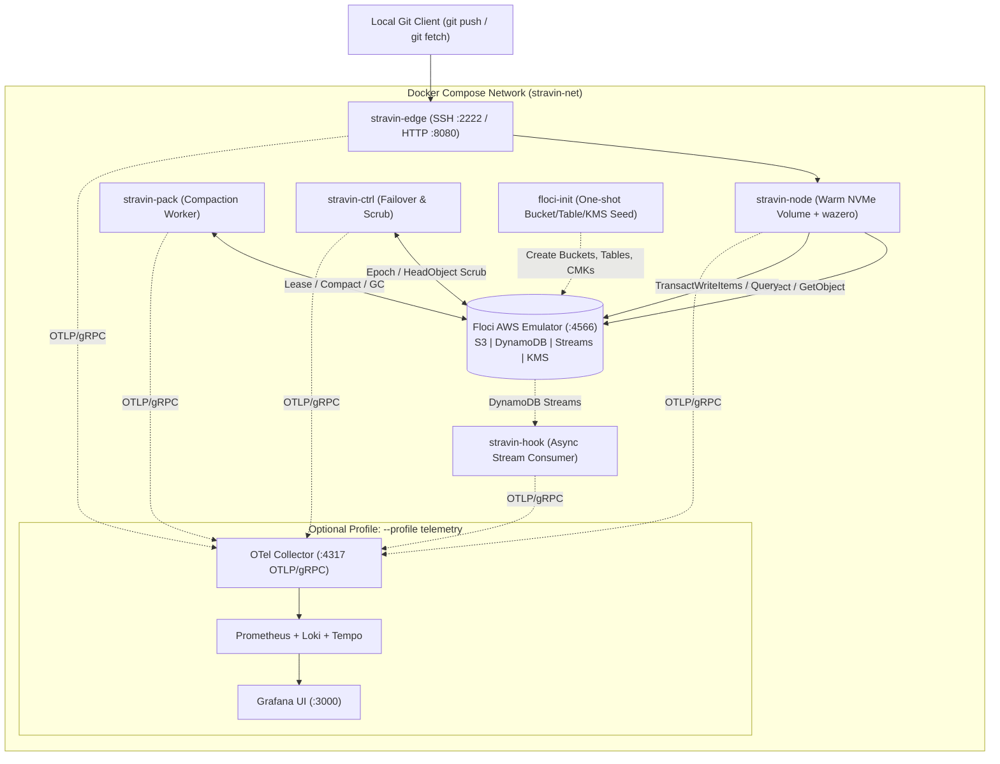

# Local Development with Docker Compose & Floci

Stravin Core is designed to run completely locally without live AWS accounts, shared staging environments, or cloud credentials. Developers spin up the full Go daemon suite (`stravin-edge`, `stravin-node`, `stravin-pack`, `stravin-ctrl`, and `stravin-hook`) via **Docker Compose**, backed by **Floci** for local AWS service emulation and an optional OpenTelemetry / Grafana LGTM profile for end-to-end observability.

## Purpose & Scope

Running against a high-fidelity local AWS emulator keeps the inner development loop fast, offline-capable, and deterministic:

- **Zero cloud drift:** Every Stravin daemon talks to standard AWS SDK v2 clients pointed at Floci via `AWS_ENDPOINT_URL` rather than in-memory test doubles.
- **Full write/read/compaction fidelity:** Developers exercise real S3 packfile uploads, DynamoDB `TransactWriteItems` Ref-CAS commits, DynamoDB Streams outbox delivery to `stravin-hook`, and KMS envelope encryption on a laptop.
- **Reproducible failure injection:** Multi-region replication lag, `404 NoSuchKey` origin fallbacks, and `failover_epoch` transitions can be reproduced locally before touching production AWS accounts.

## Local Docker Compose Topology



## AWS Surface Emulated by Floci

Stravin Core depends on a tight, well-defined slice of AWS APIs. The table below maps each production requirement from [Storage Layer: S3 & DynamoDB](../core/storage.md) to its local Floci configuration and bootstrap setup.

| AWS Service | Stravin Core Requirement | Floci Configuration & Local Bootstrap |
| :--- | :--- | :--- |
| **Amazon S3** | Immutable content-addressed `.pack`, `.idx`, `.midx`, `commit-graph`, and `.wasm` hook binaries under `{pack_sha256[0:2]}/{tenant_id}/{repo_id}/...`; strong regional read-after-write consistency. | Enable S3 on Floci with path-style addressing (`STRAVIN_S3_FORCE_PATH_STYLE=true`). Bootstrap container creates `git-objects-us-east-1` (and optional secondary `git-objects-us-west-2`) buckets. |
| **Amazon DynamoDB** | Adaptive key-sharded tables (`PK`/`SK`), `TransactWriteItems` atomic Ref-CAS + Ref History + Pack Manifest commits, conditional expressions (`oid = :old_oid`, `attribute_not_exists(oid)`), and TTL on `Ref History`. | Bootstrap creates the `stravin-core` table with `PK` (String) and `SK` (String) plus TTL enabled on the `ttl` attribute. Daemons use standard AWS SDK v2 `TransactWriteItems` and `Query` calls against Floci. |
| **DynamoDB Streams** | Transactional outbox emitting `Ref History` inserts to `stravin-hook` for Tier 2 asynchronous post-receive hooks and webhooks. | Enable `StreamSpecification` (`NEW_IMAGE`) on the `stravin-core` table at bootstrap. `stravin-hook` polls `DescribeStream`, `GetShardIterator`, and `GetRecords` directly from Floci. |
| **AWS KMS** | Envelope encryption data-encryption keys (DEKs) via `GenerateDataKey` and `Decrypt` for per-tenant secrets, webhook signing keys, and encrypted metadata. | Bootstrap creates a local symmetric KMS key and alias (`alias/stravin-local-dev`) in Floci, exposing its ARN to daemons via `STRAVIN_KMS_KEY_ID`. |
| **Multi-Region Emulation** | S3 CRR + RTC lag, DynamoDB Global Tables (MREC) async replication, `404 NoSuchKey` origin fallback, and `failover_epoch` fencing. | Default single-region profile runs one Floci instance (`us-east-1`). Multi-region test scenarios run two regional Floci endpoints (`floci-region-a` and `floci-region-b`) with a lightweight local replicator or fault-injection proxy that delays S3 copy relative to DynamoDB replication to exercise metadata-before-blob fallback paths. |

### Local Bootstrap Sequence

A one-shot `floci-init` container runs after Floci passes its health check and before Stravin daemons start:

1. Create regional S3 bucket(s) (`git-objects-us-east-1`, plus `git-objects-us-west-2` in multi-region mode).
2. Create the DynamoDB table with `PK`/`SK` key schema, `StreamViewType=NEW_IMAGE`, and TTL enabled on `ttl`.
3. Create the local KMS symmetric key and `alias/stravin-local-dev` alias.
4. Seed a default local tenant and test repository `META` item (optional, for instant `git push` smoke tests).

## Reference Docker Compose Architecture

The snippet below illustrates the canonical service wiring, Floci endpoint overrides, and optional `telemetry` profile. Actual runnable compose files live in `stravin-dev/core` rather than this documentation repository.

```yaml
services:
  floci:
    image: ghcr.io/floci-io/floci:v0.x.y # Pin exact tag or digest
    ports:
      - "4566:4566"
    environment:
      FLOCI_SERVICES: "s3,dynamodb,dynamodbstreams,kms"
      FLOCI_DEFAULT_REGION: "us-east-1"
    healthcheck:
      test: ["CMD", "curl", "-fsS", "http://localhost:4566/_floci/health"]
      interval: 2s
      timeout: 2s
      retries: 15

  floci-init:
    image: amazon/aws-cli:latest
    depends_on:
      floci:
        condition: service_healthy
    environment:
      AWS_ENDPOINT_URL: "http://floci:4566"
      AWS_ACCESS_KEY_ID: "test"
      AWS_SECRET_ACCESS_KEY: "test"
      AWS_DEFAULT_REGION: "us-east-1"
    entrypoint: ["/bin/sh", "/scripts/bootstrap-floci.sh"]
    volumes:
      - ./scripts/bootstrap-floci.sh:/scripts/bootstrap-floci.sh:ro

  stravin-edge:
    build: { context: ., dockerfile: Dockerfile.edge }
    depends_on:
      floci-init:
        condition: service_completed_successfully
    ports:
      - "2222:2222" # Git SSH
      - "8080:8080" # Git Smart HTTP
    environment:
      STRAVIN_REGION: "us-east-1"
      STRAVIN_NODE_PEERS: "stravin-node:9090"
      AWS_ENDPOINT_URL: "http://floci:4566"
      AWS_REGION: "us-east-1"
      AWS_ACCESS_KEY_ID: "test"
      AWS_SECRET_ACCESS_KEY: "test"
      OTEL_EXPORTER_OTLP_ENDPOINT: "http://otel-collector:4317"

  stravin-node:
    build: { context: ., dockerfile: Dockerfile.node }
    depends_on:
      floci-init:
        condition: service_completed_successfully
    environment:
      STRAVIN_REGION: "us-east-1"
      STRAVIN_S3_BUCKET: "git-objects-us-east-1"
      STRAVIN_S3_FORCE_PATH_STYLE: "true"
      STRAVIN_DDB_TABLE: "stravin-core"
      STRAVIN_KMS_KEY_ID: "alias/stravin-local-dev"
      AWS_ENDPOINT_URL: "http://floci:4566"
      AWS_REGION: "us-east-1"
      AWS_ACCESS_KEY_ID: "test"
      AWS_SECRET_ACCESS_KEY: "test"
      OTEL_EXPORTER_OTLP_ENDPOINT: "http://otel-collector:4317"
    volumes:
      - node-nvme-cache:/var/lib/stravin/cache

  stravin-pack:
    build: { context: ., dockerfile: Dockerfile.pack }
    depends_on:
      floci-init:
        condition: service_completed_successfully
    environment:
      STRAVIN_REGION: "us-east-1"
      STRAVIN_S3_BUCKET: "git-objects-us-east-1"
      STRAVIN_S3_FORCE_PATH_STYLE: "true"
      STRAVIN_DDB_TABLE: "stravin-core"
      AWS_ENDPOINT_URL: "http://floci:4566"
      AWS_REGION: "us-east-1"
      AWS_ACCESS_KEY_ID: "test"
      AWS_SECRET_ACCESS_KEY: "test"
      OTEL_EXPORTER_OTLP_ENDPOINT: "http://otel-collector:4317"

  stravin-ctrl:
    build: { context: ., dockerfile: Dockerfile.ctrl }
    depends_on:
      floci-init:
        condition: service_completed_successfully
    environment:
      STRAVIN_REGION: "us-east-1"
      STRAVIN_DDB_TABLE: "stravin-core"
      AWS_ENDPOINT_URL: "http://floci:4566"
      AWS_REGION: "us-east-1"
      AWS_ACCESS_KEY_ID: "test"
      AWS_SECRET_ACCESS_KEY: "test"
      OTEL_EXPORTER_OTLP_ENDPOINT: "http://otel-collector:4317"

  stravin-hook:
    build: { context: ., dockerfile: Dockerfile.hook }
    depends_on:
      floci-init:
        condition: service_completed_successfully
    environment:
      STRAVIN_REGION: "us-east-1"
      STRAVIN_DDB_TABLE: "stravin-core"
      AWS_ENDPOINT_URL: "http://floci:4566"
      AWS_REGION: "us-east-1"
      AWS_ACCESS_KEY_ID: "test"
      AWS_SECRET_ACCESS_KEY: "test"
      OTEL_EXPORTER_OTLP_ENDPOINT: "http://otel-collector:4317"

  otel-collector:
    image: otel/opentelemetry-collector-contrib:latest
    profiles: ["telemetry"]
    ports:
      - "4317:4317" # OTLP gRPC
    volumes:
      - ./deploy/local/otel-collector.yaml:/etc/otelcol-contrib/config.yaml:ro

  prometheus:
    image: prom/prometheus:latest
    profiles: ["telemetry"]
    ports:
      - "9090:9090"

  loki:
    image: grafana/loki:latest
    profiles: ["telemetry"]
    ports:
      - "3100:3100"

  tempo:
    image: grafana/tempo:latest
    profiles: ["telemetry"]
    ports:
      - "3200:3200"

  grafana:
    image: grafana/grafana:latest
    profiles: ["telemetry"]
    ports:
      - "3000:3000"
    depends_on:
      - prometheus
      - loki
      - tempo

volumes:
  node-nvme-cache:
```

## Upstream Floci Feature-Gap & PR Policy

!!! important "No Local-Only AWS Mocks or Production Divergences"
    Stravin Core will **not** fork AWS behavior behind local-only stubs, mock storage backends, or `if localMode` conditionals in production Go code. If Floci is missing an AWS API, parameter, error code, or semantic behavior required by Stravin Core, the fix belongs **upstream in Floci** as a pull request.

Maintaining strict parity between local emulation and AWS production guarantees that integration tests written against Floci catch real wire-protocol, transaction, and error-handling bugs rather than testing a custom mock.

### Required Workflow for Missing Floci Features

When a developer encounters an unsupported or incompatible AWS behavior in Floci (for example, a `TransactWriteItems` cancellation reason format, a DynamoDB Streams iterator edge case, or an S3 conditional header):

1. **Minimal Reproducer:** Isolate the exact AWS SDK v2 request/response pair that succeeds on real AWS (or matches documented AWS API semantics) and fails or diverges on Floci. Record it in an issue tracking the gap.
2. **Parity Test Against AWS Semantics:** Write a focused unit/integration test in Floci validating the wire format, HTTP status code, AWS error code (such as `TransactionCanceledException` with `CancellationReasons`), and boundary conditions against AWS behavior.
3. **Submit Upstream PR to Floci:** Open a pull request against the upstream Floci repository implementing the missing behavior along with the parity tests. Link the upstream PR from the Stravin issue.
4. **Pin Updated Floci Image:** Once the upstream PR is merged and published in a Floci release, update the pinned Floci image tag/digest in Stravin's Compose and CI manifests and remove any temporary tracking note.

## Related Documents

- [Telemetry & Observability](telemetry.md) — Local OTel Collector and Grafana LGTM stack wiring, trace correlation, and unit-test telemetry muting.
- [Storage Layer: S3 & DynamoDB](../core/storage.md) — Production S3 key prefix layout, DynamoDB schema, and `TransactWriteItems` semantics.
- [System Topology & Request Flows](../core/topology.md) — Service roles for `stravin-edge`, `stravin-node`, `stravin-pack`, and `stravin-ctrl`.
- [Server-Side Hooks](../core/hooks.md) — Tier 1 `wazero` hooks and Tier 2 DynamoDB Streams outbox consumed by `stravin-hook`.
