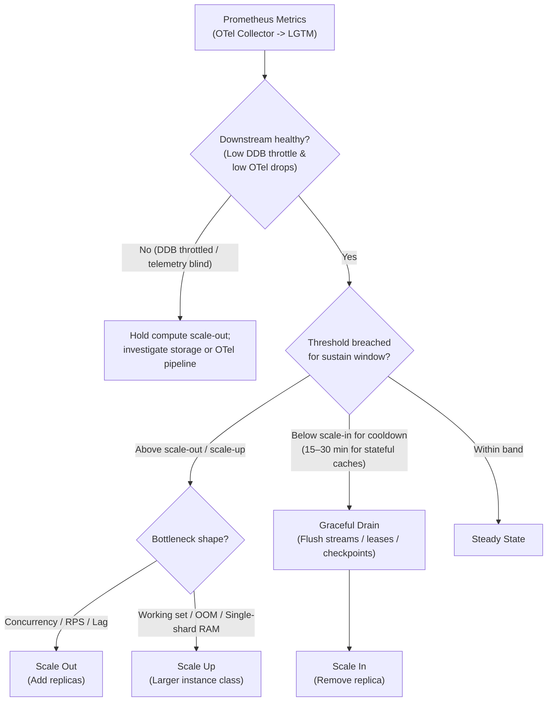

# Service Scaling

!!! warning "Status: TBD / Planned (Not Yet Built)"
    Only the **local Docker Compose + Floci development experience** exists today in `stravin-dev/core` (`v1.12.x`). Service interfaces, graceful shutdown hooks, and bounded-cardinality OpenTelemetry/Prometheus metrics are defined and implemented, while **production Kubernetes autoscaling manifests, HPA/KEDA policies, and scaling controllers are TBD** and will be built with the final production platform.

This document defines how Stravin Core's five Go daemons (`stravin-edge`, `stravin-node`, `stravin-pack`, `stravin-relay` [`stravin-hook` in `v1.12.x`], and `stravin-ctrl`) and the `vNext` platform foundation services (`NATS JetStream`, `Temporal`, `stravin-webhooks`, `stravin-auth`, and `stravin-notify`) scale up/out under increasing load, scale down/in when load subsides, and how operators and autoscalers use OpenTelemetry metrics to decide when to act.

Storage-plane ceilings (DynamoDB WCUs/shards and S3 prefix partitioning) are covered separately in [Performance & Throughput Scaling](../core/performance.md); this guide focuses strictly on scaling Stravin's services.

## Core Service Scaling Matrix

| Service | Scaling Type | Upper Bound / Constraint | Scale-Out / Scale-Up Behavior | Scale-In / Scale-Down Behavior |
| :--- | :--- | :--- | :--- | :--- |
| **`stravin-edge`** | **Horizontal** (primary) | Unbounded per region (behind L4/L7 LB) | Add stateless replicas immediately; zero warmup required | Mark unready, drain in-flight SSH/HTTP Git streams, terminate |
| **`stravin-node`** | **Horizontal + Vertical** | Unbounded horizontally; vertical bounded by instance NVMe/RAM | **Out:** Add nodes to rendezvous ring (remaps `~1/N` repos). **Up:** Larger NVMe/RAM for huge monorepo working sets | **Conservative:** Step down 1 node at a time after long cooldown to protect warm NVMe cache hit ratio; drain active streams |
| **`stravin-pack`** | **Horizontal + Vertical** | Horizontal capped by active manifest shards (`M`); vertical for Tier 1 repack RAM/CPU | **Out:** Add workers up to `M` to claim idle shard leases. **Up:** Bigger CPU/RAM/NVMe for deep delta repacks | Release shard lease cleanly after completing active two-phase manifest swap; scale down when lag clears or lease contention rises |
| **`stravin-relay`** (`stravin-hook` in `v1.12.x`) | **Horizontal** (primary) | Capped by DynamoDB Streams shard count | Add stream relay consumers up to active shard count to publish Standard Async Event Envelopes onto `STRAVIN_CORE` JetStream (zero Wasm, zero external HTTP) | Stop polling new stream batches, flush in-flight JetStream publishes (`Nats-Msg-Id`), commit sequence checkpoint, terminate |
| **`stravin-ctrl`** | **Fixed HA + Vertical** | **1 active leader** + 1–2 warm standbys (never active-active) | Vertical only (CPU/RAM/network) if post-failover parallel `HeadObject` scrubs saturate the leader | Scale down vertically only after verifying failover scrub drill fits within target RTO |

## Telemetry-Driven Scaling Loop

All scaling decisions read bounded Prometheus metrics exported via the OpenTelemetry Collector (see [Telemetry & Observability](telemetry.md)). Before scaling any service out, verify that latency is not caused by an upstream/downstream bottleneck (such as DynamoDB throttling or S3 origin fallback) where adding compute would amplify retries.

## Per-Service Scaling Playbooks

### 1. `stravin-edge` (Horizontal)

`stravin-edge` terminates SSH and Smart HTTP connections, enforces auth and per-tenant rate limits, and proxies writes to `home_region`. It holds no persistent local state and only a tiny in-memory `home_region` routing cache.

- **Scaling type:** **Horizontal.** Adding instances linearly scales TLS/SSH handshakes, concurrent Git streams, and gRPC write-proxy throughput. Vertical scaling is rarely needed unless single-process network bandwidth or file-descriptor limits are reached on small instance types.
- **When to increase (scale out):**
    - `stravin_edge_request_duration_seconds` (p95/p99) rises while `stravin_node_request_duration_seconds` remains flat (indicating ingress queuing or proxy saturation).
    - Sustained CPU utilization > 65–70% (SSH/TLS crypto overhead) or active concurrent connections approaching per-instance socket/goroutine budgets.
    - Rising `stravin_edge_requests_total` RPS combined with non-auth `5xx` or timeout error classes.
- **When to decrease (scale in):**
    - CPU utilization < 30% and `stravin_edge_request_duration_seconds` p99 within SLO for a 5–10 minute stabilization window.
- **How to scale in safely:** Remove the instance from load-balancer rotation via readiness probe first, then allow long-running `git clone` / `git push` streams to drain before `SIGTERM` completes.

### 2. `stravin-node` (Horizontal + Vertical)

`stravin-node` is stateless with respect to durability (S3 and DynamoDB are authoritative), but **cache-warm** via local ephemeral NVMe disks and tenant-pinned sandboxes/Wasm module caches. Because `stravin-edge` routes requests with **rendezvous hashing (HRW)**, changing the node count remaps only `~1/N` of repositories.

- **Scaling type:** **Hybrid (Horizontal for throughput, Vertical for working-set size).**
    - **Horizontal** scales aggregate push/fetch RPS, concurrent sandboxed `git-upload-pack` executions, and synchronous `wazero` Wasm hook capacity. For hot repositories routed by `(tenant_id, repo_id, ref_shard)`, horizontal scale-out directly increases single-repo write parallelism.
    - **Vertical** (larger NVMe disk, RAM, and vCPU per node) is required when individual large monorepos or high-activity tenants exceed a single node's NVMe cache quota or `cgroup v2` memory ceiling during `git-upload-pack` graph walks.
- **When to increase horizontally (scale out):**
    - `stravin_node_request_duration_seconds` p95/p99 climbs alongside rising `stravin_node_requests_total` and host CPU > 70%.
    - `stravin_hook_wasm_duration_seconds` p99 exceeds the S3 upload overlap window (~15–30 ms) or `stravin_hook_wasm_verdicts_total{verdict="timeout"}` spikes due to Wasm bulkhead semaphore saturation (capped at 25% of host vCPUs).
    - Concurrent `git-upload-pack` sandboxes saturate host vCPU or NIC egress bandwidth.
- **When to increase vertically (scale up):**
    - `stravin_node_cache_bytes_used` stays pinned near the node's NVMe capacity **while** the cache hit ratio (`stravin_node_cache_hits_total / (hits + misses)`) drops and `stravin_node_s3_pack_fetches_total` rises for active repositories (indicating NVMe working-set thrashing rather than cold traffic).
    - Frequent `cgroup v2` OOM kills or elevated `node.git.upload_pack` span durations on large monorepos even when overall node RPS is low.
- **When to decrease (scale in / scale down):**
    - Host CPU < 30%, `stravin_node_cache_bytes_used` comfortably below NVMe ceiling across the fleet, and p99 `stravin_node_request_duration_seconds` within SLO for **15–30 minutes**.
- **How to scale in safely:**
    - Step down **one node at a time** (or at most 10% of the fleet) with a pause between removals so rendezvous-remapped repositories re-warm on remaining nodes without triggering a thundering herd of S3 `GetObject` calls.
    - Drain active `git-upload-pack` and `git-receive-pack` streams before shutting down.

### 3. `stravin-pack` (Horizontal + Vertical)

`stravin-pack` runs out-of-band sharded compaction (Tier 0 streaming merges and Tier 1 deep delta repacks) and delayed garbage collection by claiming DynamoDB manifest shard leases (`SHARD#{m}`).

- **Scaling type:** **Hybrid (Horizontal up to shard count `M`, Vertical for heavy Tier 1 repacks).**
    - **Horizontal** increases parallel compaction across manifest shards, up to a hard ceiling of the active manifest shard count `M` (typically 32–64). Running more workers than dirty shards adds zero throughput and only increases lease contention.
    - **Vertical** (higher RAM, CPU, and scratch NVMe per worker) is needed when Tier 1 deep delta compression, `.midx`, or `commit-graph` builds on large repositories exceed single-worker memory or time budgets.
- **When to increase horizontally (scale out):**
    - `stravin_pack_uncompacted_packs` trends upward faster than `stravin_pack_compaction_cycles_total` clears them.
    - `stravin_pack_compaction_lag_seconds` breaches target (Tier 0 packs not consolidating within seconds, risking `git-upload-pack` read degradation) **while** `stravin_pack_lease_contention_total` remains low.
- **When to increase vertically (scale up):**
    - `stravin_pack_compaction_duration_seconds` p99 spikes on individual shards, or workers hit memory/NVMe ceilings during Tier 1 repacks while shard concurrency is already saturated.
- **When to decrease (scale in):**
    - `stravin_pack_uncompacted_packs` and `stravin_pack_compaction_lag_seconds` remain near baseline for 10–15 minutes, **or** `stravin_pack_lease_contention_total` rises sharply (workers fighting over too few dirty shards).
- **How to scale in safely:** On `SIGTERM`, stop claiming new shard leases, finish any in-progress two-phase manifest swap (`Publish` → `Supersede`), and explicitly release held DynamoDB leases before exiting.

### 4. `stravin-relay` (`stravin-hook` in `v1.12.x`) (Horizontal)

In `vNext` ([ADR-0001](../adr/0001-platform-transport-events-webhooks.md)), `stravin-relay` (renamed from `stravin-hook` in Core `v1.12.x`) is a pure, lightweight transactional outbox relay that tails DynamoDB Streams (`Ref History` `NEW_IMAGE`) and publishes Standard Async Event Envelopes onto **NATS JetStream** (`STRAVIN_CORE`) completely off the `git push` path. `stravin-relay` runs **zero Wasm** and sends **zero external HTTP webhooks** (external HTTP delivery scales independently in `stravin-webhooks`, and any future async `post-receive` Wasm runner scales as a separate JetStream consumer).

- **Scaling type:** **Horizontal.** Scale relay instances up to the active DynamoDB Streams shard count (one active consumer per shard). Because `stravin-relay` performs no outbound internet I/O or Wasm execution, vertical CPU/RAM requirements stay minimal and predictable.
- **When to increase (scale out):**
    - DynamoDB Streams iterator age / consumer lag rises continuously (events aging faster than `stravin-relay` publishes them to JetStream).
    - Relay goroutine/CPU utilization exceeds 70% (`v1.12.x` `stravin-hook`: `hook.async.dispatch` latency or outbound webhook retry/DLQ queue depth grows).
- **When to decrease (scale in):**
    - Stream iterator age is near zero and CPU stays low (< 25%) for 10–15 minutes.
- **How to scale in safely:** Stop polling new stream batches, flush in-flight JetStream publishes (deduplicated via `Nats-Msg-Id`), and commit the final DynamoDB Stream sequence checkpoint before terminating. *(In `v1.12.x`, `stravin-hook` finishes in-flight HTTP webhook deliveries before committing its checkpoint.)*

### 5. `stravin-ctrl` (Fixed HA + Vertical Only)

`stravin-ctrl` orchestrates regional `home_region` ownership transitions, increments `failover_epoch` fencing tokens, and runs post-failover S3 `HeadObject` integrity scrubs and ref rewinds.

- **Scaling type:** **Fixed Active-Passive HA (1 active leader + 1–2 warm standbys); Vertical only.**
    - **Never scale horizontally for throughput.** Failover fencing and ref-rewind mutations require single-leader serialization; adding active instances introduces split-brain coordination risk.
    - **Vertical** scaling (more CPU, memory, and network sockets on the leader/standby pair) increases parallel `HeadObject` verification concurrency during disaster failover scrubs.
- **When to increase vertically (scale up):**
    - Periodic failover drills show `ctrl.scrub.region` or `ctrl.failover.transition` span durations approaching the RTO budget due to CPU, RAM, or concurrent connection saturation on the leader.
- **When to decrease vertically (scale down):**
    - Only after confirming repository count and recent-pack volume fit comfortably within the smaller instance class during a failover drill.

## Platform & Foundation Services Scaling (`vNext` — TBD / Planned)

Per [ADR-0001](../adr/0001-platform-transport-events-webhooks.md) and [ADR-0003](../adr/0003-platform-auth-and-sso-seam.md), platform infrastructure and foundation services scale independently of Core's Git data plane:

| Service | Scaling Type | Primary Scaling Signals | Constraints & Safety Rules |
| :--- | :--- | :--- | :--- |
| **`NATS JetStream`** | **Fixed Odd-Quorum Raft + Vertical** (3 or 5 pods, `R=3`) | Stream storage utilization, JetStream publish/ack p99 latency, consumer pending count | **Never HPA-autoscale Raft cluster size.** Scale vertically (NVMe PVC IOPS/size, RAM, CPU) or expand storage before adding cluster peers; keep odd quorum (`3` or `5`). |
| **`Temporal`** (**Run** & **Gate** only) | **Horizontal** (Server tiers + Run/Gate workers) | Task-queue backlog, schedule-to-start latency, workflow/activity execution latency | Scale Run and Gate Temporal worker pools independently on their own namespaces (`stravin-run`, `stravin-gate`). Core, Review, Index, Webhooks, Auth, and Notify remain permanently Temporal-free. |
| **`stravin-webhooks`** | **Horizontal** (fan-out + delivery workers) | `STRAVIN_WEBHOOK_OUTBOX` pending lag, outbound HTTP concurrency, per-endpoint retry depth | Per-endpoint JetStream queues, rate limits, and circuit breakers isolate slow customer endpoints so one broken destination never forces fleet-wide scale-out. |
| **`stravin-auth`** | **Horizontal** (stateless API) + **Valkey** (independent) | Login/SSO/STS exchange RPS, SCIM/Directory Sync burst rate, RBAC batch filter latency | Strictly off the synchronous Git hot path (`stravin-edge` verifies cached JWKS locally); Git RPS does **not** drive `stravin-auth` scaling. Scale Valkey `jti` deny-list independently for low-latency write checks. |
| **`stravin-notify`** | **Horizontal** (fan-out/channel workers + WS/SSE gateways) | `STRAVIN_NOTIFY_OUTBOX` lag, per-channel provider throttling, active WebSocket/SSE connection count | Isolate external channel workers (`email`, `web_push`, `slack`/`teams`/`discord`) from In-App Inbox persistence; scale WS/SSE pods horizontally over Valkey pub/sub. |

## Telemetry Signal Quick Reference

| Telemetry Signal | Target Service | Scale Direction | Interpretation & Action |
| :--- | :--- | :--- | :--- |
| `stravin_edge_request_duration_seconds` (p99) high + `stravin_node_request_duration_seconds` flat | `stravin-edge` | **Horizontal Out** | Ingress/proxy bottleneck; add `stravin-edge` replicas. |
| `stravin_node_request_duration_seconds` (p99) + `stravin_node_requests_total` + CPU > 70% | `stravin-node` | **Horizontal Out** | Compute/concurrency saturation; add `stravin-node` replicas to rendezvous ring. |
| `stravin_hook_wasm_duration_seconds` > 15–30 ms or `stravin_hook_wasm_verdicts_total{verdict="timeout"}` rising | `stravin-node` | **Horizontal Out** | Tier 1 Wasm bulkhead saturated; add `stravin-node` replicas (or widen host vCPUs). |
| `stravin_node_cache_bytes_used` near cap + cache hit ratio falling + `stravin_node_s3_pack_fetches_total` rising | `stravin-node` | **Vertical Up** (or Out for multi-tenant spread) | NVMe working-set thrashing; upsize NVMe/RAM if single large repos dominate, or add nodes if aggregate tenant count grew. |
| `stravin_pack_uncompacted_packs` & `stravin_pack_compaction_lag_seconds` rising + low `stravin_pack_lease_contention_total` | `stravin-pack` | **Horizontal Out** (up to `M`) | Compaction falling behind push rate; add workers up to manifest shard count `M`. |
| `stravin_pack_compaction_duration_seconds` (p99) high + high per-worker RAM/NVMe | `stravin-pack` | **Vertical Up** | Single-shard Tier 1 repack is memory/CPU bound; move workers to larger instance class. |
| `stravin_pack_lease_contention_total` rising + low lag | `stravin-pack` | **Horizontal In** | Excess idle workers contending on leases; remove workers. |
| DynamoDB Streams iterator age / JetStream publish lag rising (`v1.12.x`: `hook.async.dispatch` backlog) | `stravin-relay` (`stravin-hook`) | **Horizontal Out** | Outbox relay falling behind; add consumers up to active DynamoDB Streams shard count. |
| `ctrl.scrub.region` duration approaching RTO during drill | `stravin-ctrl` | **Vertical Up** | Increase leader/standby CPU/RAM/network; keep active count fixed at 1. |

## Anti-Thrashing & Safety Guardrails

!!! warning "Do Not Autoscale Compute to Fix Storage Throttling"
    If `stravin_ddb_transact_total{result="throttled"}`, `stravin_ddb_cas_retries_total`, or `stravin_s3_origin_fallback_total` spikes alongside latency, **do not scale out `stravin-node` or `stravin-edge`**. Adding more writers amplifies retry storms against already-throttled DynamoDB partitions; address table WCU quotas, `WarmThroughput`, or shard counts (`S`/`M`) first.

- **Asymmetric cooldown windows:** Scale out quickly (1–3 minute sustain window) to protect user-facing Git SLOs; scale in slowly (5–10 minutes for stateless `stravin-edge`/`stravin-relay`/`stravin-auth`/`stravin-webhooks`/`stravin-notify`, **15–30 minutes** for warm-cache `stravin-node`) so brief traffic lulls do not churn NVMe caches.
- **Step-capped scale-in on `stravin-node`:** Never remove more than 10% of `stravin-node` replicas in a single step; verify `stravin_node_cache_hits_total` stabilizes before removing the next replica.
- **Telemetry health fail-safe:** Monitor `stravin_otel_dropped_items_total` and `otelcol_exporter_enqueue_failed_spans`. If telemetry drops spike or Prometheus data goes stale, **freeze scale-in actions** so autoscalers never downscale on missing metrics.
- **Minimum floor per region:** Maintain at least 2 replicas of `stravin-edge` and `stravin-node` across distinct Availability Zones in every active region, and 1 active + 1 standby for `stravin-ctrl`.

## Related Documents

- [Telemetry & Observability](telemetry.md) — OpenTelemetry Collector pipeline, Prometheus metrics, and cardinality rules referenced by scaling triggers.
- [Zero-Downtime Deployment](deployment.md) — Ordered rolling and canary deployment waves, graceful drains, and rollback gates across Core daemons and `vNext` platform services.
- [Performance & Throughput Scaling](../core/performance.md) — DynamoDB WCU/shard math, S3 prefix sharding, and tiered LSM compaction ceilings.
- [System Topology & Request Flows](../core/topology.md) — Service roles, rendezvous hashing, and two-phase compaction lifecycles.
- [Sandboxed Execution & Multi-Tenancy](../core/isolation-multitenancy.md) — `cgroup v2` ceilings, NVMe tenant cache quotas, and noisy-neighbor isolation.
- [ADR-0001: Platform Transport, Events & Webhooks](../adr/0001-platform-transport-events-webhooks.md) & [ADR-0003: Platform Auth & SSO Seam](../adr/0003-platform-auth-and-sso-seam.md) — Platform foundation service boundaries and scaling assumptions.
