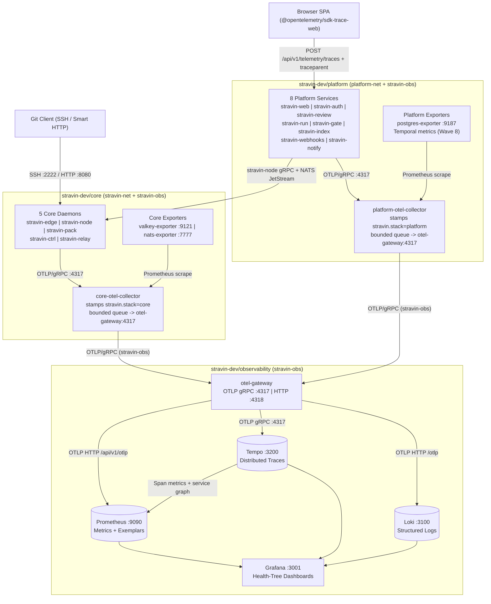
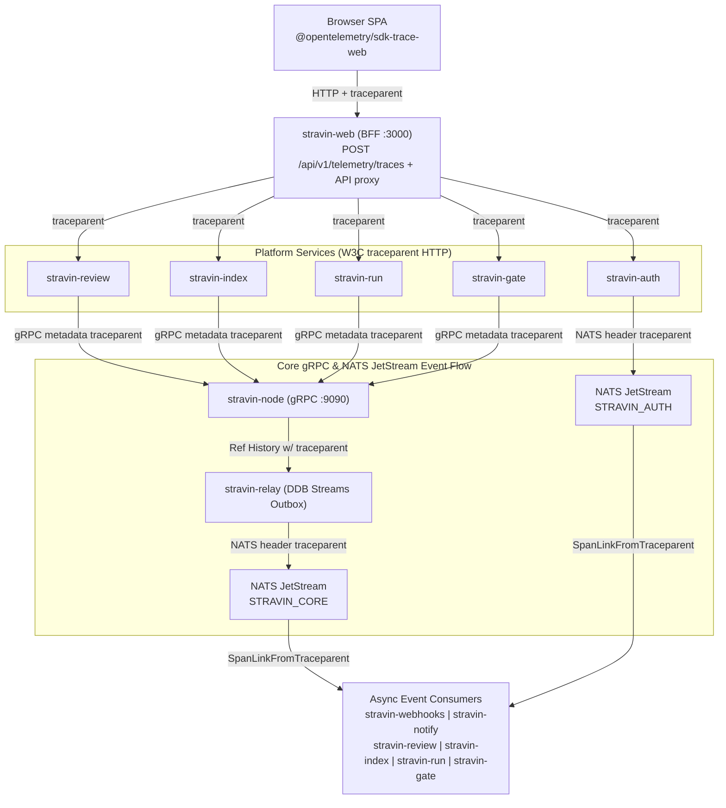
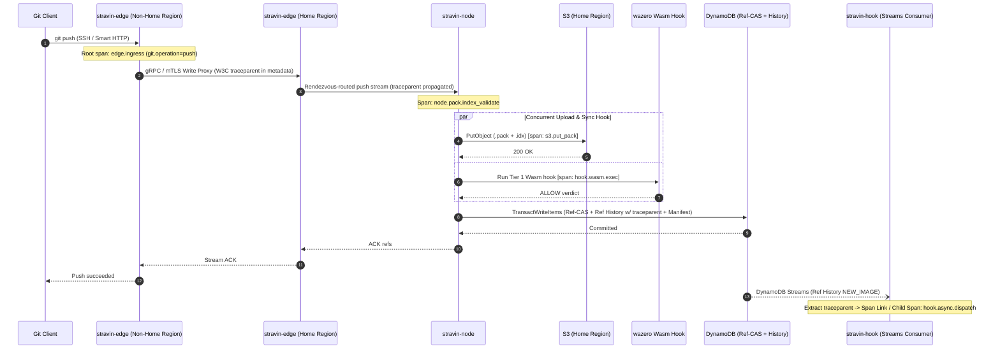
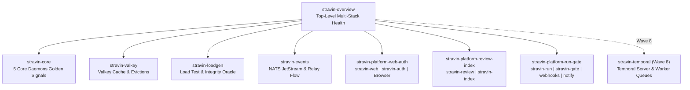

# Telemetry & Observability (OpenTelemetry + LGTM)

Stravin instruments every Core daemon, Platform service, and browser SPA session with **OpenTelemetry (OTel)** and exports unified metrics, structured logs, and distributed traces via OTLP to a consolidated **Grafana LGTM stack** (**Loki**, **Grafana**, **Tempo**, and **Prometheus**) hosted in `stravin-dev/observability`. This provides unbroken end-to-end traceability from browser user actions and Git client ingress through Platform services, `stravin-node` gRPC, warm NVMe caches, S3 pack storage, `wazero` Wasm hooks, DynamoDB Ref-CAS transactions, NATS JetStream event streams, and background compaction/failover workers.

## Consolidated 3-Stack Observability Topology

Local development separates telemetry storage and visualization from the Core and Platform runtime stacks using three Docker Compose stacks bridged by a shared `stravin-obs` Docker network:

1. **`stravin-dev/observability` (Central LGTM + Gateway):** Owns the shared `stravin-obs` bridge network, `otel-gateway` (`:4317` OTLP/gRPC, `:4318` OTLP/HTTP, `:13133` health, `:8888` self-metrics), a single **Grafana** instance on `http://localhost:3001` (avoiding collision with `stravin-web` on `:3000`), **Prometheus** (`:9090` with OTLP receiver, remote-write receiver, and exemplar storage), **Tempo** (`:3200` with service-graph and span-metrics generator), and **Loki** (`:3100` with native OTLP log ingestion).
2. **`stravin-dev/core` (`core-otel-collector`):** Receives OTLP traces, metrics, and logs from all five Core Go daemons (`stravin-edge`, `stravin-node`, `stravin-pack`, `stravin-ctrl`, `stravin-relay`), scrapes Prometheus metrics from `stravin-node:8081`, `valkey-exporter:9121`, and `nats-exporter:7777`, stamps `stravin.stack=core`, and forwards to `otel-gateway:4317` over `stravin-obs` using a bounded non-blocking sending queue.
3. **`stravin-dev/platform` (`platform-otel-collector`):** Receives OTLP traces, metrics, and logs from all 8 Platform services (`stravin-web`, `stravin-auth`, `stravin-review`, `stravin-run`, `stravin-gate`, `stravin-index`, `stravin-webhooks`, `stravin-notify`), scrapes `postgres-exporter:9187` (plus Temporal server metrics in Wave 8), stamps `stravin.stack=platform`, and forwards to `otel-gateway:4317` over `stravin-obs` via a bounded non-blocking queue so Platform stays healthy even when `stravin-dev/observability` is offline.

### Cross-Signal Correlation in Grafana

Grafana in `stravin-dev/observability` is pre-provisioned with stable datasource UIDs (`prometheus`, `tempo`, `loki`) and four-way cross-linking:

- **Prometheus -> Tempo (Exemplars):** Histogram metrics (such as `stravin.push.duration_ms`, `stravin.fetch.duration_ms`, and `stravin.ddb.transact_duration_ms`) attach OpenTelemetry **exemplars** carrying `trace_id`. Clicking an exemplar dot opens the matching trace in Tempo.
- **Tempo -> Loki (`tracesToLogsV2`):** Every `slog` record emitted within a traced `context.Context` injects `trace_id` and `span_id` fields. Clicking any Tempo span jumps directly to Loki log lines filtered by `trace_id` and `service_name`.
- **Tempo -> Prometheus (`serviceMap` / `nodeGraph`):** Tempo's metrics generator remote-writes span metrics and service-graph edges to Prometheus to power live topology views.
- **Loki -> Tempo (Derived Fields):** Derived field matchers turn `trace_id` labels and structured log fields into clickable links directly to the corresponding Tempo trace.

## End-to-End Distributed Trace Flows

W3C Trace Context (`traceparent` / `tracestate`) propagates across browser requests, HTTP/gRPC service hops, subprocess boundaries, and asynchronous NATS JetStream and Temporal boundaries.

### Browser-to-Core & Event Flow Trace Propagation

Browser sessions initialize `@opentelemetry/sdk-trace-web`, inject W3C `traceparent` headers onto API calls to `stravin-web`, and ship client-side spans to `POST /api/v1/telemetry/traces` (proxied by `stravin-web` to `platform-otel-collector:4318`). From `stravin-web`, `traceparent` flows across Platform services (`stravin-review`, `stravin-auth`, `stravin-index`, `stravin-run`, `stravin-gate`), down into `stravin-core` (`stravin-node` gRPC metadata), and across NATS JetStream (`STRAVIN_CORE`, `STRAVIN_AUTH`) message headers:

- **Browser span ingestion:** `@opentelemetry/sdk-trace-web` exports OTLP/HTTP JSON trace payloads to `POST /api/v1/telemetry/traces` on `stravin-web` (same-origin, avoiding browser CORS and keeping the OTel collector off public ports), which forwards them to `platform-otel-collector`.
- **Synchronous request chain:** `stravin-web` propagates `traceparent` over HTTP to `stravin-review`, `stravin-auth`, `stravin-index`, `stravin-run`, and `stravin-gate`; services calling Core inject `traceparent` into outbound gRPC metadata to `stravin-node`.
- **Asynchronous event chain:** `stravin-relay` reads persisted `traceparent` values from DynamoDB `Ref History` records and injects them into NATS JetStream headers on `STRAVIN_CORE`, while `stravin-auth` injects `traceparent` into `STRAVIN_AUTH` lifecycle events. Consumers (`stravin-review`, `stravin-index`, `stravin-run`, `stravin-gate`, `stravin-webhooks`, `stravin-notify`) link spans via `SpanLinkFromTraceparent`, and `stravin-run` / `stravin-gate` propagate `traceparent` across Temporal workflow and activity headers.

### Push (`git push`) & Async Hook Trace Flow

### Fetch (`git fetch` / `git clone`) & Background Worker Traces

- **Read Path (`git fetch` / `git clone`):** `stravin-edge` starts the root `edge.ingress` span (`git.operation=fetch`), propagates `traceparent` to local `stravin-node`, which records child spans for incremental DynamoDB manifest/ref queries (`ddb.query_refs`, `ddb.query_manifest`), local NVMe cache lookup (`node.cache.lookup`), concurrent local S3 pack fetches (`s3.get_pack`), optional cross-region `404 NoSuchKey` origin fallback (`s3.origin_fallback`), and sandboxed `git-upload-pack` execution (`node.git.upload_pack`).
- **Async Outbox Continuation:** Because `stravin-node` persists the W3C `traceparent` string as a lightweight attribute on the `Ref History` item inside `TransactWriteItems`, `stravin-hook` (`v1.12.x`) links its asynchronous `hook.async.dispatch` and outbound webhook HTTP spans directly back to the originating `git push` trace without adding any write-path latency.
    - **`vNext` Platform Trace Propagation ([ADR-0001](../adr/0001-platform-transport-events-webhooks.md), [ADR-0003](../adr/0003-platform-auth-and-sso-seam.md)):** In `vNext`, `stravin-relay` (renamed from `stravin-hook`) injects the persisted W3C `traceparent` into **NATS JetStream** message headers (`STRAVIN_CORE`). Downstream services (`Review`, `Run`, `Index`, `Gate`, `stravin-webhooks`, `stravin-auth`, `stravin-notify`) link spans via `SpanLinkFromTraceparent`, and **Run** / **Gate** propagate `traceparent` across **Temporal** workflow and activity headers so a single Tempo trace links `git push` → `stravin-relay` → JetStream → Temporal / `stravin-webhooks` / `stravin-notify`.
- **Background Daemons (`stravin-pack` & `stravin-ctrl`):**
    - `stravin-pack` opens a root trace per compaction job (`pack.compact.shard`) with child spans for lease acquisition (`ddb.lease_acquire`), S3 pack download, merge/indexing, two-phase manifest publish/supersede (`ddb.manifest_publish`, `ddb.manifest_supersede`), and delayed GC sweeps (`pack.gc.sweep`).
    - `stravin-ctrl` opens a root trace per failover or integrity scrub cycle (`ctrl.failover.transition`, `ctrl.scrub.region`) tagged with `failover_epoch`, recording `HeadObject` verification counts and any ref rewind transactions.

## Standardized Attributes & Cardinality Guardrails

Consistent naming across traces, logs, and metrics lets dashboards and ad-hoc Tempo/Loki queries slice cleanly by tenant, region, shard, or hook.

### Resource & Span Attributes

| Attribute | Scope | Description |
| :--- | :--- | :--- |
| `service.name` | Resource (all signals) | Service binary name: Core (`stravin-edge`, `stravin-node`, `stravin-pack`, `stravin-ctrl`, `stravin-relay`), Platform (`stravin-web`, `stravin-auth`, `stravin-review`, `stravin-run`, `stravin-gate`, `stravin-index`, `stravin-webhooks`, `stravin-notify`), and `stravin-browser` |
| `stravin.stack` | Resource (all signals) | Stack tag stamped by per-stack collectors: `core` (`core-otel-collector`) or `platform` (`platform-otel-collector`) |
| `region` | Resource (all signals) | Local AWS region executing the span (e.g., `us-east-1`) |
| `home_region` | Span / Log | Authoritative write region for the target repository |
| `tenant_id` | Span / Log (bounded metric only for tier/pool) | Owning tenant identifier |
| `repo_id` | Span / Log **only** | Target repository identifier |
| `ref_shard` | Span / Log / Metric | Shard bucket index `0..63` for DynamoDB Ref-CAS (`RS#{s}`) |
| `manifest_shard` | Span / Log / Metric | Shard bucket index `0..31` for DynamoDB Pack Manifest (`MS#{m}`) |
| `failover_epoch` | Span / Log | Monotonic fencing epoch active during the operation |
| `hook_id` | Span / Log | Identifier of the executed Tier 1 Wasm or Tier 2 async hook |
| `git.protocol` | Span / Log / Metric | Wire protocol: `ssh` or `http` |
| `git.operation` | Span / Log / Metric | Git operation: `push`, `fetch`, `clone`, `ls-refs` |

### Prometheus Cardinality Guardrails (`GuardedMeter`)

!!! warning "Unbounded Labels Never Go on Prometheus Metrics"
    Never attach `repo_id`, `ref_name`, `pack_id`, `oid`, `actor_id`, `tenant_id`, `hook_id`, or `failover_epoch` as Prometheus metric labels. High-cardinality time series cause memory explosions in Prometheus and slow Grafana queries.

In `stravin-dev/core` (`internal/telemetry/cardinality.go`), `Provider.Meter(...)` wraps every OpenTelemetry meter in **`GuardedMeter`** (a GoF Decorator) that automatically enforces bounded cardinality at runtime:

- **Forbidden labels:** `repo_id`, `ref_name`, `pack_id`, `oid`, `actor_id`, `tenant_id`, `hook_id`, `failover_epoch`.
- **Enforcement policies:** `PolicyStrip` (default, removes forbidden attributes before recording) or `PolicyReject` (drops the datapoint entirely), with optional `WithOnViolation` callbacks for tests and alerts.
- **Keep on Prometheus metrics:** Bounded enums and small integers (`service.name`, `region`, `git.protocol`, `git.operation`, `status_code`, `error_class`, `fail_mode`, `tier`, `result`, `shard_bucket`).
- **Keep on Tempo traces & Loki logs:** Unbounded identifiers (`tenant_id`, `repo_id`, `ref_name`, `pack_id`, `hook_id`, `failover_epoch`).
- **Bridge the gap with exemplars:** Use Prometheus exemplars on latency and error histograms to jump from a bounded metric bucket straight to the exact high-cardinality trace in Tempo.

## Grafana Dashboard Health Tree & Golden Signals

`stravin-dev/observability` provisions a hierarchical **Grafana dashboard health tree** under `grafana/provisioning/dashboards/` (accessible at `http://localhost:3001`), starting from a single top-level overview and drilling down into Core, infrastructure, event bus, and Platform service groups:

| Dashboard | Stack / Scope | Primary Signals |
| :--- | :--- | :--- |
| **`stravin-overview`** | Cross-stack root | Top-level availability, error rates, p95/p99 latency across `stravin.stack=core` and `stravin.stack=platform`, and drill-down links to every child dashboard. |
| **`stravin-core`** | Core (`stravin-edge`, `stravin-node`, `stravin-pack`, `stravin-ctrl`, `stravin-relay`) | Core Golden Signals, tiered pack-cache efficiency, `upload-pack` queueing, CAS retries, S3 origin fallbacks, and compaction lag. |
| **`stravin-valkey`** | Core cache (`valkey-exporter:9121`) | Valkey availability, memory utilization, LFU evictions, keyspace hit ratio, and command latency. |
| **`stravin-loadgen`** | Core load testing | Multi-persona developer vs. AI agent load test metrics, scenario distribution, retries, and integrity oracle counters (see [Load Testing & Chaos Engineering](load-testing.md)). |
| **`stravin-events`** | Event bus (`nats-exporter:7777` + `stravin-relay`) | NATS JetStream stream depth (`STRAVIN_CORE`, `STRAVIN_AUTH`), consumer lag, redeliveries, and DynamoDB Streams relay throughput. |
| **`stravin-platform-web-auth`** | Platform (`stravin-web`, `stravin-auth`, Browser) | BFF request rate/latency, browser trace ingestion (`POST /api/v1/telemetry/traces`), auth token/session latency, and Postgres pool health. |
| **`stravin-platform-review-index`** | Platform (`stravin-review`, `stravin-index`) | Pull request and diff API latency, `stravin-node` gRPC call latency, code search query latency, and index update lag. |
| **`stravin-platform-run-gate`** | Platform (`stravin-run`, `stravin-gate`, `stravin-webhooks`, `stravin-notify`) | Pipeline/gate evaluation throughput, webhook delivery latency/retries, and notification fan-out health. |
| **`stravin-temporal`** *(Wave 8)* | Platform workflows (Temporal) | Workflow execution rates, task queue backlog, schedule-to-start latency, and worker poll health. |

| Dashboard Panel / Signal Group | Implemented Metrics | Purpose & Alert Thresholds |
| :--- | :--- | :--- |
| **Ingress RPS, Errors & Concurrency (`stravin-edge`)** | `stravin_edge_requests_total`, `stravin_edge_request_duration_seconds`, `stravin_edge_active_clones`, `stravin_edge_meta_cache_lookups_total`, `stravin_edge_info_refs_retries_total` | Tracks overall Git traffic, non-home write-proxy overhead, META cache hit rate, active clone slots, and Smart HTTP `info/refs` transient retries. |
| **Tiered Pack Response Cache (`stravin-edge`)** | `stravin_edge_pack_cache_lookups_total`, `stravin_edge_pack_cache_writes_total`, `stravin_edge_pack_cache_op_duration_seconds`, `stravin_edge_pack_cache_bytes_total`, `stravin_edge_valkey_pool_dials_total` | Measures hit/miss rates and latency across `singleflight`, `valkey`, and `s3` tiers, cached bytes served, and Valkey connection pool reuse. |
| **`stravin-node` Requests, NVMe Cache & Queueing** | `stravin_node_requests_total`, `stravin_node_request_duration_seconds`, `stravin_node_cache_hits_total` / `misses_total`, `stravin_node_cache_bytes_used`, `stravin_node_s3_pack_fetches_total`, `stravin_node_aux_index_refresh_failures_total`, `stravin_node_upload_pack_queue_wait_seconds`, `stravin_node_upload_pack_queue_timeouts_total` | Tracks warm NVMe cache efficiency, S3 fetches, `.midx`/commit-graph refresh health, and `upload-pack` concurrency semaphore queueing/timeouts. |
| **CAS Conflict & Retry Rate** | `stravin_ddb_transact_total{result="ok\|conflict\|throttled"}`, `stravin_ddb_cas_retries_total` | Detects hot-ref contention, DynamoDB partition throttling, or adaptive sharding thresholds (`S`/`M`) that need expansion. |
| **S3 Put/Get & Origin-Fallback Rate** | `stravin_s3_ops_total{op="put\|get\|head",result}`, `stravin_s3_origin_fallback_total` | Monitors regional S3 health and spikes in cross-region `404 NoSuchKey` origin fallback caused by S3 CRR lag. |
| **Wasm Sync Hooks & Async Deliveries (`stravin-hook`)** | `stravin_hook_wasm_duration_seconds`, `stravin_hook_wasm_verdicts_total`, `stravin_hook_deliveries_total{result="ok\|retry\|dlq\|error"}`, `stravin_hook_delivery_duration_seconds`, `stravin_hook_stream_records_total` | Verifies Tier 1 hooks stay hidden inside the S3 upload window and tracks Tier 2 DynamoDB Streams processing, webhook latency, retries, and DLQ drops. |
| **Compaction Lag (`stravin-pack`)** | `stravin_pack_uncompacted_packs`, `stravin_pack_compaction_lag_seconds`, `stravin_pack_gc_reaped_total` | Ensures Tier-0 push packs are consolidated before read fan-out degrades `git-upload-pack` latency. |
| **Telemetry Dropped** | `otelcol_exporter_enqueue_failed_spans`, `stravin_otel_dropped_items_total` | Surfaces genuine bounded queue overflows in the Go OTel SDK batch processor or Collector ingress buffers so blind spots never go unnoticed. |

## Local vs. Production Telemetry

| Concern | Local Development (Consolidated 3-Stack, Implemented) | Production Deployment (**TBD / Planned**) |
| :--- | :--- | :--- |
| **Collector Topology** | Per-stack OTel collectors (`core-otel-collector` and `platform-otel-collector`) forwarding over the shared `stravin-obs` network to the central `otel-gateway` (`:4317` / `:4318`) in `stravin-dev/observability`, with bounded non-blocking queues. | Node-local OTel Collector DaemonSet (fast loopback OTLP) forwarding to a horizontally scaled Collector Gateway tier. |
| **Sampling Strategy** | **100% head sampling** so every local browser action, API call, `git push`, and `git fetch` appears immediately in Tempo. | **Tail-based sampling** at the Collector Gateway: retain 100% of error traces, CAS conflicts, origin fallbacks, slow p99 requests, and failover scrubs; sample routine fast `200 OK` requests (e.g., 1–5%). |
| **Log Export** | JSON `slog` to stdout + OTLP Logs to Loki (`:3100`) for local Grafana (`:3001`) drill-down. | Structured JSON `slog` collected via DaemonSet or OTLP Logs with PII/secret redaction processors before Loki ingestion. |
| **Unit Tests** | **Live OTel export muted by default.** Automated Go unit tests use a no-op or in-memory OTel exporter (`sdktrace.NewTracerProvider()` without OTLP network export) so fast parallel test bursts never overflow bounded Collector ingress buffers or pollute local Grafana dashboards—keeping the **Telemetry Dropped** panel meaningful for real runtime overflows. | N/A (production binaries always enable OTLP export when `OTEL_EXPORTER_OTLP_ENDPOINT` is configured). |

## Related Documents

- [Local Development with Docker Compose & Floci](local-dev.md) — 3-stack local startup order (`observability` -> `core` -> `platform`) and local ports table.
- [Service Scaling](scaling.md) — Using these OpenTelemetry and Prometheus signals to scale each Stravin Go daemon up/out and down/in.
- [System Topology & Request Flows](../core/topology.md) — Multi-region request paths traced by `stravin-edge`, `stravin-node`, `stravin-pack`, and `stravin-ctrl`.
- [Server-Side Hooks](../core/hooks.md) — Concurrent S3 + `wazero` execution model and DynamoDB Streams outbox traced into `stravin-hook` (`v1.12.x`) / `stravin-relay` (`vNext`).
- [Storage Layer: S3 & DynamoDB](../core/storage.md) — Shard keys (`ref_shard`, `manifest_shard`) and `Ref History` schema carrying trace context.
- [ADR-0001: Platform Transport, Events & Webhooks](../adr/0001-platform-transport-events-webhooks.md) & [ADR-0003: Platform Auth & SSO Seam](../adr/0003-platform-auth-and-sso-seam.md) — `vNext` W3C `traceparent` propagation across NATS JetStream, Temporal, `stravin-webhooks`, `stravin-auth`, and `stravin-notify`.
