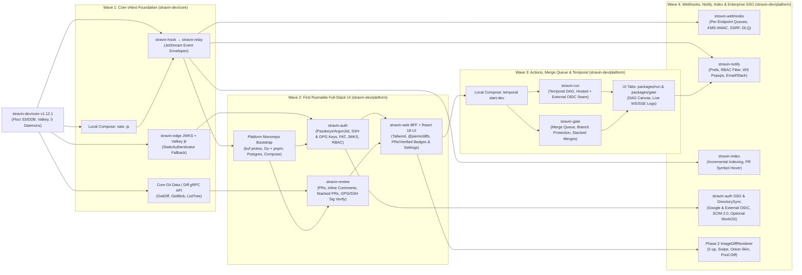

# Full-Stack Build Waves (`Core v1.12.1` → Full Platform & Web UI)

This roadmap defines the actionable 4-wave implementation sequence taking Stravin from the currently shipped `stravin-dev/core` (`v1.12.1`) bare Git engine to a locally runnable, full-stack developer platform and web application.

## Locked-In Stack Defaults

The following five architectural defaults are locked across `stravin-dev/core` and `stravin-dev/platform` so Wave 1–4 teams can build independently without contract drift:

1. **Web Frontend Stack (`stravin-web` + SPA):** **React 19 + TypeScript + Vite + Tailwind CSS + `@pierre/diffs`** ([diffs.com](https://diffs.com/), Apache-2.0, Shiki syntax highlighting, virtualized split/unified diffs) mounted inside the lazy-loaded `DiffRenderer` registry per [ADR-0004](../adr/0004-frontend-stack-spa-go-bff.md). Zero Node.js/Bun runtime processes run in production.
2. **Repository Layout:**
    - **`stravin-dev/core`** (standalone repository): Stateless multi-region Git storage engine (`stravin-edge`, `stravin-node`, `stravin-pack`, `stravin-ctrl`, `stravin-relay`), `stravin-admin`, `stravin-loadgen`, and `stravin-chaos`.
    - **`stravin-dev/platform`** (single monorepo): Shared `buf` `proto/` contracts, all upper Go services (`auth`, `review`, `run`, `gate`, `index`, `webhooks`, `notify`, `web`), database migrations, React 19 web workspace, and the unified local Docker Compose stack linking `core` + `platform`.
3. **Upper-Service Database — Geo-Ready PostgreSQL (Option 4):**
    - **Stravin Core** keeps **S3 + DynamoDB** (unchanged).
    - **Upper platform services** (`auth`, `review`, `gate`, `run` metadata, `webhooks`, `notify`) use **PostgreSQL**:
        - **Local Compose:** One shared PostgreSQL container with isolated per-service schemas (`auth`, `review`, `gate`, `run`, `webhooks`, `notify`).
        - **Production:** Regional HA PostgreSQL (Aurora Global Database or CloudNativePG), matching Core's tenant/repository home-region model.
    - **Geo-Ready Schema Guardrails (non-negotiable for zero-rewrite upgrade to YugabyteDB / CockroachDB RPO=0 later):**
        - Composite primary key `(tenant_id, id)` on **every** table using time-ordered **ULID / UUIDv7** (never global `SERIAL` / `BIGSERIAL` sequences).
        - `tenant_id` as the leading column in every secondary index and mandatory in every `WHERE` clause and foreign key.
        - No Postgres-only extensions or features that break YugabyteDB / CockroachDB wire compatibility: no advisory locks, no `LISTEN/NOTIFY` as a durable bus (use **NATS JetStream**), and no custom C extensions.
        - Clean Repository / DAO seam behind `pgx` so Regional HA PostgreSQL runs on Day 1 with a drop-in upgrade path to RPO=0 distributed SQL.
4. **API & BFF Contract:** **Protobuf + ConnectRPC (`buf`)** — a single canonical schema generating Go gRPC services (internal Cilium eBPF mTLS) and typed TypeScript clients for React with zero hand-written OpenAPI drift.
5. **Transport, Events & Workflows:** **Cilium (eBPF)** sidecarless mTLS, **NATS JetStream** internal async event bus, and **Temporal** durable workflows for `Stravin Run` and `Stravin Gate` per [ADR-0001](../adr/0001-platform-transport-events-webhooks.md).

## Wave Dependency Graph

---

## Wave 1 — Core `vNext` Foundation (`stravin-dev/core`)

**Goal:** Equip `stravin-dev/core` with the event outbox, read-only Git Data/Diff RPCs, and JWKS JWT verification required by upper platform services while preserving 100% backward compatibility with standalone `v1.12.x` local workflows.

### Deliverables

1. **Evolve `stravin-hook` → `stravin-relay` ([stravin-dev/core#188](https://github.com/stravin-dev/core/issues/188)):**
    - Rename/evolve the DynamoDB Streams consumer into `stravin-relay` per [ADR-0001](../adr/0001-platform-transport-events-webhooks.md).
    - Publish Standard Async Event Envelopes (`stravin.core.*.*.ref.updated`, `repo.created`, `repo.deleted`) to the `STRAVIN_CORE` NATS JetStream stream.
    - Propagate deterministic `Nats-Msg-Id` deduplication keys and W3C `traceparent` headers on every published message.
2. **Core Read-Only Git Data / Diff gRPC API ([stravin-dev/core#189](https://github.com/stravin-dev/core/issues/189)):**
    - Implement the `GitData` gRPC service defined in [Core ⟷ Review](../interfaces/core-review.md):
        - `GetDiff` returning `DiffFileEntry` descriptors (`path`, `old_path`, `change_kind`, `mime_type`, `is_binary`, `old_blob_oid`, `new_blob_oid`, `old_size_bytes`, `new_size_bytes`, and text `hunks`).
        - `GetBlob` for streaming raw blob bytes by OID (powering `stravin-web`'s sandboxed blob proxy).
        - `ListTree` for repository tree browsing and file-tree navigation.
3. **Local JWKS + Valkey `jti` Verification in `stravin-edge` ([stravin-dev/core#190](https://github.com/stravin-dev/core/issues/190)):**
    - Add local JWKS signature verification and Valkey `jti` deny-list checks in `stravin-edge` per [ADR-0003](../adr/0003-platform-auth-and-sso-seam.md) so `stravin-auth` is never on the Git push/fetch hot path.
    - Retain `StaticAuthenticator` as an explicit fallback for standalone Core development and `stravin-loadgen`.
4. **Local JetStream Container ([stravin-dev/core#187](https://github.com/stravin-dev/core/issues/187)):**
    - Add a single `nats -js` container to `stravin-dev/core`'s `docker-compose.yml` with stream bootstrap seeding and Prometheus metrics export.

### Wave 1 Exit Criteria

- `make up` in `stravin-dev/core` boots Floci, Valkey, `nats -js`, and all 5 daemons (with `stravin-relay`).
- Pushing a commit via Git emits a verified `STRAVIN_CORE` JetStream envelope with `Nats-Msg-Id` and `traceparent`.
- `GitData.GetDiff`, `GetBlob`, and `ListTree` pass integration tests covering text diffs, renames, and binary files.
- `stravin-edge` accepts valid JWKS-signed JWTs, rejects Valkey-revoked `jti` tokens, and passes existing `make load-test` benchmarks with zero regressions.

---

## Wave 2 — First Runnable Full-Stack Web UI (`stravin-dev/platform`)

**Goal:** Stand up the `stravin-dev/platform` monorepo and deliver the first end-to-end runnable Stravin experience: push code over Git, open a stacked PR in the browser, review virtualized diffs with `@pierre/diffs`, comment, and merge cleanly.

### Deliverables

1. **Bootstrap `stravin-dev/platform` Monorepo:**
    - **`proto/` (`buf`):** Canonical Protobuf + ConnectRPC definitions generating Go gRPC stubs and typed TypeScript clients (`buf generate`).
    - **Go workspace:** Shared `pkg/` packages (`pgx` Geo-Ready DAO helpers, ULID/UUIDv7 IDs, NATS JetStream client, Cilium/mTLS & `tenant_id` context middleware, OTel instrumentation).
    - **Web workspace (`web/`):** `pnpm` + Vite + React 19 + TypeScript + Tailwind CSS modular monorepo (`apps/shell`, `packages/review`, `packages/settings`, `packages/ui`).
    - **Database migrations:** Per-service PostgreSQL schemas (`auth`, `review`) strictly enforcing the Geo-Ready Schema Guardrails (`(tenant_id, id)` composite PKs, ULID/UUIDv7, leading `tenant_id` indexes, zero Postgres-only extensions).
    - **Unified Local Docker Compose:** Single `make up` linking `stravin-dev/core` containers with Postgres, `stravin-auth`, `stravin-review`, and `stravin-web`.
2. **Standalone `stravin-auth`:**
    - Local passkeys (WebAuthn) and Argon2id password login, SSH and GPG public key management, Personal Access Tokens (PATs), JWKS keypair rotation, Valkey `jti` revocation writes, `STRAVIN_AUTH` revocation events, and coarse RBAC (`owner`, `maintainer`, `write`, `read`) per [ADR-0003](../adr/0003-platform-auth-and-sso-seam.md).
    - Exposes user GPG and SSH signing public keys for commit signature verification.
3. **`stravin-review`:**
    - Pull Request lifecycle, inline line/file comment threads, review states, and **Stacked PRs** (`FULL_STACK_ATOMIC` and `BOTTOM_UP_CASCADE` merge modes with automatic branch-on-branch base resolution).
    - GPG and SSH commit signature verification against registered user public keys in `stravin-auth`, surfacing verification status (`Verified` badge) on commits and PRs.
    - Consumes `STRAVIN_CORE` ref updates and publishes `STRAVIN_REVIEW` JetStream events.
4. **`stravin-web` (Go BFF) + React 19 UI:**
    - **Go BFF:** `HttpOnly`, `Secure`, `SameSite=Lax` cookie session termination, CSRF enforcement, ConnectRPC proxy/aggregator with mandatory `tenant_id` propagation, authenticated blob proxy (`/api/v1/repos/{tenant}/{repo}/blobs/{oid}`), strict CSP/security headers, and thin Go OpenGraph/SEO meta injection per [ADR-0004](../adr/0004-frontend-stack-spa-go-bff.md).
    - **React 19 Frontend:** Full-width responsive shell (`<768px`, `768–1023px`, `1024–1439px`, `≥1440px`), PR List, PR Detail with Stacked PR Navigation Strip and `Verified` commit signature badges, lazy-loaded `CodeDiffRenderer` powered by **`@pierre/diffs`** (Shiki highlighting, virtualized split/unified diffs), inline comment composer, and basic Settings (`SSH Keys`, `GPG Keys`, `PATs`, `Auth`).

### Wave 2 Exit Criterion

> Local `make up` boots **Core + Platform**; a developer pushes a branch stack via `git push`, opens a stacked PR in the browser, reviews virtualized diffs via `@pierre/diffs`, posts inline comments, and merges cleanly end-to-end.

---

## Wave 3 — Actions, Merge Queue & Temporal (`stravin-dev/platform`)

**Goal:** Introduce durable workflow orchestration with Temporal to power CI pipelines (`stravin-run`), serialized merge queues (`stravin-gate`), and real-time UI streaming.

### Deliverables

1. **Temporal in Local Compose:**
    - Add `temporal server start-dev` (with Web UI) to the unified Docker Compose stack alongside per-service PostgreSQL schemas (`run`, `gate`).
2. **`stravin-run` (CI / Runners):**
    - Temporal DAG workflows executing pipeline graphs with `tree_oid` verdict reuse and `<200ms` cancellation propagation on supersede/eviction.
    - Hosted ephemeral runner pool + **Phase 1 External OIDC Job-Lease Seam** per [ADR-0002](../adr/0002-external-runner-seam-and-oidc-auth.md).
    - Real-time ANSI step log streaming and `STRAVIN_RUN` JetStream check/verdict events.
3. **`stravin-gate` (Merge Queue & Policy):**
    - Temporal merge-queue workflows implementing speculative batches, branch protection enforcement (paired with Core's Tier 1 Wasm pre-receive gate), and stacked PR `FULL_STACK_ATOMIC` + `BOTTOM_UP_CASCADE` execution.
    - Strict `app_id`-bound verdict validation (`(tree_oid, commit_oid, policy_version, app_id)`) per [Run ⟷ Gate](../interfaces/run-gate.md).
4. **Actions & Merge Queue UI (`packages/run/`, `packages/gate/`):**
    - Lazy-loaded Actions tab with interactive Temporal DAG canvas, hosted vs. external runner pool badges, and live WebSocket/SSE step log streaming proxied through `stravin-web`.
    - Merge Queue tab and PR Merge Box integration showing queue position, speculative batch status, and policy checks per [Actions & Workflows UI](../ui/actions-runs.md) and [Pull Requests UI](../ui/pull-requests.md).

### Wave 3 Exit Criteria

- Pushing a PR triggers a `stravin-run` Temporal DAG workflow with live log streaming in the browser.
- Enqueuing a PR (single or stacked) into `stravin-gate` runs speculative checks, reuses unchanged `tree_oid` verdicts, cancels evicted runs in `<200ms`, and atomically advances the protected target branch.

---

## Wave 4 — External Webhooks, Notifications, Code Index & Enterprise SSO (`stravin-dev/platform`)

**Goal:** Complete the full platform surface with outbound webhooks, human notifications, incremental code intelligence, enterprise SSO/DirectorySync add-ons, and Phase 2 visual diff renderers.

### Deliverables

1. **`stravin-webhooks` (Outbound Machine-to-Machine Delivery):**
    - JetStream consumer (`STRAVIN_CORE`, `STRAVIN_REVIEW`, `STRAVIN_RUN`, `STRAVIN_GATE`) with per-endpoint delivery queues, KMS-backed HMAC-SHA256 signing, SSRF-isolated egress proxy, exponential retry backoff, and DLQ/redelivery UI in Settings per [External Webhooks](../interfaces/external-webhooks.md).
2. **`stravin-notify` (Human-Facing Notifications — Parallel to Webhooks):**
    - Per-user notification preferences, quiet hours, digest batching, `stravin-auth` RBAC leak-prevention filtering, live In-App WebSocket toast/inbox popups via `stravin-web`, and pluggable Email / Slack / Teams `ChannelAdapter` delivery per [Platform Notify](../interfaces/platform-notify.md).
3. **`stravin-index` (Code Search & Inline Intelligence):**
    - Incremental indexing driven by `STRAVIN_CORE` JetStream events, trigram full-text search, and low-latency PR diff symbol hover / go-to-definition popovers (`packages/index-client/`) per [Core ⟷ Index](../interfaces/core-index.md) and [Review ⟷ Index](../interfaces/review-index.md).
4. **Enterprise SSO & Directory Sync (`stravin-auth` Add-Ons):**
    - **Google OIDC** and other external OIDC providers (e.g., Okta, Entra ID), SCIM 2.0, and optional WorkOS stay in Wave 4 rather than expanding Wave 2's standalone local auth surface.
    - Pluggable `IdentityProvider` (native OIDC including Google OIDC + optional WorkOS SSO adapter) and `DirectorySyncAdapter` (native SCIM 2.0 + optional WorkOS Directory Sync adapter) per [ADR-0003](../adr/0003-platform-auth-and-sso-seam.md).
5. **Phase 2 `ImageDiffRenderer`:**
    - Register the lazy-loaded `ImageDiffRenderer` chunk inside `packages/review/src/diff/` supporting **`2-up`**, **`Swipe`**, **`Onion-Skin`**, and **`Pixel Diff`** view modes over `stravin-web`'s sandboxed blob proxy.

### Wave 4 Exit Criteria

- Outbound webhooks deliver signed payloads with SSRF protection and support one-click DLQ replay from Settings.
- Mentioning a reviewer delivers an RBAC-checked real-time in-app toast and respects configured notification channels.
- Hovering a symbol inside a PR diff surfaces type/definition context from `stravin-index`.
- PRs modifying raster images render in `2-up`, `Swipe`, `Onion-Skin`, and `Pixel Diff` modes without loading image codec bundles on pure-code PRs.

---

## Core ⟷ Platform Development & Cloud Deployment Workflow

To keep daily iteration fast while preserving clean repository boundaries and production-parity network security, `stravin-dev/core` and `stravin-dev/platform` follow three distinct operating modes:

- **Daily Local Development (100% Docker Compose):**
    - `stravin-dev/platform`'s unified Docker Compose stack links `stravin-dev/core` containers (Floci, Valkey, 5 Core daemons) with PostgreSQL, NATS JetStream, and Temporal on a shared local Docker network.
    - No Kubernetes or Cilium is required for day-to-day feature work, frontend development, or integration testing.
- **Local Cilium eBPF Policy Testing (`kind` on OrbStack):**
    - Because OrbStack's built-in Kubernetes cluster ships with a fixed CNI, local Cilium eBPF mTLS and `CiliumNetworkPolicy` verification runs inside a **`kind` cluster on OrbStack** configured with `disableDefaultCNI: true` and Cilium installed as the CNI.
- **Cloud Deployment (Independent Charts + Thin Umbrella Chart):**
    - `stravin-dev/core` and `stravin-dev/platform` build, version, and publish independent OCI container images and Helm charts on their own release cadences.
    - Production and staging environments pin tested Core and Platform chart versions together through a thin umbrella Helm chart rather than coupling their build or release pipelines.

---

## Related Documents

- [ADR-0001: Platform Transport, Internal Events, External Webhooks, and Durable Workflows](../adr/0001-platform-transport-events-webhooks.md)
- [ADR-0002: External Runner Seam, State-Machine Ownership, and OIDC App Authentication](../adr/0002-external-runner-seam-and-oidc-auth.md)
- [ADR-0003: Platform IAM, Authentication, STS, and Pluggable SSO Seam (`stravin-auth`)](../adr/0003-platform-auth-and-sso-seam.md)
- [ADR-0004: Web Frontend Stack — Static TypeScript SPA + Go BFF (`stravin-web`)](../adr/0004-frontend-stack-spa-go-bff.md)
- [Product-Stack Interface Overview & Matrix](../interfaces/index.md)
- [UI Design Overview & Shell](../ui/index.md)
- [Local Development](../operations/local-dev.md)
