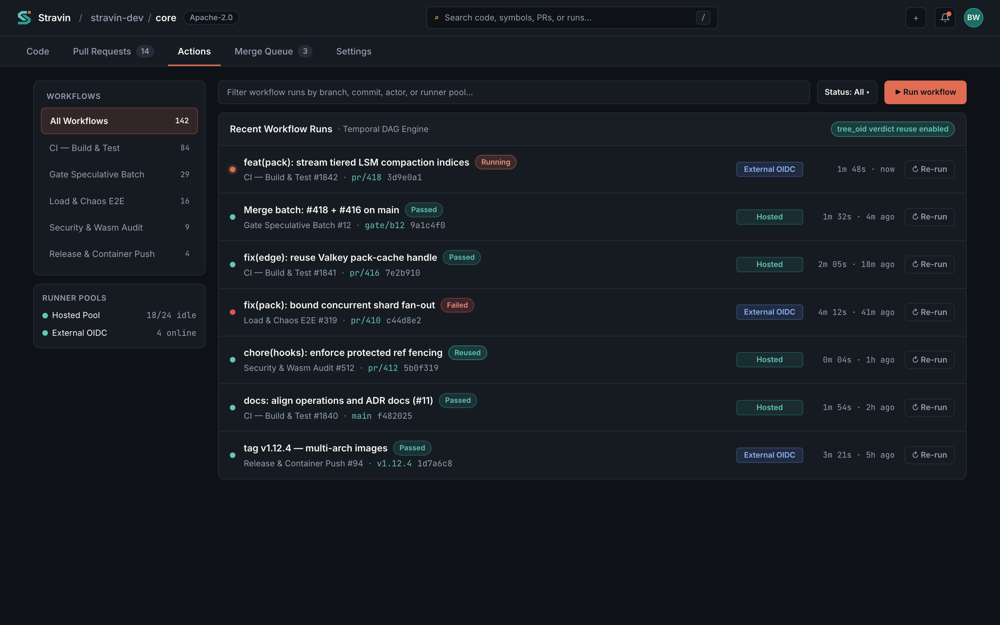
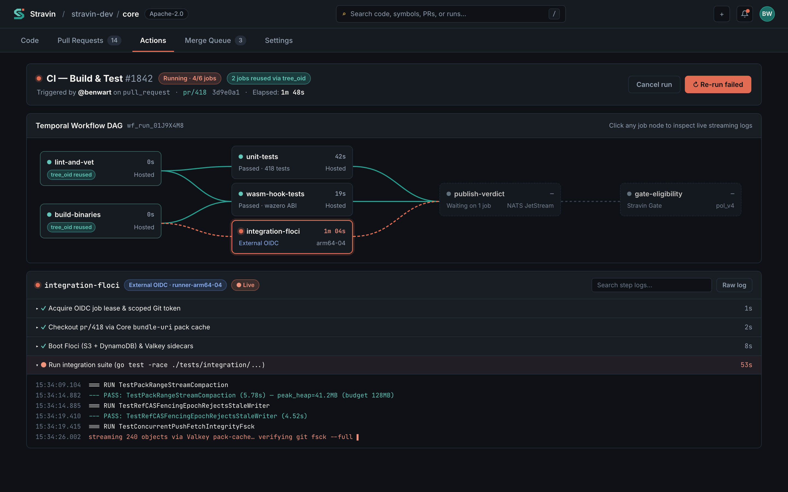
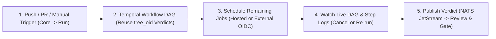

# Actions & Workflows (`Stravin Run`)

The Actions workspace gives developers an immediate GitHub Actions mental model—workflow filter rail, recent runs list, job graph, and streaming logs—while cleanly exposing **Temporal DAG execution**, **`tree_oid` verdict reuse**, and **`Hosted` vs `External OIDC` runner pools**.

## Actions & Workflows List

### Key Elements

- **Left Workflow Rail & Runner Pool Health:** Lists repository workflows with run counts alongside a compact **Runner Pools** card showing live `Hosted` capacity and `External OIDC` online runners without opening a separate admin page.
- **Clear Run Rows:** Every run displays status (`Running`, `Passed`, `Failed`, `Reused`), commit or PR title, workflow name, branch/SHA, runner pool badge (`Hosted` in Strata Teal vs `External OIDC` in Blueprint Blue), elapsed duration, and a one-click **`Re-run`** button.
- **`tree_oid` Reuse Transparency:** Runs satisfied completely by cached verdicts show a Glacier Mint `Reused` pill and near-zero duration so engineers immediately understand why CI completed in seconds.

## Workflow Run Detail

### Key Elements

- **Run Header & Direct Controls:** Displays run status (`Running · 4/6 jobs`), `tree_oid` reuse summary, triggering actor/branch/SHA, elapsed time, and two clear actions: **`Cancel run`** and **`Re-run failed`**.
- **Visual Temporal Job DAG:** Sits directly above the log viewer so developers see job dependencies and critical-path progress at a glance:
    - Cached jobs (`lint-and-vet`, `build-binaries`) display a **`tree_oid reused`** pill and `0s` duration.
    - The active or selected job (`integration-floci`) is outlined in Rivet Terracotta and displays its runner pool (`External OIDC · arm64-04`).
    - Downstream verdict and Gate eligibility nodes remain visibly queued until upstream dependencies finish.
- **Collapsible Live Streaming Step Logs:** Clicking any DAG node updates the log panel below in place. Completed steps collapse to single summary lines with durations; the active step streams timestamped `JetBrains Mono` output with inline log search and a `Raw log` link.

## End-to-End Developer Flow

## Responsive Behavior

| Breakpoint | Layout & Rail Adaptation | DAG & Live Log Viewport |
| :--- | :--- | :--- |
| **Wide Desktop (`>= 1440px`)** | `100%` fluid width (`padding-inline: 24px`); `240px` left workflow + runner pool rail | Full horizontal Temporal DAG without scrolling; wide `JetBrains Mono` log lines with inline search |
| **Desktop (`1024px - 1439px`)** | `100%` fluid width (`padding-inline: 20px`); compact `220px` left workflow rail | Full horizontal DAG with tighter node spacing; full-width collapsible step log viewer |
| **Tablet (`768px - 1023px`)** | `100%` fluid width (`padding-inline: 16px`); left workflow rail becomes a toggleable slide-over drawer | DAG scrolls horizontally inside its bounded card; run controls (`Cancel run`, `Re-run failed`) stay pinned in header |
| **Mobile (`< 768px`)** | Single-column `100%` width (`padding-inline: 12px`); scrollable repo tab bar; workflow selector chip | DAG switches to a compact vertical stage list; wrapped/scrollable log pane with sticky bottom `Re-run` / `Cancel` bar |

## Product Interface Grounding

- **Core ⟷ Run:** Ephemeral runners fetch via Core's Valkey + S3 pack cache and `bundle-uri` with short-lived scoped Git tokens ([Core ⟷ Run](../interfaces/core-run.md)).
- **Review ⟷ Run:** Streams check status, inline annotations, and idempotent cancel/re-run actions back to PR views ([Review ⟷ Run](../interfaces/review-run.md)).
- **Run ⟷ Gate & External Runners:** Binds verdicts to `(tree_oid, commit_oid, policy_version, app_id)` and supports Phase 1 pull-based OIDC runner leases ([Run ⟷ Gate](../interfaces/run-gate.md), [ADR-0002](../adr/0002-external-runner-seam-and-oidc-auth.md)).
