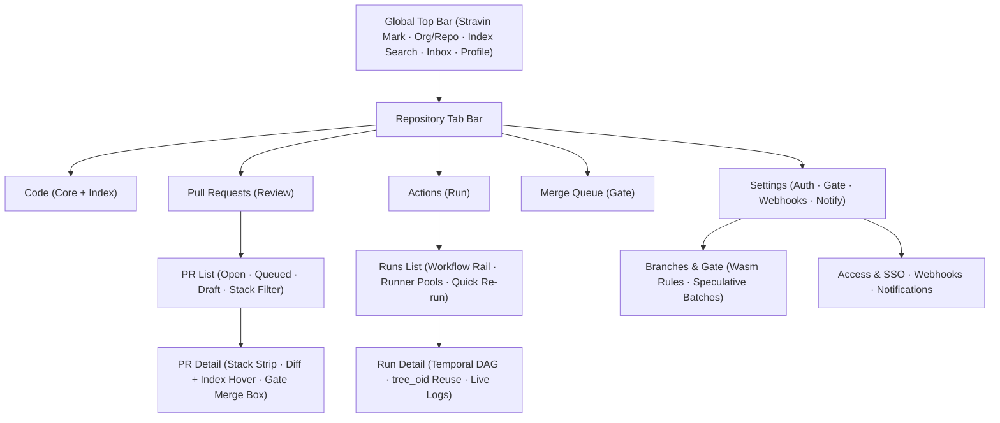

# UI Design Overview & Shell

**Stravin** brings GitHub's familiar developer ergonomics—Pull Requests, Actions Runs, and Repository Settings—into a calm, high-contrast interface styled with Stravin's architectural palette and backed by the `vNext` platform stack (**Core**, **Review**, **Run**, **Index**, **Gate**, **Auth**, **Webhooks**, and **Notify**).

!!! info "Design Status (`vNext` UI Specification)"
    This section specifies the canonical web UI shell, core developer journeys, and visual design language for Stravin's upper layers. Screens are intentionally scoped to high-frequency daily workflows so users can orient immediately without tutorials.

## Design Principles

1. **Familiarity without Clutter:** Keep GitHub's proven mental model—top bar, repository tabs (`Code | Pull Requests | Actions | Merge Queue | Settings`), conversation/diff review, live workflow logs, and left-rail settings—so any engineer is productive in seconds.
2. **Intuitive First:** Every screen has one clear primary action (`New Pull Request`, `Queue for Merge`, `Run workflow`, `Save Changes`). Avoid nested menus, multi-step wizards, or cryptic backend jargon on the main canvas.
3. **Progressive Disclosure:** Surface power-user capabilities—stacked diffs, `tree_oid` verdict reuse, Temporal DAG inspection, speculative Gate batches, and WorkOS/SCIM adapters—as compact inline affordances or collapsible drawers rather than mandatory configuration walls.
4. **Unified Product Accent Language:** Subtle 2px tab underlines, status pills, and inline badges use each product layer's canonical accent so users can tell at a glance whether an affordance belongs to **Core**, **Review**, **Run**, **Index**, or **Gate**.

## Stravin Brand Tokens

Every UI surface uses the canonical tokens defined in `stravin-dev/assets/BRANDING.md` and `docs/assets/stylesheets/extra.css`:

| Role | Token Name | Hex | UI Surface Usage |
| :--- | :--- | :--- | :--- |
| **Dark Canvas** | Basalt 950 | `#0E1116` | Primary application background, diff canvas, log viewport |
| **Dark Surface** | Slate 900 | `#161B22` | Top bar, cards, left navigation rails, right metadata rail |
| **Dark Hairline** | Slate 800 | `#252D38` | Card borders, row dividers, input outlines |
| **Light Canvas / Primary Ink** | Limestone 50 | `#F7F6F2` | Dark-mode primary text, light-mode canvas |
| **Muted Text** | Slate 400 | `#93A0B0` | Secondary metadata, timestamps, inactive tabs |
| **Brand Highlight** | Glacier Mint | `#64C5B9` | Active links, reused `tree_oid` pills, pass indicators |
| **Stravin Core Accent** | Strata Teal | `#2A9D8F` | Git refs, active branch chips, secondary create buttons |
| **Shaded Teal** | Abyss Teal | `#1C6E66` | Pressed states, subtle badge fills |
| **Stravin Run / Primary CTA** | Rivet Terracotta | `#E06D53` | Focal primary CTA (`Queue for Merge`, `Run workflow`), live running states |
| **Stravin Review Accent** | Blueprint Blue | `#5B8DEF` | Active Pull Requests tab, stacked diff indicators, OIDC pool badges |
| **Stravin Index Accent** | Ochre Amber | `#D4A34B` | Global search icon, inline symbol hover popovers |
| **Stravin Gate Accent** | Forged Steel | `#7A8B99` | Merge Queue status badges, policy eligibility indicators |

Typography uses **`Inter`** for all UI chrome and prose, and **`JetBrains Mono`** for branch refs, commit SHAs, code diffs, step logs, and filter queries.

## GitHub ⟷ Stravin UX Mapping

| Workflow Area | Kept Familiar from GitHub | Simplified or Upgraded in Stravin |
| :--- | :--- | :--- |
| **Repository Navigation** | `Code`, `Pull Requests`, `Actions`, `Settings` top tabs | Dedicated `Merge Queue` tab with live count; removes noisy Wiki/Projects/Insights clutter |
| **Pull Request Review** | `Conversation`, `Commits`, `Checks`, `Files Changed` tabs + right rail | Optional single-line **Stack Strip** for stacked diffs, inline **Index** symbol hover, and a single **`Queue for Merge`** Gate CTA |
| **CI / Workflow Runs** | Left workflow filter rail + recent runs list + collapsible step logs | Visual **Temporal Job DAG** above logs, instant **`tree_oid reused`** badges, and explicit `Hosted` vs `External OIDC` pool tags |
| **Branch Protection & Queue** | Branch rule form + required status checks | Unified **Branches & Gate** screen backed synchronously by Core Tier 1 `wazero` hooks and speculative Gate batches |
| **Auth, Webhooks & Alerts** | Org/repo left settings rail with focused cards | Standalone-first `stravin-auth` with optional OIDC/SCIM/WorkOS add-on card, one-click DLQ webhook `Redeliver`, and quiet-hours `stravin-notify` toggles |

## Global Navigation & Information Architecture

## Screen Specifications

- [Pull Requests (`Stravin Review`)](pull-requests.md) — PR list, stacked diff navigation, inline `Index` symbol hover, and the unified Checks & Gate merge box.
- [Actions & Workflows (`Stravin Run`)](actions-runs.md) — Workflow run list, runner pool visibility (`Hosted` vs `External OIDC`), visual Temporal Job DAG, `tree_oid` verdict reuse, and live streaming logs.
- [Settings (`Auth`, `Gate`, `Webhooks`, `Notify`, `Runners`)](settings.md) — Progressive-disclosure configuration for branch protection, Merge Queue batches, standalone vs SSO add-on (`stravin-auth`), external webhook redelivery (`stravin-webhooks`), and user notifications (`stravin-notify`).
