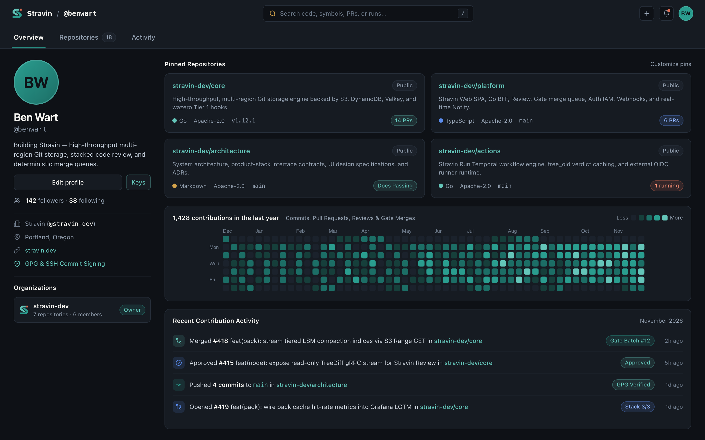
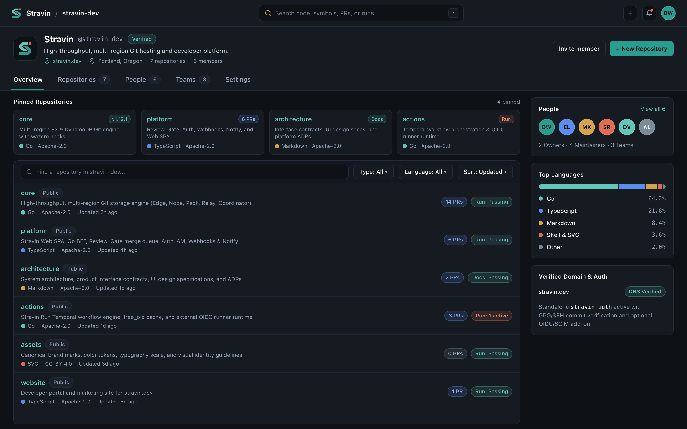

# Profiles (`User` & `Organization`)

Stravin's User and Organization Profile screens provide fast orientation across people, teams, pinned repositories, and recent engineering activity while keeping private repositories and restricted activity strictly RBAC-scoped.

## User Profile (`/:username`)

### Key Elements

- **Left Profile Sidebar (`280px`):** Displays the user's avatar or initials badge, full name, `@handle`, concise bio, profile actions (`Edit profile` / `Keys`), follower and following counts, organization membership (`@stravin-dev`), location, website link, and a `GPG & SSH Commit Signing` indicator backed by `stravin-auth`.
- **Organizations Card:** Lists public organization memberships (and private memberships visible to the current viewer) with canonical `StravinMark` icons and role badges (`Owner`, `Maintainer`, `Member`).
- **Context Tab Bar (`Overview | Repositories | Activity`):** Uses the standard 2px Strata Teal active underline so navigation mirrors the repository workspace.
- **Pinned Repositories (2x2 Grid):** Highlights up to four flagship repositories with visibility pill, concise summary, primary language dot, license, release/branch ref, and live PR or Run status badge.
- **52-Week Contribution Heatmap:** Renders daily commit, pull request, review, and Gate merge activity across a 52-week grid using Stravin's Strata Teal / Glacier Mint intensity ramp (`#1B222C` -> `#163F3B` -> `#1C6E66` -> `#2A9D8F` -> `#64C5B9`).
- **Recent Contribution Activity Timeline:** Lists recent merged PRs (with Gate batch numbers), review approvals, verified pushes, and opened stacked PRs in reverse chronological order.

## Organization Profile (`/:org`)

### Key Elements

- **Organization Header Band:** Pairs the organization's `StravinMark` logo card with its display name, `@handle`, Glacier Mint `Verified` badge, single-line description, DNS-verified domain (`stravin.dev`), location, repository/member totals, and primary org actions (`Invite member`, `+ New Repository` for authorized roles).
- **Organization Tab Bar (`Overview | Repositories | People | Teams | Settings`):** Exposes repository count, member count, team count, and role-gated org settings without secondary dropdown clutter.
- **Pinned Repositories Strip:** Compact 4-column card row highlighting core organization repositories (`core`, `platform`, `architecture`, `actions`) with version, PR count, or Run status pills.
- **Filterable Repository List:** Full-width searchable card (`Find a repository...`, `Type`, `Language`, and `Sort` controls) showing visibility, summary, primary language dot, license, last update timestamp, open PR pill, and latest **Stravin Run** status pill (`Run: Passing` or `Run: N active`).
- **Right Rail (`300px`):**
    - **People Card:** Member avatar grid with role breakdown (`Owners`, `Maintainers`, `Teams`) and `View all` link.
    - **Top Languages Card:** Proportional multi-segment language bar and percentage table aggregated across repositories visible to the viewer.
    - **Verified Domain & Auth Card:** Displays DNS domain verification status and active `stravin-auth` posture (standalone local auth plus optional OIDC/SCIM add-on).

## RBAC & Visibility Rules

Profile endpoints enforce server-side authorization inside the Go BFF (`stravin-web`) and `stravin-auth` before any repository metadata, heatmap counts, or timeline events leave the backend:

| Surface | Unauthenticated / Non-Member | Organization Member | Organization Owner / Admin |
| :--- | :--- | :--- | :--- |
| **User Profile Metadata** | Public bio, location, website, public org badges | Same + shared private org badges | Same + org role management links |
| **Pinned & Listed Repositories** | Public repositories only; private pins omitted silently | Public + private repositories where viewer holds `read` or higher | All organization repositories |
| **Contribution Heatmap** | Public repository counts only (optional user setting to include anonymized private counts) | Public + shared-access private counts | Public + shared-access private counts |
| **Activity Timeline** | Public events only; zero private repo names or commit titles leaked | Events from public + authorized private repos | Events from public + authorized private repos |
| **Org `People`, `Teams`, `Settings`** | Public members only; `Teams` and `Settings` tabs hidden | Full member directory & visible teams; `Settings` hidden | Full directory, team CRUD, domain verification, and `Settings` tab |

## Responsive Behavior

| Breakpoint | Layout & Rail Adaptation | Grids, Heatmap & Lists |
| :--- | :--- | :--- |
| **Wide Desktop (`>= 1440px`)** | `100%` fluid width (`padding-inline: 28px`); `280px` left profile sidebar (User) or `300px` right metadata rail (Org) | 2x2 User pins, 4-column Org pins, full 52-week heatmap, single-row repo list with right-aligned PR/Run pills |
| **Desktop (`1024px - 1439px`)** | `100%` fluid width (`padding-inline: 20px`); compact `250px` sidebar/rail | 2x2 pin grids on both User and Org profiles; heatmap scales smoothly inside card |
| **Tablet (`768px - 1023px`)** | Stacked top identity header; right Org rail collapses below pinned repos as 2-column summary cards | Horizontal scroll container on 52-week heatmap; repo filter controls wrap cleanly onto two lines |
| **Mobile (`< 768px`)** | Single-column `100%` width (`padding-inline: 12px`); horizontally scrollable tab bar | 1-column pinned cards; compact activity timeline rows; PR/Run pills wrap under repository metadata with zero horizontal page scroll |

## Product Interface Grounding

- **Platform Auth (`stravin-auth`):** Resolves user/org identity, role memberships, GPG/SSH signing key badges, and DNS-verified organization domains ([Platform Auth](../interfaces/platform-auth.md), [ADR-0003](../adr/0003-platform-auth-and-sso-seam.md)).
- **Web Frontend & Go BFF (`stravin-web`):** Aggregates RBAC-filtered repository lists, contribution heatmaps, and activity feeds without exposing internal service tokens to the browser ([ADR-0004](../adr/0004-frontend-stack-spa-go-bff.md)).
- **Implementation Tracking:** Grounded against platform profile and navigation work items `stravin-dev/platform#31` and `stravin-dev/platform#33`.
