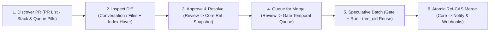

# Pull Requests (`Stravin Review`)

The Pull Requests workspace preserves GitHub's low-friction review rhythm—discover, inspect diff, approve, merge—while surfacing **Stravin Review**, **Stravin Index**, and **Stravin Gate** as lightweight inline affordances instead of separate tools.

## Pull Requests List

### Key Elements

- **Unified Filter Bar & Quick Pills:** Standard query syntax (`is:pr is:open sort:updated-desc`) paired with one-click `Open`, `Queued`, `Draft`, and `Merged` pills so engineers rarely need to hand-type filters.
- **Gate Queue Visibility:** PRs currently inside **Stravin Gate** display a `Queued #N` Glacier Mint pill and a subtle summary banner showing the active speculative batch.
- **Compact Stack Indicator:** PRs belonging to a stacked diff carry a single Blueprint Blue pill (`Stack 2/3`) without expanding nested trees in the list view.
- **At-a-Glance Readiness:** Each row aligns three signals on the right—CI check summary pill, reviewer avatars with approval checkmarks, and comment count—for fast scanning.

## Pull Request Detail

### Key Elements

- **Header & Branch Ref Chips:** PR title, state pill, diff stats, and copyable `source -> target` branch chips styled in Strata Teal.
- **Optional Stack Strip:** Appears only when a PR is part of a stack—a single 36px horizontal strip (`#417 Merged -> #418 Current -> #419 Draft`) that lets reviewers step through stacked diffs without losing context.
- **Familiar 4-Tab Workspace:** `Conversation`, `Commits`, `Checks`, and `Files Changed` keep the exact layout developers already know.
- **Subtle `Stravin Index` Symbol Hover:** Hovering any identifier in a diff queries `Review ⟷ Index` over Cilium mTLS and displays an Ochre Amber popover with the symbol signature, definition path, cross-repo caller count, and a `Go to definition` link. When Index lags, the diff stays unaffected and falls back gracefully.
- **Unified Checks & Gate Merge Box:** Replaces multi-panel merge widgets with one calm box summarizing required checks (calling out `tree_oid` reused verdicts), approvals, conflict state, and a single primary Rivet Terracotta CTA: **`Queue for Merge`**.
- **Uncluttered Right Rail:** Limited to four high-signal sections—**Reviewers**, **Gate Status**, **Labels**, and **Checks Summary**.

## End-to-End Developer Flow

## Product Interface Grounding

- **Core ⟷ Review:** Reads diffs and commit history via Core's read-only Git Data/Diff API and tracks PR head updates from `STRAVIN_CORE` JetStream events ([Core ⟷ Review](../interfaces/core-review.md)).
- **Review ⟷ Index:** Powers inline symbol hover and cross-repo caller counts with RBAC filtering ([Review ⟷ Index](../interfaces/review-index.md)).
- **Review ⟷ Gate:** Submits idempotent enqueue requests and renders live batch eligibility and atomic stack merge feedback ([Review ⟷ Gate](../interfaces/review-gate.md)).
