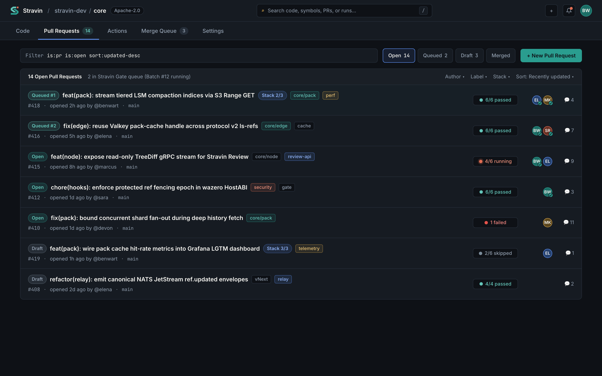
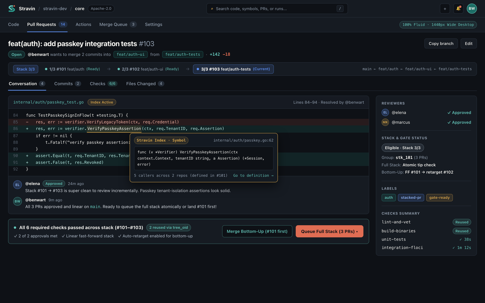
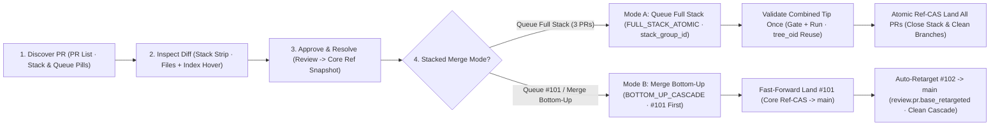

# Pull Requests (`Stravin Review`)

The Pull Requests workspace preserves GitHub's low-friction review rhythm—discover, inspect diff, approve, merge—while surfacing **Stravin Review**, **Stravin Index**, and **Stravin Gate** as lightweight inline affordances instead of separate tools.

## Pull Requests List

### Key Elements

- **Unified Filter Bar & Quick Pills:** Standard query syntax (`is:pr is:open sort:updated-desc`) paired with one-click `Open`, `Queued`, `Draft`, and `Merged` pills so engineers rarely need to hand-type filters.
- **Gate Queue Visibility:** PRs currently inside **Stravin Gate** display a `Queued #N` Glacier Mint pill and a subtle summary banner showing the active speculative batch.
- **Compact Stack Indicator:** PRs belonging to a stacked diff carry a single Blueprint Blue pill (`Stack 2/3`) without expanding nested trees in the list view.
- **At-a-Glance Readiness:** Each row aligns three signals on the right—CI check summary pill, reviewer avatars with approval checkmarks, and comment count—for fast scanning.

## Pull Request Detail

### Key Elements

- **Header & Branch Ref Chips:** PR title, state pill, diff stats, and copyable `source -> target` branch chips styled in Strata Teal. For stacked PRs, the target chip displays the parent PR branch (for example `feat/auth-tests -> feat/auth-ui`).
- **Optional Stack Strip (Zero-Tutorial Stacked PRs):** Appears only when a PR belongs to a branch-on-branch stack (`PR #101 (feat/auth -> main)` <- `PR #102 (feat/auth-ui -> feat/auth)` <- `PR #103 (feat/auth-tests -> feat/auth-ui)`). Renders a single 36px horizontal strip—for example **`1/3 #101 Ready` -> `2/3 #102 Current` -> `3/3 #103 Draft`** (or `1/3 #101 Ready` -> `2/3 #102 Ready` -> `3/3 #103 Current` at the stack tip)—so reviewers step up and down the chain with one click and never lose context.
- **Familiar 4-Tab Workspace:** `Conversation`, `Commits`, `Checks`, and `Files Changed` keep the exact layout developers already know.
- **Subtle `Stravin Index` Symbol Hover:** Hovering any identifier in a diff queries `Review ⟷ Index` over Cilium mTLS and displays an Ochre Amber popover with the symbol signature, definition path, cross-repo caller count, and a `Go to definition` link. When Index lags, the diff stays unaffected and falls back gracefully.
- **Unified Checks & Gate Merge Box (Stacked-Aware):** Replaces multi-panel merge widgets with one calm box summarizing required checks (calling out `tree_oid` reused verdicts), approvals, conflict state, and stack-aware merge actions:
    - **Bottom PR (`#101`, base = `main`):** Primary Rivet Terracotta CTA **`Queue #101 (Fast-Forward)`** (`BOTTOM_UP_CASCADE`). Landing `#101` via fast-forward automatically retargets `#102` from `feat/auth` to `main` and restacks cleanly down the chain without manual retargeting.
    - **Upper / Tip PR (`#102` or `#103`):** Primary Rivet Terracotta CTA **`Queue Full Stack (3 PRs)`** (`FULL_STACK_ATOMIC`) paired with a clean secondary option **`Merge Bottom-Up (#101 first)`** (`BOTTOM_UP_CASCADE`).
    - **Standalone PR (not stacked):** Single primary CTA **`Queue for Merge`**.
- **Uncluttered Right Rail:** Limited to four high-signal sections—**Reviewers**, **Gate Status**, **Labels**, and **Checks Summary**.

## First-Class Stacked Pull Requests

Stravin supports native branch-on-branch stacking without custom CLI wrappers or hidden metadata branches. Basing `PR #102` on `PR #101`'s head branch (`feat/auth-ui -> feat/auth`) automatically links the stack in **Stravin Review** and unlocks two intuitive merge modes in **Stravin Gate**:

| Merge Mode | Contract Value | Triggered From | Behavior & Git History |
| :--- | :--- | :--- | :--- |
| **Mode A — Merge Full Stack (Top-Down Atomic Group)** | `FULL_STACK_ATOMIC` | Any upper/tip PR (`Queue Full Stack (3 PRs)`) | Enqueues the entire unmerged chain (`[#101, #102, #103]`) into Gate under one `stack_group_id`. Gate validates the combined tip once (reusing `tree_oid` verdicts where applicable), merges the full stack atomically into `main`, marks all PRs Merged, and cleans up intermediate branches. |
| **Mode B — Incremental Bottom-Up Merge (Fast-Forward Cascade)** | `BOTTOM_UP_CASCADE` | Bottom PR (`Queue #101 (Fast-Forward)`) or secondary CTA on upper PR (`Merge Bottom-Up (#101 first)`) | Lands the bottom PR (`#101 -> main`) via fast-forward when linear, then automatically retargets `#102`'s base branch from `feat/auth` to `main` (`review.pr.base_retargeted`) and fast-forwards/restacks cleanly down the chain while upper PRs stay open in review. |

## End-to-End Developer Flow

## Responsive Behavior

| Breakpoint | Layout & Rail Adaptation | Diffs, Stack Strip & Merge Box |
| :--- | :--- | :--- |
| **Wide Desktop (`>= 1440px`)** | `100%` fluid width (`padding-inline: 24px`); fluid main pane + `300px` right metadata rail | Side-by-side diffs fill full width; full horizontal Stack Strip; inline primary + secondary Merge Box CTAs |
| **Desktop (`1024px - 1439px`)** | `100%` fluid width (`padding-inline: 20px`); compact `260px` right metadata rail | Side-by-side diffs stay active with compact gutters; Stack Strip truncates long PR titles cleanly |
| **Tablet (`768px - 1023px`)** | `100%` fluid width (`padding-inline: 16px`); right rail collapses into top summary strip + slide-over drawer | Diffs default to **unified** view; Stack Strip scrolls horizontally if > 4 PRs; Merge Box stays full-width |
| **Mobile (`< 768px`)** | Single-column `100%` width (`padding-inline: 12px`); scrollable repo tab bar; stacked cards | Unified diff only; compact Stack Strip pill (`Stack 3/3` drawer); **sticky bottom action bar** (`Approve` / `Queue`) with zero horizontal page scroll |

## Product Interface Grounding

- **Core ⟷ Review:** Reads diffs and commit history via Core's read-only Git Data/Diff API, resolves branch-on-branch stack lineage, and handles automatic base-branch retargeting + fast-forward ref advancement ([Core ⟷ Review](../interfaces/core-review.md)).
- **Review ⟷ Index:** Powers inline symbol hover and cross-repo caller counts with RBAC filtering ([Review ⟷ Index](../interfaces/review-index.md)).
- **Review ⟷ Gate:** Submits idempotent enqueue requests with `merge_mode` (`FULL_STACK_ATOMIC` or `BOTTOM_UP_CASCADE`) and renders live batch eligibility, atomic stack merges, and bottom-up cascade feedback ([Review ⟷ Gate](../interfaces/review-gate.md)).
