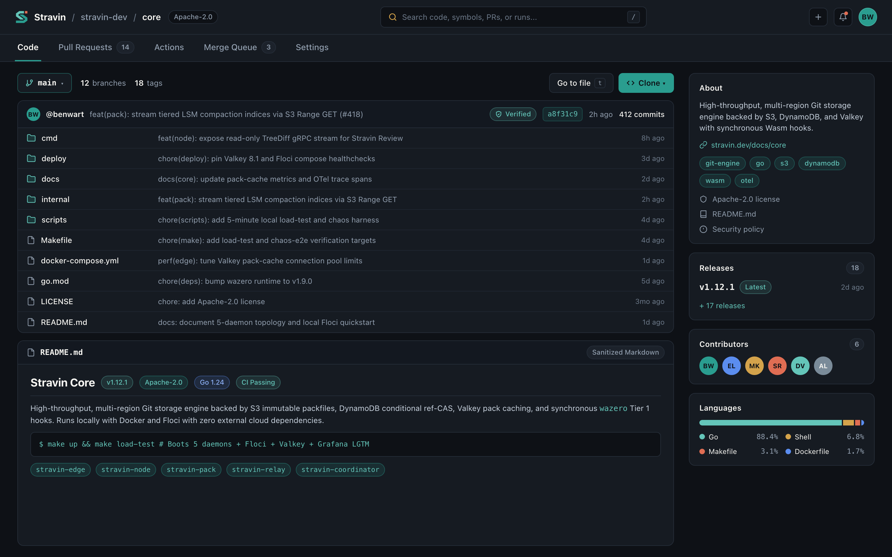
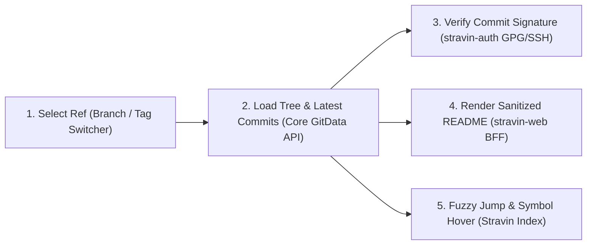

# Repository Overview (`Code` Tab)

The Repository Overview (`Code` tab) is the default landing surface for every repository (`/:org/:repo`). It shares the exact global top bar and 5-tab repository shell (`Code | Pull Requests | Actions | Merge Queue | Settings`) used across **Stravin Review**, **Stravin Run**, and **Stravin Gate**, pairing fast Git tree browsing with verified commit metadata and an uncluttered `About` rail.

## Key Elements

- **Shared Repository Chrome:** Identical top bar (`StravinMark`, `org / repo`, license pill, global `Stravin Index` search, quick create, inbox, profile avatar) and repository tab bar with `Code` highlighted by a 2px Strata Teal underline.
- **Ref Switcher & Primary Toolbar:**
    - **Branch / Tag Switcher (`main`):** Strata Teal-bordered selector supporting instant search across branches and tags, alongside direct `branches` and `tags` counts.
    - **`Go to file` (`t`):** Keyboard-first fuzzy file finder powered by **Stravin Index** for instant path navigation without expanding nested directories.
    - **Primary `Clone` CTA:** Strata Teal dropdown button exposing HTTPS (`stravin-edge` smart HTTP v2), SSH, and one-click copy commands.
- **Latest Commit Bar with Cryptographic Verification:** Anchors the top of the file tree card with committer avatar, `@handle`, commit subject, Glacier Mint `Verified` badge (validated against registered GPG or SSH public keys in `stravin-auth`), short monospace SHA, relative timestamp, and total commit count.
- **File Tree Table:** Displays directories first (with Strata Teal folder icons) followed by root files, each paired with its latest touching commit subject and relative age. Clicking any directory updates the tree in place; clicking a file opens the blob viewer with syntax highlighting and **Stravin Index** symbol hover.
- **Sanitized `README.md` Preview Card:** Renders the repository's root README directly below the file tree inside a sandboxed, XSS-sanitized Markdown pipeline (`Sanitized Markdown` indicator). Raw HTML `<script>`, unsafe `javascript:` URIs, and untrusted inline styles are stripped server-side in `stravin-web` before delivery.
- **Right `About` Rail (`300px`):**
    - **About:** Repository description, documentation URL, Strata Teal topic pills, license (`Apache-2.0`), `README.md`, and security policy links.
    - **Releases:** Latest semantic release tag (`v1.12.1`) with Glacier Mint `Latest` pill, relative release age, and link to full release history.
    - **Contributors:** Avatar strip of top contributors with total count.
    - **Languages:** Proportional multi-segment language bar and exact percentage breakdown (Go, Shell, Makefile, Dockerfile).

## Code Browsing & Verification Flow

## Responsive Behavior

| Breakpoint | Layout & Rail Adaptation | Toolbar, File Tree & README |
| :--- | :--- | :--- |
| **Wide Desktop (`>= 1440px`)** | `100%` fluid width (`padding-inline: 28px`); fluid main pane + fixed `300px` right `About` rail | Full 3-column file tree (name, latest commit message, age); single-row ref toolbar and full `README.md` width |
| **Desktop (`1024px - 1439px`)** | `100%` fluid width (`padding-inline: 20px`); compact `260px` right `About` rail | File tree commit messages truncate cleanly with ellipsis; `About` rail stays pinned on the right |
| **Tablet (`768px - 1023px`)** | `100%` fluid width (`padding-inline: 16px`); `About` rail collapses into a compact summary strip above the tree + expandable drawer | Branch switcher and `Clone` CTA stay on one line; `README.md` fills full viewport width |
| **Mobile (`< 768px`)** | Single-column `100%` width (`padding-inline: 12px`); horizontally scrollable repo tab bar | File tree switches to 2 columns (name + relative age); latest commit bar wraps SHA and `Verified` pill cleanly with zero horizontal page scroll |

## Product Interface Grounding

- **Core Read-Only Git Data API (`stravin-node`):** Serves tree listings, blob contents, ref lists, and last-touching commit metadata over internal gRPC without touching write paths ([Core ⟷ Review](../interfaces/core-review.md)).
- **Core ⟷ Index:** Backs `Go to file` (`t`) fuzzy path lookup and inline symbol definitions in the file viewer ([Core ⟷ Index](../interfaces/core-index.md)).
- **Platform Auth (`stravin-auth`):** Validates commit GPG and SSH signatures surfaced by the `Verified` badge and enforces repository read RBAC ([Platform Auth](../interfaces/platform-auth.md)).
- **Implementation Tracking:** Grounded against core Git browsing API and platform repository overview work items `stravin-dev/core#195`, `stravin-dev/platform#32`, and `stravin-dev/platform#33`.
