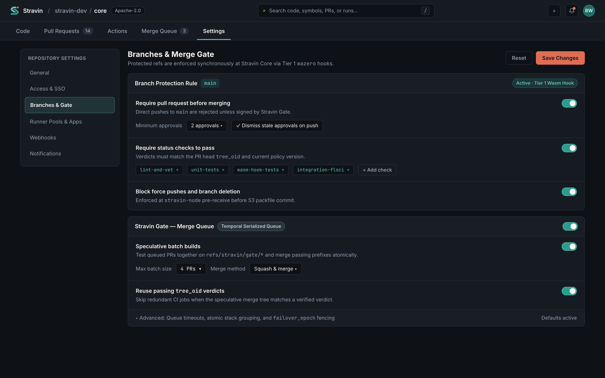
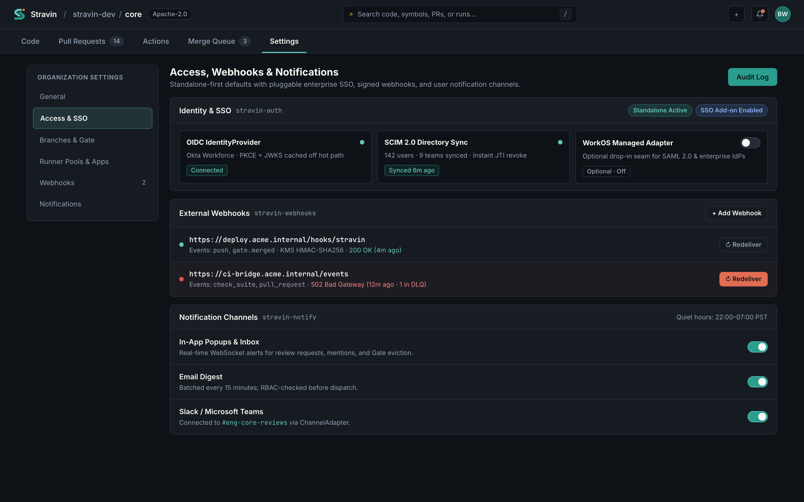
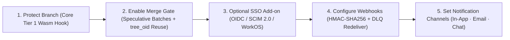

# Settings (`Auth`, `Gate`, `Webhooks`, `Notify`, `Runners`)

Stravin Settings keeps configuration approachable for both small standalone teams and enterprise organizations. Every settings page uses a single predictable left rail—`General`, `Access & SSO`, `Branches & Gate`, `Runner Pools & Apps`, `Webhooks`, `Notifications`—and progressive-disclosure cards that hide rarely changed tuning knobs behind sensible defaults.

## Branches & Merge Gate

### Key Elements

- **Protected Branch Card (`main`):** Clean toggle rows for requiring pull requests, minimum approvals, stale approval dismissal, required status check chips, and blocking force pushes/deletions.
- **Explicit Core Enforcement Badge:** A subtle `Active · Tier 1 Wasm Hook` pill communicates that branch protection is enforced synchronously inside `stravin-node` (`wazero` pre-receive) before S3 packfile commit—not merely in the UI.
- **Stravin Gate (Merge Queue) Card:** Enables serialized merge queues with one toggle, exposing only the three everyday controls—**Speculative batch builds**, **Max batch size**, and **Merge method**—plus **`tree_oid` verdict reuse**.
- **Progressive Disclosure:** Advanced parameters (queue timeouts, atomic stack grouping, `failover_epoch` fencing) stay collapsed by default under a single expandable footer row.

## Access & SSO, Webhooks & Notifications

### Key Elements

- **Identity & SSO (`stravin-auth`):** Reflects Stravin's standalone-first architecture—local passkeys/Argon2id login, **SSH Keys**, **GPG Keys** (for signed commits), and **PATs** stay active by default, while the Wave 4 enterprise SSO add-on surfaces three crisp tiles:
    - **OIDC `IdentityProvider`:** Direct IdP integration (Google OIDC, Okta, Entra ID) with JWKS cached off the Git hot path.
    - **SCIM 2.0 `DirectorySyncAdapter`:** Automated user/team provisioning with instant Valkey `jti` revocation.
    - **WorkOS Managed Adapter:** Single optional toggle for organizations wanting managed SAML 2.0 / enterprise directory sync without custom wiring.
- **External Webhooks (`stravin-webhooks`):** Shows each outbound endpoint with a live health dot, subscribed events, KMS HMAC-SHA256 signing status, last HTTP result, and a one-click **`Redeliver`** button for failed/DLQ deliveries.
- **Notification Channels (`stravin-notify`):** Clean channel toggles for **In-App Popups & Inbox** (real-time WebSocket), **Email Digest** (batched with quiet hours), and **Slack / Microsoft Teams** (`ChannelAdapter`), all RBAC-checked before dispatch.

## Admin & User Configuration Flow

## Responsive Behavior

| Breakpoint | Layout & Rail Adaptation | Forms, Cards & Tables |
| :--- | :--- | :--- |
| **Wide Desktop (`>= 1440px`)** | `100%` fluid width (`padding-inline: 24px`); `240px` left settings rail + breathing full-width card grid | Multi-column SSO adapter tiles (OIDC / SCIM 2.0 / WorkOS) and wide webhook delivery tables |
| **Desktop (`1024px - 1439px`)** | `100%` fluid width (`padding-inline: 20px`); compact `220px` left settings rail | Multi-column adapter tiles stay side-by-side; toggle rows align cleanly with right-justified switches |
| **Tablet (`768px - 1023px`)** | `100%` fluid width (`padding-inline: 16px`); left settings rail collapses into a toggleable section drawer | 2-column SSO tiles; webhook rows wrap secondary metadata under the endpoint URL |
| **Mobile (`< 768px`)** | Single-column `100%` width (`padding-inline: 12px`); top section selector chip; stacked cards | Single-column form cards; one-tap `Redeliver` and switches; sticky bottom `Save Changes` bar when dirty |

## Product Interface Grounding

- **Core ⟷ Gate:** Synchronizes branch protection rules into Tier 1 Wasm hooks and manages speculative Gate refs ([Core ⟷ Gate](../interfaces/core-gate.md)).
- **Platform Auth (`stravin-auth`):** Defines standalone-first IAM and the pluggable `IdentityProvider` / `DirectorySyncAdapter` seams ([Platform Auth](../interfaces/platform-auth.md), [ADR-0003](../adr/0003-platform-auth-and-sso-seam.md)).
- **External Webhooks & Platform Notify:** Separates machine-to-machine outbound webhook delivery from human-facing notification preferences and quiet hours ([External Webhooks](../interfaces/external-webhooks.md), [Platform Notify](../interfaces/platform-notify.md)).
